# Buy and nominate natural gas for the plants

`gen-mkt-procure-gas` · electric power generation · energy marketing and trading · part of `power-generation-co`

Every day, weekends included, the gas scheduler works out how much gas each gas-fired plant will burn on the next gas day, buys or sells the difference between that burn and the gas already bought under term contracts, and tells the pipelines where to deliver it by the nomination deadline. During the gas day the scheduler follows the plants' dispatch and buys, sells and renominates when units ramp, trip or the pipeline restricts flow, and the next morning checks the measured volumes for imbalances. Uncertain merchant dispatch, tight nomination windows, cold-weather pipeline restrictions and re-keying volumes between the exchange, the pipeline portal and the trading system make it error-prone.

| | |
|---|---|
| Unit of work | one gas day of purchases and nominations for all gas-fired plants |
| Starts when | The day's generation forecast is published in the morning and the pipeline notices for the next gas day are out. |
| Done when | The gas day has flowed, measured volumes are checked against nominations, any imbalance is traded or carried into the next nomination, and volumes are logged for the month-end supplier and pipeline reconciliation. |
| Organisation | An Alberta merchant generator of about 1,300 staff with three coal units converted to gas in 2021, two cogeneration plants and a small gas desk inside its energy marketing group. (1,300 employees, 2019-2022) |
| Volume | 30 cases a month (range 28 to 31) |

## Where it sits

- Starts with **generation_forecast** from mkt-forecast-generation (85% of cases)
- Starts with **pipeline_notice** from gas_pipeline (15% of cases)
- Relies on **hedge_trade** from mkt-execute-hedges (a standing input; it does not start a case)
- Relies on **dispatch_instruction** from mkt-respond-dispatch (a standing input; it does not start a case)
- Relies on **unit_status** from gas-operate-units (a standing input; it does not start a case)
- Sends **fuel_cost_estimate** to mkt-submit-energy-offers (outcome: gas_day_closed)
- Sends **gas_nomination** to gas_suppliers (outcome: gas_day_closed)
- Sends **gas_nomination** to gas_pipeline (outcome: gas_day_closed)
- Sends **gas_nomination** to gas-operate-units (outcome: gas_day_closed)
- Sends **gas_nomination** to fin-pay-suppliers (outcome: gas_day_closed)
- Sends **hedge_trade** to energy_exchange (outcome: gas_day_closed)
- Sends **hedge_trade** to mkt-settle-trades (outcome: gas_day_closed)

## Flow

```mermaid
flowchart TD
    s01["s01 Load overnight data into gas workbook<br/>Automated"]
    s02["s02 Read pipeline notices<br/>Natural gas scheduler and buyer"]
    s03["s03 Estimate next-day burn by plant<br/>Natural gas scheduler and buyer"]
    s04["s04 Agree dispatch range with optimiser<br/>Portfolio optimisation analyst"]
    s05{{"s05 Compare burn with contracted supply<br/>Natural gas scheduler and buyer"}}
    s06{{"s06 Approve purchase outside daily limit<br/>Term trader"}}
    s07["s07 Trade day-ahead gas on NGX<br/>Natural gas scheduler and buyer"]
    s08["s08 Buy from supplier bilaterally<br/>Natural gas scheduler and buyer"]
    s09["s09 Capture gas deals in trading system<br/>Natural gas scheduler and buyer"]
    s10{{"s10 Enter NGTL nominations<br/>Natural gas scheduler and buyer"}}
    s11["s11 Enter ATCO Pipelines nominations<br/>Natural gas scheduler and buyer"]
    s12{{"s12 Pipeline confirms nominations<br/>Outside party"}}
    s13["s13 Resolve nomination cut<br/>Natural gas scheduler and buyer"]
    s14["s14 Send fuel schedule to plants<br/>Natural gas scheduler and buyer"]
    s15{{"s15 Acknowledge schedule and check fuel gas limits<br/>Shift supervisor  first-class power engineer"}}
    s16["s16 Send fuel cost to offer desk<br/>Natural gas scheduler and buyer"]
    s17{{"s17 Monitor burn against nomination during the gas day<br/>Natural gas scheduler and buyer"}}
    s18["s18 Trade same-day gas<br/>Natural gas scheduler and buyer"]
    s19{{"s19 Submit intraday renomination<br/>Natural gas scheduler and buyer"}}
    s20["s20 Respond to pipeline restriction<br/>Natural gas scheduler and buyer"]
    s21{{"s21 Check measured volumes and imbalance<br/>Natural gas scheduler and buyer"}}
    s22["s22 Correct imbalance<br/>Natural gas scheduler and buyer"]
    s23["s23 Log daily volumes for month-end reconciliation<br/>Natural gas scheduler and buyer"]
    s01 --> s02
    s02 --> s03
    s03 --> s04
    s04 --> s05
    s05 -->|"88%"| s07
    s05 -->|"12%"| s06
    s06 -->|"60%"| s07
    s06 -->|"40%"| s08
    s07 --> s09
    s08 --> s09
    s09 --> s10
    s10 -->|"50%"| s11
    s10 -->|"50%"| s12
    s11 --> s12
    s12 -->|"93%"| s14
    s12 -->|"7%"| s13
    s13 --> s12
    s14 --> s15
    s15 -->|"97%"| s16
    s15 -->|"3%"| s13
    s16 --> s17
    s17 -->|"55%"| s21
    s17 -->|"35%"| s18
    s17 -->|"10%"| s20
    s18 --> s19
    s19 -->|"90%"| s21
    s19 -->|"10%"| s17
    s20 --> s19
    s21 -->|"85%"| s23
    s21 -->|"15%"| s22
    s22 --> s23
    s23 --> end0
    end0(["gas_day_closed"])
```

## Roles

| Role | Department | Layer | FTE on this process | Loaded cost per hour | Evidence |
|---|---|---|---:|---:|---|
| Natural gas scheduler and buyer | Commercial and trading | individual contributor | 2.6 | 80 CAD | C |
| Term trader | Commercial and trading | senior specialist | 0.05 | 125 CAD | C |
| Portfolio optimisation analyst | Real-time desk | senior specialist | 0.1 | 100 CAD | C |
| Shift supervisor (first-class power engineer) | Wabamun-area converted units | supervisor | 0.1 | 92 CAD | C |
| Real-time trader | Real-time desk | individual contributor | 0.03 | 90 CAD | C |

## Steps

Hands-on time and the wait before each step show the most common value. Evidence tier A is a sourced number, B a sourced description, C the author's estimate.

| Step | Who | Kind | Hands-on | Wait before | Control | Evidence |
|---|---|---|---:|---:|---|---|
| **s01 Load overnight data into gas workbook.** Overnight jobs copy the previous day's measured burn from the plant historian, the open gas trades from the trading system and the pipeline's posted notices into the scheduler's gas position workbook, ready for the morning. | Automated | system auto | 0 min | 0 min |  | C |
| **s02 Read pipeline notices.** The scheduler opens the NGTL and ATCO customer portals and reads operational notices for the next gas day: maintenance, capacity restrictions at delivery areas serving the plants, linepack warnings and any service interruptions. | Natural gas scheduler and buyer | lookup | 15 min | 30 min |  | B [w2] |
| **s03 Estimate next-day burn by plant.** Once the morning generation forecast is out, the scheduler multiplies each unit's expected hourly output by its heat rate, adds start-up and minimum-load gas, and adds the cogeneration hosts' steam demand, to get GJ per plant for the gas day. | Natural gas scheduler and buyer | analysis | 40 min | 3.0 h |  | C |
| **s04 Agree dispatch range with optimiser.** The scheduler calls the portfolio optimisation analyst to agree how likely each merchant gas unit is to run at full, part or minimum load tomorrow given the price outlook, and settles on a burn range to buy against. | Portfolio optimisation analyst | communication | 10 min | 20 min |  | C |
| **s05 Compare burn with contracted supply.** The scheduler subtracts the term supply contracts, fixed-price hedges delivered that day and any storage withdrawal from the agreed burn to get the volume still to buy or sell on the day. | Natural gas scheduler and buyer | analysis | 20 min | 10 min |  | B [w2] |
| **s06 Approve purchase outside daily limit.** A term trader reviews a large day purchase, a weekend package or a balance-of-month deal that exceeds the scheduler's authority and approves it or changes the volume. | Term trader | approval | 10 min | 45 min | Trading delegation of authority: per-trade volume and tenor limits for the gas scheduler | C |
| **s07 Trade day-ahead gas on NGX.** Before the exchange's next-day window closes in the morning, the scheduler buys or sells the net position as AB-NIT next-day gas on the NGX screen; on Friday the weekend package covers Saturday to Monday. | Natural gas scheduler and buyer | judgment | 20 min | 30 min |  | B [w6] |
| **s08 Buy from supplier bilaterally.** The scheduler phones or messages a producer or marketer for a firm daily or balance-of-month purchase at an AECO index or fixed price and receives a written confirmation. | Natural gas scheduler and buyer | communication | 20 min | 1.0 h |  | C |
| **s09 Capture gas deals in trading system.** The scheduler enters each exchange or supplier deal in the trading and risk system with counterparty, delivery point, daily volume, dates and price so settlement and risk can see it. | Natural gas scheduler and buyer | data entry | 10 min | 10 min | Deal capture procedure under the Energy Trading Code of Conduct | B [w2] |
| **s10 Enter NGTL nominations.** In the NGTL customer portal the scheduler enters the receipt and delivery nominations for each plant's delivery meter station, matching supply packages at NIT, before the timely nomination deadline; NGX deals arrive as exchange title transfers. | Natural gas scheduler and buyer | data entry | 25 min | 30 min | NGTL gas transportation tariff, approved by the Canada Energy Regulator: nominations by the cycle deadline for each gas day | B [w1], [w6] |
| **s11 Enter ATCO Pipelines nominations.** For plants supplied through ATCO Pipelines the scheduler enters the matching nominations in ATCO's portal so that the second pipeline can deliver if NGTL is restricted. | Natural gas scheduler and buyer | data entry | 15 min | 10 min | ATCO Pipelines tariff approved by the Alberta Utilities Commission: nominations by the cycle deadline | B [w1], [w2] |
| **s12 Pipeline confirms nominations.** The pipeline matches the company's nominations with the suppliers' and the exchange's transfers at the end of the cycle and posts confirmed or cut quantities in the portal. | Outside party | external wait | 0 min | 3.0 h |  | B [w6] |
| **s13 Resolve nomination cut.** The scheduler compares the cut with the supplier's or exchange's transfer, calls the counterparty or the pipeline's gas control desk, and resubmits a corrected nomination or buys replacement gas. | Natural gas scheduler and buyer | coordination | 30 min | 30 min |  | C |
| **s14 Send fuel schedule to plants.** The scheduler emails each plant's control room the confirmed GJ by hour block for the gas day and phones the shift supervisor when the schedule differs from what the plant expects. | Natural gas scheduler and buyer | communication | 10 min | 15 min |  | C |
| **s15 Acknowledge schedule and check fuel gas limits.** The plant shift supervisor reads the fuel schedule, checks it against the unit's planned load and minimum fuel gas pressure for the burners, and replies to confirm or to flag a mismatch. | Shift supervisor (first-class power engineer) | validation | 10 min | 1.0 h | Plant fuel gas and burner management operating procedures for ABSA-registered boilers: supply pressure within limits before load changes | C |
| **s16 Send fuel cost to offer desk.** The scheduler sends the real-time desk the day's marginal gas cost per plant, including transport and fuel charges, so the energy offers reflect the cost of burning more gas. | Natural gas scheduler and buyer | communication | 10 min | 15 min |  | C |
| **s17 Monitor burn against nomination during the gas day.** From the start of the gas day the scheduler, or the on-call scheduler at weekends, watches plant burn in the historian, AESO dispatches and unit trips, and compares running burn with the nominated quantity. | Natural gas scheduler and buyer | analysis | 40 min | 19.0 h |  | C |
| **s18 Trade same-day gas.** When a unit is dispatched up or trips, the scheduler buys or sells same-day gas on NGX or with a supplier to bring the position back toward the expected burn. | Natural gas scheduler and buyer | judgment | 20 min | 30 min |  | B [w6] |
| **s19 Submit intraday renomination.** The scheduler enters a revised nomination in the pipeline portal for the next intraday cycle and tells the plant control room of the new quantity. | Natural gas scheduler and buyer | data entry | 15 min | 30 min |  | C |
| **s20 Respond to pipeline restriction.** When NGTL restricts deliveries, most often in cold weather or during maintenance, the scheduler checks how much gas each plant will get, warns the real-time desk so it can restate unit capability with the AESO, and switches supply to ATCO where possible. | Natural gas scheduler and buyer | coordination | 45 min | 1.0 h |  | B [w2] |
| **s21 Check measured volumes and imbalance.** The next morning the scheduler compares the pipeline's measured deliveries to each plant with the confirmed nominations and checks the imbalance account against the tolerance band. | Natural gas scheduler and buyer | validation | 20 min | 15.0 h | Daily balancing within the pipeline's imbalance tolerance to avoid charges | C |
| **s22 Correct imbalance.** The scheduler trades imbalance gas with another shipper or adjusts the next day's nomination so that the account returns inside the tolerance band. | Natural gas scheduler and buyer | data entry | 20 min | 1.0 h |  | C |
| **s23 Log daily volumes for month-end reconciliation.** The scheduler records the day's bought, sold, nominated and measured volumes by supplier and pipeline in the volume log that settlement and accounts payable use to check supplier invoices and pipeline bills at month end. | Natural gas scheduler and buyer | data entry | 15 min | 30 min |  | C |

## Exceptions

| Exception | Share of cases | What happens |
|---|---:|---|
| Unit trip or dispatch change | 35% | A unit is dispatched up or down or trips during the gas day; the scheduler trades same-day gas and renominates. |
| Cold-weather pipeline restriction | 10% | NGTL restricts deliveries; the scheduler reallocates gas, moves supply to ATCO and warns the real-time desk to restate capability. |
| Nomination cut | 7% | The pipeline cuts a nomination because the counterparty's transfer does not match; fixed by phone and resubmitted. |
| Weekend package | 14% | On Fridays the scheduler buys a Saturday-to-Monday package on the same day; weekend days are handled by the on-call scheduler from home. |

## Benchmarks

| Metric | Value | Unit | Population | Evidence |
|---|---|---|---|---|
| cycle_time_days | p50 2.1, p90 2.4 | calendar days from morning forecast to imbalance check after the gas day | One gas day at a gas-fired generator on NGTL | C |
| gas_consumption_contractually_fixed_2021 | 70 | percent of gas used in generation | TransAlta, 2021 (89 percent in 2020) | A [w2] |
| ngtl_firm_transport_contracted | 400 | TJ per day of long-term NGTL transport for the Alberta gas units | TransAlta, contracted by 2021 for delivery by end 2023 | A [w1] |

## Pain points

- Burn depends on merchant dispatch that is not known when gas must be bought and nominated, so about a third of days need same-day trades and renominations. (steps s03, s17, s18, s19; C)
- The same volumes are keyed into the exchange screen, the trading system, two pipeline portals and a spreadsheet log. (steps s07, s09, s10, s11, s23; C)
- Cold-weather and maintenance restrictions on NGTL can leave a plant short of gas at short notice. (steps s02, s20; B [w2])
- Weekend and holiday gas days are covered by one on-call scheduler, so packages are bought on Friday with less information. (steps s07, s17; C)

## Assumptions

- NGTL nomination cycle times and the NGX next-day window were not confirmed from an opened source; the waits use typical morning-trade, early-afternoon timely nomination and 24-hour gas day timing.
- The converted units and cogeneration plants consume the gas but are not held or scheduled by this process, so they are listed as resources without step occupancy.
- No travel or site access applies; schedulers work from the office or from home when on call.
- Exchange and supplier gas purchases are sent to mkt-settle-trades and energy_exchange as 'hedge_trade' because the organisation file has no separate business object for day gas trades.
- Portfolio optimiser, plant shift supervisor and real-time trader take part but are not listed in the organisation file's process roles.
- Loaded costs come from the organisation file (wage x 1.40).

## Sources

- [w1] [TransAlta Corporation Annual Information Form for the year ended December 31, 2021 (Exhibit 13.1 to Form 40-F)](https://www.sec.gov/Archives/edgar/data/1144800/000114480022000004/a20211231tacex131aif.htm) (TransAlta Corporation via U.S. SEC EDGAR, 2022). Energy Marketing secures fuel supply and handles procurement of gas, transport and storage for the gas fleet; it trades power, natural gas and environmental products; the company regularly hedges portions of uncontracted merchant positions with physical and financial contracts; about 50 percent of capacity contracted in 2022 and 2023; an independent Risk Management group applies risk capital limits, value at risk, gross margin at risk, tail risk scenarios and position limits; the Pioneer Pipeline was integrated into NGTL and ATCO systems to supply Sundance and Keephills; long-term NGTL transportation agreements for 400 TJ per day; 1,282 employees at end 2021.
- [w2] [TransAlta Corporation Management's Discussion and Analysis for the year ended December 31, 2021 (Exhibit 13.2 to Form 40-F)](https://www.sec.gov/Archives/edgar/data/1144800/000114480022000004/a20211231tacex132mda.htm) (TransAlta Corporation via U.S. SEC EDGAR, 2022). VaR is calculated and reported daily, over a three-day holding period at 95 percent confidence, by the historical variance/covariance method, with periodic stress tests; VaR on proprietary trading was 2 million CAD at Dec. 31, 2021 (1 million in 2020); the Audit, Finance and Risk Committee approves the Commodity and Financial Exposure Management policies; trading risk is reviewed monthly by the Commodity Risk and Compliance Committee chaired by the EVP Finance and Trading and CFO and weekly by the commodity risk team, commercial managers and the CFO; Energy Trading Code of Conduct; about 78 percent of 2021 production under contracts and hedges; 70 percent of 2021 gas consumption contractually fixed or passed through; gas supply risk managed with at least two pipelines, firm delivery and supply contracts, gas hedges and monitoring of pipeline maintenance; 2022 Alberta hedges of 6,278 GWh at 75 CAD/MWh and 50 million GJ of gas at 2.75 CAD/GJ; credit limits by counterparty with collateral when exceeded.
- [w6] [Schedule F to the ICE NGX Contracting Party Agreement: Physically Settled Gas Futures Products, Canadian Delivery Points](https://www.ice.com/publicdocs/ICE_NGX_Schedule_F_Physically_Settled_Gas_Futures_Canadian_Delivery_Points.pdf) (ICE NGX, 2026). For AB-NIT trades the exchange aggregates each participant's daily quantities and submits title transfers to TCPL (NGTL) for next-day, same-day and yesterday products; participants enable a nomination waiver or appoint the exchange as agent; a rejected title transfer is notified by instant message, phone or email. The version read was amended in 2026; the author assumes the AB-NIT mechanics were the same in 2019 to 2022.

Written by claude-opus on 2026-11-24.
