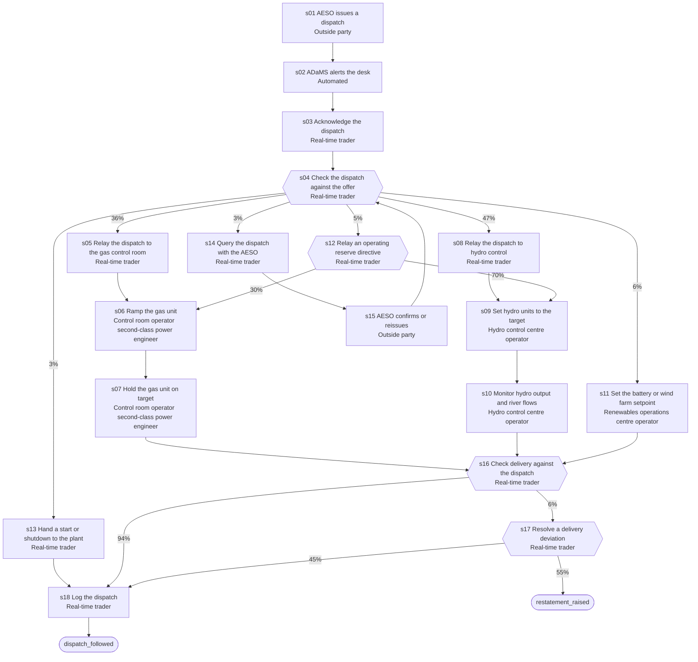

# Follow AESO dispatches and directives

`gen-mkt-respond-dispatch` · electric power generation · energy marketing and trading · part of `power-generation-co`

The AESO tells each offered asset how much to generate by issuing dispatches in its ADaMS system whenever the system price crosses the asset's offer blocks, so the company's real-time desk receives thousands of dispatches a month. The trader on shift acknowledges each one, checks it against the offer, and passes it to the gas control room, the hydro control centre or the renewables operations centre, whose operators ramp the unit, hold it inside the allowed variance and report problems. The work is minutes long but continuous, bunches up in volatile and cold-weather hours, and late acknowledgements or poor delivery are among the most frequent ISO rule matters reviewed by the market surveillance administrator.

| | |
|---|---|
| Unit of work | one dispatch instruction |
| Starts when | The AESO system controller issues a dispatch or directive for one of the company's assets in ADaMS. |
| Done when | The dispatch is acknowledged, the asset is delivering the dispatched MW inside the allowable variance (or a restatement or start-up has been handed on), and the dispatch is logged. |
| Organisation | An Alberta merchant generator with three converted gas units, partner unit shares, about ten offered hydro assets and a 10 MW battery, dispatched through a 24-hour real-time desk. (1,300 employees, 2019-2022) |
| Volume | 3,000 cases a month (range 1,500 to 6,000) |

## Where it sits

- Starts with **dispatch_instruction** from aeso (100% of cases)
- Relies on **ancillary_award** from mkt-offer-ancillary (a standing input; it does not start a case)
- Relies on **unit_status** from gas-start-stop-units (a standing input; it does not start a case)
- Relies on **iso_rules** from aeso (a standing input; it does not start a case)
- Sends **dispatch_confirmation** to aeso (outcome: any)
- Sends **dispatch_instruction** to gas-operate-units (outcome: dispatch_followed)
- Sends **dispatch_instruction** to gas-start-stop-units (outcome: dispatch_followed)
- Sends **dispatch_instruction** to hyd-operate-plants (outcome: dispatch_followed)
- Sends **dispatch_instruction** to wnd-operate-battery (outcome: dispatch_followed)
- Sends **availability_change** to mkt-restate-offers (outcome: restatement_raised)
- Sends **dispatch_log** to mkt-settle-aeso (outcome: any)

## Flow

## Roles

| Role | Department | Layer | FTE on this process | Loaded cost per hour | Evidence |
|---|---|---|---:|---:|---|
| Real-time trader | Real-time desk | individual contributor | 2.6 | 90 CAD | C |
| Control room operator (second-class power engineer) | Wabamun-area converted units | individual contributor | 1 | 70 CAD | C |
| Hydro control centre operator | Hydro control centre | individual contributor | 1.5 | 68 CAD | C |
| Renewables operations centre operator | Renewables operations centre | individual contributor | 0.1 | 62 CAD | C |

## Steps

Hands-on time and the wait before each step show the most common value. Evidence tier A is a sourced number, B a sourced description, C the author's estimate.

| Step | Who | Kind | Hands-on | Wait before | Control | Evidence |
|---|---|---|---:|---:|---|---|
| **s01 AESO issues a dispatch.** The AESO system controller issues a dispatch to one of the company's assets in ADaMS, naming the asset, Dispatch On or Off, the MW level and the time it takes effect, as the system marginal price moves through the asset's offer blocks. | Outside party | intake | 0 min | 0 min |  | A [id2012005] |
| **s02 ADaMS alerts the desk.** The ADaMS dispatch pane on the real-time desk flashes and sounds an alert for the new dispatch, and the dispatch is time-stamped in the AESO system and in the desk's dispatch history for later settlement and compliance checks. | Automated | system auto | 0 min | 0 min |  | B [id2012005] |
| **s03 Acknowledge the dispatch.** The real-time trader on shift reads the dispatch and clicks the Ack Disp button in the ADaMS dispatch pane, which tells the AESO the dispatch was received; during busy hours several dispatches may be waiting at once. | Real-time trader | data entry | 0.5 min | 1 min | ISO Rules section 201.7 s.5: acknowledge receipt of a dispatch | A [id2012005], [msacr2021] |
| **s04 Check the dispatch against the offer.** The trader compares the dispatch MW and time with the asset's current offer blocks, available capability, ramp rate and any reserve award, to spot a dispatch that the asset cannot follow or that conflicts with a pending restatement. | Real-time trader | validation | 1 min | 0 min |  | C |
| **s05 Relay the dispatch to the gas control room.** The trader phones the converted unit's control room on the recorded line, or confirms the operator has seen the dispatch on the ADaMS display there, and gives the MW target, the effective time and any reserve the unit must keep. | Real-time trader | communication | 1 min | 0.5 min |  | C |
| **s06 Ramp the gas unit.** The control room operator enters the new load target in the distributed control system, adjusts burners, fans and feedwater as the unit moves at its offered ramp rate, and starts the move within ten minutes of the dispatch time but not before it. | Control room operator (second-class power engineer) | physical | 4 min | 2 min | Plant operating procedures and boiler and turbine limits under a certificated shift engineer: dispatch is followed only within safe ramp rates and equipment limits | A [iso2034] |
| **s07 Hold the gas unit on target.** The operator watches the unit settle at the dispatched MW and keeps the 10-minute average output inside the allowable dispatch variance, telling the desk at once if a mill, pump or burner problem stops the unit from reaching or holding the target. | Control room operator (second-class power engineer) | validation | 4 min | 3 min | ISO Rules section 203.4 s.3 and s.4: start moving within 10 minutes of the dispatch time, reach steady state within the ramp-time limit and stay inside the allowable dispatch variance | A [iso2034] |
| **s08 Relay the dispatch to hydro control.** The trader passes the dispatch to the hydro control centre by phone or by the shared ADaMS display, with the plant or river system, the MW target and the effective time. | Real-time trader | communication | 1 min | 0.5 min |  | C |
| **s09 Set hydro units to the target.** The hydro control centre operator spreads the MW across units and plants in the river system on SCADA, keeping within the water schedule, licence minimum flows and forebay limits, and starts or stops units remotely where needed. | Hydro control centre operator | physical | 3 min | 1 min | ISO Rules section 203.4 s.3 and s.4: start moving within 10 minutes of the dispatch time, reach steady state within the ramp-time limit and stay inside the allowable dispatch variance | B [iso2034] |
| **s10 Monitor hydro output and river flows.** The operator watches plant output against the dispatch and the downstream flows and levels, correcting unit loadings when a plant drifts outside the dispatch variance or a river limit is approached. | Hydro control centre operator | validation | 3 min | 3 min |  | C |
| **s11 Set the battery or wind farm setpoint.** The renewables operations centre operator sets the battery's charge or discharge setpoint, or a wind farm's curtailment limit, in SCADA to match the dispatch, and checks the battery's state of charge can sustain the instruction. | Renewables operations centre operator | physical | 3 min | 2 min | ISO Rules section 203.4 s.3 and s.4: start moving within 10 minutes of the dispatch time, reach steady state within the ramp-time limit and stay inside the allowable dispatch variance | B [id2012005] |
| **s12 Relay an operating reserve directive.** The trader receives an AESO directive to convert awarded spinning or supplemental reserve into energy after a system contingency, passes it to the plant holding the reserve and tracks that the MW are delivered within the required time. | Real-time trader | communication | 2 min | 0.5 min | ISO Rules section 205.2 directives and sections 205.5 and 205.6 spinning and supplemental reserve performance standards | B [iso2034], [msacr2021] |
| **s13 Hand a start or shutdown to the plant.** When a dispatch requires a converted unit to start, synchronise or come off line, the trader calls the plant shift supervisor, agrees the start-up plan and verbal plan to the AESO, and hands the case to the plant's start and stop procedure. | Real-time trader | coordination | 6 min | 2 min | ISO Rules section 203.4 s.6(1)(b): verbal plan to the ISO when ramping to minimum stable generation | A [iso2034], [id2012005] |
| **s14 Query the dispatch with the AESO.** The trader phones the AESO system controller about a dispatch that does not match the asset's offer or restated capability, explains the asset's position and asks whether the dispatch stands or will be reissued. | Real-time trader | communication | 4 min | 1 min |  | C |
| **s15 AESO confirms or reissues.** The AESO system controller checks the merit order and either confirms the dispatch or issues a corrected one in ADaMS, after which the desk checks it again before passing it on. | Outside party | external wait | 0 min | 5 min |  | C |
| **s16 Check delivery against the dispatch.** The trader watches the asset's real-time output on the historian and the AESO display and confirms it reached the dispatched MW within the ramp-time limit and is holding inside the allowable dispatch variance. | Real-time trader | validation | 1 min | 5 min | ISO Rules section 203.4 s.2(2): dispatch protocols, personnel and software able to detect and address errors in a timely fashion | A [iso2034] |
| **s17 Resolve a delivery deviation.** The trader calls the plant for the cause of the deviation; if the asset cannot recover within 20 minutes the trader starts a restatement of its capability, otherwise the trader records the cause and time the asset returned to target. | Real-time trader | judgment | 5 min | 2 min | ISO Rules section 203.4 s.5(1): restate within 20 minutes when an operational deviation lasts 20 minutes or more | A [iso2034] |
| **s18 Log the dispatch.** The trader records the dispatch, acknowledgement time, ramp completion and any deviation or start-up hand-off in the desk dispatch log, which feeds the settlement check and the compliance file. | Real-time trader | data entry | 0.5 min | 5 min |  | C |

## Exceptions

| Exception | Share of cases | What happens |
|---|---:|---|
| Delivery deviation | 6% | The asset does not reach or hold the dispatched MW; the trader finds the cause and restates capability if it will last 20 minutes or more. |
| Dispatch queried with the AESO | 3% | The dispatch conflicts with the offer or a pending restatement and the trader calls the system controller, who confirms or reissues it. |
| Start or shutdown required | 3% | The dispatch needs a converted unit to start or come off line, which is handed to the plant's start and stop procedure. |
| Reserve directive after a contingency | 5% | The AESO directs awarded spinning or supplemental reserve to deliver energy; the plant holding it must respond within the reserve performance standard. |

## Benchmarks

| Metric | Value | Unit | Population | Evidence |
|---|---|---|---|---|
| cycle_time_days | p50 0.02, p90 0.04 | calendar days from dispatch issue to logged delivery | Energy dispatches to an Alberta generator, 2019-2022 | B [iso2034] |
| ramp_start_limit | 10 | minutes after the dispatch time | AESO generating source assets | A [iso2034] |
| dispatch_tolerance_storage | 5 | MW either side of the dispatch (assets of 200 MW or less) | AESO stand-alone storage and generating units | A [id2012005] |
| dispatch_related_matters_2021 | section_201_7 67, section_203_4 83 | ISO rules compliance matters addressed, all Alberta participants | Alberta electricity market, 2021 | A [msacr2021] |

## Pain points

- Dispatches arrive continuously and bunch up in volatile hours, when the same trader is also taking restatement calls, so acknowledgements and deviation checks slip. (steps s03, s16; B [msacr2021])
- Each dispatch is relayed by phone from the desk to a separate control room, adding a hand-off and a chance of mishearing the MW or the unit. (steps s05, s08; C)
- Converted coal-to-gas units ramp more slowly and less predictably than purpose-built gas plants, so holding them inside the variance takes close operator attention. (steps s06, s07; C)

## Assumptions

- One case is one dispatch or directive for one asset. Dispatches to the partner-operated unit shares are acknowledged by the desk but delivered by the partner's control room, and are counted in the gas branch without separate partner steps.
- The volume of 3,000 a month is the organisation file's estimate; it is the number most worth checking against ADaMS history.
- Branch shares (36 percent gas, 47 percent hydro, 6 percent battery or wind, 5 percent reserve directives, 3 percent starts, 3 percent queries) are estimates.
- Step resources show the plant being moved during the ramp: the converted unit for 10 to 45 minutes, a hydro plant for 5 to 30 minutes, the battery for 5 to 60 minutes. The plant keeps running afterwards; this only marks the period it is tied to the dispatch change.
- Desk relay of dispatches by phone is assumed for 2019-2022; where control rooms watched ADaMS directly the relay step is shorter but still includes a confirmation.
- The converted_gas_unit resource is listed without its running cost per hour (14,000 CAD in the organisation file), because fuel and carbon burned during a ramp are the cost of generating energy that the pool pays for, not a cost of handling the dispatch; including it would add about 2,200 CAD to every case.
- Wind farm curtailments are rare and are included in the battery branch without a separate wind_farm resource.
- The simulated cycle is about 25 to 50 minutes, close to the rule-derived benchmark.
- Loaded costs come from the organisation file (wage x 1.40).

## Sources

- [iso2034] [ISO Rules Section 203.4, Delivery Requirements for Energy (2023-03-31 administrative version; substantive text from 2020-09-16)](https://www.aeso.ca/assets/documents/203.4-Delivery-Requirements-for-Energy-Admin-Amendments-2023-03-31.pdf) (Alberta Electric System Operator, 2023). Respond to dispatches with reasonable dispatch protocols, personnel and software; start moving toward the dispatched MW within 10 minutes of the dispatch time; reach steady state within the ramp time plus 40 percent (at least 5 minutes) plus 10 minutes; stay inside the allowable dispatch variance over 10-minute periods; restate within 20 minutes if an operational deviation lasts 20 minutes or longer. The revision history shows the 2023 version only aligned drafting with the 2020 text.
- [id2012005] [Information Document 2012-005R, Dispatches (posted 2025-03-12; acknowledgement section unchanged since 2016)](https://www.aeso.ca/assets/Information-Documents/2012-005R-Dispatches-2025-03-12.pdf) (Alberta Electric System Operator, 2025). Dispatches are issued in the Automated Dispatch and Messaging System (ADaMS) with asset, Dispatch On or Off, MW and effective time; Section 201.7 subsection 5 requires acknowledgement, done with the Ack Disp button; stand-alone storage and generating assets must hold output within plus or minus 5 MW (200 MW or less) or 10 MW (above 200 MW).
- [msacr2021] [MSA Compliance Review 2021 (April 5, 2022)](https://www.albertamsa.ca/assets/Documents/Compliance-Review-2021.pdf) (Market Surveillance Administrator (Alberta), 2022). 462 ISO rules matters addressed in 2021 (437 in 2020), 91 percent self-reported; 75 notices of specified penalty totalling 129,250 CAD; 114 matters under section 203.3 (restatements), 83 under 203.4 (dispatch delivery), 67 under 201.7 (dispatch acknowledgement), 43 under 205.6 and 26 under 205.5 (reserves); 74 percent of matters closed with forbearance; TransAlta entities among those penalised.

Written by claude-opus on 2026-11-24.
