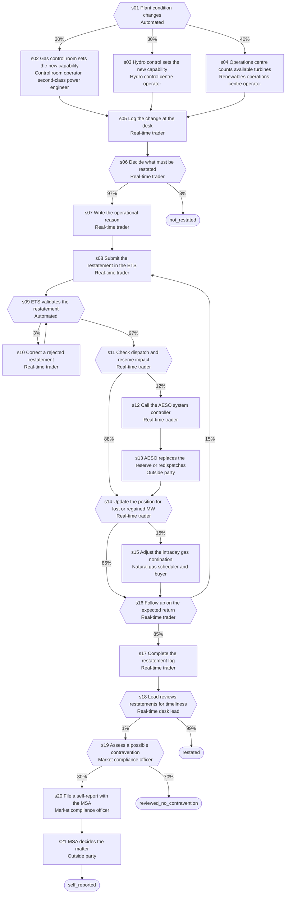

# Restate offers and declare availability changes

`gen-mkt-restate-offers` · electric power generation · energy marketing and trading · part of `power-generation-co`

When a plant can no longer deliver what its offer says, because a unit trips, turbines ice up, a hydro unit loses flow or a unit comes back from outage, the company must restate the offer in the AESO Energy Trading System as soon as reasonably practicable and give an acceptable operational reason. Plant operators in the gas control rooms, hydro control centre and renewables operations centre call the real-time desk, which decides the restatement type and hours, enters it, checks the effect on dispatches and reserve awards, and logs the timing. The work is fast but happens hundreds of times a month, peaks during cold snaps when the desk is busiest, and late or missing restatements are the most common ISO rule matters reported to the market surveillance administrator.

| | |
|---|---|
| Unit of work | one offer restatement |
| Starts when | A plant operator reports a change in what an asset can deliver: a trip, derate, early or late return from outage, turbine faults or icing, or a hydro flow or head limit. |
| Done when | The offer in the ETS reflects the asset's real capability for every affected hour with a reason recorded, the position is updated, and the restatement has passed the next-day timeliness review (or been self-reported to the MSA). |
| Organisation | An Alberta merchant generator with about thirty offered assets and a 24-hour real-time desk linked by recorded phone lines to plant control rooms. (1,300 employees, 2019-2022) |
| Volume | 600 cases a month (range 300 to 1,200) |

## Where it sits

- Starts with **availability_change** from gas-respond-forced-outage (15% of cases)
- Starts with **availability_change** from gas-start-stop-units (15% of cases)
- Starts with **availability_change** from wnd-monitor-fleet (40% of cases)
- Starts with **availability_change** from hyd-operate-plants (30% of cases)
- Relies on **iso_rules** from aeso (a standing input; it does not start a case)
- Relies on **compliance_guidance** from hse-market-compliance (a standing input; it does not start a case)
- Sends **energy_offer** to aeso (outcome: restated)
- Sends **energy_offer** to aeso (outcome: reviewed_no_contravention)
- Sends **energy_offer** to aeso (outcome: self_reported)
- Sends **offer_record** to hse-market-compliance (outcome: any)
- Sends **inquiry_response** to msa (outcome: self_reported)

## Flow

## Roles

| Role | Department | Layer | FTE on this process | Loaded cost per hour | Evidence |
|---|---|---|---:|---:|---|
| Real-time trader | Real-time desk | individual contributor | 1.3 | 90 CAD | C |
| Control room operator (second-class power engineer) | Wabamun-area converted units | individual contributor | 0.2 | 70 CAD | C |
| Hydro control centre operator | Hydro control centre | individual contributor | 0.2 | 68 CAD | C |
| Renewables operations centre operator | Renewables operations centre | individual contributor | 0.25 | 62 CAD | C |
| Real-time desk lead | Real-time desk | supervisor | 0.05 | 120 CAD | C |
| Natural gas scheduler and buyer | Commercial and trading | individual contributor | 0.05 | 80 CAD | C |
| Market compliance officer | Regulatory and market compliance | senior specialist | 0.05 | 98 CAD | C |

## Steps

Hands-on time and the wait before each step show the most common value. Evidence tier A is a sourced number, B a sourced description, C the author's estimate.

| Step | Who | Kind | Hands-on | Wait before | Control | Evidence |
|---|---|---|---:|---:|---|---|
| **s01 Plant condition changes.** A unit trips or is derated, a unit returns from outage early or late, turbines fault or ice up, or a hydro unit loses head or flow; the plant control system or SCADA raises an alarm or the operator sees the change on the console. | Automated | system auto | 0 min | 0 min |  | C |
| **s02 Gas control room sets the new capability.** The control room operator first stabilises the unit within its safe operating limits, then works out with the shift supervisor how many MW the unit can deliver, from what time and for how long, and phones the real-time desk with the MW, the cause and the expected duration. | Control room operator (second-class power engineer) | judgment | 5 min | 5 min | Plant operating procedures: stabilise the unit within safe operating limits under a certificated shift engineer before reporting capability (Alberta pressure equipment and power engineer rules) | C |
| **s03 Hydro control sets the new capability.** The hydro control centre operator checks the tripped or limited unit, reservoir and forebay levels, ice or debris on intakes and licence flow limits on SCADA, works out the plant's new MW capability and calls the real-time desk. | Hydro control centre operator | judgment | 4 min | 5 min |  | C |
| **s04 Operations centre counts available turbines.** The renewables operations centre operator counts turbines faulted, iced or stopped for high wind, checks substation and collector limits, waits briefly to see whether an icing or high-wind stop persists, and sends the desk the wind farm's new available MW. | Renewables operations centre operator | judgment | 3 min | 10 min |  | C |
| **s05 Log the change at the desk.** The real-time trader takes the call or message on the recorded line, notes the time the company became aware, the asset, the MW, the cause and the expected return time in the desk log, because the restatement clock runs from that moment. | Real-time trader | intake | 1.5 min | 3 min |  | C |
| **s06 Decide what must be restated.** The trader decides whether the change needs an available capability, MW or minimum stable generation restatement, which hours it covers, whether those hours are inside T-2, and whether the cause is an acceptable operational reason rather than a commercial one. | Real-time trader | judgment | 3 min | 1 min |  | A [iso2033], [id2012009] |
| **s07 Write the operational reason.** The trader picks the reason category and types the operational reason for the restatement in the ETS reason field, for example forced derate on a boiler feed pump or seven turbines iced, as the rule requires for every available capability restatement. | Real-time trader | drafting | 2 min | 0 min | ISO Rules section 203.3 s.2(3) and s.4(3): submit the reasons for an available capability restatement and for MW restatements within T-2 | A [iso2033] |
| **s08 Submit the restatement in the ETS.** The trader enters the new available capability or redistributed MW for each affected hour in the Energy Trading System, which drops the highest priced blocks out of the merit order on a downward restatement and restores the lowest priced blocks first on an upward one. | Real-time trader | data entry | 3 min | 1 min | ISO Rules section 203.3 s.2(2) and s.4(2): restate as soon as reasonably practicable; section 203.4 s.5(1): within 20 minutes when an operational deviation lasts 20 minutes or more | A [iso2033], [iso2034], [id2012009] |
| **s09 ETS validates the restatement.** The ETS acknowledges the restatement and checks it, for example that a price change is not inside T-2 and that minimum stable generation still fits the lowest block, and returns a valid or invalid notice. | Automated | system auto | 0 min | 1 min |  | B [iso2031] |
| **s10 Correct a rejected restatement.** The trader reads the rejection reason, corrects the hours, MW or minimum stable generation and resubmits straight away, because the time spent fixing counts against the as-soon-as-practicable requirement. | Real-time trader | data entry | 3 min | 1 min | ISO Rules section 203.3 s.2(2) and s.4(2): restate as soon as reasonably practicable; section 203.4 s.5(1): within 20 minutes when an operational deviation lasts 20 minutes or more | C |
| **s11 Check dispatch and reserve impact.** The trader checks whether the asset is currently dispatched above its new capability or holds an operating reserve award for the affected hours, and whether a new dispatch from the AESO should follow from the restated merit order. | Real-time trader | analysis | 2 min | 1 min |  | C |
| **s12 Call the AESO system controller.** The trader phones the AESO system controller on the recorded line to report that the asset cannot provide its awarded reserve or dispatched energy, gives the MW and expected duration, and notes the controller's instructions. | Real-time trader | communication | 4 min | 2 min | ISO Rules on operating reserve delivery (division 205) and section 201.7 compliance with dispatches | B [msacr2021] |
| **s13 AESO replaces the reserve or redispatches.** The AESO system controller acknowledges the shortfall, replaces the reserve from other providers or standby offers and issues revised dispatches, which the desk then receives in ADaMS. | Outside party | external wait | 0 min | 5 min |  | B [msa2009or] |
| **s14 Update the position for lost or regained MW.** The trader updates the ETRM position for the MW lost or regained over the affected hours so the hedge book and the day's open position are right, and tells the gas scheduler when a gas unit's burn changes. | Real-time trader | data entry | 2 min | 5 min |  | C |
| **s15 Adjust the intraday gas nomination.** The natural gas scheduler revises the unit's intraday nomination on the pipeline portal or sells surplus gas back, so the plant is not left long or short of fuel after the trip or return. | Natural gas scheduler and buyer | communication | 10 min | 30 min |  | C |
| **s16 Follow up on the expected return.** The trader sets a reminder for the expected return time and checks back with the plant then; if the return is earlier or later than first reported, or the cause changes, the trader restates the further hours. | Real-time trader | coordination | 1 min | 2.0 h |  | C |
| **s17 Complete the restatement log.** The trader completes the restatement log entry with the awareness time, submission time, hours, MW and the reason text, so the gap between the event and the restatement can be shown to the AESO or MSA. | Real-time trader | data entry | 1 min | 10 min | Evidence of timeliness for AESO compliance monitoring and MSA self-reports | B [nsp2021112] |
| **s18 Lead reviews restatements for timeliness.** Next business morning the real-time desk lead compares the restatement log with the ETS restatement report and plant event times, checking that each restatement was made promptly with an acceptable reason, and flags any that look late or wrong. | Real-time desk lead | review | 1 min | 14.0 h | Company ISO rules compliance programme: daily review of restatements and self-reporting | B [msacr2021] |
| **s19 Assess a possible contravention.** The market compliance officer gathers the plant event log, recorded call, ETS timestamps and reason text for the flagged restatement, decides whether section 203.3 was breached and whether a self-report to the MSA is needed. | Market compliance officer | analysis | 2.0 h | 3.0 d |  | C |
| **s20 File a self-report with the MSA.** The compliance officer drafts the self-report with the facts, the cause (often a missed call or a busy desk during a trip) and the corrective action, has it approved by the desk director, and submits it to the MSA. | Market compliance officer | drafting | 2.0 h | 2.0 d | MSA Compliance Process (self-reporting of ISO rule contraventions) and AUC Rule 019 specified penalties | A [msacr2021], [nsp2021112] |
| **s21 MSA decides the matter.** The MSA reviews the self-report with AESO data and issues forbearance, a no-contravention finding or a notice of specified penalty; in 2021, 74 percent of matters ended in forbearance and 16 percent in a penalty. | Outside party | external wait | 0 min | 70.0 d |  | A [msacr2021], [nsp2021112] |

## Exceptions

| Exception | Share of cases | What happens |
|---|---:|---|
| Reserve award or dispatch cannot be met | 12% | The asset holds an operating reserve award or is dispatched above its new capability, so the trader calls the AESO system controller, which replaces the reserve or redispatches. |
| Return time changes | 15% | The unit comes back earlier or later than reported, or the cause changes, and further hours are restated. |
| Late restatement self-reported | 0% | The daily review finds a restatement made too late or with a weak reason; compliance assesses it and self-reports to the MSA, which usually forbears. |

## Benchmarks

| Metric | Value | Unit | Population | Evidence |
|---|---|---|---|---|
| cycle_time_days | p50 1.0, p90 2.5 | calendar days from the plant event to the completed next-day review | Offer restatements at an Alberta generator, 2019-2022 | C |
| operational_deviation_restatement_deadline | 20 | minutes after the deviation starts | AESO generating source assets | A [iso2034] |
| operating_constraint_update_expectation | 15 | minutes after becoming aware of the change | AESO pool assets (ramp rate and other operating constraints) | A [id2012008] |
| section_203_3_matters_2021 | 114 | ISO rules compliance matters addressed, all Alberta participants | Alberta electricity market, 2021 | A [msacr2021] |

## Pain points

- Restatements pile up exactly when the desk is busiest: during cold snaps and volatile hours, trips, dispatches and reserve calls arrive together, and late restatements become the most common ISO rule matter. (steps s05, s08, s12; A [msacr2021])
- Capability is relayed by phone from three different control rooms and re-keyed by the trader, so awareness time, MW and reason are recorded twice and can disagree. (steps s02, s03, s04, s05, s17; C)
- First estimates of return time are often wrong, so one event produces several restatements. (steps s16, s08; C)

## Assumptions

- One case is one restatement event for one asset, which may cover several hours. Follow-up restatements for the same event loop back inside the case (15 percent).
- The trigger mix (15 percent forced outages, 15 percent start-stop and returns, 40 percent wind, 30 percent hydro) is an estimate; wind farms restate most often because turbine availability changes many times a day.
- The volume of 600 a month is the organisation file's estimate and is the number most worth checking against ETS data.
- The share that ends in a self-report (about 0.3 percent, about 20 a year) is scaled from the 114 section 203.3 matters across all Alberta participants in 2021, assuming this company holds roughly a sixth of that activity.
- The MSA disposition wait is long (months) but rare, so it shows in the cycle time only beyond the 99th percentile.
- The surge copies the organisation file's cold-snap surge.
- Loaded costs come from the organisation file (wage x 1.40).

## Sources

- [iso2031] [ISO Rules Section 203.1, Offers and Bids for Energy (effective 2013-12-20)](https://www.aeso.ca/assets/documents/Section-203.1-Offers-and-Bids-for-Energy.pdf) (Alberta Electric System Operator, 2013). Offers due before 12:00 on the day before the delivery day and no earlier than 7 days before; offer for every settlement interval for source assets of 5 MW or more; prices of at least 0 and under 1,000 CAD/MWh; block MW, flexible or inflexible flag and minimum stable generation; top block equals maximum capability; available capability equal to maximum capability unless an acceptable operational reason is given; ramp rate and initial start-up time; standing submissions; ETS acknowledgement and valid or invalid notice.
- [id2012008] [Information Document 2012-008R, Energy Offers and Bids (posted 2017-04-04)](https://www.aeso.ca/assets/Uploads/2012-008R-Energy-Offers-and-Bids-2017-04-04.pdf) (Alberta Electric System Operator, 2017). Offers have up to seven operating blocks; inflexible blocks dispatched only in full; net-to-grid offers for sites with on-site load; AESO expects operating constraints such as ramp rate to be updated within 15 minutes of becoming aware of a change; constraints are used to judge compliance.
- [iso2033] [ISO Rules Section 203.3, Energy Restatements (effective 2014-07-02)](https://www.aeso.ca/assets/documents/Section-203-3-Energy-Restatements-July-2-2014.pdf) (Alberta Electric System Operator, 2014). Available capability restatements only for an acceptable operational reason, an operational deviation or testing, submitted as soon as reasonably practicable with reasons; price and MW restatements allowed only before two hours ahead of the settlement interval (T-2); MW restatements within T-2 require reasons; minimum stable generation restatements. In force through the 2019-2022 period (replaced 2024-04-01).
- [id2012009] [Information Document 2012-009R, Restatements (posted 2017-05-11)](https://www.aeso.ca/assets/Uploads/2012-009R-Restatements-2017-05-11.pdf) (Alberta Electric System Operator, 2017). How the Energy Trading System removes the highest priced blocks from the merit order when available capability is restated down and restores the lowest priced blocks first when restated up; price restatements need no operational reason but must be made before T-2 (for HE12, before 9:00); MW restatements keep block prices.
- [iso2034] [ISO Rules Section 203.4, Delivery Requirements for Energy (2023-03-31 administrative version; substantive text from 2020-09-16)](https://www.aeso.ca/assets/documents/203.4-Delivery-Requirements-for-Energy-Admin-Amendments-2023-03-31.pdf) (Alberta Electric System Operator, 2023). Respond to dispatches with reasonable dispatch protocols, personnel and software; start moving toward the dispatched MW within 10 minutes of the dispatch time; reach steady state within the ramp time plus 40 percent (at least 5 minutes) plus 10 minutes; stay inside the allowable dispatch variance over 10-minute periods; restate within 20 minutes if an operational deviation lasts 20 minutes or longer. The revision history shows the 2023 version only aligned drafting with the 2020 text.
- [msa2009or] [Operating Reserves Procurement: Understanding Market Outcomes (2009-09-16)](https://resources.albertamsa.ca/assets/Documents/Operating-Reserves-Procurement-Understanding-Market-Outcomes-2009-09-16.pdf) (Market Surveillance Administrator (Alberta), 2009). Watt-Ex day-ahead trading from 9:00 with closes at 9:40 (active regulating), 9:50 (spinning), 10:00 (supplemental), 10:10 to 10:30 (standby products), with over-the-counter trades after close; typical procured volumes (about 110 to 165 MW regulating, 170 to 260 MW spinning and supplemental); standby suppliers have fifteen minutes to get into position.
- [msacr2021] [MSA Compliance Review 2021 (April 5, 2022)](https://www.albertamsa.ca/assets/Documents/Compliance-Review-2021.pdf) (Market Surveillance Administrator (Alberta), 2022). 462 ISO rules matters addressed in 2021 (437 in 2020), 91 percent self-reported; 75 notices of specified penalty totalling 129,250 CAD; 114 matters under section 203.3 (restatements), 83 under 203.4 (dispatch delivery), 67 under 201.7 (dispatch acknowledgement), 43 under 205.6 and 26 under 205.5 (reserves); 74 percent of matters closed with forbearance; TransAlta entities among those penalised.
- [nsp2021112] [Notice of Specified Penalty, MSA file 2021-112 (section 203.3, available capability not restated after a trip)](https://www.albertamsa.ca/assets/Documents/NSP-2021-112.pdf) (Market Surveillance Administrator (Alberta), 2021). A trip on February 16, 2021 left available capability unrestated for HE12 to HE14; self-reported on March 11, 2021; 750 CAD penalty for a first contravention in 12 months; the MSA relies on AESO available capability, dispatch, generation and offer data.

Written by claude-opus on 2026-11-24.
