# Reconcile AESO power pool settlement statements

`gen-mkt-settle-aeso` · electric power generation · energy marketing settlement · part of `power-generation-co`

Every month the Alberta Electric System Operator (AESO) settles the wholesale power pool: it posts a preliminary statement for each pool participant on the fifth business day, a final statement on the fifteenth, and moves the money by wire on the twentieth. A settlement analyst rebuilds each statement hour by hour from the company's own meter, dispatch, offer and trade records, chases differences with the AESO or the meter data manager, and books the result. The work is slow because statements hold thousands of asset-hours, the preliminary-to-final window is only ten business days, and each production month is resettled again at two and four months, so differences surface long after the month closed.

| | |
|---|---|
| Unit of work | one settlement statement |
| Starts when | The AESO posts a preliminary or final power pool statement for one of the company's pool participant entities in the Energy Trading System. |
| Done when | A preliminary statement has been reconciled and every material difference queried before the final; or a final statement has been tied out, disputed if needed, paid or received on the 20th business day and posted to the ledger. |
| Organisation | An Alberta merchant generator with gas, hydro, wind and battery assets held in several pool participant entities and a central settlement team in its energy marketing division. (1,300 employees, 2019-2022) |
| Volume | 10 cases a month (range 8 to 14) |

## Where it sits

- Starts with **aeso_settlement_statement** from aeso (100% of cases)
- Relies on **offer_record** from mkt-submit-energy-offers (a standing input; it does not start a case)
- Relies on **dispatch_log** from mkt-respond-dispatch (a standing input; it does not start a case)
- Relies on **ancillary_award** from mkt-offer-ancillary (a standing input; it does not start a case)
- Relies on **hedge_trade** from mkt-execute-hedges (a standing input; it does not start a case)
- Relies on **pool_price** from aeso (a standing input; it does not start a case)
- Sends **settlement_query** to aeso (outcome: preliminary_reconciled)
- Sends **journal_entries** to fin-close-month (outcome: final_settled)
- Sends **payment_request** to fin-treasury (outcome: final_settled)

## Flow

```mermaid
flowchart TD
    s01["s01 Post statement in the Energy Trading System<br/>Automated"]
    s02["s02 Log statement and download supporting reports<br/>Settlement analyst"]
    s03["s03 Load statement data into the shadow settlement<br/>Settlement analyst"]
    s04["s04 Compare metered volumes with plant records<br/>Settlement analyst"]
    s05["s05 Recompute energy payments and market charges<br/>Settlement analyst"]
    s06["s06 Reconcile net settlement instructions with bilateral trades<br/>Settlement analyst"]
    s07["s07 Check operating reserve payments and fees<br/>Settlement analyst"]
    s08["s08 Review prior period resettlement lines<br/>Settlement analyst"]
    s09{{"s09 Summarise variances and apply materiality<br/>Settlement analyst"}}
    s10{{"s10 Investigate the cause of a material variance<br/>Settlement analyst"}}
    s11["s11 Meter data manager confirms and resubmits meter data<br/>Outside party"]
    s12["s12 Send a settlement query to the AESO<br/>Settlement analyst"]
    s13["s13 AESO processes the correction or answers the query<br/>Outside party"]
    s14{{"s14 Manager reviews the reconciliation package<br/>Manager, settlement and contracts"}}
    s15{{"s15 Compare the final statement with the preliminary and open queries<br/>Settlement analyst"}}
    s16["s16 Draft a written settlement dispute<br/>Settlement analyst"]
    s17["s17 Approve the net amount to pay or receive<br/>Manager, settlement and contracts"]
    s18["s18 Release the wire or confirm the receipt<br/>Treasury analyst"]
    s19["s19 Prepare and post the settlement journal entries<br/>Settlement analyst"]
    s20["s20 Update the query log and resettlement watchlist<br/>Settlement analyst"]
    s01 --> s02
    s02 --> s03
    s03 --> s04
    s04 --> s05
    s05 --> s06
    s06 --> s07
    s07 --> s08
    s08 --> s09
    s09 -->|"62%"| s14
    s09 -->|"38%"| s10
    s10 -->|"20%"| s09
    s10 -->|"35%"| s11
    s10 -->|"45%"| s12
    s11 --> s13
    s12 --> s13
    s13 --> s14
    s14 -->|"47%"| end0
    s14 -->|"48%"| s15
    s14 -->|"5%"| s09
    s15 -->|"92%"| s17
    s15 -->|"8%"| s16
    s16 --> s17
    s17 --> s18
    s18 --> s19
    s19 --> s20
    s20 --> end1
    end0(["preliminary_reconciled"])
    end1(["final_settled"])
```

## Roles

| Role | Department | Layer | FTE on this process | Loaded cost per hour | Evidence |
|---|---|---|---:|---:|---|
| Settlement analyst | Settlement and contract administration | individual contributor | 1.6 | 64 CAD | C |
| Manager, settlement and contracts | Settlement and contract administration | manager | 0.1 | 120 CAD | C |
| Treasury analyst | Treasury and tax | individual contributor | 0.02 | 74 CAD | C |

## Steps

Hands-on time and the wait before each step show the most common value. Evidence tier A is a sourced number, B a sourced description, C the author's estimate.

| Step | Who | Kind | Hands-on | Wait before | Control | Evidence |
|---|---|---|---:|---:|---|---|
| **s01 Post statement in the Energy Trading System.** The AESO posts a preliminary power pool statement by the end of the fifth business day after the production month, or a final statement by the end of the fifteenth, for one pool participant, and sends a message in the Energy Trading System that it is ready. | Automated | system auto | 0 min | 0 min |  | B [aeso_settle_guide] |
| **s02 Log statement and download supporting reports.** The settlement analyst logs into the Energy Trading System with the company's digital certificate, downloads the statement and the csv reports behind it (daily detail, metered volumes, NSI detail, trading charge, settlement changes, PFAM summary) and records the statement in the monthly settlement tracker. | Settlement analyst | intake | 40 min | 3.0 h |  | B [aeso_settle_guide] |
| **s03 Load statement data into the shadow settlement.** The analyst imports the hourly csv data into the shadow settlement workbook, maps each AESO pool asset ID to the plant, hydro group or wind farm and legal entity, and refreshes the hourly pool price so every line can be recomputed independently. | Settlement analyst | data entry | 1.0 h | 30 min |  | C |
| **s04 Compare metered volumes with plant records.** The analyst compares the AESO metered energy for each asset and hour with the plant historian's net-to-grid MWh and the dispatch log, and flags hours where the gap exceeds the tolerance, such as a missing hour after a meter or communications fault. | Settlement analyst | validation | 2.0 h | 1.0 h |  | B [aeso_settle_guide] |
| **s05 Recompute energy payments and market charges.** For each asset and hour the analyst recomputes the energy payment as volume times pool price, applies the energy market trading charge rate, and checks payments to a supplier on the margin, transmission constraint rebalancing and dispatch down service lines against the offer and dispatch records. | Settlement analyst | validation | 1.5 h | 30 min |  | B [aeso_settle_guide] |
| **s06 Reconcile net settlement instructions with bilateral trades.** The analyst compares the net settlement instructions accepted in the Energy Trading System, hour by hour, with the physical bilateral power trades booked in the ETRM system, because each instruction moves volume between participants and changes the energy payment. | Settlement analyst | validation | 1.0 h | 30 min |  | B [aeso_settle_guide] |
| **s07 Check operating reserve payments and fees.** The analyst compares operating reserve payments and charges with the ancillary service awards and delivery records, and checks the other lines on the statement such as the participation fee, interest on late payments and cash on deposit. | Settlement analyst | validation | 45 min | 30 min |  | C |
| **s08 Review prior period resettlement lines.** The analyst reviews the prior period energy and charge lines, which carry the interim (two month) and final (four month) resettlements of earlier production months, and ties each change to earlier shadow figures and to queries still open in the tracker. | Settlement analyst | analysis | 1.0 h | 30 min |  | B [aeso_settle_guide], [aeso_dispute_2021] |
| **s09 Summarise variances and apply materiality.** The analyst totals the variances from the metering, energy, NSI, ancillary and prior period checks by cause in the variance log, applies the department's dollar and MWh materiality thresholds, and decides which items need follow-up before the next statement. | Settlement analyst | analysis | 45 min | 30 min |  | C |
| **s10 Investigate the cause of a material variance.** The analyst pulls historian trends and dispatch logs, asks the real-time desk or the plant control room about curtailments, derates or meter work, and checks the shadow settlement mapping to decide whether the error lies with the company, the meter data or the AESO calculation. | Settlement analyst | analysis | 2.0 h | 4.0 h |  | C |
| **s11 Meter data manager confirms and resubmits meter data.** The company's meter data manager checks whether all generation data reached the AESO and, where data were missing or wrong, resubmits corrected interval data so that the correction appears on the final statement or a later resettlement. | Outside party | external wait | 0 min | 3.0 d |  | B [aeso_settle_guide] |
| **s12 Send a settlement query to the AESO.** The analyst emails settlement@aeso.ca with the day, hour ending, pool asset, MWh or dollar amount according to company records and supporting extracts, and logs the query with its expected correction date in the tracker. | Settlement analyst | communication | 45 min | 1.0 h |  | B [aeso_settle_guide] |
| **s13 AESO processes the correction or answers the query.** AESO settlement staff review the query or the resubmitted meter data and either correct the final statement, schedule the change for the next resettlement run, or reply explaining why the figure stands. | Outside party | external wait | 0 min | 4.0 d |  | C |
| **s14 Manager reviews the reconciliation package.** The manager of settlement and contracts reviews the variance log, open queries and the tie of statement totals to the shadow settlement, signs off the preliminary review or releases the final statement for payment, and returns the work if a variance is unexplained. | Manager, settlement and contracts | review | 30 min | 12.0 h | Internal control over financial reporting (NI 52-109 certification and SOX 404 for a US-listed issuer): independent review of revenue reconciliations | C |
| **s15 Compare the final statement with the preliminary and open queries.** The analyst checks that the corrections agreed with the AESO or the meter data manager appear on the final statement, ties the final total to the shadow settlement, and decides whether any remaining difference is large enough to dispute. | Settlement analyst | validation | 1.0 h | 2.0 h |  | B [aeso_settle_guide] |
| **s16 Draft a written settlement dispute.** The analyst drafts a formal written dispute with hourly calculations and evidence, has the manager sign it, and files it with the AESO before the twenty-business-day dispute submission period after the final energy market statement closes. | Settlement analyst | drafting | 4.0 h | 1.0 d | ISO rules section 103.2 (Dispute Resolution) and section 103.4 subsection 27: written dispute within the published dispute submission period | B [aeso_settle_guide], [aeso_dispute_2021] |
| **s17 Approve the net amount to pay or receive.** The manager approves the net amount on the final statement to be paid to or received from the AESO, noting that the full amount must be paid even while a dispute is open, and sends the payment approval to treasury. | Manager, settlement and contracts | approval | 20 min | 12.0 h | Treasury and payments policy: settlement approves the amount, treasury releases the wire | B [aeso_settle_guide] |
| **s18 Release the wire or confirm the receipt.** On the twentieth business day the treasury analyst releases the wire transfer to the AESO's account for a net payable statement, or confirms that the AESO's wire arrived for a net receivable one, and records the bank reference. | Treasury analyst | data entry | 15 min | 2.0 d | ISO rules section 103.4 subsections 20 and 23: settlement on the 20th business day by wire transfer | B [aeso_settle_guide] |
| **s19 Prepare and post the settlement journal entries.** The analyst reverses the month-end accrual made from the shadow settlement, books final energy revenue, ancillary revenue, fees and prior period adjustments by asset and legal entity, and uploads the journal for the accounting team's month-end close. | Settlement analyst | data entry | 1.0 h | 12.0 h | Internal control over financial reporting: documented support and review of revenue journal entries | C |
| **s20 Update the query log and resettlement watchlist.** The analyst closes resolved queries in the tracker and carries open items and expected corrections forward to the watchlist for the interim and final resettlement runs that will appear on later statements. | Settlement analyst | data entry | 20 min | 1.0 h |  | C |

## Exceptions

| Exception | Share of cases | What happens |
|---|---:|---|
| Missing meter data | 13% | A meter or communications fault leaves hours missing; the meter data manager resubmits and the correction lands on the final statement or a later resettlement. |
| AESO calculation or NSI error | 17% | An uplift, net settlement instruction or prior period line disagrees with company records; the analyst queries the AESO and tracks the correction. |
| Formal dispute | 4% | A material difference remains on the final statement; the company pays in full and files a written dispute within twenty business days. |

## Benchmarks

| Metric | Value | Unit | Population | Evidence |
|---|---|---|---|---|
| cycle_time_days | p50 6, p90 14 | calendar days from statement posting to reconciliation sign-off (preliminary) or posting of journal entries (final) | Preliminary and final power pool statements of an Alberta pool participant | B [aeso_settle_guide] |
| statement_issue_and_payment_days | preliminary 5, final 15, payment 20 | business days after the end of the settlement period | AESO power pool financial settlement under ISO rule 103.4 | A [aeso_settle_guide] |
| dispute_submission_period | 20 | business days after the final energy market statement | AESO power pool settlement 2020-2021 | A [aeso_dispute_2021] |

## Pain points

- Each statement holds hourly data for dozens of assets, and the shadow settlement is rebuilt in spreadsheets each month, so most of the analyst's time goes to re-keying and matching rather than investigating. (steps s03, s04, s05; C)
- Only ten business days separate the preliminary and final statements, so queries raised late slip to the interim or final resettlement two to four months later. (steps s10, s12, s13; B [aeso_settle_guide])
- Each production month is resettled at one, two and four months and the final energy market statement issues about five months after the period, so open items must be tracked across many statements. (steps s08, s20; A [aeso_settle_guide], [aeso_dispute_2021])

## Assumptions

- The unit of work is one statement. Preliminary statements end at the manager's sign-off with queries raised; final statements continue to payment and posting. The split is modelled at the manager review step (s14) because the statement type is known at posting.
- Settlement analysts also review ETS settlement reports during the month, as the AESO recommends, and book a month-end accrual from the shadow settlement before statements arrive; that work is counted in the analyst FTE but not modelled as steps.
- No surge is given: statement volume is fixed by the AESO calendar, and price spikes raise the work per statement rather than the number of statements.
- No physical resources, travel or field wait causes apply to this office process.
- Treasury releases the wire; the organisation file lists only settlement roles for this process.
- Times and branch shares are tier C estimates unless a step cites a source; the AESO dates are tier A or B.

## Sources

- [aeso_settle_guide] [Information Document: Power Pool Settlement Guide, ID #2011-002R](https://www.aeso.ca/assets/downloads/ID-2011-002R-Power-Pool-Settlement-Guide4.pdf) (Alberta Electric System Operator, 2017). Preliminary power pool statements by the end of the 5th business day after the settlement period and final statements by the 15th; payments based on final statements and settled by wire on the 20th business day; statement line items (energy payment, trading charge, PSM, TCR, dispatch down service, prior period adjustments, participation fee, interest); verification reports in the Energy Trading System (metered volumes updated 5 business days after production, NSI reports, settlement changes, PFAM summary); generator discrepancies go to the meter data manager, other queries to settlement@aeso.ca; each production month settled at 1 month (initial), 2 months (interim) and 4 months (final); written disputes on final statements under section 103.2; final amount must be paid in full despite a dispute.
- [aeso_dispute_2021] [Power Pool Financial Settlement 2020-2021 Dispute Timelines](https://www.aeso.ca/assets/Uploads/2020-2021-Dispute-Timelines.pdf) (Alberta Electric System Operator, 2021). Issue dates of the final energy market statement for August 2020 to December 2021 settlement periods (about five months after each period, for example Aug 2020 final issued Jan 22, 2021) and the dispute submission period of twenty business days after that issue date; initial, interim and final runs at one, two and four months.
- [msa_cr2021] [MSA Compliance Review 2021](https://www.albertamsa.ca/assets/Documents/Compliance-Review-2021.pdf) (Market Surveillance Administrator (Alberta), 2022). 462 ISO rules matters addressed in 2021 (437 in 2020), 91 percent self-reported; outcomes 341 forbearance, 75 notices of specified penalty, 44 no contravention; 56 matters unresolved at end of 2021; 10 percent of self-reported and 77 percent of AESO-referred matters received a specified penalty; most matters under sections 203.3 (restatements), 203.4, 201.7, 205.5 and 205.6; TransAlta Generation Partnership 8 penalty matters (19,500 CAD), TA Alberta Hydro LP 5 (8,000 CAD), TransAlta Corporation 1 (500 CAD) and TransAlta Generation Partnership 1 O&P ARS matter (2,250 CAD); 80 O&P ARS and 294 CIP ARS matters addressed; O&P ARS counts vary with the three-year audit cycle; no penalty disputed.

Written by claude-opus on 2026-11-24.
