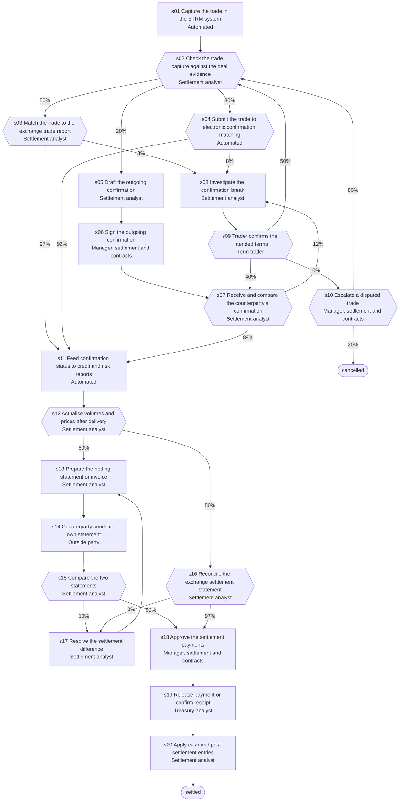

# Confirm and settle power and gas trades with counterparties

`gen-mkt-settle-trades` · electric power generation · energy marketing settlement · part of `power-generation-co`

When the trading desk sells future output or buys gas, the back office must confirm that the counterparty agrees every term of the trade and, after delivery, settle the money. Settlement analysts match each trade with the exchange report, an electronic confirmation service or a paper confirmation, chase the breaks with traders and counterparties, then after each delivery month prepare netting statements, compare them with the counterparty's, approve payments and post the entries. Unconfirmed or mis-booked trades create credit and accounting risk, and month-end bunches several hundred settlements into a few days.

| | |
|---|---|
| Unit of work | one trade |
| Starts when | A trade is booked in the ETRM system by a trader or arrives from the exchange trade feed. |
| Done when | The trade is confirmed and its first delivery month has been settled in cash and posted to the ledger, or it has been cancelled after a dispute. |
| Organisation | An Alberta merchant generator hedging about half of its capacity with forward power and gas trades, cleared on NGX or ICE or traded bilaterally under EEI, ISDA and GasEDI master agreements. (1,300 employees, 2019-2022) |
| Volume | 800 cases a month (range 400 to 1,500) |

## Where it sits

- Starts with **hedge_trade** from mkt-execute-hedges (80% of cases)
- Starts with **exchange_statement** from energy_exchange (15% of cases)
- Starts with **trade_confirmation** from trading_counterparties (5% of cases)
- Relies on **system_release** from it-change-release (a standing input; it does not start a case)
- Relies on **credit_limits** from fin-credit-collateral (a standing input; it does not start a case)
- Sends **counterparty_invoice** to trading_counterparties (outcome: settled)
- Sends **journal_entries** to fin-close-month (outcome: settled)
- Sends **credit_exposure** to fin-credit-collateral (outcome: any)
- Sends **payment_request** to fin-treasury (outcome: settled)

## Flow

## Roles

| Role | Department | Layer | FTE on this process | Loaded cost per hour | Evidence |
|---|---|---|---:|---:|---|
| Settlement analyst | Settlement and contract administration | individual contributor | 4 | 64 CAD | C |
| Manager, settlement and contracts | Settlement and contract administration | manager | 0.25 | 120 CAD | C |
| Term trader | Commercial and trading | senior specialist | 0.05 | 125 CAD | C |
| Treasury analyst | Treasury and tax | individual contributor | 0.1 | 74 CAD | C |

## Steps

Hands-on time and the wait before each step show the most common value. Evidence tier A is a sourced number, B a sourced description, C the author's estimate.

| Step | Who | Kind | Hands-on | Wait before | Control | Evidence |
|---|---|---|---:|---:|---|---|
| **s01 Capture the trade in the ETRM system.** The trader's deal, or the exchange trade feed, creates a trade record in the energy trading and risk management system, which assigns a deal number, checks mandatory fields and places the trade in the back-office confirmation queue. | Automated | system auto | 0 min | 0 min |  | C |
| **s02 Check the trade capture against the deal evidence.** A settlement analyst compares the ETRM record with the trader's ticket, broker recap or exchange trade report, checking counterparty, buy or sell, product, volume, price, delivery period, delivery point and master agreement, and sends booking errors back to the trader. | Settlement analyst | validation | 4 min | 4.0 h | Risk management policy: trade confirmation and settlement by a back office independent of the traders | C |
| **s03 Match the trade to the exchange trade report.** The analyst ties each exchange-cleared trade to the exchange's end-of-day trade and clearing report; a matched exchange trade needs no bilateral confirmation because the clearing house is the counterparty. | Settlement analyst | validation | 2 min | 10.0 h | Risk management policy: trade confirmation and settlement by a back office independent of the traders | C |
| **s04 Submit the trade to electronic confirmation matching.** The ETRM system sends the trade to ICE eConfirm, whose matching engine compares it with the counterparty's or broker's submission and returns a matched or unmatched status to the back office. | Automated | system auto | 0 min | 2.0 h |  | B [ice_econfirm] |
| **s05 Draft the outgoing confirmation.** The analyst generates a confirmation from the ETRM template under the governing master agreement (EEI, ISDA or GasEDI), adds any special terms such as shaped volumes, delivery points or option features, and checks it against the trade record. | Settlement analyst | drafting | 15 min | 4.0 h |  | C |
| **s06 Sign the outgoing confirmation.** The manager of settlement and contracts, as an authorised signatory, reviews non-standard terms on the confirmation, signs it and the analyst sends it to the counterparty by email. | Manager, settlement and contracts | approval | 5 min | 8.0 h | Delegation of authority and authorised signatory list for trading confirmations | C |
| **s07 Receive and compare the counterparty's confirmation.** The analyst waits for the counterparty to countersign or send its own confirmation, then compares every economic term with the ETRM record and the outgoing confirmation and records the confirmation as matched or disputed. | Settlement analyst | validation | 10 min | 2.0 d | Risk management policy: trade confirmation and settlement by a back office independent of the traders | C |
| **s08 Investigate the confirmation break.** The analyst compares the broker recap, chat or recorded line notes and both parties' records to find which term differs, and contacts the counterparty's or exchange's back office to compare records. | Settlement analyst | analysis | 40 min | 2.0 h |  | C |
| **s09 Trader confirms the intended terms.** The term trader who executed the deal states the agreed terms, checks the recorded line if needed, and amends the ETRM booking if the company's record is wrong or asks the counterparty's trader to have their side corrected. | Term trader | judgment | 15 min | 4.0 h |  | C |
| **s10 Escalate a disputed trade.** The manager reviews the evidence, including recorded calls and broker records, discusses the disputed terms with the counterparty's back-office manager and the trading director, and agrees an amendment, a settlement of the difference or cancellation. | Manager, settlement and contracts | judgment | 1.0 h | 3.0 d |  | C |
| **s11 Feed confirmation status to credit and risk reports.** The confirmed trade, with its mark-to-market exposure, flows from the ETRM system into the daily credit exposure and risk reports used by the credit and risk teams, and trades unconfirmed after the policy deadline appear on an ageing report. | Automated | system auto | 0 min | 0 min |  | B [ta_aif2021] |
| **s12 Actualise volumes and prices after delivery.** After the delivery month ends the analyst confirms delivered volumes (net settlement instructions in the AESO system for physical power, pipeline allocations for physical gas) and loads the final index prices used to settle financial trades. | Settlement analyst | lookup | 3 min | 21.0 d |  | B [aeso_settle_guide] |
| **s13 Prepare the netting statement or invoice.** The ETRM settlement module computes the amount due on each trade for the month; the analyst checks it, nets payables and receivables with each counterparty as the master agreement allows, and emails the statement or invoice by the agreed day early in the month. | Settlement analyst | drafting | 4 min | 3.0 d |  | C |
| **s14 Counterparty sends its own statement.** The counterparty's settlement desk sends its statement or invoice for the same month, which may arrive before or after the company's own and may net trades differently. | Outside party | external wait | 0 min | 2.0 d |  | C |
| **s15 Compare the two statements.** The analyst compares the counterparty's statement with the company's line by line on volume, price and amount, and either agrees it or lists the differences to resolve before the payment date. | Settlement analyst | validation | 5 min | 12.0 h |  | C |
| **s16 Reconcile the exchange settlement statement.** For exchange-cleared trades the analyst reconciles the exchange's monthly settlement statement with the ETRM settlement amounts, including fees and any physical delivery adjustments, and lists any differences. | Settlement analyst | validation | 2 min | 2.0 d |  | C |
| **s17 Resolve the settlement difference.** The analyst works the difference with the counterparty's or exchange's settlement staff, checking trade lists, index prices and delivered volumes, and agrees a corrected statement or an adjustment in the next month. | Settlement analyst | coordination | 30 min | 2.0 d |  | C |
| **s18 Approve the settlement payments.** The manager reviews the monthly payment and receipt list by counterparty, checks large or unusual amounts against the agreed statements, and approves the payment run sent to treasury. | Manager, settlement and contracts | approval | 1 min | 1.0 d | Payments policy: settlement approves amounts, treasury releases funds | C |
| **s19 Release payment or confirm receipt.** On the payment date set by the master agreement or the exchange, the treasury analyst releases wires for net payables and confirms that receivables arrived, chasing late payers through the credit team. | Treasury analyst | data entry | 1 min | 4.0 d |  | C |
| **s20 Apply cash and post settlement entries.** The analyst matches cash received and paid to open receivables and payables in the ERP, clears the realised trading amounts and uploads the journal entries for the month-end close. | Settlement analyst | data entry | 2 min | 1.0 d | Internal control over financial reporting (NI 52-109 and SOX 404): reconciliation of trading settlements to cash and ledger | C |

## Exceptions

| Exception | Share of cases | What happens |
|---|---:|---|
| Mis-booked trade | 3% | The company's ETRM booking differs from what was agreed; the trader amends it and the trade is rechecked and reconfirmed. |
| Disputed trade terms | 0% | Both sides believe different terms were agreed; managers resolve it from recordings and broker records, sometimes cancelling the trade. |
| Settlement statement difference | 5% | Counterparty statement differs on price, volume or trade list; the analyst resolves it and reissues the statement. |

## Benchmarks

| Metric | Value | Unit | Population | Evidence |
|---|---|---|---|---|
| cycle_time_days | p50 45, p90 110 | calendar days from trade capture to cash settlement of the first delivery month | Power and gas trades of an Alberta generator's hedging desk | C |
| electronic_match_share_within_minutes | 0.95 | share of trades submitted to ICE eConfirm | ICE eConfirm users (vendor claim) | A [ice_econfirm] |

## Pain points

- Paper confirmations wait days for counterparties to countersign, and unconfirmed trades sit on ageing reports that credit and audit follow up. (steps s05, s06, s07; B [ice_econfirm])
- Month-end concentrates hundreds of trade settlements into the first two weeks of the month, and statement differences must be worked out before the payment date. (steps s13, s15, s17; C)
- Physical power trades must agree with net settlement instructions in the AESO system, so a trade error shows up again in AESO settlement. (steps s12; B [aeso_settle_guide])

## Assumptions

- The unit of work is one trade followed to the settlement of its first delivery month; touch times at month-end steps are the trade's share of batch work.
- Interface shares assume most trades start from the company's own booking (hedging process); exchange-sourced and counterparty-first trades are smaller shares.
- Credit exposure is produced for every trade, so that interface uses outcome 'any'; the payment request to treasury is added beyond the organisation file's links.
- Payment dates come from master agreements and exchange rules that were not opened; the 20th-of-month practice is tier C.
- No physical resources, travel or field wait causes apply to this office process.

## Sources

- [aeso_settle_guide] [Information Document: Power Pool Settlement Guide, ID #2011-002R](https://www.aeso.ca/assets/downloads/ID-2011-002R-Power-Pool-Settlement-Guide4.pdf) (Alberta Electric System Operator, 2017). Preliminary power pool statements by the end of the 5th business day after the settlement period and final statements by the 15th; payments based on final statements and settled by wire on the 20th business day; statement line items (energy payment, trading charge, PSM, TCR, dispatch down service, prior period adjustments, participation fee, interest); verification reports in the Energy Trading System (metered volumes updated 5 business days after production, NSI reports, settlement changes, PFAM summary); generator discrepancies go to the meter data manager, other queries to settlement@aeso.ca; each production month settled at 1 month (initial), 2 months (interim) and 4 months (final); written disputes on final statements under section 103.2; final amount must be paid in full despite a dispute.
- [ice_econfirm] [ICE eConfirm fact sheet](https://www.ice.com/publicdocs/data/ICE_eConfirm_Fact_Sheet.pdf) (Intercontinental Exchange, 2015). Electronic matching of energy trade confirmations for physical and financial trades on and off exchange, including voice-brokered and bilateral trades; 95 percent of submitted trades matched within minutes; input by web form, file upload or XML API; users review confirmed trades and resolve discrepancies; manual paper confirmation is the alternative.
- [ta_aif2021] [TransAlta Corporation Annual Information Form for the year ended December 31, 2021 (Exhibit 13.1 to Form 40-F)](https://www.sec.gov/Archives/edgar/data/1144800/000114480022000004/a20211231tacex131aif.htm) (TransAlta Corporation via U.S. SEC EDGAR, 2022). Energy Marketing negotiates contracts with customers for the output of the generation assets and trades power, gas and environmental products; about 50 percent of capacity contracted in 2022 and 2023 and uncontracted merchant positions regularly hedged; Dow contract extension with a 10-year initial term from January 1, 2020; 18-year 100 MW renewable PPA with Pembina for Garden Plain and the remaining 30 MW marketed to commercial and industrial customers; counterparty credit limits monitored and collateral required above credit limits.

Written by claude-opus on 2026-11-24.
