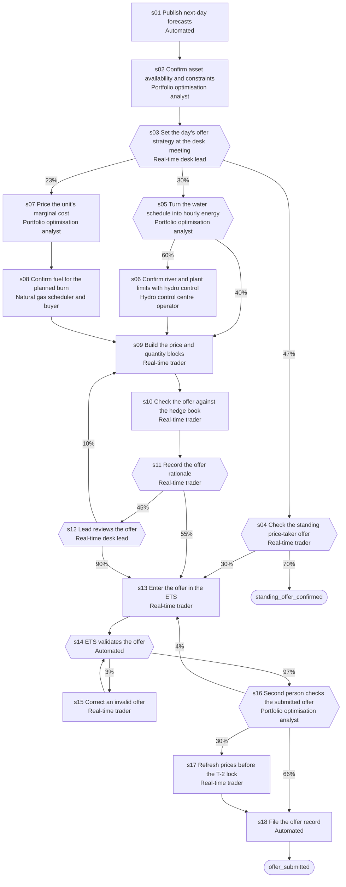

# Prepare and submit daily energy offers to the AESO

`gen-mkt-submit-energy-offers` · electric power generation · energy marketing and trading · part of `power-generation-co`

Every source asset of 5 MW or more must offer its output to the Alberta power pool for every hour, so each morning the real-time desk prepares the next day's offers for about thirty assets and enters them in the AESO Energy Trading System before 12:00. Wind farms and cogeneration sites roll forward standing offers at 0 CAD/MWh, while hydro and converted gas units are priced from water value or marginal cost, checked against the hedge book, reviewed by the desk lead and checked by a second person. The work is squeezed into a few morning hours, depends on late plant and fuel information, and a keyed error can sell a unit far below cost or strand it, so every offer and its rationale is recorded for the market surveillance administrator.

| | |
|---|---|
| Unit of work | one asset-day of offers |
| Starts when | The next-day forecasts are published and the desk starts the daily offer cycle ahead of the 12:00 deadline for the following delivery day. |
| Done when | A valid offer for every hour of the delivery day is in the ETS (or the standing submission is confirmed), any price changes were made before T-2, and the offer and its rationale are filed. |
| Organisation | An Alberta merchant generator with converted gas units, partner unit shares, cogeneration, reservoir hydro, wind farms and a small battery, offered by a central 24-hour real-time desk. (1,300 employees, 2019-2022) |
| Volume | 880 cases a month (range 780 to 960) |

## Where it sits

- Starts with **generation_forecast** from mkt-forecast-generation (70% of cases)
- Starts with **water_schedule** from hyd-plan-water-schedule (30% of cases)
- Relies on **iso_rules** from aeso (a standing input; it does not start a case)
- Relies on **price_forecast** from mkt-market-analysis (a standing input; it does not start a case)
- Relies on **fuel_cost_estimate** from mkt-procure-gas (a standing input; it does not start a case)
- Relies on **capability_declaration** from eng-performance-testing (a standing input; it does not start a case)
- Relies on **compliance_guidance** from hse-market-compliance (a standing input; it does not start a case)
- Relies on **ancillary_award** from mkt-offer-ancillary (a standing input; it does not start a case)
- Sends **energy_offer** to aeso (outcome: offer_submitted)
- Sends **offer_record** to hse-market-compliance (outcome: any)
- Sends **offer_record** to mkt-settle-aeso (outcome: any)

## Flow

## Roles

| Role | Department | Layer | FTE on this process | Loaded cost per hour | Evidence |
|---|---|---|---:|---:|---|
| Real-time trader | Real-time desk | individual contributor | 2 | 90 CAD | C |
| Portfolio optimisation analyst | Real-time desk | senior specialist | 1.6 | 100 CAD | C |
| Real-time desk lead | Real-time desk | supervisor | 0.25 | 120 CAD | C |
| Hydro control centre operator | Hydro control centre | individual contributor | 0.05 | 68 CAD | C |
| Natural gas scheduler and buyer | Commercial and trading | individual contributor | 0.1 | 80 CAD | C |

## Steps

Hands-on time and the wait before each step show the most common value. Evidence tier A is a sourced number, B a sourced description, C the author's estimate.

| Step | Who | Kind | Hands-on | Wait before | Control | Evidence |
|---|---|---|---:|---:|---|---|
| **s01 Publish next-day forecasts.** Overnight runs of the forecasting models publish the next-day hourly availability, wind, inflow and pool price forecasts to the desk's shared workbook and the ETRM, giving every asset a starting position for the offer day. | Automated | system auto | 0 min | 0 min |  | C |
| **s02 Confirm asset availability and constraints.** The portfolio optimisation analyst opens the outage schedule, the plant status notes and the latest capability declaration for the asset and confirms next-day maximum capability, known derates, ramp rate, minimum stable generation and initial start-up time. | Portfolio optimisation analyst | lookup | 3 min | 45 min |  | B [iso2031], [id2012008] |
| **s03 Set the day's offer strategy at the desk meeting.** The real-time desk lead runs the morning meeting where traders and analysts review the supply cushion, intertie and outage reports, gas price and hedge position, and agree the broad price strategy for each group of assets. The time shown is this asset's share of the meeting. | Real-time desk lead | coordination | 2 min | 30 min |  | C |
| **s04 Check the standing price-taker offer.** The real-time trader opens the standing submission for the wind farm or net-to-grid cogeneration asset, which offers its output at 0 CAD/MWh, and checks whether the available capability needs changing for turbines or host-plant demand known for tomorrow. | Real-time trader | validation | 3 min | 30 min |  | B [iso2031], [id2012008] |
| **s05 Turn the water schedule into hourly energy.** The portfolio optimisation analyst reads the weekly water schedule for the river system, the reservoir levels and the minimum flow limits, and spreads tomorrow's release volume across the hours with the highest expected prices, giving MW by hour and a water value per MWh. | Portfolio optimisation analyst | analysis | 10 min | 15 min |  | C |
| **s06 Confirm river and plant limits with hydro control.** The hydro control centre operator answers the analyst's call or email, confirming unit availability, ice or debris problems, licence minimum and maximum flows and any downstream requests for the next day, so the hourly plan can be offered as built or adjusted. | Hydro control centre operator | coordination | 4 min | 30 min |  | C |
| **s07 Price the unit's marginal cost.** The analyst calculates the marginal cost of each output range of the converted gas unit or partner share from the heat rate curve, the next-day gas price, transport and the carbon cost above the TIER benchmark, plus start-up costs; for the battery the analyst plans charge and discharge hours from the price shape. | Portfolio optimisation analyst | analysis | 10 min | 15 min |  | C |
| **s08 Confirm fuel for the planned burn.** The natural gas scheduler checks the next-day gas nomination against the expected burn implied by the draft offer and confirms with the trader that the pipeline nomination and gas purchases cover the unit if it is dispatched. | Natural gas scheduler and buyer | communication | 3 min | 30 min |  | C |
| **s09 Build the price and quantity blocks.** The real-time trader sets up to seven operating blocks for each hour, choosing MW, price between 0 and 999.99 CAD/MWh and the flexible or inflexible flag, so that the top block equals maximum capability and minimum stable generation sits in the lowest block. | Real-time trader | judgment | 8 min | 20 min |  | B [iso2031], [id2012008], [msaew2020] |
| **s10 Check the offer against the hedge book.** The trader compares the offered volumes in each hour with forward sales, customer contract obligations and the fuel position in the ETRM, so the offer does not leave the company short of power it has already sold at a fixed price. | Real-time trader | lookup | 3 min | 2 min |  | C |
| **s11 Record the offer rationale.** The trader writes the inputs and reasons behind the offer (cost basis, water value, price view, outage information used) in the desk offer log, keeping only public or own-company information so the record can be produced if the MSA asks. | Real-time trader | drafting | 2 min | 1 min | Company market conduct policy under the Fair, Efficient and Open Competition Regulation (records of offer rationale and use of non-public information) | B [msaew2020], [erq2015] |
| **s12 Lead reviews the offer.** The real-time desk lead compares the draft blocks with the agreed strategy, the marginal cost sheet and the previous day's offer, and either approves it or sends it back with a change to price levels or block sizes. | Real-time desk lead | review | 4 min | 30 min | Trading authority and risk policy: desk lead sign-off on offers for major assets | C |
| **s13 Enter the offer in the ETS.** The trader enters or uploads the hourly blocks, available capability, minimum stable generation, ramp rate and initial start-up time for the asset in the AESO Energy Trading System before 12:00 on the day before delivery, or edits the standing submission. | Real-time trader | data entry | 4 min | 10 min | ISO Rules section 203.1 (offer deadline 12:00 the day before, offer content, available capability, operating constraints) | A [iso2031] |
| **s14 ETS validates the offer.** The Energy Trading System acknowledges receipt and checks the offer against the rule, for example that the top block equals maximum capability and minimum stable generation does not exceed the lowest block, and returns a valid or invalid notice with a reason. | Automated | system auto | 0 min | 1 min |  | A [iso2031] |
| **s15 Correct an invalid offer.** The trader reads the ETS rejection reason, corrects the blocks, capability or minimum stable generation that broke the rule and resubmits, watching the clock because an asset without a valid offer by noon falls back to its standing submission. | Real-time trader | data entry | 5 min | 3 min | ISO Rules section 203.1 (offer deadline 12:00 the day before, offer content, available capability, operating constraints) | B [iso2031] |
| **s16 Second person checks the submitted offer.** Another analyst pulls the ETS offer report for the asset and compares each hour's blocks, prices and capability with the approved offer sheet, looking for keyed errors that could sell output far below cost or strand the unit. | Portfolio optimisation analyst | review | 3 min | 20 min | Desk procedure: four-eyes check of submitted offers against the approved sheet | C |
| **s17 Refresh prices before the T-2 lock.** On the delivery day the trader revisits the offer as the pool price forecast, gas price or competitors' outages change, and submits price or MW restatements in the ETS for hours that are more than two hours away, after which the prices are locked. | Real-time trader | judgment | 8 min | 18.0 h | ISO Rules section 203.3 s.3 and s.4(1): price and MW restatements only before two hours ahead of the settlement interval | A [iso2033], [id2012009] |
| **s18 File the offer record.** The final offer for the asset-day, with the rationale and any restatements, is saved to the offer archive and copied to the settlement shadow records so settlement analysts and compliance can reconstruct what was offered in every hour. | Automated | system auto | 0 min | 5 min | Record retention for MSA information requests and AESO settlement checks | B [nsp2021112] |

## Exceptions

| Exception | Share of cases | What happens |
|---|---:|---|
| Invalid offer rejected by the ETS | 3% | The ETS returns an invalid notice (for example the top block does not equal maximum capability) and the trader must correct and resubmit before noon. |
| Lead sends the offer back | 4% | On a major asset the desk lead changes the price levels or block sizes and the trader rebuilds the offer. |
| Keyed error found in the second check | 4% | The four-eyes check finds a price or MW keyed into the wrong hour and the trader re-enters the offer before the deadline. |
| Delivery-day price refresh | 30% | Prices or volumes are restated before T-2 on the delivery day after the price view changes. |

## Benchmarks

| Metric | Value | Unit | Population | Evidence |
|---|---|---|---|---|
| cycle_time_days | p50 0.15, p90 0.9 | calendar days from forecast publication to the filed offer | Asset-day offers of an Alberta generator, 2019-2022 | B [iso2031], [iso2033] |
| operating_blocks_per_offer_max | 7 | blocks | AESO energy offers | A [id2012008] |
| offer_price_range | low 0, high 999.99 | CAD/MWh | AESO energy offers for non-import source assets, 2019-2022 | A [iso2031] |

## Pain points

- Everything for about thirty assets must be finished before 12:00, so late derates, fuel news or ancillary awards (which close around 10:00) arrive just as offers are being keyed. (steps s02, s09, s13; B [iso2031], [msa2009or])
- Offers are built in spreadsheets and re-keyed into the ETS, so keyed price or MW errors need a second-person check. (steps s09, s13, s16; C)
- Offer rationale must be recorded every day because offer and outage behaviour has been the subject of MSA enforcement, including the 2015 case against the company modelled here. (steps s11; B [erq2015], [msaew2020])

## Assumptions

- One case is one asset-day. The case mix (47 percent price-taking wind and cogeneration, 30 percent hydro, 23 percent converted gas units, partner shares and battery) follows the asset counts in the organisation file.
- Wind and net-to-grid cogeneration offers are standing submissions at 0 CAD/MWh; 70 percent roll forward without any change on a given day (estimate).
- Times are estimates from general knowledge of Alberta trading desks in 2019-2022; no published time study of offer preparation was found.
- The cycle starts when forecasts are published (about 06:00 on the day before delivery). The simulated median of about 0.2 days (about 5 hours) is a little longer than the 0.15-day benchmark because the simulation adds each queue wait in turn, while in practice the desk works the assets in parallel through the morning and must finish by noon; the gap is within the uncertainty of an estimated benchmark.
- Offers are prepared on the day before delivery. On Fridays some desks prepare weekend offers in one batch; that is not modelled separately because each asset-day still passes through the same steps.
- The step resources field is not used: preparing an offer does not occupy a plant. The organisation file lists converted_gas_unit, hydro_plant and wind_farm as resources of this process; they are the assets offered, not resources held by the work.
- Loaded costs come from the organisation file (wage x 1.40).

## Sources

- [iso2031] [ISO Rules Section 203.1, Offers and Bids for Energy (effective 2013-12-20)](https://www.aeso.ca/assets/documents/Section-203.1-Offers-and-Bids-for-Energy.pdf) (Alberta Electric System Operator, 2013). Offers due before 12:00 on the day before the delivery day and no earlier than 7 days before; offer for every settlement interval for source assets of 5 MW or more; prices of at least 0 and under 1,000 CAD/MWh; block MW, flexible or inflexible flag and minimum stable generation; top block equals maximum capability; available capability equal to maximum capability unless an acceptable operational reason is given; ramp rate and initial start-up time; standing submissions; ETS acknowledgement and valid or invalid notice.
- [id2012008] [Information Document 2012-008R, Energy Offers and Bids (posted 2017-04-04)](https://www.aeso.ca/assets/Uploads/2012-008R-Energy-Offers-and-Bids-2017-04-04.pdf) (Alberta Electric System Operator, 2017). Offers have up to seven operating blocks; inflexible blocks dispatched only in full; net-to-grid offers for sites with on-site load; AESO expects operating constraints such as ramp rate to be updated within 15 minutes of becoming aware of a change; constraints are used to judge compliance.
- [iso2033] [ISO Rules Section 203.3, Energy Restatements (effective 2014-07-02)](https://www.aeso.ca/assets/documents/Section-203-3-Energy-Restatements-July-2-2014.pdf) (Alberta Electric System Operator, 2014). Available capability restatements only for an acceptable operational reason, an operational deviation or testing, submitted as soon as reasonably practicable with reasons; price and MW restatements allowed only before two hours ahead of the settlement interval (T-2); MW restatements within T-2 require reasons; minimum stable generation restatements. In force through the 2019-2022 period (replaced 2024-04-01).
- [id2012009] [Information Document 2012-009R, Restatements (posted 2017-05-11)](https://www.aeso.ca/assets/Uploads/2012-009R-Restatements-2017-05-11.pdf) (Alberta Electric System Operator, 2017). How the Energy Trading System removes the highest priced blocks from the merit order when available capability is restated down and restores the lowest priced blocks first when restated up; price restatements need no operational reason but must be made before T-2 (for HE12, before 9:00); MW restatements keep block prices.
- [msa2009or] [Operating Reserves Procurement: Understanding Market Outcomes (2009-09-16)](https://resources.albertamsa.ca/assets/Documents/Operating-Reserves-Procurement-Understanding-Market-Outcomes-2009-09-16.pdf) (Market Surveillance Administrator (Alberta), 2009). Watt-Ex day-ahead trading from 9:00 with closes at 9:40 (active regulating), 9:50 (spinning), 10:00 (supplemental), 10:10 to 10:30 (standby products), with over-the-counter trades after close; typical procured volumes (about 110 to 165 MW regulating, 170 to 260 MW spinning and supplemental); standby suppliers have fifteen minutes to get into position.
- [msaew2020] [MSA Enforcement Statement: Economic Withholding (June 29, 2020)](https://www.albertamsa.ca/assets/Documents/MSA-Enforcement-statement-related-to-economic-withholding.pdf) (Market Surveillance Administrator (Alberta), 2020). Offering available capacity above short-run marginal and opportunity cost is not in itself a contravention; the MSA will act only when it is combined with conduct contrary to the Fair, Efficient and Open Competition Regulation.
- [erq2015] [Market Manipulation in Alberta: TransAlta Pays $56 Million (case comment)](https://energyregulationquarterly.ca/case-comments/market-manipulation-in-alberta-transalta-pays-56-million) (Energy Regulation Quarterly, 2015). The AUC found that outages at Sundance and Keephills units in late 2010 and early 2011 were timed on market conditions; one trader used non-public information; consent order of about 56 million CAD; the AUC suggested an independent review of compliance policies.
- [nsp2021112] [Notice of Specified Penalty, MSA file 2021-112 (section 203.3, available capability not restated after a trip)](https://www.albertamsa.ca/assets/Documents/NSP-2021-112.pdf) (Market Surveillance Administrator (Alberta), 2021). A trip on February 16, 2021 left available capability unrestated for HE12 to HE14; self-reported on March 11, 2021; 750 CAD penalty for a first contravention in 12 months; the MSA relies on AESO available capability, dispatch, generation and offer data.

Written by claude-opus on 2026-11-24.
