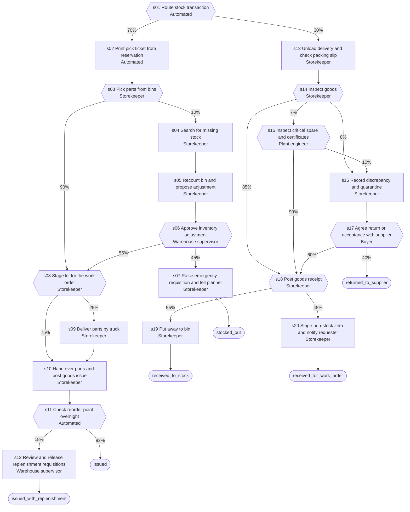

# Manage warehouses and spare parts

`gen-scm-manage-stores` · electric power generation · supply chain (warehousing) · part of `power-generation-co`

The warehouses hold the spare parts and consumables that maintenance needs, including expensive critical spares for the generating units. Storekeepers pick and issue parts against work order reservations, deliver kits to plants and remote sites, receive and inspect supplier deliveries, post receipts so invoices can be paid, and put stock away. The work is slowed and made error-prone by stock records that do not match the bins, which turn picks into searches and stock-outs into emergency purchases, by deliveries that are short or damaged, and by long drives to hydro and wind sites.

| | |
|---|---|
| Unit of work | one stock issue or receipt |
| Starts when | A work order reservation is released for issue, or a supplier delivery arrives at the warehouse. |
| Done when | Parts are issued and posted to the work order, or received, posted and put away or staged, or returned to the supplier, or a stock-out is passed to purchasing. |
| Organisation | An Alberta generator's central supply chain group running warehouses at the Wabamun-area plants and the mine, with satellite stores for hydro and wind, on an ERP inventory module with paper pick tickets. (1,300 employees, 2019-2022) |
| Volume | 3,500 cases a month (range 2,500 to 5,500) |

## Where it sits

- Starts with **material_request** from gas-routine-maintenance (30% of cases)
- Starts with **material_request** from etr-mine-coal (22% of cases)
- Starts with **material_request** from hyd-maintain-plants (10% of cases)
- Starts with **material_request** from wnd-troubleshoot-turbines (8% of cases)
- Starts with **delivered_goods** from material_suppliers (30% of cases)
- Relies on **purchase_order** from scm-purchase-materials (a standing input; it does not start a case)
- Sends **issued_parts** to gas-routine-maintenance (outcome: issued)
- Sends **issued_parts** to hyd-maintain-plants (outcome: issued)
- Sends **issued_parts** to wnd-troubleshoot-turbines (outcome: issued)
- Sends **issued_parts** to etr-mine-coal (outcome: issued)
- Sends **material_request** to scm-purchase-materials (outcome: issued_with_replenishment)
- Sends **material_request** to scm-purchase-materials (outcome: stocked_out)
- Sends **goods_receipt** to fin-pay-suppliers (outcome: received_to_stock)
- Sends **goods_receipt** to fin-pay-suppliers (outcome: received_for_work_order)

## Flow

## Roles

| Role | Department | Layer | FTE on this process | Loaded cost per hour | Evidence |
|---|---|---|---:|---:|---|
| Storekeeper | Warehouses | individual contributor | 21 | 46 CAD | C |
| Warehouse supervisor | Warehouses | supervisor | 0.5 | 66 CAD | C |
| Buyer | Procurement | individual contributor | 0.4 | 62 CAD | C |
| Plant engineer | Thermal technical services | senior specialist | 0.4 | 92 CAD | C |

## Steps

Hands-on time and the wait before each step show the most common value. Evidence tier A is a sourced number, B a sourced description, C the author's estimate.

| Step | Who | Kind | Hands-on | Wait before | Control | Evidence |
|---|---|---|---:|---:|---|---|
| **s01 Route stock transaction.** The case is either a reservation released from a work order, which needs parts issued, or a supplier delivery arriving at the warehouse dock, which needs receiving. This step only routes the case. | Automated | system auto | 0 min | 0 min |  | C |
| **s02 Print pick ticket from reservation.** Released reservations for the next day's scheduled work print as pick tickets in the warehouse overnight; break-in requests are printed when the craftsperson arrives at the counter. | Automated | system auto | 0 min | 4.0 h |  | C |
| **s03 Pick parts from bins.** The storekeeper walks the pick ticket through the warehouse, takes each item from its bin location, checks the part number and quantity against the ticket, and notes any bin that is empty or short. | Storekeeper | physical | 10 min | 2.0 h |  | B [rweb_store] |
| **s04 Search for missing stock.** The storekeeper checks alternate bin locations, open receipts not yet put away, the quarantine area and recent issue history in the ERP to find the missing item or explain the difference. | Storekeeper | lookup | 20 min | 0 min |  | B [reliamag_mro] |
| **s05 Recount bin and propose adjustment.** The storekeeper counts the bin and any alternate locations, compares the count with the ERP quantity, and enters a count document with the proposed adjustment and a reason. | Storekeeper | validation | 15 min | 0 min |  | C |
| **s06 Approve inventory adjustment.** The warehouse supervisor reviews the count document and the reason, approves adjustments within limits or escalates large write-offs to finance, and decides whether the part was found or is out of stock. | Warehouse supervisor | approval | 4 min | 8.0 h | Internal control over financial reporting: independent approval of inventory adjustments | C |
| **s07 Raise emergency requisition and tell planner.** The storekeeper creates a purchase requisition for the stock-out marked urgent and emails or phones the planner so the work order can be rescheduled or a substitute found. | Storekeeper | communication | 10 min | 30 min |  | B [rweb_store] |
| **s08 Stage kit for the work order.** The storekeeper bags and tags the parts with the work order number and places them in the staging area for the crew, or in the delivery cage for remote sites. | Storekeeper | physical | 6 min | 1.0 h |  | C |
| **s09 Deliver parts by truck.** On the daily run the storekeeper drives a service truck from the central warehouse to plants, hydro stations, wind sites or the mine, drops kits at the site laydown or stores cage and collects returns. | Storekeeper | travel | 45 min | 8.0 h |  | C |
| **s10 Hand over parts and post goods issue.** The storekeeper gets the receiver's signature or name, posts the goods issue against the work order in the ERP, and files the signed pick ticket. | Storekeeper | data entry | 5 min | 30 min |  | B [reliamag_mro] |
| **s11 Check reorder point overnight.** The nightly materials planning run compares stock on hand plus open orders with each item's reorder point and creates replenishment requisitions for items that fall below it. | Automated | system auto | 0 min | 12.0 h |  | C |
| **s12 Review and release replenishment requisitions.** The warehouse supervisor reviews the requisitions the run created, checks unusual quantities and items with no recent use, adjusts or deletes them, and releases the rest to purchasing. | Warehouse supervisor | review | 4 min | 1.0 d |  | B [reliamag_mro] |
| **s13 Unload delivery and check packing slip.** The storekeeper signs the carrier's bill of lading, unloads with a forklift, and matches the packing slip to the open purchase order in the ERP by PO number, item and quantity. | Storekeeper | intake | 10 min | 1.0 h |  | C |
| **s14 Inspect goods.** The storekeeper opens the packaging, checks part numbers, quantity and visible damage, and flags items marked as critical spares or pressure parts that need technical inspection or material certificates. | Storekeeper | validation | 8 min | 0 min |  | C |
| **s15 Inspect critical spare and certificates.** A plant engineer checks the critical spare against the drawing or specification and reviews material test reports and certificates for pressure-retaining parts before the item can be accepted into stock. | Plant engineer | validation | 30 min | 2.0 d | Company quality procedure for critical spares and pressure-retaining parts | C |
| **s16 Record discrepancy and quarantine.** The storekeeper photographs the problem, moves the goods to the quarantine area, notes the discrepancy on the PO and emails the buyer with the details. | Storekeeper | communication | 20 min | 30 min |  | C |
| **s17 Agree return or acceptance with supplier.** The buyer contacts the supplier and agrees either a return for replacement or credit, or acceptance of a partial or slightly different item with a price adjustment, and tells stores what to do. | Buyer | communication | 20 min | 1.0 d |  | C |
| **s18 Post goods receipt.** The storekeeper posts the goods receipt against the PO in the ERP for the accepted quantity, which updates stock or the work order and lets accounts payable match the invoice. | Storekeeper | data entry | 6 min | 1.0 h | Receiving recorded by stores, independent of the buyer who placed the order | C |
| **s19 Put away to bin.** The storekeeper labels the item, puts it in its bin location, and updates the bin if it is a new item. Bulky or preserved spares, such as motors and shafts, go to the yard or a heated building. | Storekeeper | physical | 8 min | 12.0 h |  | C |
| **s20 Stage non-stock item and notify requester.** The storekeeper tags the direct-charge item with the work order number, places it in the staging area and emails the planner or requester that it has arrived. | Storekeeper | communication | 6 min | 1.0 h |  | C |

## Exceptions

| Exception | Share of cases | What happens |
|---|---:|---|
| Short pick | 7% | The bin does not hold what the record says; the storekeeper searches, recounts and gets the adjustment approved. |
| Stock-out | 3% | The part is not in stock and an urgent requisition goes to purchasing. |
| Delivery to a remote site | 16% | Kits are driven to plants, hydro stations, wind sites or the mine on the daily run. |
| Receiving discrepancy | 3% | Short, damaged or wrong goods are quarantined and the buyer agrees a return or credit. |
| Critical spare inspection | 2% | A plant engineer checks the item and certificates before acceptance. |

## Benchmarks

| Metric | Value | Unit | Population | Evidence |
|---|---|---|---|---|
| cycle_time_days | p50 1, p90 4 | calendar days from reservation release or delivery arrival to issue posted or stock put away | MRO stores at a generator, 2019-2022 | C |
| inventory_record_accuracy_target | low 0.95, high 0.98 | share of stock records matching the bin count | Practitioner targets | B [reliamag_mro] |
| planned_work_orders_filled_from_stores | low 0.5, high 0.7 | share of planned work orders | Typical MRO storerooms (practitioner article) | B [rweb_store] |

## Pain points

- Stock records drift from the bins because issues are not posted, are posted to the wrong work order or parts are put in the wrong bin, so picks turn into searches. (steps s03, s04, s05, s10, s19; B [reliamag_mro], [rweb_store])
- A stock-out found at the pick stops the work order and becomes an emergency purchase. (steps s06, s07; B [rweb_store])
- Remote hydro and wind sites depend on a daily truck run, so a missed kit costs a day. (steps s09; C)
- Critical spares wait days for an engineer's inspection before they can be accepted. (steps s15; C)

## Assumptions

- One case is one pick ticket or one delivery, not one line; a ticket averages several lines.
- Cycle counting, preservation of stored critical spares (shaft rotation, desiccant changes), returns and obsolete stock disposal are routine work outside the case flow; they are part of the storekeepers' time not assigned to this process.
- The plant engineer and buyer take part in this process although the organisation file lists only storekeepers and the warehouse supervisor.
- Service trucks are the organisation file's shared fleet; the stores share is the daily delivery run.
- Issue shares by source assume mine stores were still active, as they were for most of the reference period.

## Sources

- [rweb_store] [Reliability vs the capricious MRO storeroom](https://reliabilityweb.com/articles/entry/reliability_vs_the_capricious_mro_storeroom) (Reliabilityweb, None). Undated practitioner article on typical MRO storerooms: fill rates of stocked SKUs under 80 percent (out of stock 20 percent of the time); only 50 to 70 percent of planned work orders are filled from stores and 30 to 50 percent cause reactive, emergency purchases; inaccurate inventory quantities disrupt reservations; planners, purchasing and engineers stop their work to chase parts.
- [reliamag_mro] [MRO and spare parts inventory statistics: stockouts, accuracy, costs](https://reliamag.com/guides/mro-spare-parts-inventory-statistics/) (Reliable Media (reliamag.com), None). Undated review. Practitioners commonly target 95 to 98 percent inventory record accuracy (a management target, not a measured average); no large-scale audit of MRO storeroom record accuracy was found; vendor research puts duplicate purchases at 5 to 7 percent of spend; a 2025 vendor survey found 22 percent of MRO inventory unused for more than five years and about 66 percent of manufacturers managing MRO in the ERP alone.
- [aif2021] [TransAlta Corporation Annual Information Form for the year ended December 31, 2021 (Exhibit 13.1 to Form 40-F)](https://www.sec.gov/Archives/edgar/data/1144800/000114480022000004/a20211231tacex131aif.htm) (TransAlta Corporation via U.S. SEC EDGAR, 2022). Forward-looking risk list names disruptions to supply chains, including the ability to secure necessary equipment, and equipment failure and the ability to complete repairs cost-effectively; the partner (Heartland) operates and maintains the Sheerness units; Sundance 4 stopped firing coal from January 1, 2022; Highvale mining ended at the end of 2021; many employees have more than 20 years of service.

Written by claude-opus on 2026-11-24.
