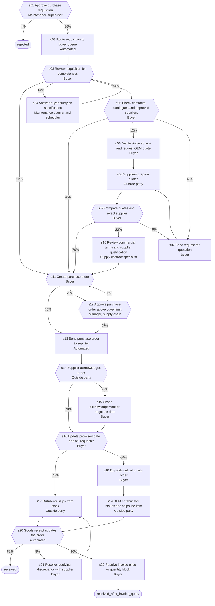

# Purchase materials and services

`gen-scm-purchase-materials` · electric power generation · supply chain (procurement) · part of `power-generation-co`

Purchasing turns approved requisitions from maintenance, stores replenishment, outages and projects into purchase orders and follows them until the goods arrive. A budget holder approves the requisition, a buyer checks it, releases it against a contract or gets quotes, creates the PO and has it approved when it is above the buyer's limit, then chases the supplier's confirmation and expedites critical items until stores receive them. Delays come from unclear specifications, slow approvers, suppliers that take days to quote, single-source OEM parts with long lead times, and price or quantity mismatches that block the invoice.

| | |
|---|---|
| Unit of work | one purchase order |
| Starts when | A purchase requisition is submitted in the ERP by a planner, storekeeper, engineer or project manager. |
| Done when | The goods or services are received against the PO and the invoice can be matched, or the requisition is rejected. |
| Organisation | A central procurement team of about 20 serving an Alberta generator's gas, hydro, wind, mine and project groups from one ERP, with buyers organised by material group. (1,300 employees, 2019-2022) |
| Volume | 750 cases a month (range 500 to 1,200) |

## Where it sits

- Starts with **material_request** from gas-routine-maintenance (28% of cases)
- Starts with **material_request** from scm-manage-stores (25% of cases)
- Starts with **material_request** from eng-manage-capital-projects (12% of cases)
- Starts with **material_request** from eng-plan-major-outages (10% of cases)
- Starts with **material_request** from hyd-maintain-plants (8% of cases)
- Starts with **material_request** from wnd-troubleshoot-turbines (6% of cases)
- Starts with **material_request** from etr-convert-coal-units (8% of cases)
- Starts with **material_request** from wnd-main-component-exchange (3% of cases)
- Sends **purchase_order** to material_suppliers (outcome: received)
- Sends **purchase_order** to material_suppliers (outcome: received_after_invoice_query)
- Sends **purchase_order** to scm-manage-stores (outcome: received)
- Sends **purchase_order** to scm-manage-stores (outcome: received_after_invoice_query)
- Sends **purchase_order** to fin-pay-suppliers (outcome: received)
- Sends **purchase_order** to fin-pay-suppliers (outcome: received_after_invoice_query)

## Flow

## Roles

| Role | Department | Layer | FTE on this process | Loaded cost per hour | Evidence |
|---|---|---|---:|---:|---|
| Buyer | Procurement | individual contributor | 10.5 | 62 CAD | C |
| Supply contract specialist | Procurement | senior specialist | 1 | 76 CAD | C |
| Manager, supply chain | Supply chain | manager | 0.2 | 135 CAD | C |
| Maintenance supervisor | Wabamun-area converted units | supervisor | 0.4 | 95 CAD | C |
| Maintenance planner and scheduler | Thermal technical services | individual contributor | 0.3 | 66 CAD | C |

## Steps

Hands-on time and the wait before each step show the most common value. Evidence tier A is a sourced number, B a sourced description, C the author's estimate.

| Step | Who | Kind | Hands-on | Wait before | Control | Evidence |
|---|---|---|---:|---:|---|---|
| **s01 Approve purchase requisition.** The budget holder for the requesting area, most often a maintenance supervisor, gets an ERP workflow email, opens the requisition, checks that the work is needed and charged to the right work order or cost centre, and approves or rejects it within their spending limit. | Maintenance supervisor | approval | 3 min | 1.0 d | Corporate delegation of authority: spending limits by role and value | C |
| **s02 Route requisition to buyer queue.** The ERP assigns the approved requisition to a purchasing group by material group and plant, and it appears in that buyer's open requisition list overnight or at once, depending on the release setting. | Automated | system auto | 0 min | 0 min |  | C |
| **s03 Review requisition for completeness.** The buyer opens the requisition and checks the description, OEM part number, quantity, required date, delivery point and account. Unclear items go back to the requester; urgent breakdown items are bought at once by phone. | Buyer | validation | 10 min | 1.0 d |  | C |
| **s04 Answer buyer query on specification.** The planner or engineer who raised the requisition looks up the OEM manual, nameplate photo or drawing, corrects the part number or description, and replies to the buyer by email or by editing the requisition. | Maintenance planner and scheduler | communication | 15 min | 1.0 d |  | C |
| **s05 Check contracts, catalogues and approved suppliers.** The buyer searches the ERP for outline agreements and info records, the contract repository for master supply or service agreements, and the approved supplier list, to decide whether the item can be released against a contract, must go to the OEM, or needs quotes. | Buyer | lookup | 10 min | 1.0 h |  | B [reliamag_mro] |
| **s06 Justify single source and request OEM quote.** For proprietary turbine, boiler or control system parts, the buyer writes a short single-source justification, attaches it to the requisition and emails the OEM or its authorised distributor for price and lead time. | Buyer | drafting | 30 min | 1.0 h | Procurement policy: written justification for single-source purchases above the quote threshold | C |
| **s07 Send request for quotation.** The buyer picks two or three suppliers from the approved list and emails a request for quotation with the specification, quantity, required date and terms, or issues it from the ERP. | Buyer | drafting | 25 min | 4.0 h |  | C |
| **s08 Suppliers prepare quotes.** Suppliers price the request and reply by email; the buyer waits for the quote deadline, chasing slow responders. Western Canadian distributors usually answer in days, OEMs in weeks. | Outside party | external wait | 0 min | 5.0 d |  | C |
| **s09 Compare quotes and select supplier.** The buyer tabulates price, lead time, freight and commercial exceptions in a spreadsheet, checks technical compliance with the requester where needed, and selects the supplier. High-value or services awards go to contract review. | Buyer | analysis | 20 min | 12.0 h |  | C |
| **s10 Review commercial terms and supplier qualification.** For high-value purchases and on-site services the contract specialist checks the terms and conditions, insurance, and contractor safety prequalification, negotiates exceptions and sets up the supplier in the ERP if it is new. | Supply contract specialist | review | 1.0 h | 2.0 d | Procurement policy: contract review and contractor safety prequalification above value thresholds | C |
| **s11 Create purchase order.** The buyer converts the requisition into a purchase order in the ERP, re-keys the quoted price, delivery date, freight terms and supplier reference from the quote, and attaches the quote and any justification. | Buyer | data entry | 20 min | 2.0 h |  | C |
| **s12 Approve purchase order above buyer limit.** The supply chain manager (or an executive for the largest orders) reviews the PO value, supplier, sourcing method and justification in the ERP release workflow and releases it or sends it back. | Manager, supply chain | approval | 5 min | 1.0 d | Corporate delegation of authority: spending limits by role and value; buyer cannot release own PO above limit | C |
| **s13 Send purchase order to supplier.** The ERP output run emails the released purchase order as a PDF to the supplier's order address and posts a commitment against the work order or cost centre. | Automated | system auto | 0 min | 30 min |  | C |
| **s14 Supplier acknowledges order.** The supplier confirms the order, price and delivery date by email or returns a signed acknowledgement; many do not reply unless chased. | Outside party | external wait | 0 min | 2.0 d |  | C |
| **s15 Chase acknowledgement or negotiate date.** The buyer phones or emails the supplier for a confirmed ship date and, if it misses the need date, asks for partial or expedited shipment or looks for an alternative source with the requester. | Buyer | communication | 15 min | 2.0 d |  | C |
| **s16 Update promised date and tell requester.** The buyer enters the confirmed delivery date in the PO and emails the planner if it affects the scheduled work, so the work order can be rescheduled. | Buyer | data entry | 5 min | 4.0 h |  | C |
| **s17 Distributor ships from stock.** The supplier picks from stock or manufactures the item and ships it by courier or truck to the plant warehouse. Distributor stock from Edmonton or Calgary arrives in days to two weeks. | Outside party | external wait | 0 min | 3.0 d |  | B [aif2021] |
| **s18 Expedite critical or late order.** For outage and breakdown items the buyer calls the supplier weekly, asks for shop progress, arranges premium freight or partial shipments, and reports status at the outage or plant planning meeting. | Buyer | communication | 40 min | 0 min |  | C |
| **s19 OEM or fabricator makes and ships the item.** Made-to-order and proprietary parts, such as valve internals, pump impellers, turbine seals and control cards for the older units, are manufactured or pulled from the OEM's global stock and shipped, often across the border with customs clearance. | Outside party | external wait | 0 min | 21.0 d |  | B [aif2021] |
| **s20 Goods receipt updates the order.** Stores post the goods receipt against the PO when the delivery is checked in, which updates the open quantity, the commitment and the receipt date the buyer sees. Discrepancies come back to the buyer. | Automated | system auto | 0 min | 4.0 h |  | C |
| **s21 Resolve receiving discrepancy with supplier.** When stores report a short, damaged or wrong item, the buyer contacts the supplier, arranges a return authorisation and a replacement or credit, and keeps the PO line open. | Buyer | communication | 30 min | 1.0 d |  | C |
| **s22 Resolve invoice price or quantity block.** Accounts payable report that the invoice fails the three-way match; the buyer compares PO, receipt and invoice, gets a credit note or corrects the PO price, and releases the block. | Buyer | analysis | 20 min | 3.0 d | Three-way match of PO, goods receipt and invoice under internal control over financial reporting | C |

## Exceptions

| Exception | Share of cases | What happens |
|---|---:|---|
| Emergency purchase | 12% | A breakdown item is bought at once by phone from a known supplier, skipping quotes. |
| Specification query | 14% | The buyer cannot source from the description and asks the requester to clarify. |
| Single-source OEM part | 9% | Proprietary parts need a justification and an OEM quote, often with long lead times. |
| Critical or late order expedited | 30% | Made-to-order and OEM items are followed up weekly until shipped. |
| Invoice block | 10% | Price or quantity differs between PO, receipt and invoice. |

## Benchmarks

| Metric | Value | Unit | Population | Evidence |
|---|---|---|---|---|
| cycle_time_days | p50 21, p90 75 | calendar days from requisition submitted to goods received | MRO and project purchases at a mid-size generator, 2019-2022 | C |

## Pain points

- Requisitions with vague descriptions or no OEM part number bounce between buyer and requester before they can be quoted. (steps s03, s04; C)
- Stock-outs and unplanned breakdowns turn into emergency purchases at spot prices without competition. (steps s03, s11; B [rweb_store])
- Single-source OEM parts for the older converted units have long and uncertain lead times, and supply chain disruption in 2021-2022 made them longer. (steps s06, s18, s19; B [aif2021])
- Approvals wait for supervisors and managers who are in the plant or in meetings. (steps s01, s12; C)
- Keying errors in PO prices and units block invoices later and pull buyers into accounts payable queries. (steps s11, s22; C)

## Assumptions

- The maintenance supervisor stands in for every budget-holder approver and the maintenance planner for every requester, because those are the largest group; hydro, wind, outage and project approvers follow the same step.
- Requisitions from hydro maintenance and wind troubleshooting are included (14 percent) although the organisation file routes those processes only to stores.
- The process ends at goods receipt; receiving work is counted in gen-scm-manage-stores and invoice matching in fin-pay-suppliers, except the buyer's work on blocked invoices (s21).
- Service orders for contractors follow the same steps; larger contracts belong to scm-contractor-management.
- Requisition-to-PO time in this model (median about a week when quotes are needed) is longer than cross-industry figures for simple catalogue buys because it includes quote waits; no benchmark page that states such figures could be opened.

## Sources

- [rweb_store] [Reliability vs the capricious MRO storeroom](https://reliabilityweb.com/articles/entry/reliability_vs_the_capricious_mro_storeroom) (Reliabilityweb, None). Undated practitioner article on typical MRO storerooms: fill rates of stocked SKUs under 80 percent (out of stock 20 percent of the time); only 50 to 70 percent of planned work orders are filled from stores and 30 to 50 percent cause reactive, emergency purchases; inaccurate inventory quantities disrupt reservations; planners, purchasing and engineers stop their work to chase parts.
- [reliamag_mro] [MRO and spare parts inventory statistics: stockouts, accuracy, costs](https://reliamag.com/guides/mro-spare-parts-inventory-statistics/) (Reliable Media (reliamag.com), None). Undated review. Practitioners commonly target 95 to 98 percent inventory record accuracy (a management target, not a measured average); no large-scale audit of MRO storeroom record accuracy was found; vendor research puts duplicate purchases at 5 to 7 percent of spend; a 2025 vendor survey found 22 percent of MRO inventory unused for more than five years and about 66 percent of manufacturers managing MRO in the ERP alone.
- [aif2021] [TransAlta Corporation Annual Information Form for the year ended December 31, 2021 (Exhibit 13.1 to Form 40-F)](https://www.sec.gov/Archives/edgar/data/1144800/000114480022000004/a20211231tacex131aif.htm) (TransAlta Corporation via U.S. SEC EDGAR, 2022). Forward-looking risk list names disruptions to supply chains, including the ability to secure necessary equipment, and equipment failure and the ability to complete repairs cost-effectively; the partner (Heartland) operates and maintains the Sheerness units; Sundance 4 stopped firing coal from January 1, 2022; Highvale mining ended at the end of 2021; many employees have more than 20 years of service.

Written by claude-opus on 2026-11-24.
