# Replace main turbine components

`gen-wnd-main-component-exchange` · electric power generation (wind) · wind operations and maintenance · part of `power-generation-co`

When a gearbox, generator, main bearing or blade fails, the turbine stays down until the component is swapped with a large crane. The site manager confirms the failure, chooses a new or refurbished part, gets the spend approved and has a buyer order the component and book a crawler crane and contractors. Lead times of weeks to months for the part, crane availability, preparing a crane pad on farmland and waiting for a few calm days for the lift keep a turbine down for weeks, while the crane costs about a thousand dollars an hour whether it is lifting or standing by.

| | |
|---|---|
| Unit of work | one main component exchange |
| Starts when | A main component work request arrives from technicians who found a failed gearbox, generator, main bearing or blade, or from inspection and condition monitoring findings. |
| Done when | The new component is installed and commissioned, the turbine is back in service, the crane has left, the failed component is shipped for repair or warranty, and the work order is closed with costs and failure data. |
| Organisation | An Alberta-centred listed generator with about 450 mostly older wind turbines in southern Alberta that rents large crawler cranes from crane contractors for main component exchanges. (1,300 employees, 2019-2022) |
| Volume | 2 cases a month (range 1 to 5) |

## Where it sits

- Starts with **work_request** from wnd-troubleshoot-turbines (80% of cases)
- Starts with **work_request** from wnd-scheduled-service (10% of cases)
- Starts with **asset_condition_report** from eng-reliability-analysis (10% of cases)
- Relies on **contractor_agreement** from scm-contractor-management (a standing input; it does not start a case)
- Sends **material_request** to scm-purchase-materials (outcome: any)
- Sends **service_order** to contractors (outcome: component exchanged)
- Sends **service_order** to oem_providers (outcome: component exchanged)
- Sends **work_order_history** to eng-reliability-analysis (outcome: component exchanged)
- Sends **delivered_energy** to aeso (outcome: component exchanged)

## Flow

```mermaid
flowchart TD
    s01{{"s01 Review the findings and confirm the work request<br/>Wind site manager"}}
    s02["s02 Inspect the component to confirm the failure<br/>Wind turbine technician"]
    s03["s03 Decide the exchange approach<br/>Wind site manager"]
    s04["s04 Prepare the cost estimate and approval request<br/>Wind site manager"]
    s05{{"s05 Approve the spend<br/>Director, wind and storage"}}
    s06{{"s06 Check fleet spares<br/>Wind site manager"}}
    s07["s07 Source the component and issue the purchase order<br/>Buyer"]
    s08["s08 Wait for the component<br/>Outside party"]
    s09["s09 Book the crane and contractors<br/>Buyer"]
    s10["s10 Wait for a crane slot<br/>Outside party"]
    s11["s11 Prepare the crane pad and access<br/>Outside party"]
    s12["s12 Review the lift plan and permits<br/>Wind site manager"]
    s13["s13 Mobilise and assemble the crane<br/>Outside party"]
    s14["s14 Wait for a calm weather window<br/>Automated"]
    s15["s15 Prepare the turbine for the lift<br/>Wind turbine technician"]
    s16["s16 Lift out the failed component and install the new one<br/>Wind turbine technician"]
    s17["s17 Reconnect, align, fill and torque<br/>Wind turbine technician"]
    s18{{"s18 Commission and test run<br/>Wind turbine technician"}}
    s19["s19 Demobilise the crane<br/>Outside party"]
    s20["s20 Return the turbine to service<br/>Renewables operations centre operator"]
    s21["s21 Ship the failed component for repair or warranty<br/>Wind site manager"]
    s22["s22 Close the work order with costs and failure data<br/>Wind site manager"]
    s23["s23 Approve crane and contractor tickets<br/>Wind site manager"]
    s01 -->|"60%"| s02
    s01 -->|"40%"| s03
    s02 --> s03
    s03 --> s04
    s04 --> s05
    s05 -->|"95%"| s06
    s05 -->|"5%"| s04
    s06 -->|"35%"| s09
    s06 -->|"65%"| s07
    s07 --> s08
    s08 --> s09
    s09 --> s10
    s10 --> s11
    s11 --> s12
    s12 --> s13
    s13 --> s14
    s14 --> s15
    s15 --> s16
    s16 --> s17
    s17 --> s18
    s18 -->|"90%"| s19
    s18 -->|"10%"| s17
    s19 --> s20
    s20 --> s21
    s21 --> s22
    s22 --> s23
    s23 --> end0
    end0(["component exchanged"])
```

## Roles

| Role | Department | Layer | FTE on this process | Loaded cost per hour | Evidence |
|---|---|---|---:|---:|---|
| Wind site manager | Wind and storage: southern Alberta wind sites | manager | 0.3 | 115 CAD | C |
| Wind turbine technician | Wind and storage: southern Alberta wind sites | individual contributor | 2.2 | 56 CAD | C |
| Buyer | Supply chain: procurement | individual contributor | 0.1 | 62 CAD | C |
| Director, wind and storage | Wind and storage | director | 0.02 | 160 CAD | C |
| Renewables operations centre operator | Wind and storage: renewables operations centre | individual contributor | 0.01 | 62 CAD | C |

## Steps

Hands-on time and the wait before each step show the most common value. Evidence tier A is a sourced number, B a sourced description, C the author's estimate.

| Step | Who | Kind | Hands-on | Wait before | Control | Evidence |
|---|---|---|---:|---:|---|---|
| **s01 Review the findings and confirm the work request.** The site manager reads the work request, photos, oil and vibration data, opens the turbine's history in the ERP and historian, and decides whether the evidence already shows a main component failure or needs an inspection first. | Wind site manager | review | 1.0 h | 1.0 d |  | B [res2023] |
| **s02 Inspect the component to confirm the failure.** A technician pair climbs the turbine with a borescope, vibration meter and oil sample kit, inspects gear teeth, bearings or the blade, and reports the damage and whether an up-tower repair is possible. | Wind turbine technician | physical | 3.0 h | 2.0 d | Alberta OHS Code Parts 2, 9 and 15: hazard assessment, fall protection and lockout for every climb | B [res2023] |
| **s03 Decide the exchange approach.** The site manager decides between a new component, a refurbished unit from a repairer or the fleet pool, and the manufacturer or an independent service company, weighing price, lead time, warranty and the turbine's remaining life. | Wind site manager | judgment | 1.5 h | 1.0 d |  | B [res2023] |
| **s04 Prepare the cost estimate and approval request.** The site manager builds a cost estimate in a spreadsheet (component, crane, crane pad, contractors, own labour, lost energy) and writes a short approval request with the exchange plan. | Wind site manager | drafting | 2.0 h | 8.0 h |  | B [wpe2015] |
| **s05 Approve the spend.** The director of wind and storage reviews the estimate against the maintenance budget and approves it, asks for more information, or sends it up when it exceeds the director's limit. | Director, wind and storage | approval | 30 min | 2.0 d | Company delegation of financial authority for maintenance spend | C |
| **s06 Check fleet spares.** The site manager checks the ERP and the spares list for a matching gearbox, generator, bearing or blade held in company stock or in a pool agreement, and reserves it if there is one. | Wind site manager | lookup | 30 min | 2.0 h |  | C |
| **s07 Source the component and issue the purchase order.** The buyer gets quotes from the manufacturer and refurbishers, checks delivery dates and warranty terms, writes a sole-source justification when only the manufacturer can supply, and issues the purchase order in the ERP. | Buyer | coordination | 4.0 h | 2.0 d | Procurement policy: competitive quotes above a threshold or a documented sole-source justification | C |
| **s08 Wait for the component.** The turbine stays down while the supplier builds, refurbishes or ships the component; gearboxes and blades for older models can take months, and refurbished units depend on the repairer's queue. | Outside party | external wait | 0 min | 35.0 d |  | B [res2023] |
| **s09 Book the crane and contractors.** The buyer asks crane contractors for availability and rates, books a crawler crane and crew to arrive when the component is due, and issues service orders to the crane company and the lifting and civil contractors; for parts on order this booking is made during the wait for the component. | Buyer | coordination | 2.0 h | 1.0 d | Contractor prequalification: only contractors with a current safety certification and approved insurance | C |
| **s10 Wait for a crane slot.** The site waits for the booked crane, which may be finishing a job at another wind farm or construction site; in the busy construction season large cranes are booked weeks ahead. | Outside party | external wait | 0 min | 2.0 d |  | C |
| **s11 Prepare the crane pad and access.** A civil contractor builds or repairs the crane pad and widens the access road at the turbine after the landowner has been notified; spring road bans and soft ground can delay the work. | Outside party | physical | 0 min | 2.0 d |  | B [wpe2015] |
| **s12 Review the lift plan and permits.** The site manager reviews the crane contractor's critical lift plan, the manufacturer's exchange procedure and the site safety plan, checks wind limits for the lift and signs the permits. | Wind site manager | review | 2.0 h | 1.0 d | Alberta OHS Code Part 6 (cranes, hoists and lifting devices): lift plan for critical lifts and operation within the manufacturer's load and wind limits | C |
| **s13 Mobilise and assemble the crane.** The crane arrives on many trucks, and the crane crew assembles the boom and counterweights on the pad over one to several days, then completes its pre-lift inspection. | Outside party | physical | 0 min | 1.0 d |  | B [wpe2015] |
| **s14 Wait for a calm weather window.** The crane stands by on site until the forecast shows the few calm days the lift needs; the decision to lift is made a day or two ahead and the crane is paid for while it waits. | Automated | external wait | 0 min | 1.0 d |  | B [res2023] |
| **s15 Prepare the turbine for the lift.** The technicians lock out the turbine and rotor, drain oil, disconnect cables, couplings and cooling lines, remove the nacelle roof sections and rig the component with the crane crew. | Wind turbine technician | physical | 8.0 h | 0 min | Alberta OHS Code Part 15 (energy isolation) and Part 9 (fall protection); company permit-to-work standard | C |
| **s16 Lift out the failed component and install the new one.** With the crane, the crew lowers the failed component (sometimes the whole rotor first), lifts the replacement into place and bolts it down, stopping whenever gusts exceed the lift limit. | Wind turbine technician | physical | 15.0 h | 0 min | Crane manufacturer wind limits and the approved critical lift plan | B [wpe2015] |
| **s17 Reconnect, align, fill and torque.** The technicians reconnect couplings, cables and cooling lines, align the drivetrain with laser tools, fill oil, torque all bolts to the manufacturer's values and refit the nacelle covers. | Wind turbine technician | physical | 12.0 h | 0 min |  | C |
| **s18 Commission and test run.** With the manufacturer's representative the technicians run the turbine through commissioning tests, check vibration, temperatures and noise, and sign the commissioning record. | Wind turbine technician | validation | 4.0 h | 0 min |  | C |
| **s19 Demobilise the crane.** The crane crew dismantles the boom and counterweights and trucks the crane off site, and the civil contractor restores the access road and pad area. | Outside party | physical | 0 min | 0 min |  | B [wpe2015] |
| **s20 Return the turbine to service.** The operations centre operator takes the turbine back into remote control, restarts it, checks power against the power curve and marks it available, ending the long outage in the availability record. | Renewables operations centre operator | validation | 10 min | 30 min |  | C |
| **s21 Ship the failed component for repair or warranty.** The site manager arranges transport of the failed component to the manufacturer or a repairer, files a warranty claim if it applies, and issues a repair service order so the unit can return to the spares pool. | Wind site manager | coordination | 1.0 h | 2.0 d |  | C |
| **s22 Close the work order with costs and failure data.** The site manager records the failure mode, root cause, component serial numbers, hours and costs on the ERP work order and closes it, so reliability engineers can track main component failures across the fleet. | Wind site manager | data entry | 1.0 h | 3.0 d |  | C |
| **s23 Approve crane and contractor tickets.** The site manager checks the crane and contractor field tickets against the booked hours, standby days and service orders, disputes errors and approves them in the ERP for invoice matching. | Wind site manager | approval | 45 min | 3.0 d | Delegation of authority and three-way match of service orders, field tickets and invoices | C |

## Exceptions

| Exception | Share of cases | What happens |
|---|---:|---|
| Long component lead time | 25% | No spare is available and the manufacturer or repairer quotes three months or more, so the turbine is down for a season. |
| Crane standing by for wind | 30% | The crane is assembled but gusts stay above the lift limit for several days; standby hours are charged. |
| Commissioning problem | 10% | Vibration, a leak or misalignment shows up in the test run and the drivetrain is reworked. |

## Benchmarks

| Metric | Value | Unit | Population | Evidence |
|---|---|---|---|---|
| crane_cost_per_gearbox_exchange | low 50000, high 150000 | USD per gearbox exchange, crane only | US wind farms, about 2015 | A [wpe2015] |
| component_lead_time_months | low 3, high 6 | months, average for some main components | RES operated fleet, about 2023 | A [res2023] |
| cycle_time_days | p50 70, p90 150 | calendar days from work request to tickets approved | Author's estimate for an Alberta fleet of older turbines | C [res2023] |

## Pain points

- Component lead times of months keep a turbine down for a season unless a spare is on hand. (steps s06, s07, s08; A [res2023])
- The crane is paid by the hour while it waits for a calm window, so a windy week can add tens of thousands of dollars. (steps s13, s14; B [res2023], [wpe2015])
- Approval, sourcing and crane booking run one after another through people with other priorities, adding weeks before the lift. (steps s04, s05, s07, s09; C)

## Assumptions

- Triggers: 80 percent from technicians' repair visits (the organisation file's only link), 10 percent from defects found during scheduled service and 10 percent from condition monitoring and oil analysis by the reliability group. The last two links are not in the organisation file.
- Crane hours are charged rental hours (about 10 a day) for assembly, standby, lifting and removal; the contractor's working time on the pad, mobilisation and demobilisation is folded into waits because it is not this organisation's labour.
- touch_min records the lead technician's minutes; a crew of about four technicians works the lift days, so the wind_technician FTE (2.2) is the lead's roughly 40 hands-on hours per exchange times about four people at two exchanges a month, less the inspection climb done by a pair.
- Up-tower repairs that avoid a crane are not modelled separately; they are a minority of main component cases for this fleet.
- The process map volume (1 to 5 a month) is kept; it implies about 5 percent of turbines a year, which is the author's estimate for an older fleet and not sourced.
- roc_operator is added for the return to service; the organisation file does not list this role for the process.
- Loaded costs are the organisation file's (wage x 1.40). Crane cost per hour is the organisation file's resource estimate.
- Organisation file corrected on 2026-11-24: the lift-day steps now carry people 4 and the inspection and commissioning steps people 2, so the staffing check counts the crew rather than the lead technician only.

## Sources

- [res2023] [How can we prepare for main component failure? (B. McDaid)](https://www.res-group.com/resources/how-can-we-prepare-for-main-component-failure/) (RES, 2023). Main component failures (gearboxes, bearings, generators, main shafts, blades) are an expected part of O&M; lead times for some components average three to six months (nine months for one main shaft); a crane exchange needs a three-to-four-day weather window that is hard to find at windy sites; crane mobilisation decisions are made 24 to 72 hours ahead; condition monitoring, oil readings and inspection give early warning.
- [wpe2015] [Clever crane lowers the cost of gearbox swaps (P. Dvorak)](https://www.windpowerengineering.com/clever-crane-lowers-the-cost-of-gearbox-swaps/) (Windpower Engineering & Development, 2015). Conventional crane costs of 50,000 to 150,000 USD per gearbox exchange depending on site location; a conventional crane must be procured and assembled and usually needs a crane pad; removing a gearbox takes about three days once the crane is assembled, sometimes with the rotor lowered to the ground.

Written by claude-opus on 2026-11-24.
