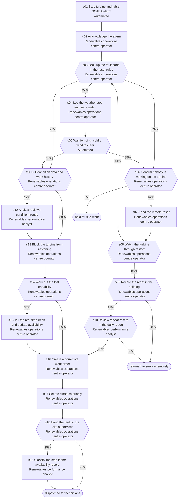

# Monitor the wind fleet and reset faults

`gen-wnd-monitor-fleet` · electric power generation (wind) · wind operations and maintenance · part of `power-generation-co`

Operators in the renewables operations centre watch alarms from about 450 wind turbines in SCADA around the clock. When a turbine stops on a fault, the operator looks up the fault code, checks that nobody is working on the turbine, and resets it remotely when the reset rules allow; weather stops such as icing, extreme cold and high-wind cut-out are watched until conditions clear. Turbines that cannot be reset are blocked, the lost capability is passed to the real-time trading desk, and a work order goes to the site technicians. Bursts of icing and cold-snap faults in winter, repeat faults on older turbines and judging which faults are safe to reset make the work uneven and error-prone.

| | |
|---|---|
| Unit of work | one turbine fault stop |
| Starts when | A turbine controller stops a turbine on a fault or a weather limit and SCADA raises an alarm at the operations centre. |
| Done when | The turbine is running again after a remote reset or after the weather condition cleared, or it is blocked, its lost capability has been passed on and a corrective work order has been handed to the site technicians. |
| Organisation | An Alberta-centred listed generator whose wind division runs a central renewables operations centre with one 24x7 operator desk over twelve southern Alberta wind farms. (1,300 employees, 2019-2022) |
| Volume | 450 cases a month (range 250 to 900) |

## Where it sits

- Starts with **unit_trip** from wnd-monitor-fleet (100% of cases)
- Relies on **weather_forecast** from weather_provider (a standing input; it does not start a case)
- Sends **turbine_fault** to wnd-troubleshoot-turbines (outcome: dispatched to technicians)
- Sends **availability_change** to mkt-restate-offers (outcome: dispatched to technicians)
- Sends **delivered_energy** to aeso (outcome: returned to service remotely)

## Flow

## Roles

| Role | Department | Layer | FTE on this process | Loaded cost per hour | Evidence |
|---|---|---|---:|---:|---|
| Renewables operations centre operator | Wind and storage: renewables operations centre | individual contributor | 3.5 | 62 CAD | C |
| Renewables performance analyst | Wind and storage: renewables operations centre | senior specialist | 0.3 | 80 CAD | C |

## Steps

Hands-on time and the wait before each step show the most common value. Evidence tier A is a sourced number, B a sourced description, C the author's estimate.

| Step | Who | Kind | Hands-on | Wait before | Control | Evidence |
|---|---|---|---:|---:|---|---|
| **s01 Stop turbine and raise SCADA alarm.** The turbine controller detects a fault or a weather limit (ice on the blades, temperature below the operating limit, wind above cut-out, grid event), brings the rotor to a stop and sends an alarm with a fault code to the SCADA alarm list at the operations centre. | Automated | system auto | 0 min | 0 min |  | C |
| **s02 Acknowledge the alarm.** The operator sees the new alarm in the SCADA alarm list among alarms from other farms, acknowledges it and opens the turbine's status page to read the fault code, the time of the stop and the current wind, temperature and power readings. | Renewables operations centre operator | intake | 2 min | 6 min |  | B [pe2013] |
| **s03 Look up the fault code in the reset rules.** The operator looks up the fault code in the manufacturer's fault list and the company's reset matrix, checks how many times this turbine has been reset for the same code in the last 24 hours in the SCADA event log, and looks at the weather data to decide whether the stop is a weather stop, a resettable fault or one that needs a technician. | Renewables operations centre operator | lookup | 4 min | 0 min |  | B [pe2013], [iea19] |
| **s04 Log the weather stop and set a watch.** The operator records the weather or grid stop in the electronic shift log with the turbine, cause and start time, and sets a watch so the turbine is restarted, or restarts itself, once ice, cold or high wind clears. | Renewables operations centre operator | data entry | 3 min | 0 min |  | C |
| **s05 Wait for icing, cold or wind to clear.** The turbine stays stopped while the operator watches temperature, wind speed and the ice detector or power curve; icing stops in southern Alberta can last from an hour to several days, and chinook warming often clears them suddenly. | Automated | external wait | 0 min | 6.0 h |  | C [iea19] |
| **s06 Confirm nobody is working on the turbine.** Before any remote command the operator checks the permit and lockout board and the technician check-in list for the farm, and confirms that no technician is in the tower or nacelle and that the turbine is not under a work permit. | Renewables operations centre operator | validation | 2 min | 0 min | Company lockout and permit-to-work standard under the Alberta OHS Code Part 15 (energy isolation): no remote start of equipment under a permit or with workers on it | C [ii2025] |
| **s07 Send the remote reset.** The operator sends the reset command for the turbine from SCADA, choosing the reset type the reset matrix allows for the fault code, and notes the reset count so the limit on repeated resets is respected. | Renewables operations centre operator | data entry | 2 min | 1 min | Manufacturer fault-reset rules and the company reset matrix: limited remote resets of the same fault in 24 hours before a technician must inspect | B [pe2013] |
| **s08 Watch the turbine through restart.** The operator watches the turbine status page while it yaws into the wind, releases the brake and ramps up, comparing power with the power curve for the measured wind, and decides whether the restart held. | Renewables operations centre operator | validation | 4 min | 0 min |  | C |
| **s09 Record the reset in the shift log.** The operator writes the turbine, fault code, reset time and outcome into the shift log so the next shift and the analysts can see repeat offenders; SCADA also keeps the event in its own log. | Renewables operations centre operator | data entry | 2 min | 0 min |  | C |
| **s10 Review repeat resets in the daily report.** On the next weekday morning the performance analyst runs the daily stop report from SCADA and the historian, lists turbines with repeated resets of the same code and decides whether the pattern points to a fault that a technician should inspect. | Renewables performance analyst | analysis | 6 min | 15.0 h |  | C |
| **s11 Pull condition data and work history.** For a fault that cannot be reset the operator opens the historian trends for the turbine (gearbox and bearing temperatures, vibration, pitch and converter signals) and the open and recent work orders in the ERP to judge how serious the fault is. | Renewables operations centre operator | analysis | 8 min | 2 min |  | B [pe2013], [walgern2026] |
| **s12 Analyst reviews condition trends.** The performance analyst compares the turbine's temperature and vibration trends with its neighbours and with earlier failures, and writes a short note on whether the problem looks like a gearbox, bearing or generator failure that should be inspected urgently. | Renewables performance analyst | analysis | 20 min | 4.0 h |  | B [res2023] |
| **s13 Block the turbine from restarting.** The operator puts the turbine into a stopped or service state in SCADA so it will not try to restart on its own, which protects a damaged drivetrain and keeps the alarm from repeating. | Renewables operations centre operator | data entry | 2 min | 0 min |  | C |
| **s14 Work out the lost capability.** The operator adds up the turbines now unavailable at the farm, compares the lost megawatts with the threshold the real-time desk uses for restating the farm's available capability, and checks the wind forecast for the next hours. | Renewables operations centre operator | analysis | 4 min | 0 min |  | C |
| **s15 Tell the real-time desk and update availability.** The operator calls or messages the real-time trader with the farm, the megawatts lost and the expected duration, and updates the turbine availability data the farm sends to the AESO so that the offer and the wind forecast reflect the stopped turbines. | Renewables operations centre operator | communication | 5 min | 2 min | AESO ISO rules requiring pool participants to keep available capability and wind facility data submitted to the AESO accurate (ISO rules Section 203 series and Section 304.9 wind forecasting data) | C |
| **s16 Create a corrective work order.** The operator creates a corrective work order in the ERP maintenance module against the turbine's equipment number, typing the fault code, symptoms, the reset attempts made and the condition note, and sets the priority code. | Renewables operations centre operator | data entry | 7 min | 3 min |  | C |
| **s17 Set the dispatch priority.** The operator ranks the job against other stopped turbines by megawatts lost, pool price, the wind forecast and any safety concern, and decides whether it needs the on-call technician tonight or can wait for the day crew. | Renewables operations centre operator | judgment | 4 min | 0 min |  | C |
| **s18 Hand the fault to the site supervisor.** The operator phones the site supervisor during the day, or the on-call technician after hours, explains the fault and priority, and sends the work order number; the call may need a callback if the person is on a tower. | Renewables operations centre operator | communication | 4 min | 5 min |  | C |
| **s19 Classify the stop in the availability record.** The performance analyst checks the stop in the availability tracker the next weekday, assigns the downtime category used in manufacturer warranty and internal availability reports (forced, weather, grid, owner) and corrects categories that SCADA set automatically. | Renewables performance analyst | analysis | 5 min | 15.0 h |  | C |

## Exceptions

| Exception | Share of cases | What happens |
|---|---:|---|
| Icing event alarm flood | 15% | During an icing or cold-snap event dozens of turbines stop within hours; the single desk acknowledges alarms late and turbines wait for conditions to clear before restart. |
| Repeat fault after reset | 7% | The turbine trips again on restart, the operator goes back to the reset rules and eventually raises a work order once the reset limit is reached. |
| Suspected main component failure | 3% | Condition trends point to a gearbox, bearing or generator problem; the analyst is asked for a view before the job is handed to the site. |

## Benchmarks

| Metric | Value | Unit | Population | Evidence |
|---|---|---|---|---|
| alarm_response_minutes | mean 10 | minutes from alarm to operator response | Siemens wind remote monitoring centres, about 2013 | A [pe2013] |
| share_of_alarms_resolved_remotely | 0.8 | share of alarm cases | Siemens wind remote monitoring centres, about 2013 | A [pe2013] |
| cycle_time_days | p50 0.05, p90 1.5 | calendar days from alarm to turbine running again or handed to technicians | Author's estimate for an owner-operated centre over about 450 turbines | C [pe2013] |

## Pain points

- One operator desk handles alarm floods during icing and cold snaps, so acknowledgement and restart are delayed exactly when many turbines stop at once. (steps s02, s05; C [iea19])
- Deciding whether a fault is safe to reset depends on the operator's experience with each turbine model; mistakes either waste a technician trip or restart a damaged turbine. (steps s03, s08, s11; C)
- Work orders and shift logs are typed by hand from SCADA, and vague fault descriptions slow the technicians' diagnosis and the reliability analysis later. (steps s09, s16; C)

## Assumptions

- The organisation file lists no trigger for this process. A fault stop starts inside the fleet being monitored, so triggered_by points to the process itself with the business object unit_trip (turbine alarm); weather forecasts are a standing input.
- About 70 percent of fault stops end without a site visit (weather stops plus remote resets) and about 30 percent are dispatched, against 80 percent remote resolution reported by a manufacturer's centre (pe2013) and the organisation file's note of about 40 percent needing a visit. The lower remote share reflects older turbines with fewer remote functions.
- The roc_operator FTE (3.5) is far above hands-on time because a 24x7 desk must be staffed whether or not alarms arrive; hands-on time alone implies about 2 FTE at the mode volume, and more during icing surges.
- Availability restatement is shown for about a third of dispatched faults; smaller losses are left to the AESO wind forecast and the next scheduled offer update.
- The cycle time ends at handover to technicians; travel and repair time are in the troubleshoot workflow.
- Loaded costs are the organisation file's (wage x 1.40).

## Sources

- [pe2013] [Using Technology to Monitor & Maintain Wind Turbines (J. Martino)](https://www.power-eng.com/renewables/wind-energy/using-technology-to-monitor-maintain-wind-turbines/) (Power Engineering (Clarion Events), 2013). Siemens remote monitoring centres resolve 80 percent of registered alarm cases remotely without a site visit; average response time 10 minutes and 99 percent of alarms answered within an hour; 24/7 remote monitoring centres; vibration-based condition monitoring for early detection.
- [walgern2026] [Reliability and O&M key performance indicators of onshore and offshore wind turbines based on field-data analysis (Walgern et al.)](https://wes.copernicus.org/articles/11/1553/2026/) (Wind Energy Science, vol. 11, pp. 1553-1568 (Copernicus), 2026). Onshore failure rate 3.3 non-resettable failures per turbine per year (1.729 per MW per year); WMEP onshore 2.4 failures per turbine per year for smaller turbines; average technician time on site 2.7 h for component replacements, about 1.5 h for other corrective maintenance and 3.8 h for preventive maintenance, excluding travel and spare-part lead times; pitch, control and converter systems have the highest onshore failure rates per MW.
- [iea19] [IEA Wind TCP Task 19: Wind energy in cold climates](https://iea-wind.org/task19/) (IEA Wind Technology Collaboration Programme, 2021). Cold climate sites are those with icing events or periods with temperatures below the operational limits of standard wind turbines; these conditions affect production, economics and safety (ice throw); work programme 2019-2021.
- [ii2025] [Working as a wind turbine technician: how to minimise risks](https://industryinsider.eu/energy-utilities/working-as-a-wind-turbine-technician/) (Industry Insider, 2025). Wind speed limits set by regulations and manufacturers: access to the lower platform up to 25 m/s and to the nacelle up to 20 m/s, hoists below 10 m/s; all work by teams of at least two people; work inside turbines only under a written order or permit; work stops and the team evacuates if gusts threaten stability.
- [res2023] [How can we prepare for main component failure? (B. McDaid)](https://www.res-group.com/resources/how-can-we-prepare-for-main-component-failure/) (RES, 2023). Main component failures (gearboxes, bearings, generators, main shafts, blades) are an expected part of O&M; lead times for some components average three to six months (nine months for one main shaft); a crane exchange needs a three-to-four-day weather window that is hard to find at windy sites; crane mobilisation decisions are made 24 to 72 hours ahead; condition monitoring, oil readings and inspection give early warning.

Written by claude-opus on 2026-11-24.
