# Perform scheduled turbine service

`gen-wnd-scheduled-service` · electric power generation (wind) · wind operations and maintenance · part of `power-generation-co`

Every wind turbine gets a semi-annual and an annual service: technicians check bolt torques, change filters, grease bearings, take oil samples, inspect blades, brakes and electrical parts, and test the safety systems. The ERP releases a preventive work order for each service, the site manager places it in the service season plan, and either an own technician pair or, for turbines under a manufacturer service agreement, the manufacturer's crew does the work. Most service is pushed into the low-wind summer months to lose less energy, which crowds the technicians' calendar, and windy days, missing kit and defects found during inspection stretch the schedule.

| | |
|---|---|
| Unit of work | one turbine service |
| Starts when | The ERP maintenance plan releases a preventive work order for a turbine's semi-annual or annual service. |
| Done when | The service checklist is complete, readings and defects are recorded, the turbine is back in remote control and the preventive work order is closed; for manufacturer-performed services the service report is accepted and the ticket approved. |
| Organisation | An Alberta-centred listed generator that services most of its southern Alberta wind turbines with its own technicians and buys service for its newest farm from the turbine manufacturer. (1,300 employees, 2019-2022) |
| Volume | 75 cases a month (range 40 to 150) |

## Where it sits

- Starts with **maintenance_strategy** from eng-reliability-analysis (100% of cases)
- Relies on **issued_parts** from scm-manage-stores (a standing input; it does not start a case)
- Sends **service_order** to oem_providers (outcome: completed by OEM)
- Sends **work_order_history** to eng-reliability-analysis (outcome: any)
- Sends **work_request** to wnd-troubleshoot-turbines (outcome: any)
- Sends **timesheet** to hr-run-payroll (outcome: any)

## Flow

```mermaid
flowchart TD
    s01["s01 Release the preventive work order<br/>Automated"]
    s02{{"s02 Place the service in the season plan<br/>Wind site manager"}}
    s03["s03 Call off the service from the manufacturer<br/>Wind site manager"]
    s04["s04 Manufacturer crew services the turbine<br/>Outside party"]
    s05["s05 Assign the pair and the day<br/>Wind site supervisor"]
    s06["s06 Pick the service kit<br/>Wind turbine technician"]
    s07{{"s07 Check the wind forecast for the day<br/>Wind turbine technician"}}
    s08["s08 Wait for a low-wind day<br/>Automated"]
    s09["s09 Drive to the turbine<br/>Wind turbine technician"]
    s10["s10 Hazard assessment, lockout and notify the operations centre<br/>Wind turbine technician"]
    s11["s11 Climb and hoist the kit<br/>Wind turbine technician"]
    s12["s12 Check bolt torques<br/>Wind turbine technician"]
    s13["s13 Lubricate, change filters and sample oil<br/>Wind turbine technician"]
    s14{{"s14 Inspect components<br/>Wind turbine technician"}}
    s15["s15 Test the safety systems<br/>Wind turbine technician"]
    s16["s16 Descend, remove lockout and return the turbine<br/>Wind turbine technician"]
    s17["s17 Drive back<br/>Wind turbine technician"]
    s18{{"s18 Enter readings and the checklist in the ERP<br/>Wind turbine technician"}}
    s19["s19 Ship the oil sample to the laboratory<br/>Wind turbine technician"]
    s20{{"s20 Review and close the preventive work order<br/>Wind site supervisor"}}
    s21["s21 Raise a corrective notification for the defect<br/>Wind turbine technician"]
    s22{{"s22 Review the manufacturer service report<br/>Wind site supervisor"}}
    s23["s23 Approve the service ticket<br/>Wind site manager"]
    s01 --> s02
    s02 -->|"80%"| s05
    s02 -->|"20%"| s03
    s03 --> s04
    s04 --> s22
    s05 --> s06
    s06 --> s07
    s07 -->|"80%"| s09
    s07 -->|"20%"| s08
    s08 --> s09
    s09 --> s10
    s10 --> s11
    s11 --> s12
    s12 --> s13
    s13 --> s14
    s14 -->|"86%"| s15
    s14 -->|"14%"| s21
    s15 --> s16
    s16 --> s17
    s17 --> s18
    s18 -->|"50%"| s19
    s18 -->|"50%"| s20
    s19 --> s20
    s20 -->|"95%"| end0
    s20 -->|"5%"| s18
    s21 --> s15
    s22 -->|"90%"| s23
    s22 -->|"10%"| s04
    s23 --> end1
    end0(["completed in house"])
    end1(["completed by OEM"])
```

## Roles

| Role | Department | Layer | FTE on this process | Loaded cost per hour | Evidence |
|---|---|---|---:|---:|---|
| Wind turbine technician | Wind and storage: southern Alberta wind sites | individual contributor | 13 | 56 CAD | C |
| Wind site supervisor | Wind and storage: southern Alberta wind sites | supervisor | 0.6 | 88 CAD | C |
| Wind site manager | Wind and storage: southern Alberta wind sites | manager | 0.3 | 115 CAD | C |

## Steps

Hands-on time and the wait before each step show the most common value. Evidence tier A is a sourced number, B a sourced description, C the author's estimate.

| Step | Who | Kind | Hands-on | Wait before | Control | Evidence |
|---|---|---|---:|---:|---|---|
| **s01 Release the preventive work order.** The ERP maintenance plan for the turbine reaches its due date (six or twelve months since the last service) and releases a preventive work order with the task list for a semi-annual or annual service. | Automated | system auto | 0 min | 0 min |  | C |
| **s02 Place the service in the season plan.** In the monthly planning session the site manager slots the released work orders into the service season plan by farm, grouping turbines on the same road, avoiding high-wind months and balancing against expected corrective work. | Wind site manager | coordination | 6 min | 5.0 d |  | B [pe2008] |
| **s03 Call off the service from the manufacturer.** For turbines under a manufacturer service agreement the site manager sends the service order to the manufacturer's site lead with the turbines, the window and site access rules, and agrees the dates. | Wind site manager | communication | 20 min | 1.0 d |  | C |
| **s04 Manufacturer crew services the turbine.** The manufacturer's crew arrives in its own window, completes its own permits and checklists, services the turbine and sends a service report; the waiting time includes their day or two of work. | Outside party | external wait | 0 min | 7.0 d |  | C |
| **s05 Assign the pair and the day.** The site supervisor assigns the service to a technician pair and a day on the weekly plan, checking that the pair holds the training for the turbine model and that the needed kit is in stock. | Wind site supervisor | coordination | 10 min | 1.0 d |  | C |
| **s06 Pick the service kit.** The pair collects the service kit from the site store (oil and air filters, grease cartridges, gear oil, oil sample bottles, consumables), books it to the work order and loads the torque tools on the truck. | Wind turbine technician | physical | 30 min | 1.0 d |  | C |
| **s07 Check the wind forecast for the day.** Before leaving, the lead technician checks forecast wind speed against the climbing and hoisting limits, because a service needs a full day of hoisting kit and working in the hub. | Wind turbine technician | validation | 5 min | 0 min | Company climbing and hoisting limits from manufacturer manuals: no nacelle access above about 20 m/s, no hoisting above about 10 m/s, hub entry only at low wind with the rotor locked | B [ii2025] |
| **s08 Wait for a low-wind day.** The service is moved to the next forecast low-wind day and the pair takes other work; in a windy week several services slip together. | Automated | external wait | 0 min | 1.0 d |  | C |
| **s09 Drive to the turbine.** The pair drives the loaded service truck from the site office to the turbine over public roads and gravel access roads on leased farmland, opening gates as the landowner agreement requires. | Wind turbine technician | travel | 35 min | 0 min |  | C [aif2021] |
| **s10 Hazard assessment, lockout and notify the operations centre.** The pair completes the field-level hazard assessment, calls the operations centre to take the turbine out of service, applies locks and tags and records the permit. | Wind turbine technician | physical | 25 min | 0 min | Alberta OHS Code Part 2 (hazard assessment) and Part 15 (energy isolation); company permit-to-work standard | B [ii2025] |
| **s11 Climb and hoist the kit.** The technicians climb the tower with fall arrest and lift filters, oil drums and torque tools to the nacelle with the service hoist. | Wind turbine technician | physical | 35 min | 0 min | Alberta OHS Code Part 9 (fall protection) and the two-climber rule; hoist used only below the wind limit | B [ii2025], [pe2008] |
| **s12 Check bolt torques.** Following the task list, the pair torques a sample or all of the blade root, hub, main frame, yaw and tower flange bolts with hydraulic tools, marking checked bolts and noting any found loose; annual services cover more bolts than semi-annual ones. | Wind turbine technician | physical | 3.3 h | 0 min |  | C [pe2008] |
| **s13 Lubricate, change filters and sample oil.** The pair greases the main, pitch and yaw bearings, changes gearbox and hydraulic filters, tops up oils and takes a gearbox oil sample for laboratory analysis. | Wind turbine technician | physical | 2.3 h | 0 min |  | C [pe2008] |
| **s14 Inspect components.** The technicians inspect the blades from the hub and nacelle, the brakes, yaw drives, pitch system, generator, cables, converter cabinet and safety equipment against the checklist, and decide whether any defect needs follow-up work. | Wind turbine technician | validation | 1.8 h | 0 min |  | C |
| **s15 Test the safety systems.** The pair tests the emergency stops, safety chain, overspeed protection and brake function, and records the results on the checklist. | Wind turbine technician | validation | 40 min | 0 min | Manufacturer maintenance manual and the company maintenance standard: safety-chain and emergency-stop tests at every scheduled service | C |
| **s16 Descend, remove lockout and return the turbine.** The pair lowers waste oil and old filters with the hoist, climbs down, removes locks and tags, closes the permit and calls the operations centre to restart the turbine. | Wind turbine technician | physical | 30 min | 0 min | Alberta OHS Code Part 15 (energy isolation): locks removed only by the workers who applied them | C |
| **s17 Drive back.** The pair drives back to the site office with waste oil, used filters and samples, and returns unused kit to the store. | Wind turbine technician | travel | 35 min | 0 min |  | C |
| **s18 Enter readings and the checklist in the ERP.** The lead technician types the checklist results, torque and temperature readings, consumables used and hours into the ERP work order and books hours in timekeeping. | Wind turbine technician | data entry | 30 min | 4.0 h |  | C |
| **s19 Ship the oil sample to the laboratory.** The technician fills in the laboratory form with turbine and gearbox details and ships the oil sample by courier; results arrive weeks later and go to the reliability engineers. | Wind turbine technician | communication | 10 min | 1.0 d |  | C |
| **s20 Review and close the preventive work order.** In the weekly review the site supervisor checks the completed checklist and readings, approves the hours and closes the preventive work order so the next due date is calculated, or returns it for missing readings. | Wind site supervisor | review | 6 min | 2.0 d |  | C |
| **s21 Raise a corrective notification for the defect.** For a defect that cannot be fixed during the service (a blade crack, worn yaw brake pads, a leaking pitch cylinder) the technician raises a corrective notification in the ERP with photos so it is planned as a repair. | Wind turbine technician | drafting | 20 min | 0 min |  | C |
| **s22 Review the manufacturer service report.** The site supervisor reads the manufacturer's service report, compares it with the task list, checks readings and open findings, and spot-checks a sample of turbines in the field. | Wind site supervisor | review | 30 min | 2.0 d |  | C |
| **s23 Approve the service ticket.** The site manager signs the manufacturer's service ticket so it can be matched to the agreement and invoiced, and closes the preventive work order in the ERP. | Wind site manager | approval | 10 min | 1.0 d | Delegation of authority and service agreement terms: site manager sign-off before an OEM service is invoiced | C |

## Exceptions

| Exception | Share of cases | What happens |
|---|---:|---|
| Windy day | 20% | Forecast wind is above the hoisting or hub limits and the service slips to the next low-wind day. |
| Defect found during inspection | 14% | The inspection finds a defect that needs separate corrective work; a notification is raised and the service continues. |
| Manufacturer punch list | 2% | The supervisor finds missing items in the manufacturer report and the crew must return. |

## Benchmarks

| Metric | Value | Unit | Population | Evidence |
|---|---|---|---|---|
| scheduled_service_downtime_hours | low 12, high 18 | hours of turbine downtime per scheduled service | US wind farms, about 2008 | A [pe2008] |
| preventive_maintenance_time_on_site_hours | 3.8 | average technician presence per preventive maintenance event | Onshore and offshore field data, Walgern et al. 2026 | A [walgern2026] |
| cycle_time_days | p50 15, p90 35 | calendar days from work order release to close | Author's estimate | C |

## Pain points

- Squeezing most services into the low-wind summer months doubles the workload exactly when breakdowns also need the same technicians. (steps s02, s06; B [pe2008])
- A service ties up a pair for a full day on one turbine, and windy days cancel hoisting and hub work. (steps s07, s08, s12, s13; B [pe2008], [ii2025])
- Paper checklists are re-typed into the ERP and readings go missing, weakening the trend data for reliability analysis. (steps s18, s20; C)

## Assumptions

- The organisation file lists no trigger for this process. The ERP maintenance plan built from the reliability group's maintenance strategy releases each work order, so triggered_by uses maintenance_strategy from eng-reliability-analysis.
- touch_min records the lead technician's minutes; services are done by a pair, so the wind_technician FTE (13) is about twice the lead's hands-on time at 80 percent own-performed services.
- About 20 percent of services (the newest farm) are done by the manufacturer's crew under a service agreement; their working time is folded into the wait at s04.
- Annual and semi-annual services are averaged in one set of step times; annual services sit toward the high end of the torque and inspection ranges.
- Defects found are sent on as work requests to the troubleshoot process; the organisation file does not list this link.
- Loaded costs are the organisation file's (wage x 1.40).
- Organisation file corrected on 2026-11-24: technicians climb in pairs, so the steps from the drive to the turbine to the drive back now carry people 2, and the staffing check counts both technicians.

## Sources

- [pe2008] [Keeping Wind Turbines Spinning (S. Blankinship)](https://www.power-eng.com/renewables/wind/keeping-wind-turbines-spinning/) (Power Engineering (Clarion Events), 2008). Scheduled wind turbine maintenance is usually done two to three times a year with 12 to 18 hours of downtime per outage; wind farms are often serviced when wind is low; replacement components are expensive and time-consuming to replace; older towers without elevators are climbed.
- [walgern2026] [Reliability and O&M key performance indicators of onshore and offshore wind turbines based on field-data analysis (Walgern et al.)](https://wes.copernicus.org/articles/11/1553/2026/) (Wind Energy Science, vol. 11, pp. 1553-1568 (Copernicus), 2026). Onshore failure rate 3.3 non-resettable failures per turbine per year (1.729 per MW per year); WMEP onshore 2.4 failures per turbine per year for smaller turbines; average technician time on site 2.7 h for component replacements, about 1.5 h for other corrective maintenance and 3.8 h for preventive maintenance, excluding travel and spare-part lead times; pitch, control and converter systems have the highest onshore failure rates per MW.
- [ii2025] [Working as a wind turbine technician: how to minimise risks](https://industryinsider.eu/energy-utilities/working-as-a-wind-turbine-technician/) (Industry Insider, 2025). Wind speed limits set by regulations and manufacturers: access to the lower platform up to 25 m/s and to the nacelle up to 20 m/s, hoists below 10 m/s; all work by teams of at least two people; work inside turbines only under a written order or permit; work stops and the team evacuates if gusts threaten stability.
- [aif2021] [TransAlta Corporation Annual Information Form for the year ended December 31, 2021 (Exhibit 13.1 to Form 40-F)](https://www.sec.gov/Archives/edgar/data/1144800/000114480022000004/a20211231tacex131aif.htm) (TransAlta Corporation via U.S. SEC EDGAR, 2022). Alberta wind facility list with capacities and commissioning years: Castle River (1997-2001), Cowley North and Sinnott (2001, five Nordex N60 1.3 MW turbines), McBride Lake (2004, 50 percent), Summerview 1 (2004) and 2, Blue Trail (2009) and Macleod Flats, Soderglen (2006, 50 percent), Oldman (2007), Ardenville (2010), Windrise (206 MW, commercial operation November 2021); wind speeds are historically greater in the cold winter months.

Written by claude-opus on 2026-11-24.
