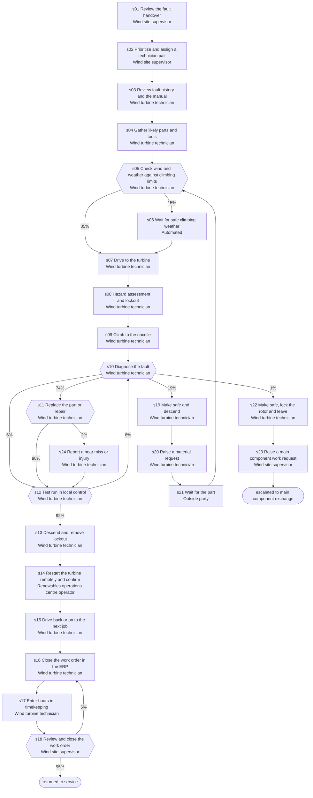

# Troubleshoot and repair turbines on site

`gen-wnd-troubleshoot-turbines` · electric power generation (wind) · wind operations and maintenance · part of `power-generation-co`

When a wind turbine stops on a fault that cannot be reset from the operations centre, a two-person technician team drives to it, locks it out, climbs the tower, finds the cause and replaces the failed part so the turbine can run again. The site supervisor ranks the jobs each morning against scheduled service work. High wind, lightning and icing stop climbing, older towers have no elevator, parts that are not in the site store have to come from central stores or the manufacturer, and driving between farms takes a large share of the day. Faults that turn out to be a gearbox, generator, main bearing or blade failure are made safe and passed to the main component exchange process.

| | |
|---|---|
| Unit of work | one turbine repair visit |
| Starts when | The operations centre hands a non-resettable turbine fault and its corrective work order to the site supervisor or the on-call technician. |
| Done when | The turbine runs again and the work order is closed with hours, parts and failure cause recorded, or the turbine is left locked out and a main component work request has been raised. |
| Organisation | An Alberta-centred listed generator that maintains most of its southern Alberta wind turbines with its own technicians based at site offices near Pincher Creek and Fort Macleod. (1,300 employees, 2019-2022) |
| Volume | 200 cases a month (range 120 to 400) |

## Where it sits

- Starts with **turbine_fault** from wnd-monitor-fleet (100% of cases)
- Relies on **issued_parts** from scm-manage-stores (a standing input; it does not start a case)
- Sends **work_request** to wnd-main-component-exchange (outcome: escalated to main component exchange)
- Sends **material_request** to scm-manage-stores (outcome: any)
- Sends **work_order_history** to eng-reliability-analysis (outcome: any)
- Sends **timesheet** to hr-run-payroll (outcome: any)
- Sends **incident_report** to hse-manage-incidents (outcome: any)
- Sends **delivered_energy** to aeso (outcome: returned to service)

## Flow

## Roles

| Role | Department | Layer | FTE on this process | Loaded cost per hour | Evidence |
|---|---|---|---:|---:|---|
| Wind turbine technician | Wind and storage: southern Alberta wind sites | individual contributor | 22 | 56 CAD | C |
| Wind site supervisor | Wind and storage: southern Alberta wind sites | supervisor | 1 | 88 CAD | C |
| Renewables operations centre operator | Wind and storage: renewables operations centre | individual contributor | 0.3 | 62 CAD | C |

## Steps

Hands-on time and the wait before each step show the most common value. Evidence tier A is a sourced number, B a sourced description, C the author's estimate.

| Step | Who | Kind | Hands-on | Wait before | Control | Evidence |
|---|---|---|---:|---:|---|---|
| **s01 Review the fault handover.** The site supervisor opens the corrective work order the operations centre created in the ERP, reads the fault code, reset attempts and condition note, and checks in SCADA that the turbine is still stopped. | Wind site supervisor | intake | 8 min | 3.0 h |  | C |
| **s02 Prioritise and assign a technician pair.** The supervisor ranks the job on the day's plan against other stopped turbines and scheduled service, weighing megawatts lost, the wind forecast and travel between farms, and assigns it to a technician pair in the ERP. | Wind site supervisor | judgment | 10 min | 0 min |  | C |
| **s03 Review fault history and the manual.** When a pair comes free the lead technician reads the turbine's recent work orders in the ERP, looks at the SCADA trends around the stop and opens the manufacturer's troubleshooting guide for the fault code to plan likely causes and parts. | Wind turbine technician | lookup | 20 min | 6.0 h |  | C |
| **s04 Gather likely parts and tools.** The technicians pick the likely spare parts (sensors, relays, pitch batteries, fuses, slip ring brushes) and tools from the site store, record what they take against the work order and load the truck. | Wind turbine technician | physical | 20 min | 0 min |  | C |
| **s05 Check wind and weather against climbing limits.** The lead technician checks current and forecast wind speed at hub height, lightning and icing against the company's climbing and hoisting limits before leaving, and decides whether the climb can go ahead today. | Wind turbine technician | validation | 5 min | 0 min | Company climbing limits from manufacturer manuals: no nacelle access above about 20 m/s, no hoisting above about 10 m/s, no climbing in lightning or with ice on the turbine | B [ii2025] |
| **s06 Wait for safe climbing weather.** The job is held while the wind stays above the climbing limit or ice remains on the tower; the pair is moved to ground-level work or another farm and the job is picked up on the next suitable day. | Automated | external wait | 0 min | 18.0 h |  | C [aif2021] |
| **s07 Drive to the turbine.** The pair drives the service truck from the site office or the last job to the turbine, over public roads and gravel access roads across leased farmland, opening gates and following landowner access rules. | Wind turbine technician | travel | 35 min | 0 min |  | C [aif2021] |
| **s08 Hazard assessment and lockout.** At the base the pair completes the field-level hazard assessment, calls the operations centre to take the turbine out of remote control, applies personal locks and tags to the isolation points and records the permit in the permit system. | Wind turbine technician | physical | 20 min | 0 min | Alberta OHS Code Part 2 (hazard assessment) and Part 15 (energy isolation); company permit-to-work standard | B [ii2025] |
| **s09 Climb to the nacelle.** The technicians put on fall-arrest harnesses, check the ladder safety system and climb the 50 to 80 metre tower by ladder (most older towers have no lift), hauling tools and parts up with the nacelle hoist. | Wind turbine technician | physical | 25 min | 0 min | Alberta OHS Code Part 9 (fall protection) and the company rule of at least two trained climbers with rescue equipment on every climb | B [ii2025], [pe2008] |
| **s10 Diagnose the fault.** The lead technician connects a laptop to the turbine controller, reads the event log, measures signals and inspects the suspect assembly (pitch, converter, yaw, hydraulics, sensors) to find the cause and decide what to replace. | Wind turbine technician | analysis | 40 min | 0 min |  | B [walgern2026] |
| **s11 Replace the part or repair.** The pair replaces the failed part or repairs the wiring or hydraulic line, following the manufacturer's procedure and torque values, and records the part serial numbers. | Wind turbine technician | physical | 50 min | 0 min |  | A [walgern2026] |
| **s12 Test run in local control.** The technicians release the locks needed for the test, run the turbine from the nacelle or base controller through start-up, pitch and yaw tests, and watch for the fault to return. | Wind turbine technician | validation | 20 min | 0 min |  | C |
| **s13 Descend and remove lockout.** The pair packs tools and removed parts, climbs down, removes personal locks and tags, closes the permit and calls the operations centre to hand the turbine back to remote control. | Wind turbine technician | physical | 25 min | 0 min | Alberta OHS Code Part 15 (energy isolation): locks removed only by the workers who applied them | C |
| **s14 Restart the turbine remotely and confirm.** The operations centre operator clears the block in SCADA, restarts the turbine, watches it reach normal power for the wind and marks it available again in the availability record. | Renewables operations centre operator | validation | 4 min | 5 min |  | C |
| **s15 Drive back or on to the next job.** The pair drives back to the site office or on to the next turbine on the day's plan, returning removed parts for repair or scrap to the site store. | Wind turbine technician | travel | 35 min | 0 min |  | C |
| **s16 Close the work order in the ERP.** At the end of the day the lead technician types the work done, failure cause code, parts used and hours into the ERP work order and marks it technically complete. | Wind turbine technician | data entry | 15 min | 1.0 h |  | C |
| **s17 Enter hours in timekeeping.** Each technician enters the hours against the work order number in the time and attendance system, including any call-out or overtime, for the weekly timesheet. | Wind turbine technician | data entry | 4 min | 1.0 h |  | C |
| **s18 Review and close the work order.** In the weekly review the supervisor checks completed work orders for a failure code, parts and hours, approves the timesheets and closes the order, or sends it back for missing information. | Wind site supervisor | review | 5 min | 2.0 d |  | C |
| **s19 Make safe and descend.** Because the needed part is not on hand, the pair leaves the turbine blocked and safe, climbs down, keeps the lockout or closes the permit as the job requires and drives back. | Wind turbine technician | physical | 1.2 h | 0 min |  | C |
| **s20 Raise a material request.** The lead technician raises a material request in the ERP for the part, quoting the manufacturer part number from the parts manual, and flags it urgent when the turbine is down. | Wind turbine technician | data entry | 10 min | 1.0 h |  | C |
| **s21 Wait for the part.** The turbine stays down while central stores ships the part or buys it from the manufacturer or a supplier; common parts arrive in a day or two, manufacturer-specific parts for older models can take weeks. | Outside party | external wait | 0 min | 3.0 d |  | C |
| **s22 Make safe, lock the rotor and leave.** For a main component failure the pair locks the rotor, leaves the turbine isolated, photographs the damage and takes oil samples or readings, then climbs down and drives back. | Wind turbine technician | physical | 1.2 h | 0 min |  | C |
| **s23 Raise a main component work request.** The supervisor writes a work request in the ERP describing the failed component, the evidence and the turbine's state, and sends it with photos to the site manager to start the main component exchange. | Wind site supervisor | drafting | 30 min | 8.0 h |  | C |
| **s24 Report a near miss or injury.** If something goes wrong during the work, a technician reports it to the supervisor at once and enters the near miss or injury in the incident system the same day so the safety team can investigate. | Wind turbine technician | communication | 30 min | 0 min | Alberta OHS Act requirement to report serious injuries and incidents, and the company incident reporting standard | C |

## Exceptions

| Exception | Share of cases | What happens |
|---|---:|---|
| Part not on hand | 19% | The pair diagnoses the fault but the part is not on the truck or in the site store; the turbine waits for a material request and a second visit. |
| Too windy to climb | 15% | Wind or ice keeps the pair off the tower and the job slips to the next suitable day. |
| Main component failure found | 1% | The fault turns out to be a gearbox, generator, main bearing or blade failure; the turbine is isolated and a main component work request is raised. |
| Repair does not fix the fault | 10% | The test run shows the fault again and the pair goes back to diagnosis. |

## Benchmarks

| Metric | Value | Unit | Population | Evidence |
|---|---|---|---|---|
| technician_time_on_site_component_replacement_hours | 2.7 | hours of technician presence per corrective component replacement, excluding travel and lead times | Onshore wind field data, Walgern et al. 2026 | A [walgern2026] |
| onshore_failure_rate | 3.3 | non-resettable failures per turbine per year | Onshore wind field data, Walgern et al. 2026 (WMEP: 2.4) | A [walgern2026] |
| cycle_time_days | p50 4, p90 14 | calendar days from fault handover to work order closed | Author's estimate for an owner-operated southern Alberta wind fleet | C |
| time_to_return_to_service_days | p50 0.8, p90 7 | calendar days from handover to turbine running | Author's estimate | C |

## Pain points

- Travel, climbing and making the turbine safe take as long as the repair itself, so each extra visit for a missing part costs a pair half a day. (steps s07, s09, s15, s19, s21; A [walgern2026])
- Windy days, lightning and icing stop climbing in exactly the season when faults are most frequent. (steps s05, s06; B [ii2025], [aif2021])
- Failure codes and parts are typed into the ERP at the end of the day, often generically, which weakens the failure history the reliability engineers rely on. (steps s16, s18; C)

## Assumptions

- touch_min records the lead technician's minutes; the second technician on every climb is counted in the wind_technician FTE (22, about twice the lead's simulated hands-on time of about 7.5 hours per visit times 200 visits a month). Together with scheduled service (about 13 FTE) and main component exchanges (about 2 FTE) this uses about 37 of the 38 technicians in the organisation file, which leaves little room for training, travel between sites and on-call rest and in the wind_tech_pair resource.
- The organisation file lists issued_parts from scm-manage-stores as a trigger; parts do not start a visit, so they are shown as a standing input.
- roc_operator is added for the remote restart at the end of each repair; the organisation file does not list this role for the process.
- Branch shares at diagnosis (74 percent fixed with parts on hand, 19 percent part missing, 6 percent no fault found, 1 percent main component) are estimates; the main component share is set so that escalations (about 1.6 a month) match the organisation file's 1 to 5 exchanges a month.
- Cycle time ends when the supervisor closes the work order in a weekly review; time to return to service is given as a separate benchmark.
- Loaded costs are the organisation file's (wage x 1.40).
- Organisation file corrected on 2026-11-24: technicians climb in pairs, so the steps from the drive to the turbine to the drive back now carry people 2, and the staffing check counts both technicians.

## Sources

- [walgern2026] [Reliability and O&M key performance indicators of onshore and offshore wind turbines based on field-data analysis (Walgern et al.)](https://wes.copernicus.org/articles/11/1553/2026/) (Wind Energy Science, vol. 11, pp. 1553-1568 (Copernicus), 2026). Onshore failure rate 3.3 non-resettable failures per turbine per year (1.729 per MW per year); WMEP onshore 2.4 failures per turbine per year for smaller turbines; average technician time on site 2.7 h for component replacements, about 1.5 h for other corrective maintenance and 3.8 h for preventive maintenance, excluding travel and spare-part lead times; pitch, control and converter systems have the highest onshore failure rates per MW.
- [ii2025] [Working as a wind turbine technician: how to minimise risks](https://industryinsider.eu/energy-utilities/working-as-a-wind-turbine-technician/) (Industry Insider, 2025). Wind speed limits set by regulations and manufacturers: access to the lower platform up to 25 m/s and to the nacelle up to 20 m/s, hoists below 10 m/s; all work by teams of at least two people; work inside turbines only under a written order or permit; work stops and the team evacuates if gusts threaten stability.
- [pe2008] [Keeping Wind Turbines Spinning (S. Blankinship)](https://www.power-eng.com/renewables/wind/keeping-wind-turbines-spinning/) (Power Engineering (Clarion Events), 2008). Scheduled wind turbine maintenance is usually done two to three times a year with 12 to 18 hours of downtime per outage; wind farms are often serviced when wind is low; replacement components are expensive and time-consuming to replace; older towers without elevators are climbed.
- [pe2013] [Using Technology to Monitor & Maintain Wind Turbines (J. Martino)](https://www.power-eng.com/renewables/wind-energy/using-technology-to-monitor-maintain-wind-turbines/) (Power Engineering (Clarion Events), 2013). Siemens remote monitoring centres resolve 80 percent of registered alarm cases remotely without a site visit; average response time 10 minutes and 99 percent of alarms answered within an hour; 24/7 remote monitoring centres; vibration-based condition monitoring for early detection.
- [aif2021] [TransAlta Corporation Annual Information Form for the year ended December 31, 2021 (Exhibit 13.1 to Form 40-F)](https://www.sec.gov/Archives/edgar/data/1144800/000114480022000004/a20211231tacex131aif.htm) (TransAlta Corporation via U.S. SEC EDGAR, 2022). Alberta wind facility list with capacities and commissioning years: Castle River (1997-2001), Cowley North and Sinnott (2001, five Nordex N60 1.3 MW turbines), McBride Lake (2004, 50 percent), Summerview 1 (2004) and 2, Blue Trail (2009) and Macleod Flats, Soderglen (2006, 50 percent), Oldman (2007), Ardenville (2010), Windrise (206 MW, commercial operation November 2021); wind speeds are historically greater in the cold winter months.

Written by claude-opus on 2026-11-24.
