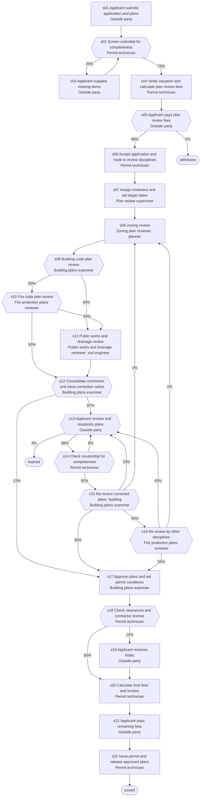

# City building permit application review through issuance

`gov-building-permit-review` · local government · building permits and plan review

A property owner, contractor or architect applies to the city for a permit to alter, add to or build a commercial or residential building, and the city must confirm the plans meet the zoning, building, fire and public works codes before work starts. A permit technician checks the submittal and calculates fees, reviewers in each discipline mark up the plans, and the applicant answers a consolidated correction notice, usually more than once, before the plans are approved, final fees are paid and the permit is issued. Most of the elapsed time is waiting in reviewer queues and for the applicant's designers to revise drawings; about half the time is with the applicant. Incomplete submittals, the slowest discipline in each round and repeated correction cycles are the main sources of delay.

| | |
|---|---|
| Unit of work | one building permit application that requires plan review (commercial or residential addition, alteration, tenant improvement or small new building) |
| Starts when | The applicant uploads the application and plans to the city portal and requests intake. |
| Done when | The permit is issued with approved plans and conditions, or the application is withdrawn or expires. |
| Organisation | A mid-size to large US city building department with a permit center, building plan review, zoning, fire marshal and public works reviewers, using a permitting system with online submittal and electronic plan review. (150 employees, 2019-2022) |
| Volume | 150 cases a month (range 60 to 300) |

## Where it sits

- Starts with **building permit application with construction drawings** from Property owner, contractor or design professional (90% of cases)
- Starts with **approved land use decision ready for building permit** from Land use or zoning approval process (10% of cases)
- Sends **issued building permit and approved plans** to Property owner, contractor or design professional (outcome: issued)
- Sends **permit record with conditions and required inspections** to Building inspections (outcome: issued)
- Sends **permit valuation and fee revenue records** to County assessor and city finance (outcome: issued)
- Sends **expiry or withdrawal notice** to Property owner, contractor or design professional (outcome: expired)
- Sends **cancelled intake** to Property owner, contractor or design professional (outcome: withdrawn)

## Flow

## Roles

| Role | Department | Layer | FTE on this process | Loaded cost per hour | Evidence |
|---|---|---|---:|---:|---|
| Permit technician | Permit center | individual contributor | 3.2 | 45 USD | B [bls_clerk], [bls_ecec], [sea_how] |
| Plan review supervisor | Building plan review | supervisor | 0.3 | 85 USD | C [bls_inspector], [bls_ecec] |
| Zoning plan reviewer (planner) | Planning and zoning | senior specialist | 2.2 | 72 USD | B [bls_planner], [bls_ecec] |
| Building plans examiner | Building plan review | senior specialist | 9 | 65 USD | B [bls_inspector], [bls_ecec], [sea_resp] |
| Fire protection plans reviewer | Fire marshal's office | senior specialist | 2 | 65 USD | B [bls_fire], [bls_ecec], [sea_addalt] |
| Public works and drainage reviewer (civil engineer) | Public works engineering | senior specialist | 1.2 | 90 USD | B [bls_civil], [bls_ecec], [sea_addalt] |

## Steps

Hands-on time and the wait before each step show the most common value. Evidence tier A is a sourced number, B a sourced description, C the author's estimate.

| Step | Who | Kind | Hands-on | Wait before | Control | Evidence |
|---|---|---|---:|---:|---|---|
| **s01 Applicant submits application and plans.** The applicant or the design professional uploads the application form, stamped drawings, site plan, energy and structural calculations and owner authorization to the city portal and requests an intake appointment. | Outside party | intake | 0 min | 0 min |  | B [sea_how] |
| **s02 Screen submittal for completeness.** At the intake appointment the permit technician opens the upload, checks the required forms, plan sheets, stamps, site plan and calculations against the submittal checklist for the permit type, confirms the parcel and zoning in GIS, and either accepts the application as complete or lists what is missing. | Permit technician | validation | 30 min | 10.0 d | State building permit law and locally adopted building code on application contents (for example Florida s. 553.792 requires notice of incompleteness within 5 business days) | B [sea_how], [fl553792] |
| **s03 Applicant supplies missing items.** The applicant gathers the missing documents, such as a signed owner authorization, a geotechnical report or a corrected site plan, and uploads them for a new intake check. | Outside party | external wait | 0 min | 5.0 d |  | C |
| **s04 Verify valuation and calculate plan review fees.** The permit technician checks the declared construction value against the building valuation table (floor area times the rate for the occupancy and construction type), raises it if it is too low, calculates the plan review fee and other review fees, and posts the invoice in the permitting system. | Permit technician | data entry | 20 min | 12.0 h | City fee ordinance setting permit fees from project valuation (building valuation data) | B [sea_addalt], [sea_fee] |
| **s05 Applicant pays plan review fees.** The applicant pays the intake portion of the fees online; if payment does not arrive within the deadline the intake is cancelled and the application must be rescheduled. | Outside party | external wait | 0 min | 1.0 d |  | B [sea_how] |
| **s06 Accept application and route to review disciplines.** The permit technician marks the application accepted, which starts the review clock, and creates review tasks for zoning, building, fire and public works as the scope requires, attaching the plan set to each. | Permit technician | coordination | 15 min | 12.0 h |  | B [sea_resp] |
| **s07 Assign reviewers and set target dates.** The plan review supervisor looks at each reviewer's queue and specialty, assigns the building review and confirms other disciplines, and sets target completion dates; complex or large projects go to senior examiners. | Plan review supervisor | coordination | 10 min | 1.0 d |  | C |
| **s08 Zoning review.** The zoning reviewer checks the plans against the zoning code: permitted use, setbacks, height, lot coverage, floor area, parking and loading, landscaping and any conditions of earlier land use approvals, and records corrections on the plan markups. | Zoning plan reviewer (planner) | review | 1.2 h | 12.0 d | City zoning ordinance (land use code) compliance review before building permit issuance | B [sea_data], [sea_addalt] |
| **s09 Building code plan review.** The plans examiner reviews the drawings and calculations for occupancy, construction type, egress, fire-resistance ratings, structural design, accessibility and energy code, marks each deficiency with a code citation in the electronic plan set, and notes required special inspections. | Building plans examiner | review | 3.0 h | 3.0 d | State building code act and locally adopted International Building Code or Residential Code: building official examines construction documents before a permit is issued | B [sea_resp], [sea_data] |
| **s10 Fire code plan review.** The fire protection plans reviewer checks fire department access, hydrant distance, sprinkler and alarm requirements, hazardous materials and exiting against the fire code, and records corrections or approval. | Fire protection plans reviewer | review | 1.0 h | 2.0 d | Locally adopted International Fire Code: fire code official review of construction documents | B [sea_addalt] |
| **s11 Public works and drainage review.** The public works engineer reviews site drainage and stormwater controls, driveway and curb cuts, work in the right of way and utility connections, and records corrections, often asking for a drainage report or a revised civil sheet. | Public works and drainage reviewer (civil engineer) | review | 1.5 h | 2.0 d | City stormwater code and right-of-way ordinance (stormwater controls required under the city's Clean Water Act municipal stormwater permit) | B [sea_addalt] |
| **s12 Consolidate comments and issue correction notice.** Once every discipline has finished, the lead plans examiner checks that comments do not conflict, compiles them into one consolidated correction report and notifies the applicant, or records that all disciplines approved on first review. | Building plans examiner | coordination | 30 min | 1.0 d |  | A [sea_data], [sea_resp] |
| **s13 Applicant revises and resubmits plans.** The applicant's architect and engineers answer each comment in the correction report, revise and cloud the drawings, sometimes ask the reviewer for a meeting, and upload a complete corrected plan set with responses. | Outside party | external wait | 0 min | 7.0 d |  | A [sea_data] |
| **s14 Check resubmittal for completeness.** The permit technician checks that the resubmittal has the full plan set, the responses embedded for each comment and correctly named files, then reopens the review tasks for the disciplines with open comments, or rejects the upload. | Permit technician | validation | 15 min | 12.0 h | Department resubmittal standards: complete plan set with responses to every correction | B [sea_resp] |
| **s15 Re-review corrected plans (building).** The plans examiner compares the corrected sheets with the earlier comments, checks that each correction is resolved and that the changes did not create new problems, and records remaining corrections or approval. | Building plans examiner | review | 1.2 h | 8.0 d |  | A [sea_data], [sea_resp] |
| **s16 Re-review by other disciplines.** The zoning, fire or public works reviewer whose comments were open checks the corrected sheets for their items and records approval or further corrections, after which the lead examiner releases the result to the applicant. | Fire protection plans reviewer | review | 45 min | 2.0 d |  | C [sea_resp] |
| **s17 Approve plans and set permit conditions.** The plans examiner, acting for the building official, marks the plan set approved with the electronic stamp, lists required special inspections and deferred submittals, and records permit conditions from all disciplines. | Building plans examiner | approval | 30 min | 12.0 h | Building official approval of construction documents under the adopted building code; plans examiners hold state or ICC certification | B [sea_data] |
| **s18 Check clearances and contractor license.** The permit technician checks that holds are cleared, such as utility capacity charges, impact or school fees, recorded covenants or health department approval, and verifies the contractor's state license and insurance in the state lookup. | Permit technician | lookup | 20 min | 12.0 h | State contractor licensing law and city requirements for other agency clearances before issuance | C |
| **s19 Applicant resolves holds.** The applicant pays an outside charge, obtains another agency's sign-off, records a required document or replaces the contractor, and notifies the permit center. | Outside party | external wait | 0 min | 7.0 d |  | C |
| **s20 Calculate final fees and invoice.** The permit technician recalculates fees for any change in scope or valuation, adds hourly review charges, the issuance balance, inspection and technology fees, and posts the final invoice. | Permit technician | data entry | 15 min | 12.0 h | City fee ordinance: fees paid in full before permit issuance | B [sea_addalt], [sea_how] |
| **s21 Applicant pays remaining fees.** The applicant or contractor receives the final invoice notice, pays the balance online or by check, and the payment posting releases the permit for issuance. | Outside party | external wait | 0 min | 12.0 h |  | A [sea_data] |
| **s22 Issue permit and release approved plans.** The permit technician issues the permit in the system, which generates the permit card and stamped approved plan set in the portal, notifies the applicant, and opens the inspection record for the field inspectors. | Permit technician | data entry | 10 min | 4.0 h |  | B [sea_how] |

## Exceptions

| Exception | Share of cases | What happens |
|---|---:|---|
| Incomplete submittal at intake | 25% | The intake screen finds missing documents, the applicant uploads them and the application is screened again. |
| Fire review required | 60% | Commercial, multifamily or sprinklered work adds a fire protection plans review in each round. |
| Public works and drainage review required | 50% | Site work, added impervious area or right-of-way work adds a public works review and often a drainage report. |
| Three or more review cycles | 44% | The corrections are not fully resolved in the first resubmittal, so the applicant revises again and reviewers re-review. |
| Resubmittal rejected at intake | 10% | The corrected upload lacks the full plan set or the comment responses and is sent back before review. |
| Major redesign | 3% | The owner changes the project substantially during corrections, triggering a full review by every discipline and often added fees. |
| Clearance hold before issuance | 15% | An outside charge, another agency's sign-off or a contractor licensing problem holds the approved permit until the applicant resolves it. |
| Application expires or is withdrawn | 7% | The applicant stops responding to corrections or does not pay intake fees, and the application expires under the code's time limit or is withdrawn. |

## Benchmarks

| Metric | Value | Unit | Population | Evidence |
|---|---|---|---|---|
| cycle_time_days | p50 80, p90 263 | calendar days from intake acceptance to permit issuance | 9,388 reviewed addition, alteration and tenant improvement permits issued in Seattle 2019 to 2022 | A [sea_data] |
| review_cycles_per_permit | mean 2.56, share_one_cycle 0.124, share_two 0.44, share_three 0.274, share_four_plus 0.162 | plan review cycles | Same Seattle population | A [sea_data] |
| initial_plan_review_days | p50 26, p90 60 | calendar days from intake to first review complete | Same Seattle population | A [sea_data] |
| applicant_days_per_correction_round | median 14, mean 30.2 | calendar days | Same Seattle population, permits with two or more cycles | A [sea_data] |
| city_days_per_rereview_cycle | median 12.5, mean 15.4 | calendar days | Same Seattle population, permits with two or more cycles | A [sea_data] |
| cycle_time_days_commercial_alteration | p50 73, p90 236 | calendar days from intake to issuance | 3,883 reviewed commercial, industrial and institutional addition, alteration and tenant improvement permits, Seattle 2019 to 2022 | A [sea_data] |
| processing_time_days_chicago_standard_review | p50 27, p90 161 | days as reported in the processing time field | 20,340 Chicago standard plan review renovation permits issued 2019 to 2022 | A [chi_data] |
| statutory_review_deadline_business_days | completeness_notice 5, residential_under_7500_sqft 30, nonresidential_under_25000_sqft 60, resubmittal 10 | business days | Florida local governments (current statute) | A [fl553792] |
| median_total_fee_usd_chicago_renovation | 800 | USD per permit | Chicago standard plan review renovation permits 2019 to 2022 | A [chi_data] |

## Pain points

- Most permits go through two or more correction cycles, each adding about two weeks of applicant time and two weeks of City re-review. (steps s12, s13, s15, s16; A [sea_data], [sea_perf])
- The applicant cannot respond until every discipline has finished, so the slowest reviewer sets the pace of each round. (steps s08, s09, s10, s11, s12; B [sea_resp])
- Intake appointments and completeness screening add weeks before the review clock starts, and incomplete submittals restart the wait. (steps s02, s03; B [sea_how])
- About half of total elapsed time is with the applicant preparing responses, outside the city's control but counted by applicants as permit delay. (steps s13, s03, s19; A [sea_perf], [sea_data])
- Fees are calculated by hand from valuation tables and hourly charges, with errors caught only at final invoicing or audit. (steps s04, s20; C)

## Assumptions

- Timings and branch probabilities are calibrated to Seattle's 2019 to 2022 log for reviewed additions, alterations and tenant improvements; Seattle is a large, busy department and smaller cities often review faster.
- Seattle's clock starts at intake acceptance; the simulated cycle adds the pre-acceptance intake queue (about 10 days) and incomplete-submittal loops, so the simulated median is expected to be one to three weeks above the 80-day benchmark.
- Discipline reviews run in parallel; the model lists them in sequence with the first-round queue wait on zoning and short extra waits on the others, so the initial round matches Seattle's 26-day median.
- Re-review by zoning, fire or public works is represented by one step with the fire reviewer's role and cost.
- Shares needing fire (60%) and public works review (50%), incomplete submittals (25%) and holds (15%) are estimates for a mix of commercial and residential work.
- Expired and withdrawn applications (about 7%) are estimates, because the Seattle log covers issued permits only.
- Hands-on review times (about 15 staff hours per permit including re-reviews) are estimates; they are consistent with plan review fees of several hundred to a few thousand dollars (Chicago median total fee $800).
- Triangular distributions cannot match the long right tail of applicant correction times (Seattle median 14 days, mean 30 per round), so the simulated p90 is likely below Seattle's 263 days.
- Volume of 150 reviewed permits a month and the staffing levels are estimates for a mid-size to large city.
- Loaded costs use BLS May 2021 local government wages times about 1.9 (benefits factor 1.62 from BLS ECEC plus about 20% overhead).
- The model code (IBC, IFC) text could not be opened during research; controls name the adopted codes, and evidence relies on Seattle's published process and Florida's statute.

## Sources

- [sea_data] [Building Permits (open data, dataset 76t5-zqzr)](https://data.seattle.gov/resource/76t5-zqzr.json) (City of Seattle, Department of Construction and Inspections, 2026). Event log with applied, initial review complete, plan review complete, ready to issue and issued dates, review cycles and days out for corrections. Author's computation for 9,388 reviewed addition, alteration and tenant improvement permits issued 2019 to 2022: intake to issue median 80 days, p75 144, p90 263, mean 124; review cycles mean 2.56 (12.4% one cycle, 44.0% two, 27.4% three, 10.6% four, 3.5% five, 2% six or more); initial plan review median 26 days, p90 60; applicant time per correction round median 14 days, mean 30; City time per re-review cycle median 12.5 days, mean 15.4; 266 reviewed building permits issued a month; about half of alteration permits (50.6%) needed plan review, the rest were issued subject to field inspection. All reviewed commercial addition or tenant improvement permits: median 73 days, p90 236, 20% approved on first review.
- [sea_perf] [Construction Permit Performance](https://www.seattle.gov/construction-and-inspections/about-us/construction-permit-performance) (City of Seattle, Department of Construction and Inspections, 2025). Most permits involve several review cycles of correction notice and resubmittal; total calendar days experienced by the applicant are roughly twice the calendar days in City control; 75th percentile City-control days for commercial addition or alteration 58 against a 30-day goal (current figures, after the reference period).
- [sea_how] [How Do You Get a Permit?](https://www.seattle.gov/construction-and-inspections/permits/how-do-you-get-a-permit) (City of Seattle, Department of Construction and Inspections, 2025). Pre-application, intake appointment (application usually taken in within two to three weeks of upload), fees due within 48 hours of the completeness determination or intake is rejected, correction and resubmittal cycles, final fees and printing of the permit and approved plans.
- [sea_addalt] [Construction Permit: Addition or Alteration](https://www.seattle.gov/construction-and-inspections/permits/permits-we-issue-(a-z)/construction-permit---addition-or-alteration) (City of Seattle, Department of Construction and Inspections, 2025). Fees based on project value, about 75% paid at intake and the rest at issuance, plus hourly fees for drainage and geotechnical review; initial review target two to three weeks for simple and eight weeks for complex permits; drainage review under the stormwater code; fire department, transportation and utility requirements; multiple correction rounds possible.
- [sea_resp] [How to Respond to Review Comments](https://www.seattle.gov/construction-and-inspections/permits/how-to-respond-to-review-comments) (City of Seattle, Department of Construction and Inspections, 2025). All reviews in a cycle must be complete before the applicant can respond; consolidated correction report; full corrected plan set required or it will not be accepted; target review time for corrected plans is two weeks.
- [sea_fee] [How Much Will Your Permit Cost?](https://www.seattle.gov/construction-and-inspections/permits/how-much-will-your-permit-cost) (City of Seattle, Department of Construction and Inspections, 2026). Permit cost depends on project size, complexity and value of work, review hours, inspection and technology fees; Director's Rule on building valuation data used to implement the fee subtitle.
- [fl553792] [Florida Statutes s. 553.792, Building permit application to local government](http://www.leg.state.fl.us/statutes/index.cfm?App_mode=Display_Statute&URL=0500-0599/0553/Sections/0553.792.html) (Florida Legislature, 2026). Written notice of an incomplete application within 5 business days or it is deemed complete; approve or deny within 30 business days for residential units under 7,500 square feet and 60 business days for nonresidential buildings under 25,000 square feet; applicant has 10 business days to submit revisions and the agency 10 business days to act on them; fee reductions for missed deadlines (current version; parts were added in 2021).
- [chi_data] [Building Permits (open data, dataset ydr8-5enu)](https://data.cityofchicago.org/resource/ydr8-5enu.json) (City of Chicago, Department of Buildings, 2026). Author's computation for 20,340 standard plan review renovation or alteration permits issued 2019 to 2022: processing time median 27 days, p90 161, mean 61.5; median total fee $800 and median reported cost $34,000. Many records show zero days, so the start date may not be first submittal.
- [bls_inspector] [Occupational Employment and Wages, May 2021: 47-4011 Construction and Building Inspectors](https://www.bls.gov/oes/2021/may/oes474011.htm) (US Bureau of Labor Statistics, 2022). Mean hourly wage $32.93 nationally, $31.39 in local government; 25th percentile $23.25, 75th $37.95.
- [bls_planner] [Occupational Employment and Wages, May 2021: 19-3051 Urban and Regional Planners](https://www.bls.gov/oes/2021/may/oes193051.htm) (US Bureau of Labor Statistics, 2022). Mean hourly wage $39.09 nationally, $38.04 in local government; 25th percentile $29.75, 75th $47.64.
- [bls_civil] [Occupational Employment and Wages, May 2021: 17-2051 Civil Engineers](https://www.bls.gov/oes/2021/may/oes172051.htm) (US Bureau of Labor Statistics, 2022). Mean hourly wage $45.91 nationally, $47.92 in local government; 25th percentile $35.70, 75th $56.38.
- [bls_fire] [Occupational Employment and Wages, May 2021: 33-2021 Fire Inspectors and Investigators](https://www.bls.gov/oes/2021/may/oes332021.htm) (US Bureau of Labor Statistics, 2022). Mean hourly wage $33.50 nationally, $34.03 in local government; 25th percentile $24.27, 75th $39.35.
- [bls_clerk] [Occupational Employment and Wages, May 2021: 43-4031 Court, Municipal, and License Clerks](https://www.bls.gov/oes/2021/may/oes434031.htm) (US Bureau of Labor Statistics, 2022). Mean hourly wage $21.57 nationally, $21.15 in local government; 25th percentile $17.64, 75th $23.19.
- [bls_ecec] [Employer Costs for Employee Compensation, December 2020](https://www.bls.gov/news.release/archives/ecec_03182021.htm) (US Bureau of Labor Statistics, 2021). State and local government workers: total compensation $53.47 per hour, wages $33.08, benefits 38.1% of compensation.

Written by claude-opus on 2026-11-17.
