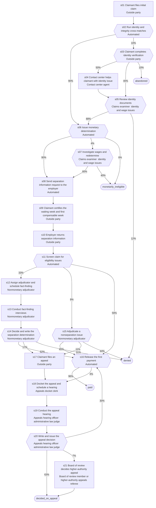

# Initial unemployment insurance claim at a US state agency

`gov-unemployment-insurance-claim` · state government · unemployment insurance benefits

A worker who has lost a job files an initial claim for unemployment insurance with the state agency, which must confirm identity, check that past wages are high enough, learn from the employer why the job ended, and decide any eligibility question before paying benefits. Most claims are paid automatically about two to three weeks after filing, once the waiting week and first payable week have passed. About a third need an adjudicator to interview the claimant and employer about a quit or discharge, and denied claimants can appeal to a hearing officer. Elapsed time is driven by the weekly certification calendar, adjudication queues and appeal hearing schedules, all of which lengthened sharply in the 2020 to 2022 claim surge.

| | |
|---|---|
| Unit of work | one new initial claim for regular state unemployment insurance |
| Starts when | The claimant files an initial claim online or by phone after losing work. |
| Done when | The first payment is issued, the claim is denied or abandoned with no appeal, or a first-level or higher-authority appeal decision is issued. |
| Organisation | A mid-size US state workforce agency handling about 12,000 new initial claims a month in normal conditions, with an online claim system, a contact center, an adjudication unit and an appeals tribunal. (1,200 employees, 2019-2022) |
| Volume | 12,000 cases a month (range 8,000 to 20,000) |

## Where it sits

- Starts with **initial claim** from Unemployed worker (claimant) (97% of cases)
- Starts with **employer-filed or attached claim** from Employer mass layoff or attached claim filing (3% of cases)
- Sends **first benefit payment and continued weekly claims** to Claimant (outcome: paid)
- Sends **benefit charges to the employer account** to Employer tax and experience rating (outcome: paid)
- Sends **claimant referral for work search and reemployment assessment** to Reemployment services (outcome: paid)
- Sends **determination with appeal rights** to Claimant (outcome: denied)
- Sends **monetary determination** to Claimant (outcome: monetarily_ineligible)
- Sends **appeal decision** to Claimant and employer (outcome: decided_on_appeal)
- Sends **ETA 5159, 9050, 9052, 207, 218 and 5130 report counts** to US Department of Labor reporting (outcome: any)

## Flow

## Roles

| Role | Department | Layer | FTE on this process | Loaded cost per hour | Evidence |
|---|---|---|---:|---:|---|
| Contact center agent | UI contact center | individual contributor | 6 | 36 USD | B [bls_csr], [bls_ecec] |
| Claims examiner (identity and wage issues) | UI benefits operations | individual contributor | 8 | 41 USD | B [bls_elig], [bls_ecec] |
| Nonmonetary adjudicator | UI adjudication | senior specialist | 52 | 45 USD | B [bls_elig], [bls_ecec], [eta207] |
| Appeals docket clerk | Appeals tribunal | individual contributor | 5 | 41 USD | C [bls_clerk], [bls_ecec] |
| Appeals hearing officer (administrative law judge) | Appeals tribunal | senior specialist | 17 | 81 USD | B [bls_alj], [bls_ecec] |
| Board of review member or higher-authority appeals referee | Board of review | executive | 1 | 120 USD | C [bls_alj] |

## Steps

Hands-on time and the wait before each step show the most common value. Evidence tier A is a sourced number, B a sourced description, C the author's estimate.

| Step | Who | Kind | Hands-on | Wait before | Control | Evidence |
|---|---|---|---:|---:|---|---|
| **s01 Claimant files initial claim.** The claimant files online or by phone, giving identity details, employers in the last 18 months, the reason for separation, and answers to eligibility questions about availability for work, other income and pensions, and registers for work as state law requires. | Outside party | intake | 0 min | 0 min |  | B [eta5159] |
| **s02 Run identity and integrity cross-matches.** The benefits system verifies the Social Security number and runs overnight cross-matches against integrity databases, new hire and prison records and earlier claims, and flags claims whose identity cannot be confirmed automatically. | Automated | system auto | 0 min | 12.0 h | State UI law and US Department of Labor integrity requirements to verify claimant identity and Social Security number before payment | C |
| **s03 Claimant completes identity verification.** The flagged claimant receives a notice asking for proof of identity and uploads a photo identification and proof of address, completes online identity proofing, or visits an office. | Outside party | external wait | 0 min | 3.0 d |  | C |
| **s04 Contact center helps claimant with identity issue.** A contact center agent answers or returns the claimant's call, looks up the claim, explains which documents are needed and how to upload them, and notes the call on the claim record. | Contact center agent | communication | 12 min | 1.0 d |  | C |
| **s05 Review identity documents.** A claims examiner opens the uploaded documents, compares name, date of birth, Social Security number and address with the claim and wage records, and clears the identity hold or denies the claim for failure to verify identity. | Claims examiner (identity and wage issues) | validation | 15 min | 4.0 d | State UI law and US Department of Labor integrity requirements on identity verification | C |
| **s06 Issue monetary determination.** The system pulls the claimant's base-period wages from the quarterly wage records, applies the state's earnings tests, computes the weekly benefit amount and maximum duration, and mails or posts the monetary determination. | Automated | system auto | 0 min | 12.0 h | State UI law base-period wage and earnings requirements (monetary eligibility) | A [eta218] |
| **s07 Investigate wages and redetermine.** A claims examiner reviews the claimant's pay stubs or W-2s, contacts the employer or another state for missing wages, adds the wages to the record and issues a redetermination. | Claims examiner (identity and wage issues) | analysis | 1.0 h | 10.0 d | State UI law on monetary redetermination and wage investigation | C |
| **s08 Send separation information request to the employer.** The system sends the last employer a request for the reason for separation through the electronic exchange or by mail, with a deadline of about 10 days, and charges notice for experience rating. | Automated | system auto | 0 min | 0 min | State UI law notice to the last employer and opportunity to provide separation information (Social Security Act s. 303(a)(1) methods of administration) | C |
| **s09 Claimant certifies the waiting week and first compensable week.** After each week ends the claimant files a weekly certification online or by phone, reporting earnings, availability, work search and any job refusals; in most states the first week is an unpaid waiting week. | Outside party | external wait | 0 min | 13.0 d | State UI law weekly eligibility conditions: able, available and actively seeking work | B [cfr640] |
| **s10 Employer returns separation information.** The employer's payroll or third-party claims administrator returns the separation reason, often contesting a quit or discharge, or does not respond by the deadline. | Outside party | external wait | 0 min | 12.0 h |  | C |
| **s11 Screen claim for eligibility issues.** The system compares the claimant's separation reason, certification answers and the employer's response, sets an issue for any quit, discharge, availability, refusal or income question, and otherwise releases the claim for payment. | Automated | system auto | 0 min | 4.0 h |  | A [eta207] |
| **s12 Assign adjudicator and schedule fact-finding.** The adjudication unit assigns the issue to an adjudicator, who reviews the claim, the employer's statement and prior claims, and sends both parties a notice of a scheduled phone fact-finding interview. | Nonmonetary adjudicator | coordination | 15 min | 3.0 d |  | C [eta9052] |
| **s13 Conduct fact-finding interviews.** The adjudicator calls the claimant and the employer, asks about the events leading to the separation, records each statement and any documents such as warnings or resignation letters, and offers rebuttal; employers often do not answer. | Nonmonetary adjudicator | communication | 45 min | 3.0 d |  | C |
| **s14 Decide and write the separation determination.** The adjudicator weighs the statements against the state's voluntary quit and misconduct provisions, writes a determination with findings of fact, reasoning and appeal rights, and issues it to the claimant and employer. | Nonmonetary adjudicator | judgment | 40 min | 1.0 d | State UI law disqualification provisions; Social Security Act s. 303(a)(1) methods of administration; DOL nonmonetary determination timeliness (80% within 21 days) and quality standards | A [eta207], [core], [eta5130] |
| **s15 Adjudicate a nonseparation issue.** The adjudicator contacts the claimant about availability, a job refusal, school attendance or other income, reviews documents, and issues a determination allowing or denying the affected weeks. | Nonmonetary adjudicator | judgment | 30 min | 6.0 d | State UI law able and available and suitable work provisions; DOL nonmonetary timeliness and quality standards | B [eta9052], [eta207] |
| **s16 Release the first payment.** With the weeks certified and no pending issue, the nightly payment run calculates the payment for the first compensable week, applies tax withholding if chosen, and sends it by direct deposit or debit card. | Automated | system auto | 0 min | 2.0 d | Social Security Act s. 303(a)(1) full payment when due; 20 CFR 640.5 first payment promptness (87% within 14 or 21 days) | A [eta9050], [cfr640] |
| **s17 Claimant files an appeal.** The denied claimant files an appeal online, by mail or by fax within the state's deadline, usually 10 to 30 days, often continuing to certify weeks while the appeal is pending. | Outside party | external wait | 0 min | 6.0 d |  | C |
| **s18 Docket the appeal and schedule a hearing.** The appeals clerk creates the appeal case, attaches the determination and claim file, schedules a telephone hearing with a hearing officer, and mails notices to both parties at least several days in advance. | Appeals docket clerk | coordination | 20 min | 3.0 d |  | C |
| **s19 Conduct the appeal hearing.** The hearing officer reviews the file, holds a recorded telephone hearing with the claimant, the employer and witnesses, takes testimony and exhibits under oath, and closes the record. | Appeals hearing officer (administrative law judge) | judgment | 1.2 h | 14.0 d | Social Security Act s. 303(a)(3) opportunity for a fair hearing; 20 CFR 650.4 appeals promptness (60% within 30 days, 80% within 45) | A [eta9054], [cfr650] |
| **s20 Write and issue the appeal decision.** The hearing officer writes the decision with findings of fact and conclusions of law, affirming or reversing the determination, and mails it with rights to a further appeal. | Appeals hearing officer (administrative law judge) | drafting | 45 min | 1.0 d |  | A [eta5130] |
| **s21 Board of review decides higher-authority appeal.** The board of review or higher-authority referee reviews the hearing record and written arguments, usually without a new hearing, and issues a decision affirming, reversing or remanding. | Board of review member or higher-authority appeals referee | review | 1.5 h | 60.0 d | State UI law higher-authority appeal and Social Security Act s. 303(a)(3) fair hearing | C |

## Exceptions

| Exception | Share of cases | What happens |
|---|---:|---|
| Identity flag | 10% | Automated checks cannot confirm identity, so the claimant must submit documents, often calls the contact center, and an examiner reviews them; in 2020 and 2021 fraud attacks made this far more common. |
| Monetarily ineligible or wage dispute | 10% | Base-period wages are too low; some claimants supply missing wages and are redetermined eligible. |
| Separation adjudication | 29% | The claimant quit or was discharged, or the employer contests, so an adjudicator holds fact-finding before any payment. |
| Nonseparation issue before first payment | 7% | An availability, job refusal, school or income question on the first certifications is adjudicated before payment. |
| Claimant appeal | 6% | A denied claimant appeals and a hearing officer holds a telephone hearing; about a third of decisions reverse the denial. |
| Employer appeal of an allowed claim | 2% | The employer appeals an allowance after benefits have started; payments continue while the appeal is heard. |
| Higher-authority appeal | 1% | The losing party appeals the hearing decision to the board of review. |
| Claim surge backlog | 0% | In 2020 and 2021, claim volume rose several-fold, so identity, adjudication and appeal queues grew from days to months; this is shown in the benchmarks rather than in the step times. |

## Benchmarks

| Metric | Value | Unit | Population | Evidence |
|---|---|---|---|---|
| cycle_time_days | p50 20, p90 35 | calendar days from filing to first payment for paid claims, normal operations | Intrastate regular UI first payments, US, 2019 (author's synthesis) | C [eta9050], [cfr640] |
| first_payments_within_14_days_share | 2019 0.824, 2020 0.643, 2021 0.585, 2022 0.621 | share of intrastate UI first payments within 14 days of the end of the first compensable week | All states | A [eta9050], [et402] |
| first_payment_promptness_standard | within_14_or_21_days 0.87, within_35_days 0.93 | required share of intrastate first payments | All states (federal regulation) | A [cfr640], [core] |
| separation_determinations_within_21_days_share | 2019 0.658, 2020 0.375, 2021 0.325, 2022 0.381 | share of intrastate separation determinations within 21 days of detection | All states | A [eta9052], [et402] |
| lower_authority_appeals_within_30_days_share | 2019 0.72, 2020 0.407, 2021 0.111, 2022 0.161 | share of first-level appeal decisions within 30 days of filing | All states | A [eta9054], [cfr650], [et402] |
| first_payments_per_new_initial_claim | 2019 0.69, 2022 0.53 | ratio | All states | A [eta5159] |
| monetary_ineligible_share | 2019 0.101, 2022 0.225 | share of monetary determinations with insufficient wages | All states | A [eta218] |
| separation_denial_rate | 2019 0.477, 2022 0.538 | share of separation determinations that deny | All states | A [eta207] |
| appeals_per_new_initial_claim | 2019 0.133 | lower authority appeals filed per new intrastate claim | All states | A [eta5130], [eta5159] |
| appeal_decisions_in_favor_of_appellant | 2019 0.323, 2022 0.265 | share of lower authority decisions | All states | A [eta5130] |

## Pain points

- During the 2020 to 2022 surge first payments slowed sharply: the share within 14 days fell from 82% in 2019 to 58% to 64%. (steps s05, s12, s16; A [eta9050])
- Appeal backlogs: the share of first-level decisions within 30 days fell from 72% in 2019 to 11% in 2021 and 16% in 2022, far below the 60% federal criterion. (steps s18, s19; A [eta9054], [cfr650])
- Separation adjudication depends on reaching both parties by phone; employers often respond late or not at all, and determinations miss the 21-day target about a third of the time even in normal years. (steps s10, s12, s13, s14; A [eta9052])
- Identity verification holds and document reviews stall legitimate claims and drive contact center calls, while fraud attempts surged in 2020 and 2021. (steps s02, s03, s04, s05; C)
- Monetary ineligibility more than doubled during the surge (10% in 2019, 23% to 44% in 2020 to 2022), adding wage disputes and redeterminations. (steps s06, s07; A [eta218])

## Assumptions

- Step times and branch shares are set for normal operations, calibrated to 2019 national ETA reports; 2020 to 2022 surge conditions appear only in the benchmarks and pain points.
- Most states have a one-week unpaid waiting week, so the first compensable week ends about 13 days after filing; non-waiting-week states pay about a week sooner. The certification wait (5 to 16 days) blends both.
- Sequential model: issue detection really happens at filing or when the employer responds, during the certification wait; the adjudication queue is shortened so that detection to determination matches the 2019 ETA 9052 median band.
- The 33% separation issue rate sits between 0.26 (per total initial claim) and 0.40 (per new claim) separation determinations in 2019 ETA 207 data.
- Shares for identity flags (10%), nonseparation issues before first payment (8%), appeal after denial (35% separation, 20% nonseparation) and board appeals (7%) are estimates.
- Claimant and employer time is outside the agency and is shown as waiting with zero hands-on time; contact center work counts only identity-related calls on initial claims.
- Hands-on times per step and the resulting staffing (about one staff hour per initial claim across identity, adjudication and appeals) are estimates; no minutes-per-unit figures were sourced.
- The process ends at the first payment for paid claims; continued weekly claims, later nonmonetary issues and overpayment recovery are out of scope.
- An employer appeal reversed in the employer's favor would create an overpayment; the model routes all favorable-to-appellant decisions to payment, which slightly overstates paid outcomes.
- Loaded costs use BLS May 2021 wages times about 1.9 (benefits factor 1.62 from BLS ECEC for state and local government plus about 20% overhead).
- The web search budget ran out during research, so identity verification guidance (UIPL) and state law details could not be opened and those controls rest on general knowledge.

## Sources

- [eta9050] [ETA 9050 Time Lapse of All First Payments (data file ar9050.csv)](https://oui.doleta.gov/unemploy/csv/ar9050.csv) (US Department of Labor, Employment and Training Administration, 2026). Intrastate UI first payments by days from the end of the first compensable week, national totals computed by the author: 2019 n=4.58 million, 55.4% within 7 days, 82.4% within 14, 91.2% within 21, 94.6% within 28, 97.2% within 42; 2020 64.3% within 14 and 75.2% within 21; 2021 58.5% and 67.3%; 2022 62.1% and 71.0%.
- [eta9052] [ETA 9052 Nonmonetary Determination Time Lapse, Detection Date (data file ar9052.csv)](https://oui.doleta.gov/unemploy/csv/ar9052.csv) (US Department of Labor, Employment and Training Administration, 2026). Intrastate determinations by days from issue detection, national, author's computation: separation issues 2019 median in the 15 to 21 day band, 19.5% within 14 days, 65.8% within 21, 93.2% within 35; 2022 38.1% within 21 and 58.1% within 35; nonseparation issues 2019 61.4% within 14 and 83.8% within 21.
- [eta9054] [ETA 9054L Lower Authority Appeals Time Lapse (data file ar9054l.csv)](https://oui.doleta.gov/unemploy/csv/ar9054l.csv) (US Department of Labor, Employment and Training Administration, 2026). Intrastate first-level appeal decisions by days from appeal filing, author's computation: 2019 72.0% within 30 days, 90.2% within 45, 95.2% within 60; 2020 40.7% within 30; 2021 11.1%; 2022 16.1% within 30 and 49.0% within 120.
- [eta5159] [ETA 5159 Claims and Payment Activities (data file ar5159.csv)](https://oui.doleta.gov/unemploy/csv/ar5159.csv) (US Department of Labor, Employment and Training Administration, 2026). State UI new intrastate initial claims and intrastate first payments, author's computation: 2019 7.24 million new claims and 4.96 million first payments (0.69 per new claim); 2020 54.75 million new claims; 2021 20.65 million; 2022 8.05 million new claims and 4.25 million first payments.
- [eta207] [ETA 207 Nonmonetary Determination Activities (data file ar207.csv)](https://oui.doleta.gov/unemploy/csv/ar207.csv) (US Department of Labor, Employment and Training Administration, 2026). Author's computation, 2019: 2.92 million separation determinations (0.40 per new intrastate claim, 0.26 per total initial claim; 32% voluntary leaving, 67% discharge) with 47.7% denials; 3.10 million nonseparation determinations with 85.7% denials. 2022: separation denial rate 53.8%.
- [eta218] [ETA 218 Benefit Rights and Experience (data file ar218.csv)](https://oui.doleta.gov/unemploy/csv/ar218.csv) (US Department of Labor, Employment and Training Administration, 2026). Monetary determinations, author's computation: 2019 7.56 million with 10.1% insufficient wage credits; 2020 29.6%; 2021 43.6%; 2022 22.5%.
- [eta5130] [ETA 5130 Benefit Appeals (data file ar5130.csv)](https://oui.doleta.gov/unemploy/csv/ar5130.csv) (US Department of Labor, Employment and Training Administration, 2026). Author's computation, 2019: 960,092 single-claimant lower authority appeals filed (0.133 per new intrastate claim); 936,288 decisions, 80.3% with the claimant as appellant, 32.3% in favor of the appellant. 2022: 1.19 million appeals filed, 26.5% in favor of the appellant.
- [et402] [ET Handbook 402, Unemployment Insurance Reports Handbook: data map of report columns](https://oui.doleta.gov/dmstree/handbooks/402/402_4/4024c6/4024c6.pdf) (US Department of Labor, Employment and Training Administration, 2026). Defines the columns of ETA 9050, 9052, 9054L, 5159, 207, 218 and 5130 used in the author's computations.
- [core] [UI Performs Core Measures and Acceptable Levels of Performance](https://oui.doleta.gov/unemploy/pdf/Core_Measures.pdf) (US Department of Labor, Office of Unemployment Insurance, 2026). First payment promptness 87% within 14/21 days of the end of the first compensable week; nonmonetary determinations 80% within 21 days of detection; nonmonetary quality 75% scoring 95 or more; average age of pending lower authority appeals 30 days; lower authority appeals quality 80%; regulation standards of 60% of appeals decided within 30 days and 80% within 45.
- [cfr640] [20 CFR 640.5, Criteria for compliance (benefit payment promptness)](https://www.law.cornell.edu/cfr/text/20/640.5) (Legal Information Institute, Cornell Law School, 2026). Intrastate first payments: 87% within 14 days of the end of the first compensable week in waiting-week states or 21 days in non-waiting-week states, and 93% within 35 days.
- [cfr650] [20 CFR 650.4, Criteria for state compliance (appeals promptness)](https://www.law.cornell.edu/cfr/text/20/650.4) (Legal Information Institute, Cornell Law School, 2026). At least 60% of first level benefit appeal decisions within 30 days of the date of appeal and 80% within 45 days.
- [bls_elig] [Occupational Employment and Wages, May 2021: 43-4061 Eligibility Interviewers, Government Programs](https://www.bls.gov/oes/2021/may/oes434061.htm) (US Bureau of Labor Statistics, 2022). Mean hourly wage $23.35 nationally, $21.31 in state government; 25th percentile $17.91, 75th $28.73.
- [bls_alj] [Occupational Employment and Wages, May 2021: 23-1021 Administrative Law Judges, Adjudicators, and Hearing Officers](https://www.bls.gov/oes/2021/may/oes231021.htm) (US Bureau of Labor Statistics, 2022). Mean hourly wage $50.08 nationally, $42.64 in state government; 25th percentile $30.70, 75th $63.70.
- [bls_csr] [Occupational Employment and Wages, May 2021: 43-4051 Customer Service Representatives](https://www.bls.gov/oes/2021/may/oes434051.htm) (US Bureau of Labor Statistics, 2022). Mean hourly wage $18.79; 25th percentile $14.28, 75th $22.34.
- [bls_clerk] [Occupational Employment and Wages, May 2021: 43-4031 Court, Municipal, and License Clerks](https://www.bls.gov/oes/2021/may/oes434031.htm) (US Bureau of Labor Statistics, 2022). Mean hourly wage $21.57; 25th percentile $17.64, 75th $23.19.
- [bls_ecec] [Employer Costs for Employee Compensation, December 2020](https://www.bls.gov/news.release/archives/ecec_03182021.htm) (US Bureau of Labor Statistics, 2021). State and local government workers: total compensation $53.47 per hour, wages $33.08, benefits 38.1% of compensation.

Written by claude-opus on 2026-11-17.
