# Discharge of an adult medical inpatient from an acute hospital

`hc-inpatient-discharge` · healthcare · inpatient nursing, care management and patient flow

Discharging a medical inpatient starts with a discharge planning assessment early in the stay and ends when the bed is cleaned and released for the next patient. Case managers and social workers arrange home health or facility placement and payer approvals, the hospitalist writes the order, reconciles medications and the discharge summary, and the nurse teaches the patient and family before transport. Much of the work is at the bedside and on the phone. Delays come from waiting for facility bed offers and plan approvals, late discharge orders, nurse availability, rides that arrive late and rooms waiting for cleaning, and errors in medication lists and follow-up plans lead to harm and readmissions after discharge.

| | |
|---|---|
| Unit of work | one adult medical inpatient discharge |
| Starts when | An adult patient is admitted to a medical unit and enters the discharge planning screen. |
| Done when | The patient has left with instructions, medications, follow-up and any post-acute services arranged, and the bed is cleaned and released. |
| Organisation | A US community hospital of about 300 beds with a hospitalist group, RN case managers and social workers, and in-house pharmacy, therapy, transport and environmental services. (2,500 employees, 2019-2022) |
| Volume | 950 cases a month (range 850 to 1,050) |

## Where it sits

- Starts with **admitted patient** from Inpatient admission (emergency department and direct admissions) (100% of cases)
- Sends **available bed** to Bed management and emergency department admissions (outcome: bed_ready)
- Sends **discharge summary and transfer packet** to Primary care physician and receiving facility or home health agency (outcome: bed_ready)
- Sends **completed inpatient record** to Health information management coding and billing (outcome: bed_ready)
- Sends **discharge instructions and prescriptions** to Patient and family (outcome: bed_ready)

## Flow

```mermaid
flowchart TD
    s01{{"s01 Screen and assess discharge needs<br/>RN case manager"}}
    s02{{"s02 Deliver the Important Message from Medicare<br/>Health unit coordinator  unit clerk"}}
    s03["s03 Physical therapy evaluates mobility and disposition<br/>Physical therapist"]
    s04{{"s04 Interdisciplinary rounds confirm readiness and disposition<br/>Hospitalist  attending physician"}}
    s05["s05 Arrange home health and equipment<br/>RN case manager"]
    s06{{"s06 Home health agency accepts and schedules the first visit<br/>Outside party"}}
    s07["s07 Present facility choices and send referrals<br/>Hospital social worker"]
    s08{{"s08 Facilities review referrals and offer beds<br/>Outside party"}}
    s09["s09 Request authorization for the post-acute stay<br/>RN case manager"]
    s10{{"s10 Plan decides on the post-acute request<br/>Outside party"}}
    s11{{"s11 Write the discharge order and reconcile medications<br/>Hospitalist  attending physician"}}
    s12["s12 Pharmacist reviews the discharge medication list<br/>Clinical pharmacist"]
    s13{{"s13 Write the discharge summary<br/>Hospitalist  attending physician"}}
    s14["s14 Give the follow-up copy of the Medicare notice<br/>RN case manager"]
    s15{{"s15 Nurse removes lines and teaches the discharge plan<br/>Staff nurse  medical unit"}}
    s16["s16 Book follow-up appointments<br/>Health unit coordinator  unit clerk"]
    s17{{"s17 Arrange the ride<br/>Health unit coordinator  unit clerk"}}
    s18["s18 Wait for the family to arrive<br/>Outside party"]
    s19["s19 Give report and send the transfer packet<br/>Staff nurse  medical unit"]
    s20["s20 Wait for the wheelchair van or ambulance<br/>Outside party"]
    s21["s21 Escort the patient out<br/>Patient transporter"]
    s22["s22 Record the discharge in the ADT system<br/>Health unit coordinator  unit clerk"]
    s23["s23 Clean the room after discharge<br/>Environmental services technician"]
    s24["s24 Inspect and release the bed<br/>Environmental services lead"]
    s01 -->|"48%"| s02
    s01 -->|"25%"| s03
    s01 -->|"27%"| s04
    s02 -->|"55%"| s03
    s02 -->|"45%"| s04
    s03 --> s04
    s04 -->|"65%"| s11
    s04 -->|"18%"| s05
    s04 -->|"17%"| s07
    s05 --> s06
    s06 -->|"92%"| s11
    s06 -->|"8%"| s05
    s07 --> s08
    s08 -->|"55%"| s09
    s08 -->|"30%"| s11
    s08 -->|"15%"| s07
    s09 --> s10
    s10 -->|"86%"| s11
    s10 -->|"7%"| s09
    s10 -->|"7%"| s05
    s11 -->|"35%"| s12
    s11 -->|"65%"| s13
    s12 --> s13
    s13 -->|"45%"| s14
    s13 -->|"55%"| s15
    s14 --> s15
    s15 -->|"96%"| s16
    s15 -->|"4%"| s04
    s16 --> s17
    s17 -->|"72%"| s18
    s17 -->|"28%"| s19
    s18 --> s21
    s19 --> s20
    s20 --> s21
    s21 --> s22
    s22 --> s23
    s23 --> s24
    s24 --> end0
    end0(["bed_ready"])
```

## Roles

| Role | Department | Layer | FTE on this process | Loaded cost per hour | Evidence |
|---|---|---|---:|---:|---|
| RN case manager | Care management | senior specialist | 6 | 72 USD | B [cfr482_43], [bls_oes2021], [bls_ecec2021] |
| Hospital social worker | Care management | senior specialist | 1.8 | 54 USD | B [cfr482_43], [bls_oes2021], [bls_ecec2021] |
| Hospitalist (attending physician) | Hospital medicine | senior specialist | 6.5 | 210 USD | C [bls_oes2021], [bls_ecec2021] |
| Staff nurse (medical unit) | Nursing, medical unit | individual contributor | 6.5 | 72 USD | B [psnet_discharge], [bls_oes2021], [bls_ecec2021] |
| Clinical pharmacist | Pharmacy | senior specialist | 1.1 | 109 USD | B [psnet_medrec], [bls_oes2021], [bls_ecec2021] |
| Physical therapist | Rehabilitation services | senior specialist | 3 | 80 USD | C [bls_ecec2021] |
| Health unit coordinator (unit clerk) | Nursing, medical unit | individual contributor | 4.3 | 34 USD | C [bls_oes2021], [bls_ecec2021] |
| Patient transporter | Patient transport | individual contributor | 2.3 | 29 USD | C [bls_oes2021], [bls_ecec2021] |
| Environmental services technician | Environmental services | individual contributor | 7 | 26 USD | C [bls_oes2021], [bls_ecec2021] |
| Environmental services lead | Environmental services | supervisor | 1 | 33 USD | C [bls_oes2021], [bls_ecec2021] |

## Steps

Hands-on time and the wait before each step show the most common value. Evidence tier A is a sourced number, B a sourced description, C the author's estimate.

| Step | Who | Kind | Hands-on | Wait before | Control | Evidence |
|---|---|---|---:|---:|---|---|
| **s01 Screen and assess discharge needs.** Within a day or two of admission the RN case manager reviews the chart, interviews the patient and family about home situation, prior services, insurance and caregivers, scores readmission and post-acute risk, and documents an initial discharge plan in the care management system. | RN case manager | analysis | 25 min | 12.0 h | 42 CFR 482.43(a): identify at an early stage patients likely to need discharge planning; evaluation by or under an RN, social worker or other qualified person. | B [cfr482_43] |
| **s02 Deliver the Important Message from Medicare.** Staff take the standard Medicare discharge appeal rights notice to the bedside, explain it, and have the patient or representative sign and date it; the signed copy is scanned into the record. | Health unit coordinator (unit clerk) | communication | 6 min | 1.0 h | 42 CFR 405.1205(b): deliver the standardized notice within 2 calendar days of admission with signature. | A [cfr405_1205] |
| **s03 Physical therapy evaluates mobility and disposition.** A physical therapist assesses transfers, gait and stairs at the bedside, reviews the home setup with the patient, and writes a recommendation for home, home with services and equipment, or a skilled nursing or rehabilitation facility. | Physical therapist | physical | 45 min | 4.0 h |  | C |
| **s04 Interdisciplinary rounds confirm readiness and disposition.** Each day the hospitalist, nurse and case manager review progress, set the expected discharge date and the disposition, and identify barriers such as pending tests or consults. The wait before this step is the remaining treatment time until the patient is medically ready. | Hospitalist (attending physician) | judgment | 6 min | 1.2 d |  | B [hcup180], [psnet_discharge] |
| **s05 Arrange home health and equipment.** The case manager gives the patient the list of participating home health agencies, records the choice, sends the referral with orders and face-to-face documentation through the referral portal or fax, and orders equipment such as a walker or home oxygen from a supplier. | RN case manager | coordination | 35 min | 6.0 h | 42 CFR 482.43(c): list of participating home health agencies, patient freedom of choice and no steering. | B [cfr482_43] |
| **s06 Home health agency accepts and schedules the first visit.** The agency's intake team checks coverage, staffing for the patient's area and the orders, then accepts and sets a start-of-care date, or declines. | Outside party | external wait | 0 min | 8.0 h |  | C |
| **s07 Present facility choices and send referrals.** The social worker meets the patient and family, gives the list of participating skilled nursing or rehabilitation facilities with quality data, records their choices, and sends referral packets with clinical notes, therapy notes and medication lists to several facilities through the referral portal. | Hospital social worker | coordination | 50 min | 1.0 d | 42 CFR 482.43(c): list of participating SNF, IRF or LTCH providers with quality and resource-use data, patient choice respected and no limiting of providers. | B [cfr482_43] |
| **s08 Facilities review referrals and offer beds.** Admissions staff at each facility review the clinical packet, insurance and care needs and decide whether to offer a bed and when; families may tour before choosing. | Outside party | external wait | 0 min | 1.0 d |  | B [medicare_snf] |
| **s09 Request authorization for the post-acute stay.** The case manager submits clinical notes and therapy evaluations to the Medicare Advantage or commercial plan through its portal or by fax and answers questions from the plan's reviewer. | RN case manager | data entry | 25 min | 4.0 h | Health plan prior authorization requirement for post-acute admissions (plan contract and medical policy). | B [oig2022] |
| **s10 Plan decides on the post-acute request.** The plan's utilization review nurse and medical director review the request; the patient stays in the hospital bed while the decision is pending. | Outside party | external wait | 0 min | 2.0 d |  | B [oig2022] |
| **s11 Write the discharge order and reconcile medications.** The hospitalist writes the discharge order, compares the home medication list with inpatient orders in the EHR reconciliation screen, decides which drugs to continue, stop or change, signs new prescriptions and lists follow-up needs. | Hospitalist (attending physician) | judgment | 15 min | 4.0 h | Joint Commission National Patient Safety Goal NPSG.03.06.01: compare current and ordered medications, resolve discrepancies and give the patient the list. | B [psnet_medrec], [psnet_discharge] |
| **s12 Pharmacist reviews the discharge medication list.** For patients on many or high-risk drugs, the pharmacist checks the reconciled list for omissions, duplicates and interactions, contacts the hospitalist about discrepancies and counsels the patient at the bedside. | Clinical pharmacist | review | 20 min | 1.0 h | Hospital policy for pharmacist review of high-risk discharges. | B [psnet_medrec] |
| **s13 Write the discharge summary.** The hospitalist dictates or types the discharge summary with the hospital course, final diagnoses, disposition, medication changes, pending results and follow-up plan, and signs it; it is sent to the primary care physician and any receiving facility. Many summaries are finished after the patient leaves. | Hospitalist (attending physician) | drafting | 20 min | 0 min | 42 CFR 482.24(c)(4)(vii) and (viii): discharge summary with outcome, disposition and follow-up, and records completed within 30 days; 42 CFR 482.43 transfer of necessary information. | B [cfr482_24], [psnet_readmit] |
| **s14 Give the follow-up copy of the Medicare notice.** The case manager or unit staff give the patient a copy of the signed appeal rights notice no more than two days before discharge and answer questions; a patient who appeals stays while the quality improvement organization reviews. | RN case manager | communication | 5 min | 30 min | 42 CFR 405.1205(c): follow-up copy no more than 2 calendar days before discharge. | A [cfr405_1205] |
| **s15 Nurse removes lines and teaches the discharge plan.** The staff nurse removes the IV and monitors, prints the discharge instructions, goes through medications, warning signs and follow-up with the patient and family using teach-back, gets signatures and returns belongings. The nurse fits this between other patients' care. | Staff nurse (medical unit) | physical | 35 min | 1.0 h | Hospital discharge education policy (teach-back and signed instructions), supporting the CoP requirement to involve patients and caregivers. | B [psnet_discharge], [cfr482_43] |
| **s16 Book follow-up appointments.** The unit clerk calls the primary care or specialist office to book a visit within one to two weeks and writes the date on the instructions; when offices are closed the patient is told to call. | Health unit coordinator (unit clerk) | coordination | 10 min | 20 min |  | B [psnet_discharge] |
| **s17 Arrange the ride.** The unit clerk or case manager confirms who is picking the patient up, or books a wheelchair van or ambulance for patients going to a facility or who cannot travel by car. | Health unit coordinator (unit clerk) | coordination | 10 min | 15 min |  | C |
| **s18 Wait for the family to arrive.** The patient waits in the room, or in a discharge lounge where one exists, until the family member arrives after work or school. | Outside party | external wait | 0 min | 1.0 h |  | C |
| **s19 Give report and send the transfer packet.** For facility transfers the nurse phones a report to the receiving nurse and prints or sends the transfer packet with the summary, medication list and orders; for medical transport the packet goes with the crew. | Staff nurse (medical unit) | communication | 20 min | 30 min | 42 CFR 482.43(b): transfer the patient with all necessary medical information to the post-acute provider. | B [cfr482_43] |
| **s20 Wait for the wheelchair van or ambulance.** The transport company sends a crew at the booked time, often later, and the patient stays in the bed until it arrives. | Outside party | external wait | 0 min | 2.0 h |  | C |
| **s21 Escort the patient out.** A transporter or nursing assistant brings a wheelchair, takes the patient and belongings to the exit or to the ambulance crew, and confirms departure with the nurse. | Patient transporter | physical | 15 min | 20 min |  | C |
| **s22 Record the discharge in the ADT system.** The unit clerk enters the discharge time and disposition in the ADT system, which marks the bed dirty on the bed board and sends a cleaning request to environmental services. Entry is often delayed when the clerk is busy. | Health unit coordinator (unit clerk) | data entry | 2 min | 20 min |  | C |
| **s23 Clean the room after discharge.** An environmental services technician takes the task from the dispatch system, strips the bed, removes waste and linen, cleans and disinfects surfaces and equipment, and remakes the bed; isolation rooms need a longer clean. | Environmental services technician | physical | 45 min | 45 min | Infection prevention and control standards for environmental cleaning (Joint Commission infection control chapter and hospital policy). | C |
| **s24 Inspect and release the bed.** The environmental services lead or charge nurse checks the room, then marks the bed clean on the bed board so bed placement can assign the next patient from the emergency department or admissions queue. | Environmental services lead | review | 5 min | 15 min | Hospital environmental services quality inspection policy. | C |

## Exceptions

| Exception | Share of cases | What happens |
|---|---:|---|
| Skilled nursing or rehabilitation placement | 17% | Referrals to several facilities, waiting for bed offers and, for managed care, plan authorization, while the patient occupies the bed. |
| Plan denies post-acute stay | 1% | The plan denies; the team requests a peer-to-peer and resubmits, or arranges home health instead. |
| Discharge cancelled on the day | 4% | A new symptom, test result or unready family stops the discharge after the order and education. |
| Medicare appeal of discharge | 0% | The patient asks the quality improvement organization to review the discharge and stays until it decides. |
| Medical transport delay | 28% | Facility and non-ambulatory patients wait for a wheelchair van or ambulance crew. |
| Agency declines home health referral | 2% | The agency lacks staff for the area and the case manager refers to another. |

## Benchmarks

| Metric | Value | Unit | Population | Evidence |
|---|---|---|---|---|
| cycle_time_days | p50 4, p90 9 | calendar days from the discharge planning screen to the bed released (about the length of stay) | Adult medical inpatients, US community hospitals | C [hcup180] |
| mean_length_of_stay | 4.5 | days | All US community hospital stays, 2012 | A [hcup180] |
| medicare_30_day_readmission | 0.2 | share of Medicare patients readmitted within 30 days (nearly 20 percent) | Medicare | A [psnet_readmit] |
| adverse_events_within_3_weeks | 0.2 | share of discharged patients | Classic study cited by AHRQ PSNet | A [psnet_readmit] |
| discharges_with_instruction_or_medication_errors | 0.1 | share of discharges (about 1 in 10, including caught near-misses) | One study cited by AHRQ PSNet | A [psnet_discharge] |
| patients_leaving_with_results_pending | 0.4 | share of patients (nearly 40 percent) | AHRQ PSNet | A [psnet_readmit] |
| hrrp_max_payment_reduction | 0.03 | share of Medicare base payments | Hospitals under HRRP | A [cms_hrrp] |

## Pain points

- Patients who are medically ready wait in beds for facility bed offers and plan authorizations. (steps s07, s08, s09, s10; B [oig2022], [cfr482_43])
- Discharge day is hard to predict, so orders, education and information all happen in a rush on the day. (steps s11, s15, s13; B [psnet_discharge])
- Medication discrepancies and missing follow-up lead to harm after discharge. (steps s11, s12, s16; A [psnet_readmit], [psnet_discharge])
- Discharge summaries often reach the outpatient physician late or lack pending results. (steps s13; A [psnet_readmit])
- Late rides, delayed ADT entries and cleaning queues hold the bed empty while emergency patients wait for it. (steps s18, s20, s22, s23; C)

## Assumptions

- The wait before interdisciplinary rounds stands for the remaining treatment time until the patient is medically ready, not a queue; it dominates the cycle time.
- Disposition shares for adult medical inpatients (65 percent home with self-care, 18 percent home health, 17 percent facility) are estimates; no source for this population was opened.
- About 48 percent of medical inpatients are Medicare beneficiaries and receive the appeal-rights notice twice; estimate.
- Order-to-departure and departure-to-clean-bed times are estimates from general practice; no time-and-motion study was opened.
- Hands-on minutes count only discharge-related work, not the clinical care given during the stay.
- Discharge summaries are drawn as running alongside education because many are signed after the patient leaves, within the 30-day record completion rule.
- Fte_on_process values are the share of each role's time spent on discharge work for these patients, from hands-on time times volume at 130 productive hours a month plus an allowance for travel between rooms and documentation outside the steps.

## Sources

- [cfr482_43] [42 CFR 482.43 Condition of participation: Discharge planning](https://www.law.cornell.edu/cfr/text/42/482.43) (Legal Information Institute, Cornell Law School, 2024). Hospitals must identify at an early stage patients likely to need discharge planning, have an RN, social worker or qualified person do or supervise the evaluation, give patients going to home health, SNF, IRF or LTCH a list of participating providers with quality and resource-use data without steering, involve patients and caregivers, and send all necessary medical information to the receiving provider.
- [cfr405_1205] [42 CFR 405.1205 Notifying beneficiaries of hospital discharge appeal rights](https://www.law.cornell.edu/cfr/text/42/405.1205) (Legal Information Institute, Cornell Law School, 2024). The standardized notice must be delivered within 2 calendar days of admission and signed; a follow-up copy is given no more than 2 calendar days before discharge unless the first notice fell within that window.
- [cfr482_24] [42 CFR 482.24 Condition of participation: Medical record services](https://www.law.cornell.edu/cfr/text/42/482.24) (Legal Information Institute, Cornell Law School, 2024). Records must contain a discharge summary with outcome, disposition and follow-up provisions, and a final diagnosis, with records completed within 30 days after discharge; entries must be dated, timed and authenticated.
- [psnet_readmit] [Readmissions and Adverse Events After Discharge (PSNet primer)](https://psnet.ahrq.gov/primer/readmissions-and-adverse-events-after-discharge) (Agency for Healthcare Research and Quality, Patient Safety Network, 2024). About 20% of patients have an adverse event within 3 weeks of discharge; nearly 20% of Medicare patients are readmitted within 30 days; nearly 40% leave with results pending; discharge summaries often do not reach outpatient physicians in time; medication reconciliation, structured communication, education and multifaceted programs such as Project RED.
- [psnet_medrec] [Medication Reconciliation (PSNet primer)](https://psnet.ahrq.gov/primer/medication-reconciliation) (Agency for Healthcare Research and Quality, Patient Safety Network, 2024). Medication reconciliation has been part of Joint Commission National Patient Safety Goal 3 since 2011; pharmacist-led reconciliation prevents discrepancies; it takes considerable time and resources; technicians are used to reduce cost.
- [psnet_discharge] [Discharge Planning and Transitions of Care (PSNet primer)](https://psnet.ahrq.gov/primer/discharge-planning-and-transitions-care) (Agency for Healthcare Research and Quality, Patient Safety Network, 2024). About 1 in 10 discharges had errors in instructions or medications or a caught near-miss; about a third of patients need more education; up to half told to schedule follow-up may not; discharge day is hard to predict so information is given that day; teach-back, checklists, follow-up booked before discharge; pharmacist and nurse roles.
- [cms_hrrp] [Hospital Readmissions Reduction Program (HRRP)](https://www.cms.gov/medicare/payment/prospective-payment-systems/acute-inpatient-pps/hospital-readmissions-reduction-program-hrrp) (Centers for Medicare & Medicaid Services, 2024). Medicare reduces payments by up to 3 percent for excess 30-day readmissions for AMI, COPD, heart failure, pneumonia, CABG and hip or knee replacement, since FY2013.
- [medicare_snf] [Skilled nursing facility (SNF) care coverage](https://www.medicare.gov/coverage/skilled-nursing-facility-snf-care) (Medicare.gov, 2024). Medicare SNF coverage needs a medically necessary inpatient stay of at least 3 days in a row (observation does not count), SNF admission generally within 30 days and daily skilled care; some MA plans waive the 3-day rule.
- [hcup180] [Overview of Hospital Stays in the United States, 2012 (HCUP Statistical Brief 180)](https://hcup-us.ahrq.gov/reports/statbriefs/sb180-Hospitalizations-United-States-2012.jsp) (Agency for Healthcare Research and Quality, HCUP, 2014). 36.5 million stays in 2012, average length of stay 4.5 days, mean cost $10,400; medical stays 56% of all stays.
- [oig2022] [Some Medicare Advantage Organization Denials of Prior Authorization Requests Raise Concerns About Beneficiary Access to Medically Necessary Care (OEI-09-18-00260)](https://oig.hhs.gov/reports-and-publications/all-reports-and-publications/some-medicare-advantage-organization-denials-of-prior-authorization-requests-raise-concerns-about-beneficiary-access-to-medically-necessary-care) (HHS Office of Inspector General, 2022). Post-acute facility stays such as inpatient rehabilitation were among the prior authorization denials that met Medicare coverage rules (13% of sampled denials).
- [bls_oes2021] [Occupational Employment and Wage Statistics, May 2021 National Estimates](https://www.bls.gov/oes/2021/may/oes_nat.htm) (US Bureau of Labor Statistics, 2022). Mean hourly wages May 2021: registered nurses $39.78, healthcare social workers $29.96, general internal medicine physicians $116.44, pharmacists $60.43, medical secretaries and administrative assistants $19.11, orderlies $16.08, maids and housekeeping cleaners $14.22, nursing assistants $15.99, ambulance drivers and attendants $14.93.
- [bls_ecec2021] [Employer Costs for Employee Compensation, December 2021](https://www.bls.gov/news.release/archives/ecec_03182022.htm) (US Bureau of Labor Statistics, 2022). Private hospitals: wages 66.1% of compensation, benefits 33.9%.

Written by claude-opus on 2026-11-17.
