# Prior authorization of a procedure or specialty drug (provider office and health plan)

`hc-prior-authorization` · healthcare · utilization management and revenue cycle front end

Before some procedures, imaging and specialty drugs, a US health plan must approve the service in advance. A coordinator in the physician's office works out whether approval is needed, gathers chart evidence, and submits it by portal, fax or phone; at the plan an intake coordinator logs it, a nurse checks it against clinical criteria and a physician must review any denial. Denials lead to peer-to-peer calls and written appeals. The process is slow because of queues on both sides, faxed documents that are re-keyed, requests for missing information and calls to chase status, and more than eight in ten appealed denials are reversed.

| | |
|---|---|
| Unit of work | one prior authorization request for one procedure or specialty drug |
| Starts when | A physician signs an order for a procedure, advanced imaging study or specialty drug for a patient whose plan may require prior authorization. |
| Done when | The service is approved and scheduled, found not to need authorization, or denied with the patient told and appeal rights used or waived. |
| Organisation | A regional US health plan with about 150,000 commercial and Medicare Advantage members and its own utilization management department, plus the several hundred physician offices that send it requests. (600 employees, 2019-2022) |
| Volume | 3,500 cases a month (range 2,500 to 4,500) |

## Where it sits

- Starts with **signed order** from Physician visit and order entry (provider office) (85% of cases)
- Starts with **scheduled procedure needing authorization** from Hospital or imaging center scheduling (15% of cases)
- Sends **authorization number** to Patient scheduling and specialty pharmacy dispensing (outcome: approved)
- Sends **authorization number on the account** to Claim submission (revenue cycle) (outcome: approved)
- Sends **denial notice with appeal rights** to Patient (member) (outcome: denied)
- Sends **appeal file** to External review organization (when the member requests) (outcome: denied)
- Sends **determination and timeliness records** to Plan UM reporting and regulators (CMS, state insurance departments) (outcome: any)
- Sends **cleared order** to Patient scheduling (outcome: no_auth_required)

## Flow

```mermaid
flowchart TD
    s01{{"s01 Check whether authorization is required<br/>Prior authorization coordinator  provider office"}}
    s02["s02 Verify eligibility, benefits and the reviewing vendor<br/>Prior authorization coordinator  provider office"]
    s03{{"s03 Gather clinical documentation<br/>Prior authorization coordinator  provider office"}}
    s04["s04 Physician adds a note or letter of medical necessity<br/>Ordering physician  specialist or primary care"]
    s05["s05 Complete the payer form and submit<br/>Prior authorization coordinator  provider office"]
    s06["s06 Receive, index and time-stamp the request<br/>Utilization management intake coordinator  health plan"]
    s07{{"s07 Screen eligibility, requirement and completeness<br/>Utilization management intake coordinator  health plan"}}
    s08["s08 Pend the case and request missing information<br/>Utilization management intake coordinator  health plan"]
    s09{{"s09 Provider supplies the missing information<br/>Prior authorization coordinator  provider office"}}
    s10["s10 Chase the plan for status<br/>Prior authorization coordinator  provider office"]
    s11{{"s11 Nurse review against clinical criteria<br/>Utilization review nurse  health plan"}}
    s12{{"s12 Physician review by the plan medical director<br/>Plan medical director  physician reviewer"}}
    s13["s13 Issue the approval and authorization number<br/>Utilization management intake coordinator  health plan"]
    s14["s14 Record the authorization in scheduling and billing systems<br/>Prior authorization coordinator  provider office"]
    s15["s15 Tell the patient and schedule the service<br/>Prior authorization coordinator  provider office"]
    s16["s16 Draft and send the denial notice<br/>Utilization review nurse  health plan"]
    s17{{"s17 Physician reviews the denial and chooses a response<br/>Ordering physician  specialist or primary care"}}
    s18["s18 Tell the patient about the denial and the options<br/>Prior authorization coordinator  provider office"]
    s19["s19 Request and schedule a peer-to-peer call<br/>Prior authorization coordinator  provider office"]
    s20["s20 Physician prepares for and joins the peer-to-peer call<br/>Ordering physician  specialist or primary care"]
    s21{{"s21 Medical director holds the call and records the outcome<br/>Plan medical director  physician reviewer"}}
    s22["s22 Physician writes the appeal letter<br/>Ordering physician  specialist or primary care"]
    s23["s23 Assemble and submit the appeal<br/>Prior authorization coordinator  provider office"]
    s24["s24 Log the appeal and assemble the case file<br/>Appeals and grievances coordinator  health plan"]
    s25{{"s25 Appeal physician reviews and decides<br/>Appeal physician reviewer  not involved in the initial decision"}}
    s26["s26 Send the upheld-appeal letter<br/>Appeals and grievances coordinator  health plan"]
    s01 -->|"95%"| s02
    s01 -->|"5%"| end0
    s02 --> s03
    s03 -->|"40%"| s04
    s03 -->|"60%"| s05
    s04 --> s05
    s05 --> s06
    s06 --> s07
    s07 -->|"3%"| end0
    s07 -->|"14%"| s08
    s07 -->|"12%"| s13
    s07 -->|"25%"| s10
    s07 -->|"46%"| s11
    s08 --> s09
    s09 -->|"88%"| s11
    s09 -->|"12%"| s12
    s10 --> s11
    s11 -->|"70%"| s13
    s11 -->|"8%"| s08
    s11 -->|"22%"| s12
    s12 -->|"38%"| s13
    s12 -->|"62%"| s16
    s13 --> s14
    s14 --> s15
    s15 --> end1
    s16 --> s17
    s17 -->|"55%"| s18
    s17 -->|"30%"| s19
    s17 -->|"15%"| s22
    s18 --> end2
    s19 --> s20
    s20 --> s21
    s21 -->|"50%"| s13
    s21 -->|"15%"| s22
    s21 -->|"35%"| s18
    s22 --> s23
    s23 --> s24
    s24 --> s25
    s25 -->|"70%"| s13
    s25 -->|"30%"| s26
    s26 --> s18
    end0(["no_auth_required"])
    end1(["approved"])
    end2(["denied"])
```

## Roles

| Role | Department | Layer | FTE on this process | Loaded cost per hour | Evidence |
|---|---|---|---:|---:|---|
| Prior authorization coordinator (provider office) | Provider office front desk and referrals | individual contributor | 27 | 33 USD | B [ama2020], [ama2023], [bls_oes2021], [bls_ecec2021] |
| Ordering physician (specialist or primary care) | Provider office clinical staff | senior specialist | 4 | 195 USD | B [ama2020], [bls_oes2021], [bls_ecec2021] |
| Utilization management intake coordinator (health plan) | Health plan utilization management | individual contributor | 10 | 33 USD | C [bls_oes2021] |
| Utilization review nurse (health plan) | Health plan utilization management | individual contributor | 12.5 | 70 USD | B [ccmguide], [bls_oes2021], [bls_ecec2021] |
| Plan medical director (physician reviewer) | Health plan utilization management | senior specialist | 2.5 | 195 USD | A [cfr422566], [wellcare2024], [bls_oes2021] |
| Appeals and grievances coordinator (health plan) | Health plan appeals and grievances | individual contributor | 0.5 | 34 USD | C [bls_oes2021] |
| Appeal physician reviewer (not involved in the initial decision) | Health plan appeals and grievances or contracted review organization | senior specialist | 0.5 | 200 USD | B [ccmguide], [cfr2560], [bls_oes2021] |

## Steps

Hands-on time and the wait before each step show the most common value. Evidence tier A is a sourced number, B a sourced description, C the author's estimate.

| Step | Who | Kind | Hands-on | Wait before | Control | Evidence |
|---|---|---|---:|---:|---|---|
| **s01 Check whether authorization is required.** The coordinator picks the new order from the EHR referral or order work queue, notes the procedure or drug code and the diagnosis, and looks up the patient's plan on the payer's code list or portal. Rules differ by plan, product, site of service and delegated vendor and change several times a year, so the coordinator often has to search or call. | Prior authorization coordinator (provider office) | lookup | 4 min | 4.0 h |  | B [ama2020] |
| **s02 Verify eligibility, benefits and the reviewing vendor.** The coordinator checks active coverage and plan type in the payer portal or eligibility response, confirms the provider and site are in network, and notes whether the plan delegates review of this service to a radiology or specialty drug benefit manager with its own portal. | Prior authorization coordinator (provider office) | lookup | 3 min | 0 min |  | C |
| **s03 Gather clinical documentation.** The coordinator opens the chart and pulls the latest office notes, imaging and lab reports and the list of treatments already tried, compares them with the payer's published criteria checklist, and saves the pages as PDF or prints them for fax. When a criterion is not documented, the coordinator flags it for the physician. | Prior authorization coordinator (provider office) | lookup | 12 min | 2.0 h |  | B [jew2020], [oig2022] |
| **s04 Physician adds a note or letter of medical necessity.** When the coordinator's EHR message reaches the physician between patients, the physician reviews the packet, writes an addendum or short letter explaining why the requested service or drug is needed and why alternatives are unsuitable, and signs it. | Ordering physician (specialist or primary care) | drafting | 10 min | 1.0 d |  | C |
| **s05 Complete the payer form and submit.** The coordinator re-keys patient, provider, codes, units, dates and clinical answers into the payer portal form or a faxed request form, attaches the documents and submits. Where the portal is not available the packet is faxed and the request is sometimes started by phone. The reference number is pasted into the EHR. | Prior authorization coordinator (provider office) | data entry | 10 min | 1.0 h |  | B [hfma2020] |
| **s06 Receive, index and time-stamp the request.** At the plan, portal requests land in the UM queue and faxes arrive on the fax server. The intake coordinator matches the request to the member, opens a case in the UM system, re-keys codes, provider and dates from faxed pages, and records the receipt time that starts the decision clock. | Utilization management intake coordinator (health plan) | intake | 7 min | 4.0 h | Receipt date starts the decision deadline: 42 CFR 422.568 (Medicare Advantage, 14 days standard) and 29 CFR 2560.503-1 (ERISA group plans, 15 days pre-service, 72 hours urgent). | B [cfr422568], [cfr2560], [ccmguide] |
| **s07 Screen eligibility, requirement and completeness.** The intake coordinator confirms coverage on the service date, network status and that the code is on the plan's PA list, and checks required fields and attachments. Where plan policy allows, non-clinical staff approve listed services that meet explicit scripted rules; anything needing clinical judgment goes to the nurse queue. | Utilization management intake coordinator (health plan) | validation | 6 min | 1.0 h | Accreditation and state utilization review rules (NCQA and URAC UM standards): non-clinical staff may approve only against explicit criteria and may never issue a medical necessity denial. | C [cfr422566] |
| **s08 Pend the case and request missing information.** The intake coordinator sends a pend notice by fax or portal message, or calls the office, listing what is missing and the response deadline. For some products this triggers a documented extension of the decision clock. | Utilization management intake coordinator (health plan) | communication | 6 min | 30 min | Extension and incomplete-request notices: 42 CFR 422.568(b)(2) written notice of the reasons for an extension (Medicare Advantage); 29 CFR 2560.503-1(f)(2)(iii) notice of missing information (ERISA). | B [oig2022], [cfr422568] |
| **s09 Provider supplies the missing information.** The coordinator finds the pend notice in the fax tray or portal inbox, pulls the requested records, asks the physician when a clinical answer is needed, and faxes or uploads them with the case number. When nobody sees the notice before the deadline, the plan decides on what it has. | Prior authorization coordinator (provider office) | communication | 12 min | 1.0 d |  | C |
| **s10 Chase the plan for status.** While the request waits at the plan, the coordinator checks the portal or calls the plan's provider line, waits on hold and asks for the case status, often because the patient has called the office asking for news. The note is logged in the EHR. | Prior authorization coordinator (provider office) | communication | 10 min | 0 min |  | B [jew2020], [ama2018] |
| **s11 Nurse review against clinical criteria.** The utilization review nurse opens the case and attachments, selects the applicable MCG or InterQual subset or plan medical or drug policy, and checks each criterion against the notes, for example weeks of conservative therapy, imaging findings or drugs already tried. The nurse approves when criteria are met and documents which were met; a case that does not meet criteria goes to a physician reviewer because nurses may not deny. | Utilization review nurse (health plan) | judgment | 22 min | 1.0 d | Written, evidence-based review criteria applied consistently and documented (NCQA and URAC UM standards; state utilization review laws). | B [ccmguide], [oig2022] |
| **s12 Physician review by the plan medical director.** The medical director reads the nurse summary and the documentation, checks the plan policy, and decides to approve, partly approve or deny, entering the clinical rationale in the UM system. Some reviewers call the ordering office first, but most decide on the file. | Plan medical director (physician reviewer) | judgment | 15 min | 1.0 d | 42 CFR 422.566(d): an adverse medical necessity decision must be reviewed by a physician or other appropriate health care professional; state utilization review laws and NCQA require a physician or peer reviewer for denials. | A [cfr422566], [oig2022] |
| **s13 Issue the approval and authorization number.** The UM system generates the authorization number with approved codes, units and dates; the intake coordinator checks it, releases the approval to the portal and fax, and the member letter is queued for mailing. | Utilization management intake coordinator (health plan) | communication | 4 min | 1.0 h |  | C |
| **s14 Record the authorization in scheduling and billing systems.** The coordinator finds the approval in the portal or fax tray, checks codes, units and dates against the order, and re-keys the authorization number into the EHR order and the practice management account so the claim will carry it. | Prior authorization coordinator (provider office) | data entry | 4 min | 12.0 h |  | C |
| **s15 Tell the patient and schedule the service.** The coordinator or scheduler calls the patient to say the service is approved and books the procedure, or sends the drug order to the specialty pharmacy or infusion center with the authorization attached. | Prior authorization coordinator (provider office) | coordination | 4 min | 2.0 h |  | C |
| **s16 Draft and send the denial notice.** The nurse fills the denial letter template with the criteria not met, the reviewer's name, alternatives, and peer-to-peer and appeal rights with deadlines. The letter is faxed or posted to the provider and mailed to the member, and the decision date is recorded. | Utilization review nurse (health plan) | drafting | 15 min | 2.0 h | Written denial notice with the reason and appeal rights: 42 CFR 422.568(d) (Medicare Advantage); 29 CFR 2560.503-1(g) (ERISA group plans); state utilization review laws. | A [cfr422568], [cfr2560] |
| **s17 Physician reviews the denial and chooses a response.** The coordinator routes the denial to the physician, who reads the reason and decides whether to accept it and change the plan of care, ask for a peer-to-peer call, or file a written appeal. Many physicians do not contest because of the time each route takes. | Ordering physician (specialist or primary care) | judgment | 5 min | 1.0 d |  | B [kff2026], [ama2023] |
| **s18 Tell the patient about the denial and the options.** The coordinator or nurse calls the patient to explain the denial, the alternative treatment the physician chose, or the option to pay or appeal, and documents the call. Some patients abandon the recommended treatment at this point. | Prior authorization coordinator (provider office) | communication | 8 min | 4.0 h |  | B [ama2020], [ama2023] |
| **s19 Request and schedule a peer-to-peer call.** The coordinator calls the plan's peer-to-peer line within the plan's window, usually a few business days, gives the case number and nurse and reviewer names, waits on hold or leaves a message, and books a slot that suits both physicians. | Prior authorization coordinator (provider office) | coordination | 15 min | 1.0 h | Plan peer-to-peer policy: request within a set window after the denial (for example five business days) and before an appeal is filed. | B [wellcare2024] |
| **s20 Physician prepares for and joins the peer-to-peer call.** At the booked time the ordering physician reviews the chart and the denial reason, calls or takes the call between patients, often after a hold, and argues the case with the plan's medical director. | Ordering physician (specialist or primary care) | communication | 20 min | 2.0 d |  | B [jew2020], [wellcare2024] |
| **s21 Medical director holds the call and records the outcome.** The plan medical director discusses the case on the same call, may accept new clinical details, and records whether the denial is reversed or upheld; a reversal is passed to intake to issue the authorization. | Plan medical director (physician reviewer) | judgment | 15 min | 0 min | Plan and accreditation practice of making a physician reviewer available to discuss a denial with the treating physician. | C [wellcare2024] |
| **s22 Physician writes the appeal letter.** The physician writes or edits a letter that answers the specific denial reason, cites guidelines or literature and adds any new clinical facts, and signs it. | Ordering physician (specialist or primary care) | drafting | 25 min | 3.0 d |  | B [jew2020] |
| **s23 Assemble and submit the appeal.** The coordinator assembles the appeal form, letter, denial notice and records and sends them to the plan's appeals unit by fax, mail or portal, keeping proof of submission. | Prior authorization coordinator (provider office) | data entry | 20 min | 4.0 h |  | C |
| **s24 Log the appeal and assemble the case file.** The appeals coordinator logs the appeal, sends an acknowledgement, pulls the original UM case and letters into the appeal file and assigns a physician reviewer who was not involved in the first decision, of the same or a similar specialty where required. | Appeals and grievances coordinator (health plan) | intake | 25 min | 12.0 h | Appeal decided by a reviewer not involved in the initial determination and within the deadline: 29 CFR 2560.503-1(h) and (i) (30 days pre-service); Medicare Advantage reconsideration rules in 42 CFR Part 422 Subpart M. | B [cfr2560], [ccmguide] |
| **s25 Appeal physician reviews and decides.** The appeal reviewer reads the whole file, including the new letter, applies the coverage policy and decides to overturn or uphold the denial, writing the rationale. | Appeal physician reviewer (not involved in the initial decision) | judgment | 30 min | 5.0 d | Appeal of a medical necessity denial decided by a licensed physician or appropriate clinical peer (29 CFR 2560.503-1(h)(3); state utilization review laws). | B [kff2026] |
| **s26 Send the upheld-appeal letter.** The appeals coordinator sends the decision letter with the reason and the rights to a further or external review, and closes the appeal case. | Appeals and grievances coordinator (health plan) | communication | 12 min | 4.0 h | Notice of adverse appeal decision with external review rights (29 CFR 2560.503-1(j); ACA external review rules). | B [cfr2560] |

## Exceptions

| Exception | Share of cases | What happens |
|---|---:|---|
| Missing information pend | 20% | The plan pends the case for missing records, the office resends, and a share lapse into a denial for lack of information. |
| Peer-to-peer after denial | 4% | The office books a call with the plan medical director within a few business days of the denial. |
| Written appeal | 2% | A letter and records go to the appeals unit and a different physician decides within 30 days for pre-service appeals. |
| Urgent (expedited) request | 10% | The office marks the request urgent; plans must decide within 72 hours, so the queues are skipped and the same steps run within one to three days. |
| Wrong vendor or plan | 3% | The request is sent to the plan when a delegated radiology or specialty drug benefit manager handles the service, and is returned to start again. |
| Retroactive authorization | 3% | The service was done urgently or the requirement was missed, and the office asks for authorization after the fact, which many plans refuse. |

## Benchmarks

| Metric | Value | Unit | Population | Evidence |
|---|---|---|---|---|
| cycle_time_days | p50 6, p90 18 | calendar days from signed order to a recorded decision, including appeals | Medical-benefit PA requests for procedures and specialty drugs, US, 2017-2022 | C [ama2018], [jew2020], [hecht2021], [cfr422568] |
| provider_minutes_per_manual_pa | 21 | minutes | US providers, 2019 CAQH Index | A [hfma2020] |
| provider_cost_per_manual_pa | 10.92 | USD | US providers, 2019 CAQH Index | A [hfma2020] |
| staff_minutes_per_pa_complex_dermatology | 30 | minutes (median, IQR 17-105) | 51 PAs, one academic clinic, 2018-2019 | A [jew2020] |
| pa_requests_per_physician_per_week | 2019 33, 2022 45 | requests | AMA physician surveys | A [ama2020], [ama2023] |
| physician_and_staff_hours_per_week_on_pa | 2019 14.4, 2022 14 | hours per physician | AMA physician surveys | A [ama2020], [ama2023] |
| ma_pa_requests_per_enrollee | 2021 1.5, 2022 1.7 | requests per enrollee per year | Medicare Advantage | A [kff2026] |
| ma_denial_rate | 0.074 | share of requests denied in full or part | Medicare Advantage, 2022 | A [kff2026] |
| ma_appeal_overturn_rate | 0.8 | share of appealed denials overturned (more than 80 percent each year) | Medicare Advantage, 2019-2024 | A [kff2026] |
| denials_meeting_coverage_rules | 0.13 | share of sampled MA PA denials | 15 large MA organizations, June 2019 | A [oig2022] |

## Pain points

- Offices struggle to tell whether a service needs authorization because lists differ by plan, product and vendor. (steps s01, s02; A [ama2020])
- Faxed packets are re-keyed at the plan and approvals are re-keyed into practice systems. (steps s05, s06, s14; B [hfma2020], [cms0057])
- Plans pend or deny for documentation that the record already contained. (steps s08, s09, s12; A [oig2022])
- Queues at the nurse and physician reviewer and the time to book peer-to-peer calls delay care. (steps s11, s12, s19, s20; A [ama2023], [ama2018])
- Most appealed denials are reversed, so much of the denial, peer-to-peer and appeal effort reverses decisions rather than changing care. (steps s16, s25, s21; A [kff2026])

## Assumptions

- Scope is medical-benefit requests for procedures, advanced imaging and specialty drugs that need clinical documentation; simple pharmacy-benefit and inpatient concurrent reviews are out of scope.
- Provider-office roles and FTE are summed across all offices submitting to one regional plan, so the stated FTE is a share of many people's time rather than one team.
- Branch shares for intake screening, nurse approval, medical director approval, peer-to-peer use and reversal are estimates chosen so that overall initial denials come to about 10 percent, slightly above the 6 to 7 percent Medicare Advantage average, because this scope excludes routine requests.
- The appeal overturn share is set at 0.70, below the more than 80 percent seen in Medicare Advantage, to allow for commercial plans; no commercial figure was found.
- The cycle-time benchmark is a synthesis of survey and single-site study figures, not a measured national distribution.
- Fte_on_process values are set from hands-on time times volume at 130 productive hours a month with a modest allowance for non-case work; no published staffing ratio for UM departments was found.
- The simulated 90th percentile (about 11 days) is below the synthesized benchmark (18 days) because repeated resubmissions, second pends and external review, which drive the longest single-site cases, are listed as exceptions rather than modelled as loops.
- Waits use the 2019-2022 rules (14 days for MA standard decisions, 15 days ERISA pre-service); the 7-day rule of CMS-0057-F applies only from 2026.

## Sources

- [ama2020] [Prior auth survey findings underscore need for legislative action](https://www.ama-assn.org/practice-management/sustainability/prior-auth-survey-findings-underscore-need-legislative-action) (American Medical Association, 2020). December 2019 survey of 1,000 physicians: 33 PAs per physician per week, 14.4 hours of physician and staff time, 30% have staff working only on PA, 67% find it difficult to tell whether PA is required, 91% report delays, 74% report abandoned treatment.
- [ama2023] [March 24, 2023: Advocacy Update spotlight on prior authorization](https://www.ama-assn.org/health-care-advocacy/advocacy-update/march-24-2023-advocacy-update-spotlight-prior-authorization) (American Medical Association, 2023). December 2022 survey: 45 PAs per physician per week, about 14 hours a week, 35% employ staff for PA only, 94% report delayed care, 80% report abandoned treatment.
- [ama2018] [Prior authorization is a major practice burden. How do you compare?](https://www.ama-assn.org/practice-management/sustainability/prior-authorization-major-practice-burden-how-do-you-compare) (American Medical Association, 2018). Almost two thirds of physicians wait at least one business day for a decision, nearly one in four wait three to five days, 7% wait more than five days; 29.1 PAs and 14.6 hours per physician per week; about half of PAs are for services and half for drugs.
- [kff2026] [Medicare Advantage Insurers Made Nearly 53 Million Prior Authorization Determinations in 2024](https://www.kff.org/medicare/medicare-advantage-insurers-made-nearly-53-million-prior-authorization-determinations-in-2024/) (KFF, 2026). Medicare Advantage PA requests per enrollee 1.7 (2019), 1.4 (2020), 1.5 (2021), 1.7 (2022); denial rate 7.4% in 2022; 7.5% of denials appealed in 2019 and 11.7% in 2023; more than 80% of appealed denials overturned each year 2019-2024; standard decision time 14 days before 2026.
- [hfma2020] [Prior authorization cost and time burdens increase for providers](https://www.hfma.org/topics/news/2020/01/prior-authorization-cost-and-time-burdens-increase-for-providers.html) (Healthcare Financial Management Association (reporting the 2019 CAQH Index), 2020). 2019 CAQH Index: provider time per manual PA 21 minutes (16 in 2018), web portal 8 minutes, fully electronic 4 minutes; provider cost per manual PA $10.92.
- [oig2022] [Some Medicare Advantage Organization Denials of Prior Authorization Requests Raise Concerns About Beneficiary Access to Medically Necessary Care (OEI-09-18-00260)](https://oig.hhs.gov/reports-and-publications/all-reports-and-publications/some-medicare-advantage-organization-denials-of-prior-authorization-requests-raise-concerns-about-beneficiary-access-to-medically-necessary-care) (HHS Office of Inspector General, 2022). 13% of sampled PA denials met Medicare coverage rules; causes include plan criteria beyond Medicare rules, requests for documentation already supported by the records, and human errors such as overlooking a document.
- [cms0057] [CMS Interoperability and Prior Authorization Final Rule (CMS-0057-F) fact sheet](https://www.cms.gov/newsroom/fact-sheets/cms-interoperability-and-prior-authorization-final-rule-cms-0057-f) (Centers for Medicare & Medicaid Services, 2024). From January 2026, impacted payers must decide within 72 hours (expedited) and 7 calendar days (standard) and give a specific reason for denials; decisions may be sent by portal, fax, email, mail or phone.
- [cfr422566] [42 CFR 422.566 Organization determinations](https://www.law.cornell.edu/cfr/text/42/422.566) (Legal Information Institute, Cornell Law School, 2024). A partially or fully adverse medical necessity decision must be reviewed by a physician or other appropriate health care professional with relevant expertise and a current unrestricted license.
- [cfr422568] [42 CFR 422.568 Standard timeframes and notice requirements for organization determinations](https://www.law.cornell.edu/cfr/text/42/422.568) (Legal Information Institute, Cornell Law School, 2024). Standard service decisions within 14 calendar days, extendable by up to 14 days with written notice of the reasons; written notice required for any full or partial denial.
- [cfr2560] [29 CFR 2560.503-1 Claims procedure](https://www.law.cornell.edu/cfr/text/29/2560.503-1) (Legal Information Institute, Cornell Law School, 2024). ERISA group health plans: pre-service decisions within 15 days (one 15-day extension), urgent within 72 hours, pre-service appeals within 30 days, urgent appeals within 72 hours.
- [jew2020] [Evaluating the impact of prior authorizations in patients with complex dermatological conditions](https://pmc.ncbi.nlm.nih.gov/articles/PMC7936393) (Journal of the American Academy of Dermatology (PubMed Central), 2020). Prospective single-clinic study, 51 PAs: median 30 minutes of staff time per PA (IQR 17-105), $33.82 average administrative cost, median 12 days delay to access treatment, 49% initially approved, 56% of appealed PAs eventually approved; activities listed include forms, payer and patient calls, appeal letters, peer-to-peer calls and faxing.
- [hecht2021] [Use of a specialty pharmacy sped time to PA decisions for dermatology practice](https://ajmc.com/view/use-of-a-specialty-pharmacy-sped-time-to-pa-decisions-for-dermatology-practice) (AJMC (reporting Hecht et al., J Am Pharm Assoc 2021), 2021). PAs for dermatology biologics handled by the physician office took an average of 20.9 days to a decision versus 1.9 days at a specialty pharmacy (2017-2019); 76% of office PAs completed versus 93%.
- [wellcare2024] [Peer-to-Peer Review (provider bulletin)](https://www.wellcare.com/california/providers/bulletins/2024/peer-to-peer-review) (Wellcare (California), 2024). Provider may request a peer-to-peer with a plan medical director within five business days of an adverse PA determination by phone, giving member, case number, medical director and nurse names; after that window or once an appeal is filed, only an appeal is available.
- [ccmguide] [Commercial insurance, managed care and utilization management (CCM study guide)](https://open-exam-prep.com/study-guides/ccm/reimbursement-payer-models/managed-care-utilization) (Open Exam Prep, 2025). Describes prospective review against MCG or InterQual criteria, adverse determination, peer-to-peer with the plan medical director before formal appeal, appeal levels reviewed by a clinician not involved in the original decision, and ERISA timeframes.
- [bls_oes2021] [Occupational Employment and Wage Statistics, May 2021 National Estimates](https://www.bls.gov/oes/2021/may/oes_nat.htm) (US Bureau of Labor Statistics, 2022). Mean hourly wages May 2021: medical secretaries and administrative assistants (43-6013) $19.11, registered nurses (29-1141) $39.78, physicians all other (29-1229) $111.30.
- [bls_ecec2021] [Employer Costs for Employee Compensation, December 2021](https://www.bls.gov/news.release/archives/ecec_03182022.htm) (US Bureau of Labor Statistics, 2022). Private health care and social assistance: wages 70.2% of compensation, benefits 29.8%; private hospitals: wages 66.1%, benefits 33.9%.

Written by claude-opus on 2026-11-17.
