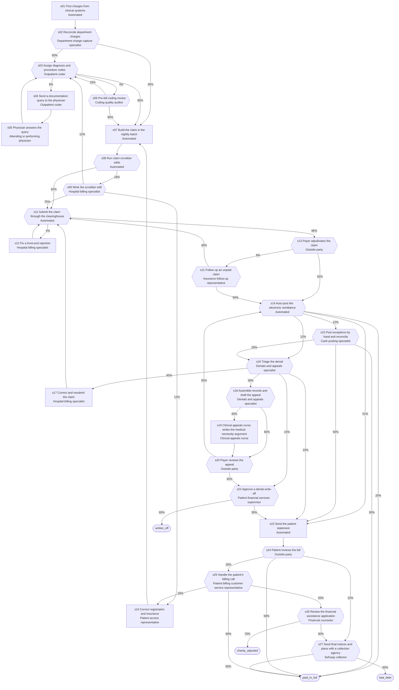

# Hospital outpatient encounter: charge capture to claim payment, denials and patient billing

`hc-revenue-cycle-claim` · healthcare · revenue cycle (health information management and patient financial services)

After a hospital outpatient visit, test or procedure, charges flow from clinical systems, coders assign diagnosis and procedure codes, and the billing system builds a claim that a scrubber checks before it goes to the payer. The payer pays, pays in part or denies; payments post automatically from electronic remittances while denials are triaged, corrected or appealed. Any balance the patient owes is billed in statement cycles, with financial assistance screening and collection rules for tax-exempt hospitals. Work slows at coding backlogs, scrubber edit queues, payer waits and appeal cycles, and about one claim in nine to one in seven is denied the first time.

| | |
|---|---|
| Unit of work | one hospital outpatient encounter (one institutional claim) |
| Starts when | Services for a registered outpatient are documented and the charges post to the patient account. |
| Done when | The account balance is zero: paid by the payer and patient, written off, adjusted under financial assistance, or placed with a collection agency as bad debt. |
| Organisation | A US nonprofit community hospital of about 300 beds with emergency, imaging, laboratory, outpatient surgery and clinic services, an in-house coding team and patient financial services office. (2,500 employees, 2019-2022) |
| Volume | 20,000 cases a month (range 17,000 to 24,000) |

## Where it sits

- Starts with **documented services and charges** from Outpatient registration and clinical services (ED, imaging, lab, surgery, clinics) (100% of cases)
- Sends **institutional claim** to Payers (Medicare, Medicaid, commercial and Medicare Advantage plans) (outcome: any)
- Sends **payments, adjustments and write-offs** to General ledger and month-end close (outcome: any)
- Sends **statements and receipts** to Patient (outcome: paid_in_full)
- Sends **financial assistance adjustment** to Community benefit reporting (IRS Schedule H) (outcome: charity_adjusted)
- Sends **placed account** to Collection agency (outcome: bad_debt)
- Sends **denial write-off with reason** to Denial prevention and revenue integrity reporting (outcome: written_off)

## Flow

## Roles

| Role | Department | Layer | FTE on this process | Loaded cost per hour | Evidence |
|---|---|---|---:|---:|---|
| Department charge capture specialist | Revenue integrity | individual contributor | 5 | 37 USD | C [bls_oes2021], [bls_ecec2021] |
| Outpatient coder | Health information management | individual contributor | 16 | 42 USD | B [ftr2019], [bls_oes2021], [bls_ecec2021] |
| Coding quality auditor | Health information management | senior specialist | 1.2 | 53 USD | B [ftr2019], [bls_oes2021], [bls_ecec2021] |
| Attending or performing physician | Medical staff | senior specialist | 0.5 | 200 USD | C [bls_oes2021], [bls_ecec2021] |
| Hospital billing specialist | Patient financial services | individual contributor | 9 | 37 USD | B [mgma2021], [bls_oes2021], [bls_ecec2021] |
| Patient access representative | Patient access | individual contributor | 2 | 28 USD | B [mgma2021], [bls_oes2021], [bls_ecec2021] |
| Cash posting specialist | Patient financial services | individual contributor | 3 | 37 USD | C [bls_oes2021], [bls_ecec2021] |
| Denials and appeals specialist | Patient financial services | individual contributor | 10 | 40 USD | B [mgma2021], [premier2024], [bls_oes2021], [bls_ecec2021] |
| Clinical appeals nurse | Utilization review and denials | senior specialist | 2.5 | 72 USD | C [bls_oes2021], [bls_ecec2021] |
| Insurance follow-up representative | Patient financial services | individual contributor | 5 | 36 USD | C [bls_oes2021], [bls_ecec2021] |
| Patient financial services supervisor | Patient financial services | supervisor | 1 | 90 USD | C [bls_oes2021], [bls_ecec2021] |
| Patient billing customer service representative | Patient financial services | individual contributor | 5 | 34 USD | C [bls_oes2021], [bls_ecec2021] |
| Financial counselor | Patient access | individual contributor | 2 | 36 USD | B [irs501r], [bls_oes2021], [bls_ecec2021] |
| Self-pay collector | Patient financial services | individual contributor | 4.5 | 36 USD | B [irs501r], [bls_oes2021], [bls_ecec2021] |

## Steps

Hands-on time and the wait before each step show the most common value. Evidence tier A is a sourced number, B a sourced description, C the author's estimate.

| Step | Who | Kind | Hands-on | Wait before | Control | Evidence |
|---|---|---|---:|---:|---|---|
| **s01 Post charges from clinical systems.** When the visit, test or procedure is documented, the clinical systems send charge lines to the patient accounting system through the chargemaster, which assigns revenue codes, prices and, for many lab, imaging and therapy items, hard-coded CPT or HCPCS codes. | Automated | system auto | 0 min | 0 min |  | C |
| **s02 Reconcile department charges.** Each morning the department charge specialist compares the previous day's procedure log or schedule with the charges posted, adds missing charges, corrects quantities and clears charge-edit work queues such as missing physician or missing modifier. | Department charge capture specialist | validation | 1 min | 12.0 h | Hospital revenue integrity policy requiring daily charge reconciliation by each revenue-producing department. | C |
| **s03 Assign diagnosis and procedure codes.** The outpatient coder opens the encounter in the coding work queue, reads the physician notes, operative or procedure report and results, and assigns ICD-10-CM diagnosis codes and CPT or HCPCS procedure codes with modifiers in the encoder. The coder checks that the codes support medical necessity and that charges match documentation, then finalizes the abstract. | Outpatient coder | judgment | 6 min | 1.5 d | HIPAA code set standards (45 CFR 162.1002: ICD-10-CM, CPT and HCPCS) and the ICD-10-CM Official Guidelines for Coding and Reporting. | B [ftr2019] |
| **s04 Send a documentation query to the physician.** The coder writes a non-leading query in the EHR inbox asking the physician to clarify a diagnosis, laterality, procedure detail or missing signature, and places the account on hold. | Outpatient coder | communication | 5 min | 0 min | Compliant query practice per hospital HIM policy (non-leading queries, retained in the record). | C |
| **s05 Physician answers the query.** The physician sees the query among many inbox items, reviews the note and adds an addendum or answers the query, which returns the account to the coder. | Attending or performing physician | drafting | 4 min | 2.0 d |  | C |
| **s06 Pre-bill coding review.** A coding auditor reviews a sample of accounts before billing (new coders, high-dollar surgeries, targeted risk areas), compares codes with documentation and either releases the account or returns it to the coder with feedback. | Coding quality auditor | review | 15 min | 1.0 d | Hospital compliance program coding audits and the 95 percent coding accuracy standard. | B [ftr2019] |
| **s07 Build the claim in the nightly batch.** Once the account is final-coded and past the bill hold days, the patient accounting system builds the institutional claim (UB-04 data in X12 837I format) in its nightly run, applying payer-specific billing rules. | Automated | system auto | 0 min | 12.0 h |  | C |
| **s08 Run claim scrubber edits.** The claim scrubber applies NCCI procedure-to-procedure and medically unlikely edits, Outpatient Code Editor logic, payer-specific rules and demographic checks. Clean claims go straight to submission; claims that fail drop into billing work queues by edit type. | Automated | system auto | 0 min | 30 min | CMS NCCI procedure-to-procedure and medically unlikely edits and the OPPS Outpatient Code Editor, updated quarterly; payer edits. | B [cms_ncci], [tt_kpi] |
| **s09 Work the scrubber edit.** The billing specialist opens the claim in the edit queue, reads the edit message, and fixes what is within billing's remit (modifier, units, payer ID, authorization number, coordination of benefits), or routes it to coding or patient access. Corrections are typed into the patient accounting system and the claim is re-released. | Hospital billing specialist | validation | 6 min | 1.0 d |  | B [mgma2021] |
| **s10 Correct registration and insurance.** A patient access representative re-verifies coverage in the eligibility tool, calls the patient or checks the payer portal for the right plan, subscriber and member ID, and updates the registration so the claim can be rebuilt. | Patient access representative | data entry | 10 min | 1.0 d |  | B [hfma2021], [mgma2021] |
| **s11 Submit the claim through the clearinghouse.** The claim goes in the next clearinghouse batch as an X12 837I file. The clearinghouse and payer return acceptance or rejection reports (999 and 277CA) that billing checks the next day. | Automated | system auto | 0 min | 6.0 h | HIPAA electronic transaction standards (ASC X12 837I) and payer timely filing limits, for Medicare one calendar year after the service (42 CFR 424.44). | B [cfr424_44] |
| **s12 Fix a front-end rejection.** The billing specialist reads the rejection report, fixes the missing or invalid data element (subscriber ID, provider identifier, date span) and re-releases the claim. | Hospital billing specialist | data entry | 6 min | 1.0 d |  | C |
| **s13 Payer adjudicates the claim.** The payer's claim system prices the claim against the contract or fee schedule, applies its edits and medical policies, and pays, pays in part, pends for records or denies. Medicare cannot pay a clean electronic claim before day 14 and owes interest after 30 days; commercial payers follow state prompt-pay laws. | Outside party | external wait | 0 min | 14.0 d | Medicare payment floor and interest (42 U.S.C. 1395h(c)): no payment before 13 days after receipt for electronic claims, interest on clean claims unpaid after 30 days; state prompt-pay laws for commercial plans. | B [usc1395h], [tt_kpi] |
| **s14 Auto-post the electronic remittance.** The remittance file and bank deposit are matched and the patient accounting system posts payments, contractual adjustments, patient responsibility and denial codes line by line without a person touching most accounts. | Automated | system auto | 0 min | 1.0 d |  | B [hfma_cit], [hcdive2017], [premier2024] |
| **s15 Post exceptions by hand and reconcile.** The cash posting specialist works unmatched deposits, paper explanations of benefits, recoupments and underpaid lines, posts them by hand from lockbox images, and reconciles the day's postings to the bank deposit. | Cash posting specialist | data entry | 6 min | 1.0 d | Daily cash reconciliation of postings to bank deposits (hospital internal control over financial reporting). | C |
| **s16 Triage the denial.** The denial specialist opens the denial work queue item, reads the claim adjustment and remark codes and the payer portal detail, decides whether the cause is registration, authorization, coding, medical necessity or non-covered, and chooses to correct and resubmit, appeal, bill the patient or write off. | Denials and appeals specialist | analysis | 10 min | 3.0 d |  | B [mgma2021], [ajmc2021] |
| **s17 Correct and resubmit the claim.** The billing specialist fixes the claim, for example adding the authorization number, a modifier or corrected coordination of benefits, gets coding to change a code where needed, and sends a corrected or replacement claim. | Hospital billing specialist | data entry | 15 min | 4.0 h |  | B [mgma2021] |
| **s18 Assemble records and draft the appeal.** The denial specialist requests the relevant record pages from release of information, fills the payer's appeal form, writes a letter citing the contract or policy, and attaches the authorization or proof of timely filing. | Denials and appeals specialist | drafting | 35 min | 1.0 d |  | B [hcdive2017], [premier2024] |
| **s19 Clinical appeals nurse writes the medical necessity argument.** For medical necessity denials, a nurse reviews the record against the payer's criteria and writes the clinical argument, sometimes asking the physician to support it. | Clinical appeals nurse | drafting | 40 min | 1.0 d |  | C |
| **s20 Payer reviews the appeal.** The appeal goes to the payer by portal, fax or mail and waits for its decision. Hospitals report each review cycle takes 45 to 60 days and many claims need more than one round. | Outside party | external wait | 0 min | 45.0 d |  | A [premier2024] |
| **s21 Follow up an unpaid claim.** From the aged trial balance the follow-up representative picks claims with no payment after 30 to 45 days, checks the payer portal or calls the payer, waits on hold, and learns the claim is in process, not on file or waiting for records, then acts or resubmits. | Insurance follow-up representative | communication | 15 min | 18.0 d |  | B [premier2024], [tt_kpi] |
| **s22 Approve a denial write-off.** The supervisor reviews write-off requests above the staff limit, checks that appeal options are exhausted, and approves the adjustment with a denial reason code so it is reported as a denial write-off. | Patient financial services supervisor | approval | 4 min | 1.0 d | Adjustment approval limits under hospital internal control policy; denial write-offs tracked as HFMA MAP Key AR-6. | B [hfma_cit] |
| **s23 Send the patient statement.** After insurance pays, the patient balance moves to self-pay and the statement vendor mails or emails a statement in the next cycle, with the financial assistance summary and online payment options. | Automated | system auto | 0 min | 2.0 d | Section 501(r) billing rules for tax-exempt hospitals: the first post-discharge statement starts the 120-day notification and 240-day application periods and must tell patients about financial assistance. | A [irs501r] |
| **s24 Patient reviews the bill.** The patient receives the statement and pays in full, calls with questions or for a payment plan, or does not respond to the first statement. | Outside party | external wait | 0 min | 10.0 d |  | C |
| **s25 Handle the patient's billing call.** The customer service representative explains the explanation of benefits and balance, sets up a payment plan, updates insurance when the patient has other coverage, and offers a financial assistance application where the patient may qualify. | Patient billing customer service representative | communication | 10 min | 1.0 h |  | C |
| **s26 Review the financial assistance application.** The financial counselor checks the application and income documents against the hospital's financial assistance policy, asks for missing documents, applies the free or discounted care level and adjusts the account. | Financial counselor | judgment | 25 min | 5.0 d | Section 501(r)(4) to (6): financial assistance policy, 240-day application period, and reasonable efforts to determine eligibility before collection actions. | A [irs501r] |
| **s27 Send final notices and place with a collection agency.** After further statements, the self-pay collector sends the 30-day final notice with the plain language financial assistance summary, attempts an oral notice by phone, and after the 120-day period places unpaid balances with a collection agency and moves them to bad debt. | Self-pay collector | communication | 10 min | 80.0 d | Section 501(r)(6): no extraordinary collection actions within 120 days of the first post-discharge statement, 30 days written notice with a plain language summary and an oral notice attempt. | A [irs501r] |

## Exceptions

| Exception | Share of cases | What happens |
|---|---:|---|
| Physician documentation query | 4% | The coder cannot code from the note and waits days for the physician's addendum. |
| Scrubber edit | 18% | The claim fails an NCCI, OCE, payer or demographic edit and waits in a billing queue. |
| Registration or eligibility error | 4% | Wrong plan or subscriber details send the account back to patient access and the claim is rebuilt. |
| Denial corrected and resubmitted | 7% | The denial specialist finds a correctable error and the claim goes through the payer again. |
| Appeal | 4% | Records and a letter go to the payer and the decision takes 45 to 60 days or more. |
| No payer response | 8% | The claim is unpaid after 30 to 45 days and a representative chases it. |
| Financial assistance | 3% | The patient applies and the balance is reduced or removed under the hospital's policy. |
| Bad debt placement | 8% | After 120 days and a 30-day notice the balance goes to a collection agency. |

## Benchmarks

| Metric | Value | Unit | Population | Evidence |
|---|---|---|---|---|
| cycle_time_days | p50 40, p90 120 | calendar days from charge posting to zero balance | US hospital outpatient accounts, 2019-2022 | C [tt_kpi], [usc1395h], [premier2024], [irs501r] |
| initial_denial_rate | 2016 0.09, Q3 2020 0.11, private payers 2022 0.15 | share of claims denied on first submission | US hospitals | A [hcdive2017], [hfma2021], [premier2024] |
| denials_potentially_avoidable | 0.86 | share of denials | 102 million claims, July 2019 to June 2020 | A [hfma2021], [mgma2021] |
| denials_not_recoverable | 0.24 | share of all denials | Change Healthcare 2020 index | A [mgma2021] |
| denial_cause_registration_eligibility | 0.27 | share of denials | Change Healthcare 2020 index | A [hfma2021], [mgma2021] |
| cost_to_rework_claim | 25.2 | USD per claim | MGMA, 2021 | A [mgma2021] |
| cost_per_appealed_claim | 2016 118, 2022 43.84 | USD | Change Healthcare 2016 hospital data; Premier survey of 516 hospitals on 2022 claims | A [hcdive2017], [premier2024] |
| denied_claims_ultimately_paid | 0.543 | share of denied claims | Premier, 2022 claims | A [premier2024] |
| days_in_accounts_receivable_target | max 50, preferred_low 30, preferred_high 40 | days | AAFP guidance cited by TechTarget | A [tt_kpi] |
| clean_claim_rate_target | 0.9 | share of claims passing edits without manual work | Industry targets | A [tt_kpi] |
| coding_accuracy_standard | 0.95 | share of codes correct on audit | Industry standard | A [ftr2019] |

## Pain points

- Registration and eligibility errors made at the front end cause about a quarter of denials and send claims back through patient access. (steps s10, s09, s16; A [hfma2021], [mgma2021])
- Accounts wait in coding queues and for physician query answers, holding up the claim. (steps s03, s04, s05; C)
- Appeals take 45 to 60 days a round and often several rounds, and much of the effort recovers claims that should have paid. (steps s18, s19, s20; A [premier2024])
- Unpaid claims are chased by phone and portal one at a time from aged trial balance lists. (steps s21; B [premier2024])
- Denial backlogs, staff turnover and legacy systems mean many avoidable denials are never recovered. (steps s16, s22; A [ajmc2021])

## Assumptions

- One encounter equals one institutional claim; interim and recurring-account billing (therapy series) are treated the same way.
- About 45 percent of encounters (lab, imaging, therapy) are hard-coded through the chargemaster and skip the coder; this share is an estimate.
- The 12 percent initial denial rate sits between the 9 to 11 percent hospital index figures and the 15 percent reported for private payers.
- Branch shares for edits, rejections, posting exceptions, patient payment and collections are estimates; no single source gives them for one encounter type.
- The cycle-time benchmark is a synthesis from days-in-A/R targets, the Medicare payment floor, appeal cycle lengths and the 501(r) 120-day period, not a measured distribution.
- Fte_on_process values are set from hands-on time times volume at 130 productive hours a month with an allowance for non-case work such as reports, training and meetings.
- External steps (payer adjudication and appeal review, patient response) carry no hands-on time in this file; their time is in wait_before_min.

## Sources

- [hfma2021] [Healthcare news of note: National index shows denials are up 11%](https://www.hfma.org/topics/news/2021/07/healthcare-news-of-note--national-index-shows-denials-are-up-11.html) (Healthcare Financial Management Association, 2021). Change Healthcare 2020 Denials Index: initial denials above 11% of claims in Q3 2020, up 23% since 2016; 86% potentially avoidable; registration and eligibility about 27% of denials; half of denials from front-end causes; 102 million claims at 1,500+ hospitals.
- [mgma2021] [6 keys to addressing denials in your medical practice's revenue cycle](https://www.mgma.com/mgma-stats/6-keys-to-addressing-denials-in-your-medical-practice-s-revenue-cycle) (Medical Group Management Association, 2021). Average cost to rework a claim $25.20; denial causes registration and eligibility 27%, authorization 11.6%, service not covered 10.6%; 86% avoidable; 24% of all denials not recoverable; recommends eligibility checks, authorization matching, scrubbers and ABNs.
- [ajmc2021] [Medical claim denial rates rising, highest in initial COVID-19 hotspots](https://www.ajmc.com/view/medical-claim-denial-rates-rising-highest-in-initial-covid-19-hotspots) (AJMC, 2021). Initial denials up 23% since 2016; 86% potentially avoidable, 34% unequivocally avoidable; 48% of avoidable denials cannot be recovered; causes include backlog, attrition and legacy technology.
- [hfma_cit] [HFMA Claim Integrity Task Force seeks to standardize denial metrics](https://www.hfma.org/topics/hfm/2021/march/hfma-claim-integrity-task-force-seeks-to-standardize-denial-metr.html) (Healthcare Financial Management Association, 2021). About 9% of hospital claims denied, about $262 billion a year; initial denial rate measured by volume and dollars; denial write-offs as a percentage of net patient service revenue (MAP Key AR-6).
- [hcdive2017] [Report: $262B in healthcare claims initially denied last year](https://www.healthcaredive.com/news/report-262b-in-healthcare-claims-initially-denied-last-year/445758/) (Healthcare Dive, 2017). Change Healthcare 2016 data: about 9% of claims initially denied; 63% of denials recoverable; $118 average cost per appealed claim.
- [premier2024] [Trend Alert: Private payers retain profits by refusing or delaying legitimate medical claims](https://www.premierinc.com/newsroom/blog/trend-alert-private-payers-retain-profits-by-refusing-or-delaying-legitimate-medical-claims) (Premier Inc., 2024). Survey of 516 hospitals on 2022 claims: nearly 15% of claims to private payers initially denied; 54.3% of denied claims ultimately paid; average $43.84 per claim to fight denials; each review cycle 45 to 60 days; average three rounds; 13.9% of claims past due.
- [tt_kpi] [Breaking down the top 5 healthcare revenue cycle KPIs](https://www.techtarget.com/revcyclemanagement/feature/Breaking-Down-the-Top-5-Healthcare-Revenue-Cycle-KPIs) (TechTarget RevCycle Management, 2023). Days in accounts receivable below 50, 30 to 40 preferable (AAFP); clean claim rate 90% or higher, some cite 95%; cost to collect 2% to 4% of net patient revenue; HFMA definitions.
- [ftr2019] [Coding productivity: In search of standards (For The Record, February 2019)](https://www.fortherecordmag.com/archives/0219p22.shtml) (For The Record, 2019). No industry-wide coding productivity standard; 95% accuracy is the accepted quality standard; quality is measured by separate manual audit teams; inpatient productivity about 2 cases per hour.
- [cms_ncci] [National Correct Coding Initiative (NCCI) edits](https://www.cms.gov/medicare/coding-billing/national-correct-coding-initiative-ncci-edits) (Centers for Medicare & Medicaid Services, 2024). Procedure-to-procedure and medically unlikely edits apply to outpatient hospital claims through the Outpatient Code Editor; files updated quarterly.
- [usc1395h] [42 U.S. Code 1395h (Social Security Act section 1816), subsection (c)](https://www.law.cornell.edu/uscode/text/42/1395h) (Legal Information Institute, Cornell Law School, 2024). Medicare may not pay clean claims sooner than 13 days after receipt for electronic claims (28 days for paper) and owes interest on clean claims not paid within 30 days.
- [cfr424_44] [42 CFR 424.44 Time limits for filing claims](https://www.law.cornell.edu/cfr/text/42/424.44) (Legal Information Institute, Cornell Law School, 2024). Medicare claims must be filed within one calendar year after the date of service, with narrow exceptions.
- [irs501r] [Billing and collections: Section 501(r)(6)](https://www.irs.gov/charities-non-profits/billing-and-collections-section-501r6) (Internal Revenue Service, 2024). Tax-exempt hospitals may not start extraordinary collection actions for 120 days after the first post-discharge bill, must accept assistance applications for 240 days, and must give 30 days written notice with a plain language summary and attempt oral notice.
- [bls_oes2021] [Occupational Employment and Wage Statistics, May 2021 National Estimates](https://www.bls.gov/oes/2021/may/oes_nat.htm) (US Bureau of Labor Statistics, 2022). Mean hourly wages May 2021: medical records specialists $23.23, health information technologists $29.53, billing and posting clerks $20.55, bill and account collectors $19.85, customer service representatives $18.79, receptionists and information clerks $15.82, registered nurses $39.78, medical and health services managers $57.61, physicians all other $111.30.
- [bls_ecec2021] [Employer Costs for Employee Compensation, December 2021](https://www.bls.gov/news.release/archives/ecec_03182022.htm) (US Bureau of Labor Statistics, 2022). Private hospitals: wages 66.1% of compensation, benefits 33.9%.

Written by claude-opus on 2026-11-17.
