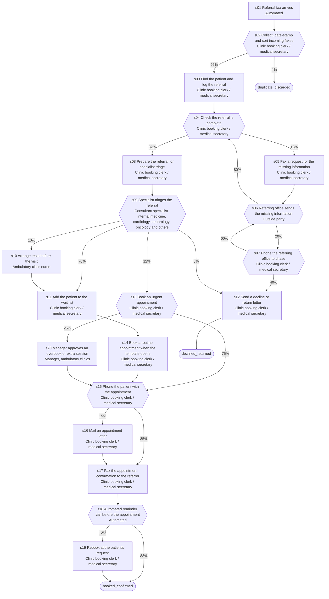

# Receive referrals and book outpatient clinics

`hosp-amb-clinic-referral-booking` · health care (public hospital) · ambulatory care · part of `community-hospital-corp`

Family physicians, community specialists and the hospital's own emergency departments send about 6,000 referrals a month to the corporation's outpatient specialty clinics, almost all by fax. Clinic clerks sort and log each fax, check it against the clinic's referral criteria and chase the referring office for anything missing; the specialist triages it by urgency, and the clerk puts the patient on the wait list, books an appointment when the clinic templates open, and tells the patient and the referring office. The process is slow because referrals wait in fax piles and triage folders, incomplete referrals bounce back and forth, and routine patients wait weeks on the list for a new-patient slot. Lost or duplicated faxes and patients who cannot be reached are the main errors.

| | |
|---|---|
| Unit of work | one clinic referral |
| Starts when | A referral for an outpatient specialty clinic arrives by fax or on paper from a family physician, community specialist or the hospital's emergency department. |
| Done when | The patient has a confirmed appointment and has been reminded, and the referring office has been told; or the referral has been declined, returned incomplete or discarded as a duplicate. |
| Organisation | A three-site Ontario community hospital corporation with about 60 outpatient specialty clinic rooms run by clinic clerks and nurses, where specialists bill OHIP and triage their own referrals. (5,790 employees, 2019-2022) |
| Volume | 6,000 cases a month (range 4,500 to 7,500) |

## Where it sits

- Starts with **clinic_referral** from primary_care (62% of cases)
- Starts with **clinic_referral** from referring_office (15% of cases)
- Starts with **clinic_referral** from ed-discharge-home (18% of cases)
- Starts with **clinic_referral** from cs-discharge-planning (5% of cases)
- Sends **clinic_appointment** to amb-clinic-visit (outcome: booked_confirmed)
- Sends **clinic_appointment** to patient (outcome: booked_confirmed)
- Sends **clinic_appointment** to dh-patient-registration (outcome: booked_confirmed)
- Sends **clinic_referral** to primary_care (outcome: declined_returned)

## Flow

## Roles

| Role | Department | Layer | FTE on this process | Loaded cost per hour | Evidence |
|---|---|---|---:|---:|---|
| Clinic booking clerk / medical secretary | Outpatient clinics | individual contributor | 20 | 35 CAD | C |
| Consultant specialist (internal medicine, cardiology, nephrology, oncology and others) | Medical, dental and midwifery staff | senior specialist | 2.5 | 200 CAD | C |
| Ambulatory clinic nurse | Outpatient clinics | individual contributor | 1 | 61 CAD | C |
| Manager, ambulatory clinics | Ambulatory and community care | manager | 0.2 | 78 CAD | C |

## Steps

Hands-on time and the wait before each step show the most common value. Evidence tier A is a sourced number, B a sourced description, C the author's estimate.

| Step | Who | Kind | Hands-on | Wait before | Control | Evidence |
|---|---|---|---:|---:|---|---|
| **s01 Referral fax arrives.** The referring physician's office faxes a referral letter or the clinic's referral form, often with lab results and imaging reports attached, to the clinic's fax machine or fax-to-email inbox; emergency department referrals arrive as a printed form or a fax from the emergency unit. | Automated | system auto | 0 min | 0 min |  | B [mohammed2020] |
| **s02 Collect, date-stamp and sort incoming faxes.** Several times a day the clinic clerk collects the faxes, stamps the date received, sorts them by clinic and specialist, and checks whether the same referral was already received and logged so that resent faxes are not entered twice. | Clinic booking clerk / medical secretary | intake | 2 min | 4.0 h |  | C |
| **s03 Find the patient and log the referral.** The clerk searches the hospital patient index by health card number, name and date of birth, notes the medical record number or flags a new patient, and logs the referral with date received, referring physician and reason in the clinic's referral tracking list. | Clinic booking clerk / medical secretary | data entry | 3 min | 30 min |  | B [mohammed2020] |
| **s04 Check the referral is complete.** The clerk compares the referral against the clinic's checklist: reason for referral and question, health card number and version, referring physician's billing number, medication list and the tests the specialist requires before a visit, such as recent blood work or an ultrasound. | Clinic booking clerk / medical secretary | validation | 2 min | 0 min | Clinic referral acceptance criteria set by the medical lead | C |
| **s05 Fax a request for the missing information.** The clerk fills in a standard 'referral incomplete' form listing what is missing, faxes it to the referring office and marks the referral pending in the tracking list. | Clinic booking clerk / medical secretary | communication | 5 min | 1.0 h |  | C |
| **s06 Referring office sends the missing information.** The family physician's or specialist's office finds the results or completes the form and faxes it back, often after the patient has had a test done. | Outside party | external wait | 0 min | 3.0 d |  | C |
| **s07 Phone the referring office to chase.** After about a week with no reply the clerk phones the referring office, explains what is still needed and notes the call; if nothing arrives after the second chase the referral is closed and returned. | Clinic booking clerk / medical secretary | communication | 6 min | 7.0 d |  | C |
| **s08 Prepare the referral for specialist triage.** The clerk prints or scans the referral with any prior hospital results pulled from the hospital record and the provincial lab viewer, and puts it in the specialist's paper or electronic triage folder. | Clinic booking clerk / medical secretary | coordination | 3 min | 1.0 h |  | C |
| **s09 Specialist triages the referral.** Between clinics the specialist reads each referral and attached results, assigns urgency (urgent, semi-urgent, routine), decides whether tests are needed before the visit, and may decline or redirect a referral that another service or primary care should handle. | Consultant specialist (internal medicine, cardiology, nephrology, oncology and others) | judgment | 3 min | 3.0 d | Specialist triage of referrals by urgency (clinic referral policy) | B [liddy2018] |
| **s10 Arrange tests before the visit.** Following the specialist's triage note, the clinic nurse fills in the lab or imaging requisition, sends it to the patient or the referring office and notes in the tracking list that results must be back before the appointment. | Ambulatory clinic nurse | coordination | 10 min | 2.0 d |  | C |
| **s11 Add the patient to the wait list.** The clerk enters the accepted referral on the specialist's wait list in the scheduling module or the clinic's wait list spreadsheet, with urgency, date received and any pre-visit tests. | Clinic booking clerk / medical secretary | data entry | 3 min | 1.0 h |  | C |
| **s12 Send a decline or return letter.** The clerk types a letter or completes a form explaining why the referral was declined, redirected or closed incomplete, with the specialist's advice where given, faxes it to the referring office and closes the entry. | Clinic booking clerk / medical secretary | drafting | 8 min | 1.0 d |  | C |
| **s13 Book an urgent appointment.** The clerk looks for the first open urgent slot in the specialist's clinic templates over the next days or weeks and books it; if none is free the clerk asks the clinic manager to approve an overbook or an extra session. | Clinic booking clerk / medical secretary | coordination | 8 min | 2.0 h |  | C |
| **s14 Book a routine appointment when the template opens.** When the specialist's clinic templates for the coming weeks are released, the clerk works down the wait list in order of urgency and date received, and books each patient into a new-patient slot. | Clinic booking clerk / medical secretary | coordination | 5 min | 21.0 d |  | B [liddy2018], [mohammed2020] |
| **s15 Phone the patient with the appointment.** The clerk calls the patient with the date, time, location and preparation instructions, confirms the phone number and address, and leaves a message or retries when the patient does not answer. | Clinic booking clerk / medical secretary | communication | 4 min | 1.0 h |  | B [oag2018] |
| **s16 Mail an appointment letter.** When the patient cannot be reached by phone the clerk prints and mails an appointment letter with the clinic's number to call if the date does not work. | Clinic booking clerk / medical secretary | communication | 5 min | 2.0 d |  | C |
| **s17 Fax the appointment confirmation to the referrer.** The clerk faxes the referring office a notice with the appointment date, so the family physician knows the referral was received and can tell the patient. | Clinic booking clerk / medical secretary | communication | 2 min | 30 min |  | C |
| **s18 Automated reminder call before the appointment.** One to three days before the visit the scheduling system's automated dialler or a clerk calls the patient to remind them of the appointment and asks them to press a key to confirm or to call to rebook. | Automated | system auto | 0 min | 14.0 d |  | C |
| **s19 Rebook at the patient's request.** The clerk finds another slot, moves the booking, offers the freed slot to the next urgent patient on the wait list and sends a new notice to the patient and the referring office. | Clinic booking clerk / medical secretary | coordination | 7 min | 4.0 h |  | C |
| **s20 Manager approves an overbook or extra session.** The ambulatory clinic manager checks room and nurse availability for the clinic day, approves overbooking an urgent patient or opening an extra half-day session with the specialist, and tells the clerk which slot to use. | Manager, ambulatory clinics | approval | 10 min | 8.0 h | Ambulatory clinic scheduling rules: overbooking and extra sessions approved by the manager | C |

## Exceptions

| Exception | Share of cases | What happens |
|---|---:|---|
| Incomplete referral | 17% | The clinic faxes back a request for missing results or details; a fifth of these need a phone chase and some are closed and returned. |
| Duplicate fax | 4% | The referring office resends a referral it has heard nothing about; the clerk discards it if the first copy was logged. |
| Urgent referral without a slot | 3% | No urgent slot is free and the manager approves an overbook or extra session. |
| Declined or redirected | 8% | The specialist decides another service or primary care should manage the patient. |
| Patient not reachable | 14% | The patient does not answer calls and is sent a letter, which risks a no-show. |

## Benchmarks

| Metric | Value | Unit | Population | Evidence |
|---|---|---|---|---|
| cycle_time_days | p50 70, p90 190 | calendar days from referral received to the reminder before the visit (about the wait from referral to visit) | Ontario specialty referrals sent by fax, 2014-2020 | B [liddy2018], [mohammed2020] |
| referral_to_visit_median_days_nonurgent | 79 | days | 461 referrals from five Ontario primary care clinics, 2014-2015 | A [liddy2018] |
| referral_to_visit_median_days_urgent | 49 | days | 461 referrals from five Ontario primary care clinics, 2014-2015 | A [liddy2018] |
| referral_to_appointment_mean_days_fax | 71.72 | days | 13,780 faxed hip and knee referrals to Ontario central intakes, 2018-2020 | A [mohammed2020] |
| share_seen_within_four_weeks_fax | 0.56 | share of faxed referrals | Ontario hip and knee central intakes, 2018-2020 | A [mohammed2020] |

## Pain points

- Referrals sit in fax piles and triage folders before anyone looks at them, and faxed referrals take weeks longer than electronic ones to process. (steps s02, s08, s09; A [mohammed2020])
- Referring offices hear nothing after sending a referral, so they resend faxes and phone the clinic, creating duplicates and calls. (steps s02, s17; A [liddy2018])
- Incomplete referrals bounce between clinic and referring office by fax for one to three weeks. (steps s04, s05, s06, s07; C)
- Routine patients wait weeks to months on the list for a new-patient slot, set by specialist clinic time rather than clerical work. (steps s14; A [liddy2018])

## Assumptions

- The case runs from the fax arriving to the reminder call before the visit, so the cycle time approximates the published wait from referral to visit; the visit itself is amb-clinic-visit.
- Triggers add cs-discharge-planning (follow-up clinic referrals at inpatient discharge, 5%), which the organisation file does not link to this process; referrals for the fracture, mental health, oncology and dialysis clinics go to their own processes.
- The step graph is memoryless: urgent bookings share the reminder step and its 7-45 day wait with routine bookings, which overstates the wait for the 12% of urgent referrals.
- Simulated median cycle time is 68 days against the 70-day benchmark; the simulated 90th percentile of 133 days is shorter than the benchmark's 190 because triangular waits cannot reproduce the long tail in liddy2018, where 11% of referrals had no visit within a year. Referrals that are never booked are not modelled.
- Simulated hands-on time implies about 29 FTE against 23.7 stated, inside the validator's range; clerks also absorb some of the referral work in time otherwise counted as visit-day paperwork.
- The clinic nurse (amb_rn) is added for pre-visit test coordination; the organisation file lists only clerks, specialists and the manager.
- Clinic clerks are set to office hours, so faxes arriving on Friday evening wait until Monday.
- Specialist cost is the organisation file's estimate of OHIP earnings per hour; triage is unpaid administrative time for the specialist.

## Sources

- [mohammed2020] [The impact of integrating electronic referral within a musculoskeletal model of care on wait time to receive orthopedic care in Ontario](https://journals.plos.org/plosone/article?id=10.1371/journal.pone.0241624) (PLOS ONE 15(11): e0241624 (Mohammed HT, Payson L-A, Alarakhia M), 2020). 15,503 hip and knee referrals to central intakes in four Ontario subregions, January 2018 to January 2020, 13,780 of them faxed or paper: mean wait from referral to rapid access clinic appointment 71.72 days for paper referrals and 50.30 days for eReferrals; 56% of paper referrals and 74% of eReferrals seen within the four-week target; paper referrals took 21.76 days longer to process at central intake; faxed referrals were manually transcribed by intake staff and reviewed for missing information before triage
- [liddy2018] [Understanding Patient Referral Wait Times for Specialty Care in Ontario: A Retrospective Chart Audit](https://www.longwoods.com/content/25397/understanding-patient-referral-wait-times-for-specialty-care-in-ontario-a-retrospective-chart-audi) (Healthcare Policy 13(3) (Liddy C, Nawar N, Moroz I, et al.), 2018). 461 referrals from five Ontario primary care clinics, 2014-2015: wait from referral to specialist visit median 79 days (IQR 35-173) for non-urgent, 49 days (IQR 18.75-77.75) for urgent and 57 days where urgency was unclear; 11% had no visit recorded after a year; the specialist office corresponded after the referral in 22% of cases; the date a referral was made could not always be told from the date it was faxed
- [oag2018] [2018 Annual Report, Volume 1, Chapter 3, Section 3.08: MRI and CT Scanning Services](https://www.auditor.on.ca/en/content/annualreports/arreports/en18/v1_308en18.pdf) (Office of the Auditor General of Ontario, 2018). Ministry priority levels for MRI and CT: emergency (P1, within 24 hours), urgent (P2, within 2 days), semi-urgent (P3, within 10 days), non-urgent (P4, within 28 days), targets set at the 90th percentile; before booking, radiologists assess the requisition, determine the type of scan and assign a priority, then a scheduler books a predefined slot; an MRI scan with contrast takes on average 40 minutes and needs at least two technologists on site, other MRI scans about 20 minutes with one; emergency scans were more than 30% of CT scans in 2017/18; MRI no-show rates 0.1% to 13.4% and CT 0.6% to 13% of scheduled appointments in 2017/18 (48,320 missed MRI and 57,916 missed CT appointments); 25-36% of patients confirmed after phone reminders versus 50% after text messages; studies found 6% to 12% of scans inappropriate under CAR referral guidelines; peer review of radiologist reports was not mandatory and three of four audited hospitals had a regular program; 69% of MRI machines ran below 16 hours a day, seven days a week; 65% of semi-urgent and non-urgent MRI patients and 33% of CT patients waited longer than target in 2017/18

Written by claude-opus on 2026-11-24.
