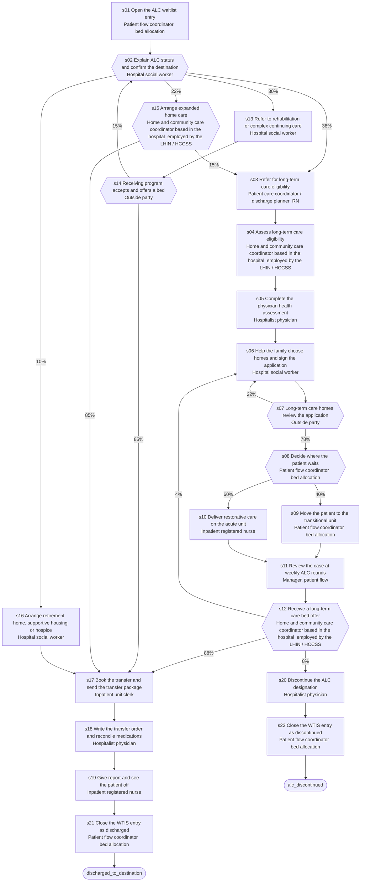

# Manage patients waiting in hospital for an alternate level of care

`hosp-cs-alc-management` · healthcare (acute care hospital) · clinical support: patient flow · part of `community-hospital-corp`

When a patient no longer needs acute care but cannot leave because the next setting is not ready, the physician designates them alternate level of care (ALC). The hospital registers the wait in the provincial system, social workers and the home care placement coordinator work through long-term care, rehabilitation or home care applications, and the patient waits on an acute unit or in a transitional bed until a place is offered. Long-term care applications are slow because eligibility, family choice of homes and the homes' own reviews happen in sequence, and accepted applicants then join long wait lists, while every ALC day blocks a bed needed for ED admissions.

| | |
|---|---|
| Unit of work | one ALC designation (waitlist entry) |
| Starts when | A physician designates an inpatient ALC because the next care setting is not available. |
| Done when | The patient has moved to the destination and the WTIS entry is closed, or the designation is discontinued because the patient's condition changed or the patient died. |
| Organisation | A three-site Ontario community hospital corporation with about 640 beds and a 35-bed regional ALC transitional unit, working with the LHIN home care organisation (HCCSS from 2021). (4,900 employees, 2019-2022) |
| Volume | 120 cases a month (range 90 to 160) |

## Where it sits

- Starts with **alc_designation** from cs-discharge-planning (100% of cases)
- Relies on **bed_offer** from ltc_homes (a standing input; it does not start a case)
- Relies on **care_plan_confirmation** from hccss (a standing input; it does not start a case)
- Sends **ltc_application** to hccss (outcome: any)
- Sends **admitted_patient** to med-ccc-rehab-stay (outcome: discharged_to_destination)
- Sends **transfer_package** to ltc_homes (outcome: discharged_to_destination)
- Sends **wait_time_record** to ontario_health (outcome: any)
- Sends **cleaning_request** to fs-environmental-cleaning (outcome: discharged_to_destination)

## Flow

## Roles

| Role | Department | Layer | FTE on this process | Loaded cost per hour | Evidence |
|---|---|---|---:|---:|---|
| Patient flow coordinator (bed allocation) | Patient flow and bed management | senior specialist | 1.5 | 63 CAD | C |
| Hospital social worker | Allied health | individual contributor | 4 | 58 CAD | B [oag2010] |
| Hospitalist physician | Medical, dental and midwifery staff | senior specialist | 1 | 160 CAD | C |
| Manager, patient flow | Patient flow and bed management | manager | 0.4 | 84 CAD | C |
| Inpatient registered nurse | Inpatient medicine units | individual contributor | 2 | 61 CAD | B [oag2016] |
| Inpatient unit clerk | Inpatient medicine units | individual contributor | 0.5 | 35 CAD | C |
| Patient care coordinator / discharge planner (RN) | Inpatient medicine and surgery units | senior specialist | 1 | 63 CAD | C |
| Home and community care coordinator based in the hospital (employed by the LHIN / HCCSS) | Home and Community Care Support Services (outside the hospital) | external party | 0 | 57 CAD | B [oag2010] |

## Steps

Hands-on time and the wait before each step show the most common value. Evidence tier A is a sourced number, B a sourced description, C the author's estimate.

| Step | Who | Kind | Hands-on | Wait before | Control | Evidence |
|---|---|---|---:|---:|---|---|
| **s01 Open the ALC waitlist entry.** The patient flow coordinator opens an ALC waitlist entry in the provincial Wait Time Information System with the designation date, inpatient service, intended destination (or TBD) and any specialized needs such as behaviours, bariatric equipment or dialysis. | Patient flow coordinator (bed allocation) | intake | 10 min | 12.0 h | Ontario Health provincial ALC definition and WTIS-ALC reporting required of hospitals | B [alc_method] |
| **s02 Explain ALC status and confirm the destination.** The social worker meets the patient and substitute decision-maker, explains that acute care is finished, what the ALC designation means, any daily co-payment that applies while waiting for long-term care, and confirms the preferred destination and whether the Home First option is possible. | Hospital social worker | communication | 45 min | 1.0 d |  | B [oag2016] |
| **s03 Refer for long-term care eligibility.** The patient care coordinator sends a long-term care referral to the home care placement coordinator in the Health Partner Gateway, attaching the medical, functional and behavioural information the coordinator needs to assess eligibility. | Patient care coordinator / discharge planner (RN) | data entry | 25 min | 12.0 h |  | B [oag2010] |
| **s04 Assess long-term care eligibility.** The placement coordinator meets the patient and family, completes the standardized assessment, and decides whether the patient is eligible for a long-term care home, explaining wait lists, basic and preferred accommodation, and the rules for accepting a bed offer. | Home and community care coordinator based in the hospital (employed by the LHIN / HCCSS) | analysis | 1.5 h | 2.0 d | Long-Term Care Homes Act, 2007: placement co-ordinators determine eligibility and authorise admission; homes must answer an application within five business days | A [oag2010] |
| **s05 Complete the physician health assessment.** The hospitalist fills in the health assessment section of the long-term care application: diagnoses, medications, tuberculosis screening, behaviours and care needs, and signs it so the application can go to the chosen homes. | Hospitalist physician | drafting | 20 min | 2.0 d |  | C |
| **s06 Help the family choose homes and sign the application.** The social worker reviews the list of homes with the family (distance, language, culture, wait list length), helps them choose up to five, and gets the consent and application forms signed and sent to the placement coordinator. | Hospital social worker | communication | 1.5 h | 3.0 d |  | A [oag2010] |
| **s07 Long-term care homes review the application.** Each chosen home reviews the application and the assessment and either accepts the applicant onto its wait list or rejects it, most often for care needs, weight or behaviours the home says it cannot manage. | Outside party | external wait | 30 min | 7.0 d | Long-Term Care Homes Act, 2007: placement co-ordinators determine eligibility and authorise admission; homes must answer an application within five business days | A [oag2010] |
| **s08 Decide where the patient waits.** The patient flow coordinator decides with the unit manager whether the patient moves to the regional ALC transitional unit, based on bed availability, the patient's care needs and the expected wait, or stays on the acute unit. | Patient flow coordinator (bed allocation) | judgment | 10 min | 1.0 d |  | B [oag2016] |
| **s09 Move the patient to the transitional unit.** The coordinator books the transitional bed, arranges a porter and the nursing handover, and updates the bed board, freeing an acute bed. The transitional bed is then held until the long-term care home has a bed. | Patient flow coordinator (bed allocation) | coordination | 20 min | 12.0 h |  | C |
| **s10 Deliver restorative care on the acute unit.** Nurses keep the waiting patient mobile and engaged with a restorative care plan (walking, meals out of bed, activity), review falls risk and antipsychotic use, and the patient keeps an acute medicine bed until placement. Minutes are the extra nursing time over the wait. | Inpatient registered nurse | physical | 5.0 h | 0 min | Accreditation Canada Required Organizational Practice: falls prevention and injury reduction | B [oag2016] |
| **s11 Review the case at weekly ALC rounds.** Each week the patient flow manager reviews every long-waiting ALC patient with the home care placement coordinator: wait list position, whether more homes should be added, and whether a short-stay interim bed is an option. Minutes add up the reviews. | Manager, patient flow | coordination | 15 min | 0 min |  | B [oag2016] |
| **s12 Receive a long-term care bed offer.** When a bed comes free in one of the chosen homes, the placement coordinator phones the patient or substitute decision-maker, who must accept or refuse quickly, and tells the hospital the admission date. | Home and community care coordinator based in the hospital (employed by the LHIN / HCCSS) | external wait | 15 min | 20.0 d |  | A [oag2010], [oag2016] |
| **s13 Refer to rehabilitation or complex continuing care.** The social worker sends the referral to the hospital's own complex continuing care or rehabilitation unit, or to an outside rehabilitation or convalescent care program, with therapy notes and goals. | Hospital social worker | drafting | 45 min | 12.0 h |  | B [oag2010] |
| **s14 Receiving program accepts and offers a bed.** The receiving program screens the referral for rehabilitation potential or medical complexity, accepts it, and offers a bed when one frees up; it may decline patients without clear goals or with behaviours. | Outside party | external wait | 20 min | 4.0 d |  | B [oag2010], [oag2016] |
| **s15 Arrange expanded home care.** The home care coordinator reassesses the patient, builds a higher-intensity plan (more personal support hours, nursing, equipment) and waits for a provider agency able to staff it before confirming a start date. | Home and community care coordinator based in the hospital (employed by the LHIN / HCCSS) | coordination | 1.0 h | 4.0 d |  | A [cihi_homecare], [oag2010] |
| **s16 Arrange retirement home, supportive housing or hospice.** The social worker helps the family find and apply to a retirement home, supportive housing unit or hospice, coordinates tours and assessments by the receiving setting, and confirms the move-in date. | Hospital social worker | coordination | 2.0 h | 10.0 d |  | B [oag2016] |
| **s17 Book the transfer and send the transfer package.** The unit clerk confirms the transfer date with the receiving setting, books non-urgent patient transport and faxes the transfer package (medication list, care plan, recent notes). Many settings do not admit on weekends. | Inpatient unit clerk | coordination | 25 min | 12.0 h |  | B [oag2010] |
| **s18 Write the transfer order and reconcile medications.** On the transfer day the hospitalist re-examines the patient, writes the discharge or transfer order and reconciles medications for the receiving home, and updates the discharge summary. | Hospitalist physician | approval | 20 min | 4.0 h | Public Hospitals Act: the physician determines when a patient is discharged (as summarised in oag2010) | C |
| **s19 Give report and see the patient off.** The nurse phones a verbal report to the receiving nurse, sends the medications and belongings with the transport crew, and records the departure time. The bed is then released for cleaning. | Inpatient registered nurse | communication | 30 min | 2.0 h |  | C |
| **s20 Discontinue the ALC designation.** If the patient becomes acutely ill again or dies while waiting, the hospitalist documents the change and cancels the ALC designation; any active applications are put on hold or withdrawn. | Hospitalist physician | judgment | 10 min | 1.0 h |  | B [alc_method] |
| **s21 Close the WTIS entry as discharged.** The patient flow coordinator closes the ALC waitlist entry with the discharge date and the actual destination type, which must be filled in before the entry can close, so the province can count ALC days. | Patient flow coordinator (bed allocation) | data entry | 5 min | 1.0 d | Ontario Health provincial ALC definition and WTIS-ALC reporting required of hospitals | B [alc_method] |
| **s22 Close the WTIS entry as discontinued.** The patient flow coordinator closes the waitlist entry with the discontinuation reason, such as change in medical status or death, and the date, so the days stop counting as ALC. | Patient flow coordinator (bed allocation) | data entry | 5 min | 1.0 d | Ontario Health provincial ALC definition and WTIS-ALC reporting required of hospitals | B [alc_method] |

## Exceptions

| Exception | Share of cases | What happens |
|---|---:|---|
| Refused by all chosen homes | 8% | Every home the family chose refuses the applicant, usually for behaviours or heavy care needs, so the family must choose again and the wait restarts. |
| Home care plan fails | 3% | No agency can staff the expanded home care plan, or the family cannot cope, so a long-term care application starts after weeks of waiting. |
| Deterioration or death while waiting | 3% | The patient becomes acutely ill or dies before a long-term care bed is offered and the designation is discontinued. |

## Benchmarks

| Metric | Value | Unit | Population | Evidence |
|---|---|---|---|---|
| cycle_time_days | p50 18, p90 110 | days from ALC designation to discharge | ALC designations in an Ontario large community hospital, all destinations | C |
| ltc_placement_wait_median | 85 | days | Ontario patients awaiting long-term care placement, 2015/16 | A [oag2016] |
| share_of_beds_occupied_by_alc | 0.14 | share of hospital beds | Ontario hospitals, 2015/16 | A [oag2016] |
| hospital_cost_per_alc_day | 730 | CAD per day | Ontario ALC patient in a hospital bed, 2015/16, versus about 130 CAD per day Ministry-funded in long-term care | A [oag2016] |

## Pain points

- Long-term care eligibility, family choice and home review run one after another and take weeks before the patient even joins a wait list. (steps s04, s05, s06, s07; A [oag2010])
- Patients may wait in hospital for their chosen homes, so waits for popular homes run for months. (steps s12; A [oag2016])
- Waiting on acute units leads to falls, deconditioning and antipsychotic use, and blocks beds needed for ED admissions. (steps s10; A [oag2016])
- Refusals by homes send families back to choose again. (steps s07, s06; A [oag2010])

## Assumptions

- Destination shares are by flow of new designations, not by census: patients waiting for long-term care stay longest, so they dominate a point-in-time count (45% in oag2016) more than new designations.
- Time spent waiting for a bed offer is the calendar wait before s12; the bed held while waiting is recorded on s09 (transitional bed) or s10 (acute medicine bed).
- The home care placement coordinator is employed outside the hospital; their minutes are in the simulated labour cost but no hospital FTE is stated.
- WTIS entries are kept by the patient flow coordinators; in some hospitals health records clerks or unit clerks do this.
- The simulated labour cost covers the hospital and home care staff steps only; the ALC bed-day cost (oag2016: about 730 CAD a day) is far larger and is not included.
- Loaded costs are the organisation file's ranges: hourly wage x 1.35 (about 25% benefits and HOOPP pension plus 10% overhead). Physician costs are gross clinical earnings paid by the province, not hospital payroll. Roles added here use the same 1.35 factor.

## Sources

- [oag2010] [2010 Annual Report, Chapter 3, Section 3.02: Discharge of Hospital Patients](https://www.auditor.on.ca/en/content/annualreports/arreports/en10/302en10.pdf) (Office of the Auditor General of Ontario, 2010). Long-term care placement steps and timings (assessment within 2 to 3 days, family choice 3 days to 2 weeks, home response 3 to 22 days, 25% to 33% rejections), placement waits in 2009/10, home care waits, weekend transfer pattern.
- [oag2016] [2016 Annual Report, Chapter 3, Section 3.08: Large Community Hospital Operations](https://www.auditor.on.ca/en/content/annualreports/arreports/en16/v1_308en16.pdf) (Office of the Auditor General of Ontario, 2016). ALC census by destination, median and 90th percentile LTC placement wait, share of beds, cost per day, falls and antipsychotic findings, interim bed program, co-located ALC ward.
- [alc_method] [Alternate Level of Care (ALC) Methodology Document (Health System Insights ALC performance reports)](https://hsihelp.ontariohealth.ca/hsi/assets/misc_doc/ALC%20Methodology%20Report.pdf) (Ontario Health, 2023). WTIS-ALC data elements, destinations, specialized needs, discontinuation reasons, closing rules and monthly data cut.
- [cihi_homecare] [Hospital Stay Extended Until Home Care Services or Supports Ready (indicator)](https://www.cihi.ca/en/indicators/hospital-stay-extended-until-home-care-services-or-supports-ready) (Canadian Institute for Health Information, 2025). Waits for home care: half 8 days or less, 10% 41 days or more.
- [cihi_stays] [Hospital stays in Canada, 2021-2022](https://www.cihi.ca/en/hospital-stays-in-canada-2021-2022) (Canadian Institute for Health Information, 2022). 5.8% of stays with ALC days, 2021-2022.

Written by claude-opus on 2026-11-24.
