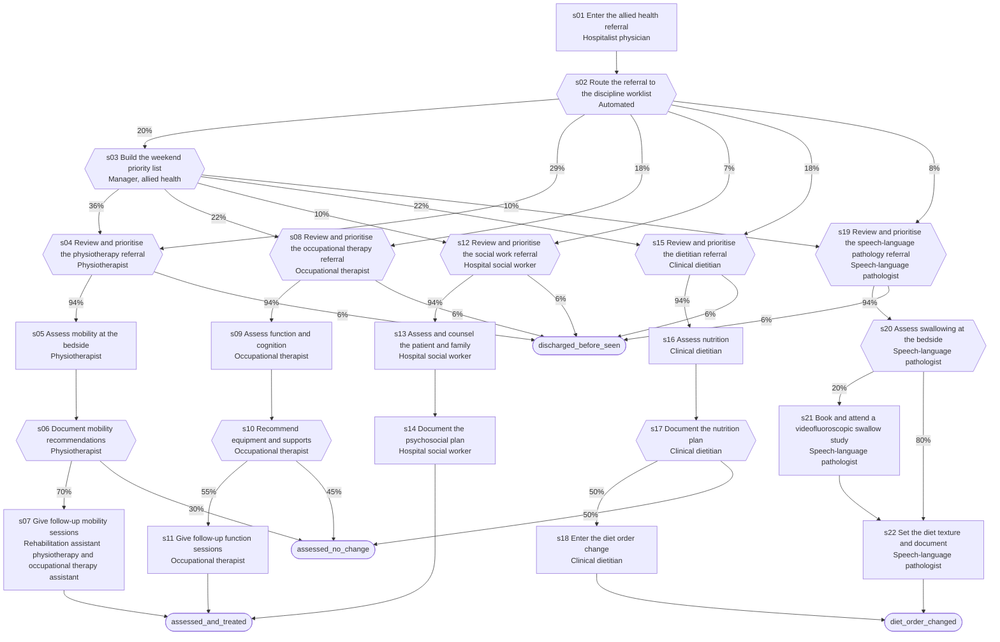

# Assess and treat inpatients referred to allied health

`hosp-cs-allied-health-referral` · healthcare (acute care hospital) · clinical support: allied health · part of `community-hospital-corp`

Physiotherapists, occupational therapists, social workers, dietitians and speech-language pathologists receive referrals for inpatients through the electronic record, rank them by discharge urgency, assess the patient at the bedside and write recommendations that decide whether the patient can go home safely. Therapy assistants and therapists then give follow-up sessions until discharge, and dietitians and speech-language pathologists change diet orders. Cover is thin on weekends and holidays, so Friday referrals wait, and a therapy assessment that is late can hold up a discharge or send a patient home without the equipment or help they need.

| | |
|---|---|
| Unit of work | one allied health referral (one discipline, one patient stay) |
| Starts when | A physician or nurse enters an allied health referral order for an inpatient. |
| Done when | The patient has been assessed, recommendations are in the chart and passed to the team, follow-up treatment has ended at discharge, and any diet order change is in place; or the patient left before being seen. |
| Organisation | A three-site Ontario community hospital corporation with about 640 beds and a centrally managed allied health department deployed by unit. (4,900 employees, 2019-2022) |
| Volume | 5,500 cases a month (range 4,500 to 6,500) |

## Where it sits

- Starts with **allied_health_referral** from med-inpatient-medical-care (65% of cases)
- Starts with **allied_health_referral** from sx-surgical-inpatient-care (35% of cases)
- Sends **allied_health_assessment** to cs-discharge-planning (outcome: any)
- Sends **diet_order** to fs-food-services (outcome: diet_order_changed)
- Sends **imaging_order** to dx-imaging-booking (outcome: any)

## Flow

## Roles

| Role | Department | Layer | FTE on this process | Loaded cost per hour | Evidence |
|---|---|---|---:|---:|---|
| Hospitalist physician | Medical, dental and midwifery staff | senior specialist | 0.3 | 160 CAD | C |
| Manager, allied health | Allied health | manager | 0.5 | 78 CAD | C |
| Physiotherapist | Allied health | individual contributor | 28 | 61 CAD | B [oag2010], [stroke_bp] |
| Rehabilitation assistant (physiotherapy and occupational therapy assistant) | Allied health | individual contributor | 9 | 36 CAD | C |
| Occupational therapist | Allied health | individual contributor | 17 | 61 CAD | B [stroke_bp] |
| Hospital social worker | Allied health | individual contributor | 4 | 58 CAD | B [oag2010] |
| Clinical dietitian | Allied health | individual contributor | 9 | 58 CAD | B [stroke_bp] |
| Speech-language pathologist | Allied health | individual contributor | 4 | 61 CAD | B [stroke_bp] |

## Steps

Hands-on time and the wait before each step show the most common value. Evidence tier A is a sourced number, B a sourced description, C the author's estimate.

| Step | Who | Kind | Hands-on | Wait before | Control | Evidence |
|---|---|---|---:|---:|---|---|
| **s01 Enter the allied health referral.** The hospitalist, or a nurse under a medical directive, enters a referral order in the electronic record naming the discipline, the reason (mobility, function, swallowing, nutrition, psychosocial) and any urgency, often linked to the estimated discharge date. | Hospitalist physician | intake | 2 min | 0 min |  | C |
| **s02 Route the referral to the discipline worklist.** The electronic record places the order on the discipline's worklist for the patient's unit and prints a requisition in the department; referrals entered after mid-afternoon on Friday land on the weekend list. | Automated | system auto | 0.5 min | 0 min |  | C |
| **s03 Build the weekend priority list.** On Friday afternoon the allied health manager or lead therapist reviews pending referrals and builds the weekend list: patients due to go home, new stroke or hip fracture admissions and swallowing screens are seen; the rest wait for Monday. | Manager, allied health | judgment | 2 min | 4.0 h |  | B [oag2016] |
| **s04 Review and prioritise the physiotherapy referral.** The physiotherapy clinician covering the unit opens the referral on the department worklist, reads the admission notes, orders, precautions and estimated discharge date, and ranks it: discharge-critical and new admissions first, routine follow-ups later in the day or the next day. | Physiotherapist | lookup | 10 min | 18.0 h |  | B [oag2016] |
| **s05 Assess mobility at the bedside.** The physiotherapist assesses strength, balance, transfers, walking and stairs, checks oxygen and pain, decides what aid and supervision the patient needs and whether the patient is safe to go home or needs rehabilitation. | Physiotherapist | physical | 45 min | 2.0 h |  | B [stroke_bp] |
| **s06 Document mobility recommendations.** The physiotherapist writes the assessment and discharge recommendation in the chart (home, home with aid, home with home care physiotherapy, or rehabilitation), updates the whiteboard and tells the charge nurse or coordinator. | Physiotherapist | drafting | 15 min | 30 min |  | C |
| **s07 Give follow-up mobility sessions.** A rehabilitation assistant walks and exercises the patient once or twice a day following the physiotherapist's plan, and reports progress or problems back. Minutes add up the sessions until discharge. | Rehabilitation assistant (physiotherapy and occupational therapy assistant) | physical | 1.0 h | 1.0 d |  | C |
| **s08 Review and prioritise the occupational therapy referral.** The occupational therapy clinician covering the unit opens the referral on the department worklist, reads the admission notes, orders, precautions and estimated discharge date, and ranks it: discharge-critical and new admissions first, routine follow-ups later in the day or the next day. | Occupational therapist | lookup | 10 min | 1.0 d |  | B [oag2016] |
| **s09 Assess function and cognition.** The occupational therapist assesses self-care (dressing, toileting, bathing), cognition and safety, and asks about the home layout to judge whether the patient can manage at home and what equipment or help is needed. | Occupational therapist | physical | 50 min | 2.0 h |  | B [stroke_bp] |
| **s10 Recommend equipment and supports.** The occupational therapist documents the assessment and recommends equipment (raised toilet seat, bath bench, walker), home care personal support or a home safety visit, and passes the list to the patient care coordinator. | Occupational therapist | drafting | 20 min | 30 min |  | C |
| **s11 Give follow-up function sessions.** The occupational therapist practises transfers, dressing and memory strategies with the patient, trains the family on equipment, and updates the recommendation before discharge. Minutes add up the sessions. | Occupational therapist | physical | 45 min | 1.0 d |  | C |
| **s12 Review and prioritise the social work referral.** The social work clinician covering the unit opens the referral on the department worklist, reads the admission notes, orders, precautions and estimated discharge date, and ranks it: discharge-critical and new admissions first, routine follow-ups later in the day or the next day. | Hospital social worker | lookup | 10 min | 1.0 d |  | B [oag2016] |
| **s13 Assess and counsel the patient and family.** The social worker meets the patient and family about the concern raised (coping, caregiver strain, finances or drug coverage, substitute decision-making, suspected abuse) and gives counselling or connects them to services. | Hospital social worker | communication | 1.0 h | 4.0 h |  | C |
| **s14 Document the psychosocial plan.** The social worker writes the assessment and plan in the chart, makes any outside referrals by phone or fax, and flags issues that affect the discharge date to the team. | Hospital social worker | drafting | 15 min | 30 min |  | C |
| **s15 Review and prioritise the dietitian referral.** The dietitian clinician covering the unit opens the referral on the department worklist, reads the admission notes, orders, precautions and estimated discharge date, and ranks it: discharge-critical and new admissions first, routine follow-ups later in the day or the next day. | Clinical dietitian | lookup | 10 min | 1.0 d |  | B [oag2016] |
| **s16 Assess nutrition.** The dietitian reviews weight history, intake records, labs and swallowing status, interviews the patient, and estimates energy and protein needs for malnutrition, diabetes, renal or tube-feeding problems. | Clinical dietitian | analysis | 30 min | 2.0 h |  | B [stroke_bp] |
| **s17 Document the nutrition plan.** The dietitian writes the nutrition care plan and teaching in the chart and decides whether the diet order, supplements or tube feed need to change. | Clinical dietitian | drafting | 12 min | 15 min |  | C |
| **s18 Enter the diet order change.** The dietitian enters the new diet, supplement or tube-feed order in the electronic record under a medical directive, which sends it to the diet office for the next meal tray. | Clinical dietitian | data entry | 5 min | 5 min |  | C |
| **s19 Review and prioritise the speech-language pathology referral.** The speech-language pathology clinician covering the unit opens the referral on the department worklist, reads the admission notes, orders, precautions and estimated discharge date, and ranks it: discharge-critical and new admissions first, routine follow-ups later in the day or the next day. | Speech-language pathologist | lookup | 10 min | 18.0 h |  | B [oag2016] |
| **s20 Assess swallowing at the bedside.** The speech-language pathologist examines oral and throat function and watches the patient swallow different textures and liquids to judge aspiration risk, and assesses speech and language when asked. | Speech-language pathologist | physical | 30 min | 2.0 h | Hospital dysphagia policy: patients who fail a swallowing screen stay nil by mouth until assessed | B [stroke_bp] |
| **s21 Book and attend a videofluoroscopic swallow study.** The speech-language pathologist requests a modified barium swallow from diagnostic imaging, waits for a fluoroscopy slot and porter, runs the study with the radiologist or technologist and reviews the images in PACS. | Speech-language pathologist | analysis | 1.0 h | 2.0 d |  | C |
| **s22 Set the diet texture and document.** The speech-language pathologist writes the recommendation (texture, liquid thickness, positioning, supervision), enters the diet texture order and posts swallowing precautions at the bedside. | Speech-language pathologist | drafting | 15 min | 30 min |  | C |

## Exceptions

| Exception | Share of cases | What happens |
|---|---:|---|
| Weekend referral wait | 15% | A referral entered on Friday afternoon is not discharge-critical, so it waits until Monday; if the physician is ready to discharge on the weekend, the patient waits for the assessment. |
| Discharged before being seen | 6% | The patient goes home or is transferred before the therapist reaches them, sometimes without the equipment or home care the therapist would have recommended. |
| Instrumental swallow study | 2% | The bedside swallowing assessment is inconclusive and the patient waits days on a modified diet or nil by mouth for a fluoroscopy slot. |

## Benchmarks

| Metric | Value | Unit | Population | Evidence |
|---|---|---|---|---|
| cycle_time_days | p50 3.0, p90 7.0 | days from referral to end of allied health involvement | inpatient allied health referrals in an Ontario community hospital | C |
| interdisciplinary_assessment_target | 48 | hours from admission | acute stroke inpatients (best practice target) | A [stroke_bp] |
| weekend_discharge_shortfall | 0.25 | share fewer daily discharges on weekends | three Ontario large community hospitals, 2015/16 | A [oag2016] |

## Pain points

- Thin weekend and holiday cover means non-urgent referrals wait until Monday and can delay discharges. (steps s03, s04, s08, s15; B [oag2016])
- Referrals with vague reasons or sent late in the stay leave too little time to assess and arrange equipment before discharge. (steps s01, s04; C)
- Recommendations sit in the chart until the next bullet round, so discharge plans change late. (steps s06, s10; B [oag2010])

## Assumptions

- One case is one discipline's referral for one stay, including all follow-up visits; a patient seen by PT and OT is two cases.
- Rehabilitation assistants (PT/OT assistants) are not in the organisation file but deliver most follow-up mobility sessions in Ontario hospitals; they are added with not_in_org_file.
- Discipline mix (PT 36%, OT 22%, dietitian 22%, social work 10%, SLP 10%) is the author's estimate; social work referrals for discharge planning are counted in the discharge-planning workflow, not here.
- Weekend and holiday cover is modelled as a 20% share of referrals routed through the weekend priority list, with longer waits in the review steps.
- The imaging order for swallow studies goes to diagnostic imaging booking; the organisation file does not link this process to imaging.
- Loaded costs are the organisation file's ranges: hourly wage x 1.35 (about 25% benefits and HOOPP pension plus 10% overhead). Physician costs are gross clinical earnings paid by the province, not hospital payroll. Roles added here use the same 1.35 factor.

## Sources

- [stroke_bp] [Canadian Stroke Best Practice Recommendations: Acute Stroke Management, Section 8, Acute Stroke Unit Care (2022 update)](https://www.strokebestpractices.ca/recommendations/acute-stroke-management/acute-stroke-unit-care) (Heart and Stroke Foundation of Canada, 2022). Core interdisciplinary team (OT, PT, SLP, social work, dietitian); assessment ideally within 48 hours; dysphagia, mood and cognition assessment; post-acute rehabilitation needs within 72 hours.
- [oag2016] [2016 Annual Report, Chapter 3, Section 3.08: Large Community Hospital Operations](https://www.auditor.on.ca/en/content/annualreports/arreports/en16/v1_308en16.pdf) (Office of the Auditor General of Ontario, 2016). Fewer staff and 25% fewer discharges on weekends.
- [oag2010] [2010 Annual Report, Chapter 3, Section 3.02: Discharge of Hospital Patients](https://www.auditor.on.ca/en/content/annualreports/arreports/en10/302en10.pdf) (Office of the Auditor General of Ontario, 2010). Multidisciplinary team composition and bullet rounds with little input from other disciplines.

Written by claude-opus on 2026-11-24.
