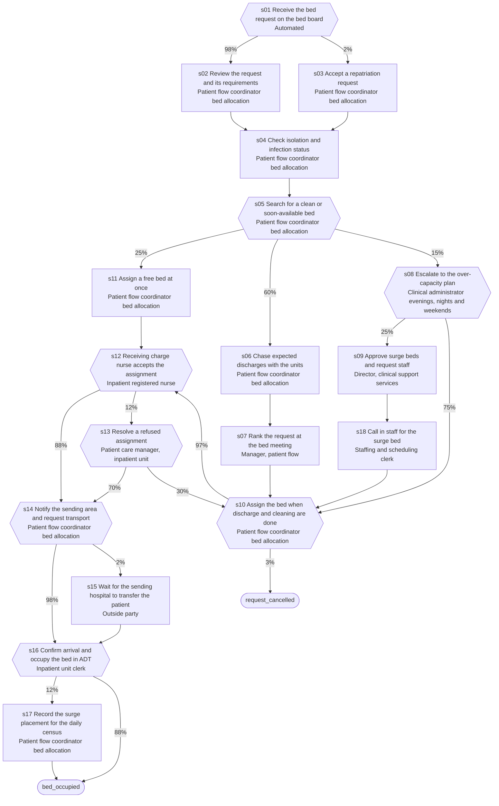

# Assign inpatient beds and run patient flow

`hosp-cs-bed-management` · healthcare (acute care hospital) · clinical support (patient flow) · part of `community-hospital-corp`

Patient flow coordinators, usually experienced nurses, take bed requests from the emergency department, the recovery room, the ICU, other units and other hospitals, and match each one to a clean bed of the right type on the electronic bed board. Because the hospital runs at or above full occupancy, most requests wait for a discharge to leave and the room to be cleaned; the coordinator chases expected discharges, ranks requests at twice-daily bed meetings and, when no bed is in sight, the manager or after-hours clinical administrator opens surge beds in unconventional spaces and asks for extra staff. Once a bed is assigned the receiving unit must accept the patient and a porter must move them. Work is slowed by late-day discharges, delays in cleaning, isolation needs that require single rooms and units that push back on assignments.

| | |
|---|---|
| Unit of work | one bed assignment (from bed request to the patient occupying the assigned inpatient bed) |
| Starts when | A bed request arrives on the bed board from the ED, recovery room, ICU, an inpatient unit needing a transfer, or another hospital asking to repatriate a patient. |
| Done when | The patient is in the assigned bed, ADT and the bed board show the bed occupied, and any surge or unconventional placement is recorded for the daily bed census. |
| Organisation | A not-for-profit Ontario community hospital corporation with three hospitals, about 640 inpatient beds and an emergency department at each site, on a single hospital information system with an electronic bed board. (5,790 employees, 2019-2022) |
| Volume | 3,000 cases a month (range 2,600 to 3,500) |

## Where it sits

- Starts with **bed_request** from ed-admission-boarding (47% of cases)
- Starts with **bed_request** from med-icu-critical-care (6% of cases)
- Starts with **repatriation_request** from tertiary_hospital (2% of cases)
- Starts with **bed_status_update** from cs-discharge-planning (30% of cases)
- Starts with **isolation_order** from qp-ipac-surveillance (5% of cases)
- Starts with **bed_status_update** from med-end-of-life-care (2% of cases)
- Starts with **bed_request** from sx-perioperative-case (8% of cases)
- Relies on **emergency_plan** from fs-emergency-preparedness (a standing input; it does not start a case)
- Relies on **clean_bed** from fs-environmental-cleaning (a standing input; it does not start a case)
- Sends **bed_assignment** to ed-admission-boarding (outcome: bed_occupied)
- Sends **bed_assignment** to med-inpatient-medical-care (outcome: bed_occupied)
- Sends **bed_assignment** to sx-surgical-inpatient-care (outcome: bed_occupied)
- Sends **transport_request** to fs-patient-portering (outcome: bed_occupied)
- Sends **staffing_request** to hr-staff-scheduling (outcome: any)
- Sends **transfer_acceptance** to tertiary_hospital (outcome: bed_occupied)
- Sends **bed_status_update** to ed-admission-boarding (outcome: request_cancelled)

## Flow

## Roles

| Role | Department | Layer | FTE on this process | Loaded cost per hour | Evidence |
|---|---|---|---:|---:|---|
| Patient flow coordinator (bed allocation) | Patient flow and bed management | senior specialist | 10 | 63 CAD | C |
| Manager, patient flow | Patient flow and bed management | manager | 0.6 | 84 CAD | C |
| Clinical administrator (evenings, nights and weekends) | Patient flow and bed management | supervisor | 2 | 68 CAD | C |
| Patient care manager, inpatient unit | Medicine and critical care program | manager | 1.2 | 78 CAD | C |
| Director, clinical support services | Clinical support services | director | 0.05 | 101 CAD | C |
| Inpatient registered nurse | Inpatient medicine units | individual contributor | 2.5 | 61 CAD | C |
| Inpatient unit clerk | Inpatient medicine units | individual contributor | 1.5 | 35 CAD | C |
| Staffing and scheduling clerk | Staffing office | individual contributor | 0.5 | 35 CAD | C |

## Steps

Hands-on time and the wait before each step show the most common value. Evidence tier A is a sourced number, B a sourced description, C the author's estimate.

| Step | Who | Kind | Hands-on | Wait before | Control | Evidence |
|---|---|---|---:|---:|---|---|
| **s01 Receive the bed request on the bed board.** A bed request arrives on the electronic bed board from ADT when the ED opens an admission, the recovery room books a post-operative bed, the ICU asks to step a patient down or a unit asks for a transfer. The board shows the service, bed type, isolation flag and the time of request. | Automated | system auto | 0 min | 0 min |  | C |
| **s02 Review the request and its requirements.** The patient flow coordinator opens the request and checks service, bed type (telemetry, step-down, surgical, medicine), any isolation needs and special needs such as bariatric equipment or a negative-pressure room, phoning the requesting nurse when the entry is unclear. | Patient flow coordinator (bed allocation) | validation | 5 min | 10 min |  | C |
| **s03 Accept a repatriation request.** A tertiary hospital asks, by phone or through the CritiCall referral line, to send back a patient who came from this community. The coordinator takes the clinical summary, confirms the receiving service and physician accept, and records the request on the bed board. | Patient flow coordinator (bed allocation) | intake | 20 min | 2.0 h | Provincial expectation that community hospitals repatriate their patients from tertiary centres promptly (regional repatriation agreements). | C |
| **s04 Check isolation and infection status.** The coordinator checks the infection flags in the hospital information system and any new isolation order from infection control (MRSA, VRE, CPE, C. difficile, from 2020 COVID-19 status), because isolated patients need a single room or a cohort with the same organism. | Patient flow coordinator (bed allocation) | lookup | 3 min | 0 min |  | C |
| **s05 Search for a clean or soon-available bed.** The coordinator scans the bed board for clean empty beds of the right type and for beds where a discharge is entered or expected today, considering off-service placement (a medical patient on a surgical unit) when the right unit is full. The coordinator decides whether a bed is available now, expected soon, or not in sight. | Patient flow coordinator (bed allocation) | analysis | 8 min | 5 min |  | B [oag2023], [moh_dbcs] |
| **s06 Chase expected discharges with the units.** The coordinator phones the charge nurses on units with expected discharges to ask when the patient will leave, whether the discharge order is written and whether family or transport is arranged, and pushes for discharges before 11:00. | Patient flow coordinator (bed allocation) | coordination | 10 min | 15 min |  | C |
| **s07 Rank the request at the bed meeting.** At the morning and afternoon bed meetings (or huddle calls) the patient flow manager and the unit managers go through every waiting request, the confirmed and possible discharges and the staffing on each unit, and agree the order in which beds go to ED, recovery room, ICU and transfer patients. The touch time is this request's share of the meeting. | Manager, patient flow | coordination | 3 min | 1.0 h |  | C |
| **s08 Escalate to the over-capacity plan.** When no bed will come free in time and the ED is full of admitted patients, the patient flow manager on weekdays or the clinical administrator after hours reviews the census with the units, decides where an unconventional surge space (a lounge, a hallway alcove or an unfunded bed) can be opened and which unit will take an extra patient. | Clinical administrator (evenings, nights and weekends) | judgment | 20 min | 30 min | Hospital surge and over-capacity protocol under the emergency response plan. | B [moh_dbcs] |
| **s09 Approve surge beds and request staff.** The director approves opening additional unfunded or field hospital beds, and the staffing office is asked to call in nurses and PSWs from the call-in lists, often at overtime rates. A surge bed cannot be used until it has a nurse. | Director, clinical support services | approval | 10 min | 2.0 h | Opening beds beyond the funded complement needs senior approval because the hospital bears the unfunded cost (hospital budget authority policy). | C |
| **s10 Assign the bed when discharge and cleaning are done.** When a matching bed is marked clean on the bed board, or a surge space is ready, the coordinator assigns it to the highest-ranked request and records the assignment, which shows on the requesting area's board. The wait here is for patients to leave and environmental services to clean the room. | Patient flow coordinator (bed allocation) | judgment | 5 min | 45 min |  | B [oag2023], [khsc_beds] |
| **s11 Assign a free bed at once.** When a matching clean bed is already empty, the coordinator assigns it straight away on the bed board and phones the sending area. | Patient flow coordinator (bed allocation) | judgment | 4 min | 0 min |  | C |
| **s12 Receiving charge nurse accepts the assignment.** The receiving unit's charge nurse checks the assignment against the unit's staffing and patient mix and accepts it, or pushes back (no nurse for a new admission at shift change, gender mix in a ward room, isolation not possible). Disputes go back to the coordinator or the administrator. | Inpatient registered nurse | review | 5 min | 15 min |  | C |
| **s13 Resolve a refused assignment.** The unit manager (or the clinical administrator after hours) talks with the coordinator and the charge nurse, either confirming the assignment with extra help for the unit or releasing the bed so the coordinator can reassign. | Patient care manager, inpatient unit | coordination | 10 min | 30 min |  | C |
| **s14 Notify the sending area and request transport.** The coordinator confirms the bed number with the sending area and enters a porter request, or for repatriations tells the sending hospital the bed is ready so it can book an ambulance. The bed stays reserved and empty until the patient arrives. | Patient flow coordinator (bed allocation) | communication | 4 min | 5 min |  | C |
| **s15 Wait for the sending hospital to transfer the patient.** The tertiary hospital books non-urgent patient transport or an ambulance and sends the patient with a transfer package; arrival often takes hours and may slip to the next day. | Outside party | external wait | 0 min | 6.0 h |  | C |
| **s16 Confirm arrival and occupy the bed in ADT.** When the patient arrives on the unit, the unit clerk moves the patient to the bed in ADT, which updates the bed board to occupied and closes the request; the coordinator watches for beds that stay reserved too long. | Inpatient unit clerk | data entry | 2 min | 40 min |  | C |
| **s17 Record the surge placement for the daily census.** For patients placed in an unconventional space or an unfunded bed, the coordinator records the placement on the census sheet so it appears in the hospital's daily bed census summary and hallway count reported to the Ministry, and flags the patient to move to a conventional bed first. | Patient flow coordinator (bed allocation) | data entry | 3 min | 30 min | Ministry of Health daily bed census summary reporting of conventional and unconventional spaces and hallway patients. | B [moh_dbcs] |
| **s18 Call in staff for the surge bed.** The staffing clerk works through the call-in and part-time availability lists in the scheduling system, phoning nurses and PSWs in seniority order under the collective agreement until the extra shift is filled, then tells the coordinator the surge bed can open. | Staffing and scheduling clerk | coordination | 25 min | 15 min | Call-in order and premium pay rules in the nursing and service collective agreements (ONA, CUPE, SEIU, OPSEU). | C |

## Exceptions

| Exception | Share of cases | What happens |
|---|---:|---|
| Bed free at request | 25% | A matching clean bed is empty and is assigned at once. |
| Over capacity | 15% | No bed is in sight; the over-capacity plan opens surge space, sometimes with director approval and called-in staff. |
| Refused assignment | 12% | The receiving unit pushes back and the manager resolves or the bed is reassigned. |
| Repatriation | 2% | A tertiary hospital sends a patient back; the patient arrives hours after the bed is assigned. |
| Surge placement | 12% | The patient goes to an unconventional space and is counted as a hallway patient in the daily census. |

## Benchmarks

| Metric | Value | Unit | Population | Evidence |
|---|---|---|---|---|
| cycle_time_days | p50 0.25, p90 0.75 | days from bed request to patient in bed | All inpatient bed requests (ED, recovery room, ICU, transfers, repatriations), Ontario community hospital, 2019-2022 | C |
| average_wait_for_inpatient_bed_mississauga_halton_2021_22 | 10.8 | hours (ED patients, decision to admit to leaving the ED) | Admitted ED patients in the Mississauga Halton LHIN sub-region | A [oag2023] |
| average_wait_for_inpatient_bed_ontario_pre_covid | low 8, high 10 | hours | Admitted ED patients, Ontario, before 2020 | A [oag2023] |
| alc_share_of_patient_days_ontario_2022_23 | 0.15 | share of inpatient days | Ontario hospitals | A [oag2023] |

## Pain points

- Most requests wait for a discharge and a clean room; discharges cluster in the afternoon while ED admissions build from late morning. (steps s06, s10; B [oag2023], [khsc_beds])
- ALC patients waiting for long-term care or home care hold about 15% of patient days, so fewer beds turn over. (steps s05, s08; A [oag2023])
- Bed meetings run twice a day, so a request that misses one meeting waits hours to be ranked. (steps s07; C)
- Units push back on assignments at shift change or when short-staffed; settling disputes adds time and management effort. (steps s12, s13; C)
- Surge beds need staff who must be called in, often at overtime, and their patients count as hallway patients. (steps s08, s09, s18, s17; B [moh_dbcs])

## Assumptions

- The unit of work is one bed assignment from any requester. The organisation file's volume and driver are kept; the shares in triggered_by are the author's split of that volume.
- The wait before s10 covers all requesters; ED requests wait longer than post-operative and planned transfer requests. hosp-ed-admission-boarding gives the ED view of the same wait.
- Bed meetings are a daily event; s07 charges each request a small share of the meeting time, and the wait is the time to the next meeting.
- Bed reservation in s16 (from assignment to arrival) is split across medicine (62%), surgical (30%) and ICU (8%) beds by expected share, so each figure is the expected minutes per case.
- Field hospital beds (s09) were open only during 2020-2022 COVID-19 waves; the occupied minutes are the time the surge capacity is held open for the request.
- Sending a repatriation acceptance to the tertiary hospital, the receiving charge nurse, inpatient unit clerk and staffing clerk are included though the process map entry does not list them; sx-perioperative-case is added as a requester because recovery-room bed requests are a large share of requests and are missing from the process map.
- The simulated median (about 0.34 days, 8 hours) is above the tier C benchmark of 6 hours because the bed meeting wait and the wait for a clean bed are modelled in sequence, while in practice a request is often ranked while the discharge is already under way; the simulated 90th percentile (about 14 hours) is shorter than the longest real waits on gridlock days. No published source gives the request-to-bed time for all requesters, so the benchmark stays a tier C estimate.

## Sources

- [oag2023] [Value-for-Money Audit: Emergency Departments (2023 Annual Report)](https://www.auditor.on.ca/en/content/annualreports/arreports/en23/AR_emergencydepts_en23.pdf) (Office of the Auditor General of Ontario, 2023). Average wait for an inpatient bed after the decision to admit: about 8 to 10 hours before COVID-19, 13 hours (90th percentile 35 hours) in 2022/23, about 21 hours at the 90th percentile in 2013/14; Mississauga Halton sub-region average 10.8 hours in 2021/22 and 21.3 hours in 2022/23; 12% of ED visits admitted in 2022/23; ALC about 15% of patient days; at least 1,000 hallway patients a day in January 2019; ED Return Visit Quality Program (72-hour and 7-day returns).
- [moh_dbcs] [Conventional and Unconventional Spaces and Hallway Definitions](https://hsihelp.ontariohealth.ca/hsi/BCM/MOH_Documents/dBCS%20(Bed%20Segmentation)%20Conventional_Unonventional%20Revised%20Info%20Sheet.pdf) (Ontario Ministry of Health, Capacity Planning and Analytics Division, 2022). Definitions from February 18, 2020 of conventional and unconventional patient spaces; hallway patients counted as admitted patients held in the ED because no bed is available plus inpatients in unconventional spaces; reported through the daily bed census summary (segmented from October 2021).
- [khsc_beds] [Preventing gridlock: New bed notification system helping smooth patient flow](https://kingstonhsc.ca/node/2927) (Kingston Health Sciences Centre, 2014). Ontario hospital discharge cleaning team: unit clerks update the patient care system at discharge, which pages a discharge-team cleaner; just under 40 minutes on average to reach the bed and about 25 minutes to clean, about 65 minutes in total; bed allocators assign the next patient while the bed is being cleaned and keep the ED informed.

Written by claude-opus on 2026-11-24.
