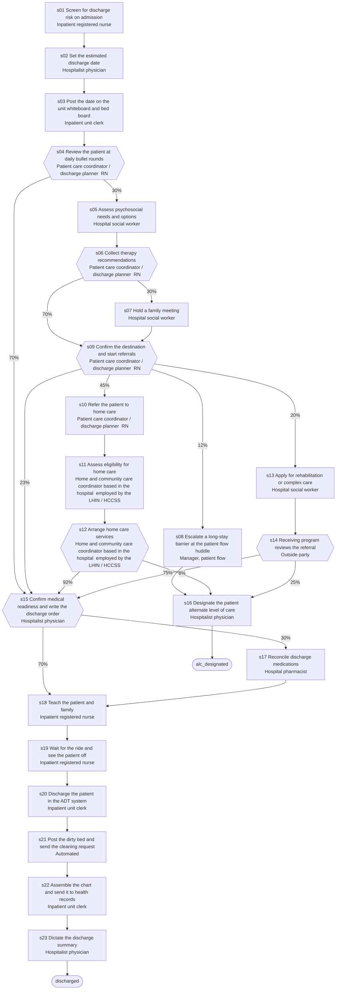

# Plan discharges and transitions from inpatient medicine and surgical units

`hosp-cs-discharge-planning` · healthcare (acute care hospital) · clinical support: patient flow and discharge planning · part of `community-hospital-corp`

From the day a patient is admitted, the care team plans when and how the patient will leave: the physician sets an estimated discharge date, nurses and a patient care coordinator review barriers at daily bullet rounds, and social workers and the home care coordinator arrange home services or a post-acute bed for the minority who need them. When the patient is medically ready the physician writes the order, the nurse teaches the patient and family, and the unit clerk frees the bed. Discharges are slowed by estimated dates that are missing or stale, late home care referrals, fewer physicians and receiving facilities on weekends, and afternoon departures that leave admitted patients waiting in the ED overnight.

| | |
|---|---|
| Unit of work | one inpatient discharge from a medicine, surgical or complex care unit |
| Starts when | A patient is admitted to an inpatient unit and the admitting nurse starts the discharge risk screen. |
| Done when | The patient has left the hospital with instructions, the bed is released for cleaning, the chart is in health records and the discharge summary is dictated; or the patient is designated ALC and handed to the ALC process. |
| Organisation | A three-site Ontario community hospital corporation with about 640 beds, hospitalists on medicine, a hybrid electronic and paper chart, and hospital-based home care coordinators. (4,900 employees, 2019-2022) |
| Volume | 1,700 cases a month (range 1,500 to 1,950) |

## Where it sits

- Starts with **discharge_plan** from med-inpatient-medical-care (62% of cases)
- Starts with **discharge_plan** from sx-surgical-inpatient-care (34% of cases)
- Starts with **discharge_plan** from med-ccc-rehab-stay (4% of cases)
- Relies on **allied_health_assessment** from cs-allied-health-referral (a standing input; it does not start a case)
- Relies on **care_plan_confirmation** from hccss (a standing input; it does not start a case)
- Sends **discharge_instructions** to patient (outcome: discharged)
- Sends **discharge_summary** to primary_care (outcome: discharged)
- Sends **dictation** to dh-transcription (outcome: discharged)
- Sends **patient_chart** to dh-chart-coding (outcome: discharged)
- Sends **bed_status_update** to cs-bed-management (outcome: discharged)
- Sends **cleaning_request** to fs-environmental-cleaning (outcome: discharged)
- Sends **home_care_referral** to hccss (outcome: any)
- Sends **alc_designation** to cs-alc-management (outcome: alc_designated)

## Flow

## Roles

| Role | Department | Layer | FTE on this process | Loaded cost per hour | Evidence |
|---|---|---|---:|---:|---|
| Inpatient registered nurse | Inpatient medicine units | individual contributor | 14 | 61 CAD | B [oag2010] |
| Surgical inpatient registered nurse | Surgical inpatient units | individual contributor | 5 | 61 CAD | C |
| Hospitalist physician | Medical, dental and midwifery staff | senior specialist | 6 | 160 CAD | B [oag2010] |
| Inpatient unit clerk | Inpatient medicine units | individual contributor | 4 | 35 CAD | C |
| Hospital social worker | Allied health | individual contributor | 9 | 58 CAD | B [oag2010] |
| Patient care coordinator / discharge planner (RN) | Inpatient medicine and surgery units | senior specialist | 7 | 63 CAD | C |
| Hospital pharmacist | Pharmacy | senior specialist | 1 | 81 CAD | B [oag2010] |
| Manager, patient flow | Patient flow and bed management | manager | 0.2 | 84 CAD | C |
| Home and community care coordinator based in the hospital (employed by the LHIN / HCCSS) | Home and Community Care Support Services (outside the hospital) | external party | 0 | 57 CAD | B [oag2010] |

## Steps

Hands-on time and the wait before each step show the most common value. Evidence tier A is a sourced number, B a sourced description, C the author's estimate.

| Step | Who | Kind | Hands-on | Wait before | Control | Evidence |
|---|---|---|---:|---:|---|---|
| **s01 Screen for discharge risk on admission.** When the patient arrives on the unit, the admitting nurse completes the admission assessment in the electronic record, including the discharge risk screen: who the patient lives with, stairs at home, mobility before admission, current home care and whether the patient can return to the same living situation. | Inpatient registered nurse | intake | 10 min | 1.0 h |  | B [oag2010] |
| **s02 Set the estimated discharge date.** At the first morning rounds after admission, the hospitalist reviews the working diagnosis and enters an estimated discharge date and the likely destination in the electronic record, using the expected length of stay for the case type as a starting point. | Hospitalist physician | judgment | 4 min | 10.0 h |  | B [oag2010], [oag2016] |
| **s03 Post the date on the unit whiteboard and bed board.** The unit clerk copies the estimated discharge date and destination onto the unit whiteboard and the electronic bed board, and colour-codes the patient as leaving within 24 hours, in two to three days, later, or waiting for another level of care. | Inpatient unit clerk | data entry | 2 min | 1.0 h |  | B [oag2010] |
| **s04 Review the patient at daily bullet rounds.** Each weekday morning the patient care coordinator runs a short bullet round with the charge nurse, physiotherapy, social work and, when available, the home care coordinator. Each patient gets about a minute: medical readiness, estimated date and open barriers. Minutes here add up the rounds over the stay. | Patient care coordinator / discharge planner (RN) | coordination | 10 min | 8.0 h |  | B [oag2010] |
| **s05 Assess psychosocial needs and options.** The social worker meets the patient and family, reviews supports at home, finances, caregiver strain and capacity concerns, explains what home care, rehabilitation or other settings can offer, and records the preferred plan in the chart. | Hospital social worker | analysis | 1.0 h | 1.0 d |  | B [oag2010] |
| **s06 Collect therapy recommendations.** The patient care coordinator reads the physiotherapy and occupational therapy assessments in the chart for mobility, equipment and home safety recommendations, and chases any assessment still outstanding with the therapist by phone. | Patient care coordinator / discharge planner (RN) | lookup | 15 min | 1.0 d |  | C |
| **s07 Hold a family meeting.** The social worker books a meeting with the patient, family or substitute decision-maker, the hospitalist and a therapist, reviews the patient's function and risks, and agrees the destination: home with services, rehabilitation, or a long-term care application. | Hospital social worker | communication | 1.0 h | 2.0 d |  | C |
| **s08 Escalate a long-stay barrier at the patient flow huddle.** For patients heading to long-term care or with no clear destination, the patient flow manager reviews the case at the daily flow huddle with the unit managers, checks the Home First option of going home with extra home care while waiting, and asks the team to prepare the ALC designation. | Manager, patient flow | coordination | 5 min | 12.0 h |  | C |
| **s09 Confirm the destination and start referrals.** The patient care coordinator records the agreed destination in the chart and on the board and decides which referrals to send: home care through the provincial portal, a rehabilitation or complex care application, or nothing new. | Patient care coordinator / discharge planner (RN) | judgment | 10 min | 4.0 h |  | B [oag2010] |
| **s10 Refer the patient to home care.** The patient care coordinator completes the home care referral in the Health Partner Gateway, attaches the therapy notes and medication list, gives the expected discharge date and phones the hospital-based home care coordinator. | Patient care coordinator / discharge planner (RN) | data entry | 20 min | 4.0 h |  | B [oag2010] |
| **s11 Assess eligibility for home care.** The home care coordinator reviews the referral, sees the patient at the bedside, completes the standard assessment and decides which nursing, personal support or therapy services the patient is eligible for. | Home and community care coordinator based in the hospital (employed by the LHIN / HCCSS) | analysis | 1.0 h | 2.0 d |  | B [oag2010] |
| **s12 Arrange home care services.** The home care coordinator contracts nursing and personal support visits with service provider agencies, sets the start date and sends the service confirmation to the unit. If an agency cannot staff the visits, the patient waits in hospital. | Home and community care coordinator based in the hospital (employed by the LHIN / HCCSS) | coordination | 30 min | 1.0 d |  | A [cihi_homecare], [oag2010] |
| **s13 Apply for rehabilitation or complex care.** The social worker completes the referral form for an inpatient rehabilitation, complex continuing care or convalescent care program, attaches the therapy and medical notes and faxes or uploads it to the receiving program. | Hospital social worker | drafting | 45 min | 1.0 d |  | B [oag2010] |
| **s14 Receiving program reviews the referral.** The rehabilitation or complex care program screens the referral, may ask for more information, and either offers a bed date or places the patient on its wait list. Many programs do not admit on weekends. | Outside party | external wait | 20 min | 3.0 d |  | B [oag2010], [oag2016] |
| **s15 Confirm medical readiness and write the discharge order.** When the patient has recovered enough, the physician confirms that discharge criteria are met, writes the discharge order and prescriptions, and reconciles discharge medications against home medications. The wait before this step is the remaining clinical stay, longer on weekends when fewer physicians discharge. | Hospitalist physician | approval | 15 min | 1.2 d | Public Hospitals Act: the physician determines when a patient is discharged, and a discharged patient must leave within 24 hours (as summarised in oag2010) | B [oag2010], [oag2016] |
| **s16 Designate the patient alternate level of care.** The physician documents that the patient no longer needs acute care but cannot leave because the destination is not available, and records the designation date and intended destination so the ALC team can take over the case. | Hospitalist physician | judgment | 10 min | 2.0 d | Provincial ALC definition and Wait Time Information System ALC reporting (Ontario Health) | B [alc_method], [cihi_stays] |
| **s17 Reconcile discharge medications.** A pharmacist compares the discharge prescriptions with the best possible medication history taken on admission, checks doses and stopped drugs, flags discrepancies to the physician and prints a medication list for the patient. | Hospital pharmacist | review | 20 min | 1.5 h | Accreditation Canada Required Organizational Practice: medication reconciliation at care transitions | B [oag2010] |
| **s18 Teach the patient and family.** The nurse reviews the discharge instructions, new medications, warning signs and follow-up appointments with the patient and family, asks them to repeat key points back, and gives the printed instructions. | Inpatient registered nurse | communication | 25 min | 2.0 h |  | B [oag2010] |
| **s19 Wait for the ride and see the patient off.** The nurse removes the intravenous line, returns belongings and medications, and waits with the patient for family or transport to arrive. The bed stays occupied until the patient leaves, often in the afternoon. | Inpatient registered nurse | physical | 10 min | 2.5 h |  | B [oag2010], [oag2016] |
| **s20 Discharge the patient in the ADT system.** The unit clerk enters the discharge time and destination in the admission-discharge-transfer module, which frees the bed on the bed board, and phones environmental services if the cleaning request does not go automatically. | Inpatient unit clerk | data entry | 4 min | 20 min |  | B [oag2016] |
| **s21 Post the dirty bed and send the cleaning request.** The bed board marks the bed as needing cleaning and sends the request to the environmental services queue, where it is worked largely in order of arrival rather than by the type of bed patients are waiting for. | Automated | system auto | 0.5 min | 0 min |  | B [oag2016] |
| **s22 Assemble the chart and send it to health records.** The unit clerk gathers the paper parts of the chart (consents, flow sheets, outside documents), checks the patient labels, and puts it in the bin collected by health records for scanning and coding. | Inpatient unit clerk | physical | 8 min | 8.0 h |  | C |
| **s23 Dictate the discharge summary.** The physician dictates or types the discharge summary: diagnosis, treatment, discharge medications with reasons for changes, pending results and follow-up. The summary goes to transcription and then to the family physician. | Hospitalist physician | drafting | 10 min | 1.0 h | Medical staff rules on health record completion (suspension of admitting privileges for overdue records) | B [oag2010] |

## Exceptions

| Exception | Share of cases | What happens |
|---|---:|---|
| Same-day home care referral | 4% | The need for home care is noticed on the discharge day, the referral goes in late and the patient either leaves without services starting or stays another day. |
| Weekend readiness | 12% | The patient becomes medically ready on a Saturday or Sunday but the covering physician is not comfortable discharging, or the receiving facility does not admit on weekends, so discharge waits for Monday. |
| Destination not ready | 6% | Home care, a rehabilitation bed or long-term care is not available when the patient is ready, so the physician designates the patient ALC. |

## Benchmarks

| Metric | Value | Unit | Population | Evidence |
|---|---|---|---|---|
| cycle_time_days | p50 5.0, p90 13.0 | days from admission to dictated summary | medicine and surgical inpatients in a large Ontario community hospital, excluding ALC days | C |
| average_length_of_stay | 7.2 | days | acute inpatient stays in Canada, 2021-2022, age-adjusted | A [cihi_stays] |
| weekend_discharge_shortfall | 0.25 | share fewer daily discharges on weekends | three Ontario large community hospitals, 2015/16 | A [oag2016] |
| discharges_between_9am_and_3pm | 0.65 | share of discharges | Ontario hospitals, January to November 2009 | A [oag2010] |

## Pain points

- Estimated discharge dates are missing or not updated, so bed planning and family preparation start late. (steps s02, s03; A [oag2010], [oag2016])
- Home care referrals arrive late, often on the discharge day, and Friday referrals wait until the following week. (steps s10, s11, s12; A [oag2010])
- Fewer discharges on weekends and after 4 p.m. leave admitted patients waiting in the ED overnight. (steps s15, s19; A [oag2016])
- Bullet rounds often lack the physician and the home care coordinator, so they settle little beyond whether a patient leaves today. (steps s04; A [oag2010])

## Assumptions

- Nursing and physician steps are written for medicine (med_rn, hospitalist); surgical units run the same steps with surg_rn and the attending surgeon.
- The patient care coordinator (RN discharge planner) is not in the organisation file; most Ontario large community hospitals had such a role in 2019-2022. If the hospital had none, the charge nurse and social worker share these steps.
- The home care coordinator is employed by the LHIN home care organisation (HCCSS from 2021), not the hospital; their time is in the simulated labour cost but no hospital FTE is stated.
- The clinical stay itself is represented by the calendar wait before s15; the steps model only discharge planning work, not treatment.
- The simulated median (about 6 days) is above the 5-day benchmark because complex cases add social work, home care and post-acute waits; the stated FTE (46) exceeds the simulated hands-on need (39) because surg_rn time is stated separately while surgical nursing steps are simulated under med_rn.
- Deaths in hospital are handled by med-end-of-life-care and are not counted here.
- Volume is reduced from the organisation file's 2,000 to 2,600 because obstetric, paediatric and psychiatric discharges are not linked to this process in the organisation file.
- Loaded costs are the organisation file's ranges: hourly wage x 1.35 (about 25% benefits and HOOPP pension plus 10% overhead). Physician costs are gross clinical earnings paid by the province, not hospital payroll. Roles added here use the same 1.35 factor.

## Sources

- [oag2010] [2010 Annual Report, Chapter 3, Section 3.02: Discharge of Hospital Patients](https://www.auditor.on.ca/en/content/annualreports/arreports/en10/302en10.pdf) (Office of the Auditor General of Ontario, 2010). Discharge process roles, estimated discharge dates, bullet rounds, home care referral notice and compliance, destinations in 2009, discharge timing by hour and weekday, discharge summary timeliness, medication reconciliation.
- [oag2016] [2016 Annual Report, Chapter 3, Section 3.08: Large Community Hospital Operations](https://www.auditor.on.ca/en/content/annualreports/arreports/en16/v1_308en16.pdf) (Office of the Auditor General of Ontario, 2016). Weekend discharge shortfall, discharge timing after 4 p.m., expected stay not updated, cleaning request practice, ALC destinations.
- [alc_method] [Alternate Level of Care (ALC) Methodology Document (Health System Insights ALC performance reports)](https://hsihelp.ontariohealth.ca/hsi/assets/misc_doc/ALC%20Methodology%20Report.pdf) (Ontario Health, 2023). ALC discharge destination set by the physician or delegate with the interprofessional team; WTIS-ALC reporting.
- [cihi_stays] [Hospital stays in Canada, 2021-2022](https://www.cihi.ca/en/hospital-stays-in-canada-2021-2022) (Canadian Institute for Health Information, 2022). Average length of stay 7.2 days and 5.8% of stays with ALC days, Canada 2021-2022.
- [cihi_homecare] [Hospital Stay Extended Until Home Care Services or Supports Ready (indicator)](https://www.cihi.ca/en/indicators/hospital-stay-extended-until-home-care-services-or-supports-ready) (Canadian Institute for Health Information, 2025). About 10% of hospital patients wait for home care; median wait 8 days among those who wait.

Written by claude-opus on 2026-11-24.
