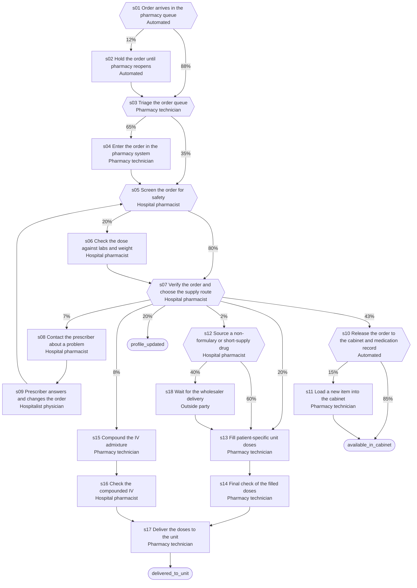

# Verify and dispense medication orders

`hosp-cs-pharmacy-order-verification` · hospital care · pharmacy · part of `community-hospital-corp`

This process takes one medication order from the moment it reaches the hospital pharmacy to the point where the nurse can give the drug. Technicians enter most orders from scanned or faxed images, pharmacists check each one for allergies, interactions and dose, and the drug is then released from the unit's dispensing cabinet or filled, checked and delivered by pharmacy technicians, with IV bags compounded in a clean room. Queues build after morning rounds and admission surges, pharmacy is closed overnight at the smaller sites, and unclear orders wait for the prescriber to call back.

| | |
|---|---|
| Unit of work | one medication order |
| Starts when | A prescriber writes or changes a medication order and the order reaches the pharmacy queue. |
| Done when | The verified order is on the medication record and the drug is available on the unit (cabinet, patient drawer or IV fridge), or the change is applied to the profile. |
| Organisation | A three-site Ontario community hospital pharmacy with central unit-dose distribution, automated dispensing cabinets on units, scanned paper orders and a pharmacy information system linked to the medication record. (5,790 employees, 2019-2022) |
| Volume | 60,000 cases a month (range 50,000 to 70,000) |

## Where it sits

- Starts with **medication_order** from med-inpatient-medical-care (42% of cases)
- Starts with **medication_order** from sx-surgical-inpatient-care (18% of cases)
- Starts with **medication_order** from med-icu-critical-care (12% of cases)
- Starts with **medication_order** from ed-physician-assessment (15% of cases)
- Starts with **medication_order** from mh-inpatient-psychiatry (8% of cases)
- Starts with **medication_order** from amb-systemic-therapy (5% of cases)
- Relies on **dispensed_medication** from cs-drug-inventory (a standing input; it does not start a case)
- Relies on **system_release** from dh-system-change (a standing input; it does not start a case)
- Relies on **lab_result** from dx-lab-testing (a standing input; it does not start a case)
- Sends **dispensed_medication** to med-medication-administration (outcome: available_in_cabinet)
- Sends **dispensed_medication** to med-medication-administration (outcome: delivered_to_unit)
- Sends **dispensed_medication** to amb-systemic-therapy (outcome: delivered_to_unit)
- Sends **mar_record** to med-medication-administration (outcome: profile_updated)

## Flow

## Roles

| Role | Department | Layer | FTE on this process | Loaded cost per hour | Evidence |
|---|---|---|---:|---:|---|
| Hospital pharmacist | Pharmacy | senior specialist | 20 | 81 CAD | B [src2] |
| Pharmacy technician | Pharmacy | individual contributor | 24 | 38 CAD | C |
| Pharmacy manager | Pharmacy | manager | 0.5 | 89 CAD | C |
| Hospitalist physician | Medical, dental and midwifery staff | senior specialist | 0.5 | 160 CAD | C |

## Steps

Hands-on time and the wait before each step show the most common value. Evidence tier A is a sourced number, B a sourced description, C the author's estimate.

| Step | Who | Kind | Hands-on | Wait before | Control | Evidence |
|---|---|---|---:|---:|---|---|
| **s01 Order arrives in the pharmacy queue.** After the prescriber writes or enters the order, the unit clerk scans or faxes it and the image lands in the pharmacy order queue with the patient, unit and time; orders marked stat print on a separate fax or flag in red. | Automated | system auto | 0 min | 20 min |  | B [src3], [src4] |
| **s02 Hold the order until pharmacy reopens.** Overnight the order waits in the queue; for urgent first doses the nurse takes the drug from the cabinet on override and the pharmacist reviews the override in the morning. | Automated | system auto | 0 min | 6.0 h |  | B [src1] |
| **s03 Triage the order queue.** A technician or pharmacist scans the incoming queue, moves stat orders, first doses and antibiotics to the front, and routes simple orders to technician entry and complex or urgent ones straight to a pharmacist. | Pharmacy technician | intake | 0.2 min | 5 min |  | C |
| **s04 Enter the order in the pharmacy system.** The technician reads the order image, selects the patient profile, picks the drug, dose, route and frequency from the formulary, sets the administration times and links the order so it will appear on the medication record after verification. | Pharmacy technician | data entry | 0.8 min | 20 min |  | B [src1], [src2] |
| **s05 Screen the order for safety.** The pharmacist compares the entered order with the image, checks allergies, duplicate therapy, interactions and dose range alerts from the pharmacy system, and checks the indication against the patient's other medications. | Hospital pharmacist | validation | 0.7 min | 30 min | Accreditation Canada / HSO medication management standard: pharmacist review of medication orders before administration | B [src1], [src3] |
| **s06 Check the dose against labs and weight.** For antibiotics, anticoagulants and drugs cleared by the kidney, the pharmacist looks up creatinine, weight and drug levels in the laboratory system and calculates whether the ordered dose fits. | Hospital pharmacist | analysis | 2 min | 0 min |  | C |
| **s07 Verify the order and choose the supply route.** The pharmacist verifies the order, which releases it to the medication record, and decides how the drug reaches the patient: from cabinet stock on the unit, as a patient-specific unit dose, as a compounded IV, or after a call to the prescriber when there is a problem. | Hospital pharmacist | approval | 0.2 min | 0 min | Ontario Drug and Pharmacies Regulation Act and Pharmacy Act: a pharmacist is responsible for the therapeutic check of each order | B [src1] |
| **s08 Contact the prescriber about a problem.** The pharmacist pages the prescriber with the problem (allergy, wrong dose for kidney function, duplicate, missing information or illegible order), suggests a change and documents the intervention. | Hospital pharmacist | communication | 5 min | 5 min |  | C |
| **s09 Prescriber answers and changes the order.** The prescriber calls back between patients, agrees or disagrees with the suggestion and gives a new order, which the pharmacist records as a verbal order for countersignature. | Hospitalist physician | judgment | 3 min | 1.0 h | Ontario Public Hospitals Act, Regulation 965: orders by an authorized practitioner | C |
| **s10 Release the order to the cabinet and medication record.** The pharmacy system sends the verified order to the unit's dispensing cabinet profile and the medication record, so the nurse can withdraw the dose for that patient. | Automated | system auto | 0 min | 1 min |  | C |
| **s11 Load a new item into the cabinet.** A technician picks the drug, takes it to the unit and loads a pocket in the cabinet for that patient, scanning the barcode so the cabinet knows what it holds. | Pharmacy technician | physical | 6 min | 1.0 h |  | B [src1] |
| **s12 Source a non-formulary or short-supply drug.** The pharmacist checks the formulary for an alternative and suggests it to the prescriber, or asks the patient to use their own supply, or orders the drug from the wholesaler. | Hospital pharmacist | coordination | 10 min | 15 min |  | C |
| **s13 Fill patient-specific unit doses.** The technician picks the unit-dose packages for the patient, prints labels, bags them by administration time and adds them to the next cart or delivery run. | Pharmacy technician | physical | 2 min | 1.0 h |  | B [src1] |
| **s14 Final check of the filled doses.** A regulated pharmacy technician or pharmacist checks each filled dose against the verified order and label (drug, strength, quantity, patient) before it leaves the pharmacy. | Pharmacy technician | validation | 0.6 min | 15 min | Ontario Pharmacy Act and Drug and Pharmacies Regulation Act: product release checked by a pharmacist or registered pharmacy technician | B [src1] |
| **s15 Compound the IV admixture.** The technician gathers vials, diluent and bags, works in the clean room hood with aseptic technique, adds the drug to the bag, labels it with the concentration and beyond-use date, and records lot numbers. | Pharmacy technician | physical | 10 min | 1.0 h | NAPRA Model Standards for Pharmacy Compounding of Non-hazardous Sterile Preparations, as adopted by the Ontario College of Pharmacists | B [src1], [src5] |
| **s16 Check the compounded IV.** The pharmacist checks the used vials and syringes pulled back to the marked volume, the worksheet calculation and the label against the order, then releases the bag. | Hospital pharmacist | validation | 2 min | 15 min | NAPRA sterile compounding standards: verification of each compounded preparation before release | B [src1], [src5] |
| **s17 Deliver the doses to the unit.** The technician sends the doses by pneumatic tube or takes them on the scheduled delivery round, places them in the patient's drawer or the unit medication fridge, and signs the delivery log. | Pharmacy technician | travel | 1 min | 30 min |  | B [src4] |
| **s18 Wait for the wholesaler delivery.** The special-order drug arrives on the next wholesaler delivery, usually the next business day, and is received into pharmacy stock. | Outside party | external wait | 0 min | 1.0 d |  | C |

## Exceptions

| Exception | Share of cases | What happens |
|---|---:|---|
| Overnight hold | 12% | The order arrives when the pharmacy is closed and waits until morning; urgent doses are taken from the cabinet on override and reviewed afterwards. |
| Prescriber clarification | 7% | The pharmacist finds a problem and pages the prescriber; the order waits for the call back and is screened again. |
| Non-formulary or short-supply drug | 2% | The drug is not stocked; the pharmacist suggests an alternative or orders it from the wholesaler. |

## Benchmarks

| Metric | Value | Unit | Population | Evidence |
|---|---|---|---|---|
| cycle_time_days | p50 0.09, p90 0.45 | days from order written to drug available on the unit | Canadian hospital pharmacies | B [src3] |
| order_to_verification_minutes | p50 93 | minutes, median, after scanned orders were introduced (143 before) | Two Canadian hospital sites, 2011 | A [src3] |
| stat_dispensary_turnaround_minutes | p50 10 | minutes from prescribing to leaving the dispensary, stat and urgent orders | 231-bed Canadian community hospital, 2009 | A [src4] |
| pharmacy_hours_open_per_week | 89 | hours per week, hospitals with 201-500 beds (96 for more than 500 beds) | CSHP survey 2020/21 | A [src1] |
| order_entry_and_verification_minutes_per_hour | 36.6 | minutes per pharmacist hour without CPOE (28.3 with CPOE) | Two US community hospital central pharmacies, 2011 | A [src2] |

## Pain points

- Orders written on morning rounds arrive together, so the verification queue reaches one to two hours before noon and first doses are late. (steps s04, s05; B [src3])
- Overnight, orders cannot be reviewed before nurses take doses from the cabinet, so checks happen after the dose is given. (steps s02; A [src1])
- Re-keying handwritten orders into the pharmacy system takes technician and pharmacist time and introduces transcription errors. (steps s04, s05; B [src1], [src2])
- Clarification calls wait for prescribers who are in clinics or procedures. (steps s08, s09; C)

## Assumptions

- Loaded costs come from the organisation file. The hospitalist role stands for all prescribers who answer pharmacist calls.
- The main site pharmacy is open about 07:30 to 23:00 and the two smaller sites for shorter day hours; about 12% of orders arrive when the site pharmacy is closed (author's estimate, consistent with src1's 86-96 opening hours a week).
- Route shares (43% cabinet stock, 20% unit dose, 8% IV admixture, 20% profile change only, 7% clarification, 2% non-formulary) are the author's estimates for a hospital using cabinets on most units.
- Touch times are short because most orders are simple; src2 measured order entry plus verification at under half a minute per order on average. Complex orders carry the dose-check step (s06).
- Chemotherapy preparation in a hazardous drug clean room is part of the systemic therapy service and is not modelled.
- The simulated median (about 3 hours) runs above the benchmark p50 because a third of orders also wait for a fill batch, check and delivery round after verification; the verification portion alone is close to the 93-143 minute medians in src3.
- The organisation file lists no sterile compounding equipment; a resource for clean room hoods is added (not_in_org_file) with a count of five across three sites (author's estimate).

## Sources

- [src1] [Hospital Pharmacy in Canada Survey 2020/21 Report](https://www.cshp.ca/common/Uploaded%20files/PDFs/HPCS-2020-21-Report-ENG-rev.Jan.14.2026.pdf) (Canadian Society of Hospital Pharmacists, 2022). 142 hospital pharmacy departments (hospitals of 50+ acute beds): pharmacies open an average 86 hours a week (96 for hospitals over 500 beds, 89 for 201-500 beds); only 9% open 24/7 (7 of 13 in Ontario); pharmacists review orders before the first dose in most (50-99%) areas in 76% of hospitals; only 2-3% review routine orders before after-hours night cupboard, ADC or ward stock access, 17% before the order reaches the MAR; 89% use automated dispensing cabinets; 77% use centralized unit dose; 19% had operational CPOE; 61% print MARs from the pharmacy system and 25% use eMAR (54% in Ontario); technical staff check patient-specific IV admixtures in 72% and ADC replenishment in 97% of hospitals.
- [src2] [Impact of Computerized Provider Order Entry on Pharmacist Productivity](https://pmc.ncbi.nlm.nih.gov/articles/PMC4062721/) (Hospital Pharmacy (Hatfield MD, Cox R, Mhatre SK, Flowers WP, Sansgiry SS), 2014). Time-motion study of central inpatient pharmacists at two community hospitals (274 and 238 beds): distributive work 72-81% of pharmacist time; order entry and verification 28.3 minutes per hour (CPOE site) vs 36.6 (non-CPOE); 114 vs 82 order entries or verifications per hour.
- [src3] [Decreasing Medication Turnaround Time with Digital Scanning Technology in a Canadian Health Region](https://www.cjhp-online.ca/index.php/cjhp/article/view/1402) (Canadian Journal of Hospital Pharmacy (Neville H, Nodwell L, Alsharif S), 2014). Two hospital sites, 548 orders audited in 2011: median time from prescriber writing the order to pharmacy verification fell from 143 to 93 minutes after scanned orders replaced the previous transmission; median time from order to nurse administration 315 and 300 minutes (not significant).
- [src4] [Retrospective Audit of Medication Order Turnaround Time after Implementation of Standardized Definitions](https://www.cjhp-online.ca/index.php/cjhp/article/download/1070/1350?inline=1) (Canadian Journal of Hospital Pharmacy (Naylor H, Woloschuk DMM, Fitch P, Miller S), 2011). 231-bed community hospital: stat and urgent orders were 1.1-2.6% of prescriptions; median dispensary turnaround 9-12 minutes against a 15-minute target met by 90%; median order-to-administration time 30-45 minutes; orders arrive by fax, a pharmacist enters, a technician fills and a pharmacist checks, then scheduled delivery to the ward.
- [src5] [Model Standards for Pharmacy Compounding of Non-hazardous Sterile Preparations](https://www.napra.ca/general-practice-resources/model-standards-for-pharmacy-compounding-of-non-hazardous-sterile-preparations/) (National Association of Pharmacy Regulatory Authorities, 2016). NAPRA model standards for non-hazardous sterile compounding replace the 2006 compounding guidelines and are implemented by each provincial pharmacy regulator.

Written by claude-opus on 2026-11-24.
