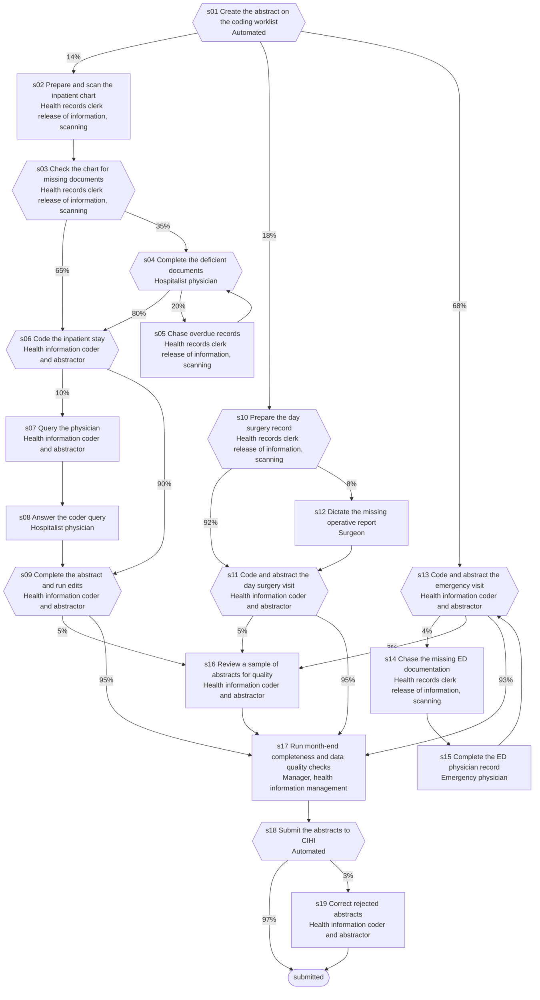

# Code and abstract inpatient, day surgery and emergency charts for CIHI

`hosp-dh-chart-coding` · healthcare (acute care hospital) · health information management · part of `community-hospital-corp`

After every inpatient stay, day surgery and emergency visit, health records staff assemble the chart and coders turn it into a standard abstract: diagnoses in ICD-10-CA, procedures in CCI and administrative fields, which the hospital submits to CIHI's Discharge Abstract Database and National Ambulatory Care Reporting System. The data drives provincial funding, wait-time reporting and research. Coding is slowed by charts that arrive without a discharge summary, physicians who answer queries late, and monthly deadlines that push coders to meet quotas with unspecified codes.

| | |
|---|---|
| Unit of work | one chart abstract (inpatient stay, day surgery visit or ED visit) |
| Starts when | The patient is discharged in the ADT system and an abstract shell appears on the coding worklist. |
| Done when | The coded abstract has passed edits and been accepted in the hospital's DAD or NACRS submission to CIHI. |
| Organisation | A three-site Ontario community hospital corporation with a hybrid electronic and scanned paper chart, about 30 coders and a commercial coding and abstracting tool with CIHI edits. (4,900 employees, 2019-2022) |
| Volume | 18,000 cases a month (range 16,000 to 19,500) |

## Where it sits

- Starts with **patient_chart** from ed-discharge-home (62% of cases)
- Starts with **patient_chart** from cs-discharge-planning (9% of cases)
- Starts with **patient_chart** from sx-perioperative-case (12% of cases)
- Starts with **patient_chart** from sx-endoscopy (6% of cases)
- Starts with **patient_chart** from wc-postpartum-newborn-care (4% of cases)
- Starts with **patient_chart** from wc-paediatric-care (1% of cases)
- Starts with **patient_chart** from mh-inpatient-psychiatry (1% of cases)
- Starts with **patient_chart** from med-end-of-life-care (1% of cases)
- Starts with **patient_chart** from dh-transcription (4% of cases)
- Relies on **system_release** from dh-system-change (a standing input; it does not start a case)
- Sends **coded_abstract** to cihi (outcome: submitted)
- Sends **coded_abstract** to fin-hsaa-reporting (outcome: submitted)

## Flow

## Roles

| Role | Department | Layer | FTE on this process | Loaded cost per hour | Evidence |
|---|---|---|---:|---:|---|
| Health information coder and abstractor | Health information management | individual contributor | 26 | 45 CAD | B [lucyk2017] |
| Health records clerk (release of information, scanning) | Health information management | individual contributor | 10 | 34 CAD | B [lucyk2017] |
| Manager, health information management | Health information management | manager | 1 | 76 CAD | B [lucyk2017] |
| Hospitalist physician | Medical, dental and midwifery staff | senior specialist | 0.5 | 160 CAD | B [oag2010], [lucyk2017] |
| Surgeon | Medical, dental and midwifery staff | senior specialist | 0.2 | 240 CAD | C |
| Emergency physician | Medical, dental and midwifery staff | senior specialist | 0.2 | 185 CAD | C |

## Steps

Hands-on time and the wait before each step show the most common value. Evidence tier A is a sourced number, B a sourced description, C the author's estimate.

| Step | Who | Kind | Hands-on | Wait before | Control | Evidence |
|---|---|---|---:|---:|---|---|
| **s01 Create the abstract on the coding worklist.** When the patient is discharged in the ADT system, an interface creates an abstract in the coding software with demographics, health card number, admission and discharge dates and service, and places it on the worklist for its type: inpatient, day surgery or emergency. | Automated | system auto | 0.5 min | 5 min |  | C |
| **s02 Prepare and scan the inpatient chart.** A health records clerk collects the paper chart from the unit, removes staples, sorts the documents into the standard order, adds barcoded cover sheets and scans them into document imaging, then checks image quality. | Health records clerk (release of information, scanning) | physical | 15 min | 1.0 d |  | B [lucyk2017] |
| **s03 Check the chart for missing documents.** The clerk runs deficiency analysis: checks for the discharge summary, operative notes, consultation reports and signatures, and assigns each missing item to the responsible physician's electronic in-box. | Health records clerk (release of information, scanning) | validation | 5 min | 4.0 h |  | B [lucyk2017] |
| **s04 Complete the deficient documents.** The physician opens the deficiency in-box, dictates or signs the discharge summary or other missing reports, and authenticates transcribed documents so the chart can be coded. | Hospitalist physician | drafting | 10 min | 5.0 d | Medical staff rules and by-laws on health record completion, with suspension of admitting privileges for overdue records | A [oag2010] |
| **s05 Chase overdue records.** The clerk sends overdue-record notices, adds the physician to the incomplete-records list reported to the chief of staff, and warns of suspension of admitting privileges under the medical staff rules. | Health records clerk (release of information, scanning) | communication | 5 min | 7.0 d |  | B [oag2010] |
| **s06 Code the inpatient stay.** The coder reads the discharge summary, progress notes, consultations, operative and diagnostic reports, selects the most responsible diagnosis and comorbidities with their diagnosis types in ICD-10-CA, and codes interventions in CCI. | Health information coder and abstractor | analysis | 20 min | 3.0 d |  | B [lucyk2017], [cihi_dad_meta] |
| **s07 Query the physician.** The coder writes a query in the physician's in-box or on a query form asking for clarification, for example whether documented urinary infection with sepsis criteria is sepsis, without leading the physician to an answer. | Health information coder and abstractor | drafting | 8 min | 30 min |  | B [lucyk2017] |
| **s08 Answer the coder query.** The physician reads the query, reviews the chart and writes an addendum clarifying the diagnosis, or does not answer before the month-end deadline, in which case the coder uses the less specific code. | Hospitalist physician | review | 5 min | 3.0 d |  | C |
| **s09 Complete the abstract and run edits.** The coder enters the remaining abstract fields (admission category, special care unit days, ALC days, intervention attributes), runs the coding software edits and the grouper to see the case mix group and weight, and fixes edit errors. | Health information coder and abstractor | data entry | 8 min | 10 min | CIHI DAD and NACRS submission requirements mandated by the Ontario Ministry of Health (hospital service accountability agreement reporting) | B [cihi_dad_meta] |
| **s10 Prepare the day surgery record.** The clerk collects the day surgery or endoscopy record, checks that the operative or procedure report and anaesthetic record are present, and scans the paper parts into document imaging. | Health records clerk (release of information, scanning) | physical | 5 min | 1.0 d |  | C |
| **s11 Code and abstract the day surgery visit.** The coder codes the main problem and procedures from the operative report, enters the anaesthetic and visit fields for the ambulatory abstract, runs edits and saves it as complete. | Health information coder and abstractor | analysis | 7 min | 2.0 d | CIHI DAD and NACRS submission requirements mandated by the Ontario Ministry of Health (hospital service accountability agreement reporting) | B [lucyk2017] |
| **s12 Dictate the missing operative report.** The surgeon receives the deficiency notice and dictates or signs the operative report so the procedure can be coded from the surgeon's own description. | Surgeon | drafting | 5 min | 3.0 d |  | C |
| **s13 Code and abstract the emergency visit.** The coder opens the electronic ED record and triage note, codes the main problem and any interventions, and checks the ED-specific fields that feed provincial wait-time reports: triage level and time, physician initial assessment time, decision to admit and departure times, and disposition. | Health information coder and abstractor | analysis | 4 min | 2.0 d | CIHI DAD and NACRS submission requirements mandated by the Ontario Ministry of Health (hospital service accountability agreement reporting) | B [lucyk2017] |
| **s14 Chase the missing ED documentation.** The clerk sends the ED physician a deficiency for the unsigned or missing ED record, or asks the ED unit clerk to correct a missing time stamp in the tracking board record. | Health records clerk (release of information, scanning) | communication | 5 min | 4.0 h |  | C |
| **s15 Complete the ED physician record.** The emergency physician opens the deficiency on the next shift, completes or signs the ED record, and adds the final diagnosis, disposition and any missing times. | Emergency physician | drafting | 3 min | 3.0 d |  | C |
| **s16 Review a sample of abstracts for quality.** A senior coder re-codes a sample of abstracts, compares diagnoses, diagnosis types and interventions with the original, corrects errors and gives feedback to the coder. | Health information coder and abstractor | review | 15 min | 3.0 d |  | B [lucyk2017] |
| **s17 Run month-end completeness and data quality checks.** At month-end the health information manager reconciles abstracts against ADT discharges, chases uncoded charts, runs data quality reports and assigns casual coders to backlogs to meet the submission date. Minutes are the per-abstract share. | Manager, health information management | validation | 0.5 min | 15.0 d |  | B [lucyk2017] |
| **s18 Submit the abstracts to CIHI.** The coding software builds the DAD and NACRS submission files, the manager uploads them through CIHI's electronic data submission service, and CIHI returns an error and correction report. | Automated | system auto | 0.5 min | 1.0 h | CIHI DAD and NACRS submission requirements mandated by the Ontario Ministry of Health (hospital service accountability agreement reporting) | B [cihi_dad_meta], [cihi_deadlines] |
| **s19 Correct rejected abstracts.** The coder opens each abstract listed on the CIHI error report, fixes the invalid code or field combination, and the corrected record goes in the next submission. | Health information coder and abstractor | data entry | 10 min | 3.0 d |  | C |

## Exceptions

| Exception | Share of cases | What happens |
|---|---:|---|
| Chart coded without a discharge summary | 3% | To meet month-end, the coder codes an inpatient stay from progress notes and admission diagnoses; the diagnoses may differ from those at discharge and are rarely revisited. |
| Overdue physician records | 1% | The physician does not complete the discharge summary after reminders, the chart is listed for suspension and coding waits weeks. |
| CIHI rejection | 3% | An abstract fails CIHI validation and is corrected and resubmitted in a later file. |

## Benchmarks

| Metric | Value | Unit | Population | Evidence |
|---|---|---|---|---|
| cycle_time_days | p50 28, p90 50 | days from discharge to accepted submission | all abstracts in an Ontario community hospital | C |
| coder_daily_quota_inpatient | 25 | inpatient charts per coder per day (average; up to 30) | Alberta coders, 2010s | B [lucyk2017] |
| discharge_summary_signed_within_10_days | low 0.07, high 0.9 | share of summaries | three Ontario hospitals, 2009 | A [oag2010] |

## Pain points

- Charts reach coders without discharge summaries, so coders wait or code from incomplete documents. (steps s03, s04, s06; B [lucyk2017], [oag2010])
- Quotas and monthly deadlines push coders toward unspecified codes and discourage physician queries. (steps s06, s07, s17; B [lucyk2017])
- Disorganised scanned or paper charts slow coding. (steps s02, s06; B [lucyk2017])

## Assumptions

- One case is one abstract. Emergency visits make up about two-thirds of the volume but little of the effort; inpatient stays take most coder time.
- The hospital submits DAD and NACRS monthly, so coded abstracts wait for the month-end cycle; the batch wait is the main part of the elapsed time.
- The simulated median (about 21 days) sits below the 28-day benchmark because two-thirds of abstracts are ED visits coded within days; inpatient abstracts alone run closer to 30 days.
- Physician steps use hospitalist for all attending physicians, surgeon for operative reports and ed_physician for ED records.
- Coder FTE (26) is below the organisation file's 30 coder headcount; the gap is assumed to cover reabstraction, data requests, vacancies and leave.
- The quota figures come from Alberta (lucyk2017); Ontario hospitals used similar productivity standards, but no Ontario source was opened.
- Loaded costs are the organisation file's ranges: hourly wage x 1.35 (about 25% benefits and HOOPP pension plus 10% overhead). Physician costs are gross clinical earnings paid by the province, not hospital payroll. Roles added here use the same 1.35 factor.

## Sources

- [lucyk2017] [Barriers to data quality resulting from the process of coding health information to administrative data: a qualitative study (Lucyk, Tang and Quan)](https://doi.org/10.1186/s12913-017-2697-y) (BMC Health Services Research 17:766, 2017). Coding workflow, documentation sources, incomplete charts, physician query practice, daily quotas (25 average, up to 30 inpatient, up to 180 ambulatory/ED), monthly submission deadline in Alberta, month-end casual coders.
- [oag2010] [2010 Annual Report, Chapter 3, Section 3.02: Discharge of Hospital Patients](https://www.auditor.on.ca/en/content/annualreports/arreports/en10/302en10.pdf) (Office of the Auditor General of Ontario, 2010). Discharge summary completion times at three Ontario hospitals and suspension of admitting privileges for overdue summaries.
- [cihi_dad_meta] [Discharge Abstract Database (DAD) metadata](https://www.cihi.ca/en/discharge-abstract-database-metadata) (Canadian Institute for Health Information, 2026). DAD coded in ICD-10-CA and CCI; electronic submission and validation; quarterly submission targets within 60 days.
- [cihi_deadlines] [Submission deadlines and refresh dates](https://www.cihi.ca/en/submit-data-and-view-standards/submission-deadlines-and-refresh-dates) (Canadian Institute for Health Information, 2026). DAD and NACRS submission deadlines, including the earlier Ontario-only year-end deadline.

Written by claude-opus on 2026-11-24.
