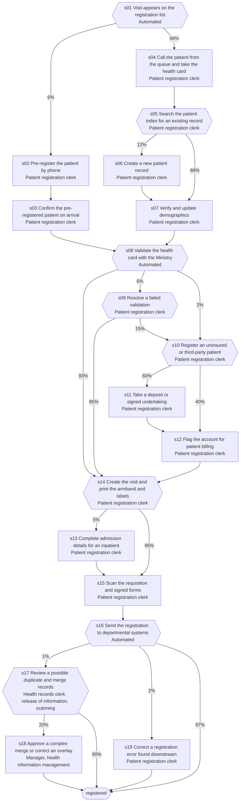

# Register outpatient, inpatient and diagnostic visits

`hosp-dh-patient-registration` · health care (public hospital) · health information management (patient access) · part of `community-hospital-corp`

Registration clerks record about 45,000 non-emergency visits a month at the corporation's three hospitals: clinic appointments, imaging and lab visits, surgery and planned admissions. For each visit the clerk finds or creates the patient's record, checks identity and demographics, validates the Ontario health card with the Ministry in real time, creates the visit and prints the armband and labels. Patients without valid OHIP coverage are registered to another payer and flagged for billing. Desk queues at the morning start of clinics slow the process, and the main errors are duplicate records and the wrong patient selected, which health records staff later have to merge or correct.

| | |
|---|---|
| Unit of work | one registration |
| Starts when | A booked or walk-in patient arrives for a clinic, imaging, laboratory, surgical or maternity visit, or a planned surgery or admission is due for pre-registration. |
| Done when | The visit is registered with a validated health card or another payer, the patient has an armband or labels, and the registration has reached the departmental and billing systems. |
| Organisation | A three-site Ontario community hospital corporation with central registration desks at each hospital entrance and a hospital-wide information system that validates health cards with the Ministry. (5,790 employees, 2019-2022) |
| Volume | 45,000 cases a month (range 35,000 to 55,000) |

## Where it sits

- Starts with **clinic_appointment** from amb-clinic-referral-booking (40% of cases)
- Starts with **imaging_appointment** from dx-imaging-booking (20% of cases)
- Starts with **imaging_order** from primary_care (8% of cases)
- Starts with **lab_order** from primary_care (19% of cases)
- Starts with **surgical_case** from sx-surgical-booking (8% of cases)
- Starts with **maternity_patient** from wc-obstetric-triage (2% of cases)
- Starts with **admission_order** from ed-admission-boarding (3% of cases)
- Sends **patient_account** to amb-clinic-visit (outcome: registered)
- Sends **patient_account** to dx-imaging-exam (outcome: registered)
- Sends **patient_account** to dx-lab-specimen-collection (outcome: registered)
- Sends **patient_account** to fin-patient-billing (outcome: registered)
- Sends **health_card_validation** to ministry_of_health (outcome: registered)

## Flow

## Roles

| Role | Department | Layer | FTE on this process | Loaded cost per hour | Evidence |
|---|---|---|---:|---:|---|
| Patient registration clerk | Patient registration and switchboard | individual contributor | 48 | 34 CAD | C |
| Health records clerk (release of information, scanning) | Health information management | individual contributor | 1 | 34 CAD | C |
| Manager, health information management | Health information management | manager | 0.3 | 76 CAD | C |

## Steps

Hands-on time and the wait before each step show the most common value. Evidence tier A is a sourced number, B a sourced description, C the author's estimate.

| Step | Who | Kind | Hands-on | Wait before | Control | Evidence |
|---|---|---|---:|---:|---|---|
| **s01 Visit appears on the registration list.** A booked clinic, imaging or surgical visit for the day appears on the registration desk's expected-arrivals list from the scheduling module, or a walk-in patient with a lab or X-ray requisition takes a number at the registration desk. | Automated | system auto | 0 min | 0 min |  | C |
| **s02 Pre-register the patient by phone.** Some days before a surgery, planned admission or maternity visit, the registration clerk phones the patient, confirms demographics, health card number and version, family physician, next of kin and any private insurance, and creates the pre-registered visit. | Patient registration clerk | data entry | 10 min | 3.0 d |  | C |
| **s03 Confirm the pre-registered patient on arrival.** On the day of the visit the clerk looks up the pre-registered visit, checks the health card and photo identification against it and confirms nothing has changed. | Patient registration clerk | validation | 2 min | 3.0 d |  | C |
| **s04 Call the patient from the queue and take the health card.** The clerk calls the next number, greets the patient, takes the Ontario health card and photo identification and asks what the visit is for, matching it to the booked appointment or the requisition the patient brings. | Patient registration clerk | intake | 0.8 min | 6 min |  | C |
| **s05 Search the patient index for an existing record.** The clerk searches the master patient index by health card number, then by name and date of birth, compares the candidates' address and phone number and selects the patient's existing medical record number. | Patient registration clerk | lookup | 1 min | 0 min | Accreditation Canada required organizational practice on client identification: two person-specific identifiers | B [just2016] |
| **s06 Create a new patient record.** For a first-time patient the clerk enters legal name, date of birth, sex, address, phone, health card number and version, family physician and emergency contact, and the system issues a medical record number. | Patient registration clerk | data entry | 5 min | 0 min |  | B [just2016] |
| **s07 Verify and update demographics.** The clerk reads back the address, phone number, family physician and next of kin, updates anything that has changed, swipes the health card and asks about consent preferences such as a privacy lock-box. | Patient registration clerk | data entry | 1.5 min | 0 min | Personal Health Information Protection Act: record consent directives (lock-box) and keep personal health information accurate | C |
| **s08 Validate the health card with the Ministry.** The card swipe sends the health card number and version code to the Ministry of Health's health card validation service, which returns a response code within seconds showing whether the card is valid and the patient is eligible for OHIP. | Automated | system auto | 0 min | 0 min | Health Insurance Act (Ontario): insured hospital services require OHIP eligibility | B [omd_hcv] |
| **s09 Resolve a failed validation.** The clerk asks for a newer card, re-keys the number, or calls the Ministry's voice response line, and if the card is expired asks the patient to renew at ServiceOntario while recording the visit as insured pending proof; during 2020-2022 expired cards were accepted under the pandemic rules. | Patient registration clerk | validation | 5 min | 0 min |  | C |
| **s10 Register an uninsured or third-party patient.** For a visitor, new resident in the waiting period, out-of-province patient or a workplace injury, the clerk records the payer (another province's plan, the Interim Federal Health Program, WSIB, private insurer or self-pay) and the policy details. | Patient registration clerk | data entry | 8 min | 0 min |  | C |
| **s11 Take a deposit or signed undertaking.** The clerk explains the estimated charge, takes a deposit by card at the desk or has the patient sign an undertaking to pay, and gives a receipt. | Patient registration clerk | communication | 6 min | 0 min | Hospital uninsured patient deposit and financial responsibility policy | C |
| **s12 Flag the account for patient billing.** The clerk sets the account type and a billing flag in the hospital system so patient accounts can invoice the patient or third party after the visit. | Patient registration clerk | data entry | 2 min | 0 min |  | C |
| **s13 Complete admission details for an inpatient.** For an inpatient admission, planned or from the emergency department, the clerk converts or creates the inpatient encounter, records the admitting physician and service, the patient's room preference and supplementary insurance for semi-private or private accommodation, and has the patient sign the accommodation agreement. | Patient registration clerk | data entry | 5 min | 0 min |  | C |
| **s14 Create the visit and print the armband and labels.** The clerk creates the encounter with patient type, service, location and attending or ordering physician, then prints the identification armband where needed, the labels and the requisition copies, and directs the patient to the department. | Patient registration clerk | data entry | 1.5 min | 0 min | Accreditation Canada required organizational practice on client identification: armband and labels with two identifiers | C |
| **s15 Scan the requisition and signed forms.** The clerk scans the paper requisition, consent and financial forms into the patient's electronic record, or places them in the visit folder for health records to scan later. | Patient registration clerk | data entry | 0.5 min | 0 min |  | C |
| **s16 Send the registration to departmental systems.** The hospital system sends the registration message to the radiology, laboratory, clinic and billing systems, and the overnight duplicate-detection job compares new records with existing ones. | Automated | system auto | 0 min | 0 min |  | C |
| **s17 Review a possible duplicate and merge records.** A health records clerk works the duplicate-candidate report, compares the two records' identifiers, visits and health card history, and merges confirmed duplicates so results and reports sit under one medical record number. | Health records clerk (release of information, scanning) | analysis | 20 min | 3.0 d |  | B [just2016] |
| **s18 Approve a complex merge or correct an overlay.** The health information manager reviews merges that span radiology, laboratory and clinic systems or where one patient's results were filed to another's record, approves the correction and notifies the departments and, if information was disclosed to the wrong person, the privacy officer. | Manager, health information management | approval | 30 min | 2.0 d | Personal Health Information Protection Act: correct records and report privacy breaches | C |
| **s19 Correct a registration error found downstream.** When coding, patient accounts or a department finds a wrong patient type, payer, physician or address, the registration clerk corrects the visit and resends it to the downstream systems. | Patient registration clerk | data entry | 6 min | 3.0 d |  | C |

## Exceptions

| Exception | Share of cases | What happens |
|---|---:|---|
| New patient | 11% | No record is found and the clerk creates one; a mistyped name here is the usual start of a duplicate. |
| Failed health card validation | 6% | The card's version code is out of date, the card has expired or eligibility has lapsed; most are resolved at the desk. |
| Uninsured or third-party payer | 2% | The patient is registered to another payer or as self-pay with a deposit or undertaking and the account is flagged for billing. |
| Duplicate record merge | 1% | The overnight check flags a possible duplicate, which health records review and merge; one in five needs the manager's approval. |
| Pre-registration | 6% | Surgical, planned admission and maternity patients are registered by phone days before and confirmed on arrival. |

## Benchmarks

| Metric | Value | Unit | Population | Evidence |
|---|---|---|---|---|
| cycle_time_days | p50 0.01, p90 0.04 | calendar days from arrival at the desk (or the pre-registration request) to registration complete | Non-emergency registrations in an Ontario community hospital, 2019-2022 | C |
| duplicate_pairs_with_middle_name_mismatch | 0.583 | share of confirmed duplicate pairs | 398,939 patient records with confirmed duplicates, United States multisite data | A [just2016] |
| health_card_validation_response | response code within a few seconds | description | Ontario health card validation service | B [omd_hcv] |

## Pain points

- Desk queues build at the morning start of clinics, lab and imaging, so patients arrive late to appointments. (steps s04; C)
- Misspelled names and mistyped birth dates at registration create duplicate records that health records must merge, and results can be filed under the wrong record in the meantime. (steps s05, s06, s17, s18; A [just2016])
- Expired cards and outdated version codes fail validation and need a call or a workaround at the desk. (steps s08, s09; B [omd_hcv])
- Outdated phone numbers and family physicians in the record send results, reports and reminders to the wrong place. (steps s07; C)

## Assumptions

- Emergency department registrations (about 13,000 a month) belong to ed-patient-triage and are excluded.
- All registrations are drawn as done by central registration clerks. In many Ontario hospitals imaging and clinic reception clerks also register patients at their own desks; that work would move to di_clerk and clinic_clerk without changing the steps.
- Triggers add primary_care imaging orders (walk-in X-ray) and emergency admissions from ed-admission-boarding (the clerk converts the emergency visit to an inpatient encounter), and outputs add dx-imaging-exam and dx-lab-specimen-collection; the organisation file lacks these links.
- The health records clerk (him_clerk) is added for duplicate review and merges; the organisation file lists only registration clerks and the manager.
- Corrections found downstream and duplicate merges happen days after the visit but are drawn on the same path, adding days to about 3% of simulated cases.
- Simulated median cycle time is about 0.02 days (roughly 25 minutes) against a tier C benchmark of 0.01 days, mostly the desk queue.
- Simulated hands-on time implies about 58 FTE against 49 stated. With emergency registration (about 13,000 visits a month at 5-6 minutes, roughly 9-10 FTE), the 75 registration clerks in the organisation file would need about 60 FTE of desk time, which is tight for a 24/7 part-time workforce; either decentralised imaging and clinic clerks register part of the volume, or the headcount is low.
- Loaded costs from the organisation file (wage times 1.35).

## Sources

- [just2016] [Why Patient Matching Is a Challenge: Research on Master Patient Index (MPI) Data Discrepancies in Key Identifying Fields](https://www.ebi.ac.uk/europepmc/webservices/rest/search?query=PMCID:PMC4832129&resultType=core&format=json) (Perspectives in Health Information Management 13 (Just BH, Marc D, Munns M, Sandefer R); abstract read through the Europe PMC record, 2016). Multisite data set of 398,939 patient records with confirmed duplicates: middle name mismatched in 58.30% of duplicate pairs and social security number in 53.54%; most name mismatches were misspellings or swapped fields; the authors recommend naming conventions, staff training and monitoring because technology alone does not remove registration errors
- [omd_hcv] [Health Card Validation](https://ontariomd.ca/products-and-services/health-card-validation) (OntarioMD, 2024). Health Card Validation checks a health card number and version code against Ministry of Health databases in real time and returns only a response code on the card's status and OHIP eligibility within a few seconds; it returns no personal health information and does not guarantee claim payment (the OntarioMD basic service was discontinued in July 2024, after the reference period)
- [hh2122] [2021-2022 Annual Community Report (Halton Healthcare by the numbers)](https://www.haltonhealthcare.on.ca/about/reports-and-publications/2021-2022-annual-community-report) (Halton Healthcare, 2022). 2021/22: 298,482 diagnostic imaging exams, 161,049 emergency visits, 45,256 surgeries, 4,690 births, 37,964 dialysis visits, 19,600 oncology visits, 62,508 mental health and addictions ambulatory visits, 40,428 fracture clinic visits, 3,220,658 laboratory tests, 5,228 staff, 931 physicians, dentists and midwives

Written by claude-opus on 2026-11-24.
