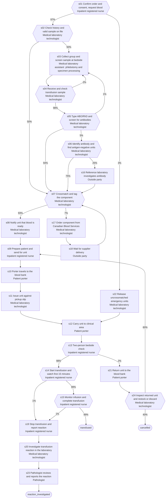

# Provide blood for transfusion

`hosp-dx-blood-transfusion` · healthcare (acute care hospital) · laboratory medicine (transfusion medicine) and nursing · part of `community-hospital-corp`

This process gets a compatible blood component safely from the hospital's transfusion laboratory into the right patient. A nurse confirms the order and consent, a laboratory assistant draws a group and screen sample with strict bedside labelling, a technologist types and screens it, crossmatches a unit and issues it to a porter, and two nurses check it at the bedside before starting and monitoring the transfusion. Most delay comes from waiting for a new sample, positive antibody screens that need reference work, porter availability and scheduling around the patient. Wrong-blood-in-tube and bedside check failures are rare but can be fatal, so most steps carry fixed regulatory checks.

| | |
|---|---|
| Unit of work | one blood component issued |
| Starts when | A prescriber orders a blood component for a patient. |
| Done when | The component is transfused and documented, a reaction is investigated and reported, or the transfusion is cancelled and the unit returned. |
| Organisation | A three-site Ontario community hospital corporation of about 640 beds with a transfusion laboratory at each site, supplied by Canadian Blood Services and accredited through IQMH. (5,790 employees, 2019-2022) |
| Volume | 800 cases a month (range 600 to 1,000) |

## Where it sits

- Starts with **blood_order** from med-inpatient-medical-care (40% of cases)
- Starts with **blood_order** from ed-physician-assessment (15% of cases)
- Starts with **blood_order** from sx-perioperative-case (12% of cases)
- Starts with **blood_order** from sx-surgical-inpatient-care (8% of cases)
- Starts with **blood_order** from med-icu-critical-care (10% of cases)
- Starts with **blood_order** from amb-systemic-therapy (10% of cases)
- Starts with **blood_order** from wc-labour-delivery (5% of cases)
- Relies on **blood_product** from blood_supplier (a standing input; it does not start a case)
- Sends **blood_product** to med-inpatient-medical-care (outcome: transfused)
- Sends **blood_product** to sx-perioperative-case (outcome: transfused)
- Sends **blood_product** to wc-labour-delivery (outcome: transfused)
- Sends **blood_product** to amb-systemic-therapy (outcome: transfused)
- Sends **blood_order** to blood_supplier (outcome: any)
- Sends **incident_report** to blood_supplier (outcome: reaction_investigated)

## Flow

## Roles

| Role | Department | Layer | FTE on this process | Loaded cost per hour | Evidence |
|---|---|---|---:|---:|---|
| Inpatient registered nurse | Inpatient medicine units | individual contributor | 6 | 61 CAD | C |
| Medical laboratory technologist | Laboratory medicine | individual contributor | 5 | 58 CAD | C |
| Medical laboratory assistant (phlebotomy and specimen processing) | Laboratory medicine | individual contributor | 0.6 | 34 CAD | C |
| Patient porter | Portering and security | individual contributor | 1.5 | 30 CAD | C |
| Pathologist | Medical, dental and midwifery staff | senior specialist | 0.1 | 220 CAD | C |

## Steps

Hands-on time and the wait before each step show the most common value. Evidence tier A is a sourced number, B a sourced description, C the author's estimate.

| Step | Who | Kind | Hands-on | Wait before | Control | Evidence |
|---|---|---|---:|---:|---|---|
| **s01 Confirm order and consent, request blood.** The patient's nurse checks that the prescriber's transfusion order names the component, dose and rate, confirms that informed consent is documented, and sends the request to the transfusion laboratory through order entry or by phone for urgent cases. | Inpatient registered nurse | validation | 8 min | 20 min | Health Care Consent Act, 1996 (Ontario) informed consent; CSA Z902 Blood and blood components (national standard for hospital transfusion services, applied in Ontario through IQMH laboratory accreditation): order content | A [orbcon2023] |
| **s02 Check history and valid sample on file.** The medical laboratory technologist on the transfusion bench looks up the patient in the transfusion system for blood group history, known antibodies, special requirements such as irradiated products, and whether a group and screen sample collected within the last 96 hours is on file. | Medical laboratory technologist | lookup | 2 min | 5 min |  | B [cbs_ch8] |
| **s03 Collect group and screen sample at bedside.** The laboratory assistant asks the patient to state full name and date of birth, checks the wristband, draws the pink-top tube and labels it in the patient's presence with full name, hospital number, date, time and collector's identity before leaving the bedside. | Medical laboratory assistant (phlebotomy and specimen processing) | physical | 8 min | 30 min | CSA Z902 Blood and blood components (national standard for hospital transfusion services, applied in Ontario through IQMH laboratory accreditation): sample identification and labelling at the bedside | B [cbs_ch8] |
| **s04 Receive and check transfusion sample.** The technologist compares every identifier on the tube with the requisition and the transfusion system record; any missing or mismatched detail means the sample is rejected and redrawn, since transfusion samples cannot be relabelled. | Medical laboratory technologist | validation | 2 min | 10 min | CSA Z902 Blood and blood components (national standard for hospital transfusion services, applied in Ontario through IQMH laboratory accreditation): sample acceptance criteria | C |
| **s05 Type ABO/RhD and screen for antibodies.** The technologist loads the sample on the automated gel or solid-phase analyser for forward and reverse ABO grouping, RhD typing and an antibody screen against reagent red cells, compares the group with any historical record and records results. | Medical laboratory technologist | analysis | 12 min | 45 min | CSA Z902 Blood and blood components (national standard for hospital transfusion services, applied in Ontario through IQMH laboratory accreditation): ABO/RhD and antibody screen before red cell transfusion | B [cbs_ch8] |
| **s06 Identify antibody and find antigen-negative units.** For a positive screen, the technologist runs an antibody identification panel, interprets the pattern, selects donor units that lack the corresponding antigen and phenotypes them, consulting the pathologist on difficult cases. | Medical laboratory technologist | analysis | 2.0 h | 30 min |  | B [cbs_ch8] |
| **s07 Crossmatch and tag the component.** The technologist performs an electronic crossmatch, or a serological crossmatch when an antibody is present, selects the unit, thaws plasma where needed, prints and attaches the compatibility tag with the patient's identifiers and places the unit in the issue fridge. | Medical laboratory technologist | analysis | 8 min | 10 min | CSA Z902 Blood and blood components (national standard for hospital transfusion services, applied in Ontario through IQMH laboratory accreditation): compatibility testing and labelling of issued units | B [cbs_ch8] |
| **s08 Notify unit that blood is ready.** The technologist marks the unit ready in the transfusion system, which shows on the chart, or phones the unit for urgent cases; the unit stays in the laboratory until the patient is ready, so it is not left out of temperature control. | Medical laboratory technologist | communication | 2 min | 0 min |  | C |
| **s09 Prepare patient and send for unit.** The nurse confirms the IV is patent, takes baseline vital signs, primes the blood tubing with saline, completes the pickup slip with the patient's identifiers and asks for a porter, timing pickup so the unit can be started soon after it arrives. | Inpatient registered nurse | coordination | 10 min | 45 min | Hospital transfusion administration policy based on ORBCoN Bloody Easy Blood Administration | A [orbcon2023] |
| **s10 Porter travels to the blood bank.** A porter picks up the request from the dispatch system or phone, walks to the unit for the pickup slip if it was not sent electronically and then to the transfusion laboratory. | Patient porter | travel | 8 min | 20 min |  | C |
| **s11 Issue unit against pickup slip.** The technologist matches the pickup slip with the compatibility tag and the unit label, inspects the bag for leaks, clots or discolouration, scans it out in the transfusion system to record issue time and hands it to the porter in a transport bag. | Medical laboratory technologist | validation | 5 min | 3 min | CSA Z902 Blood and blood components (national standard for hospital transfusion services, applied in Ontario through IQMH laboratory accreditation): issue checks and documentation of issue time | A [orbcon2023] |
| **s12 Carry unit to clinical area.** The porter carries the unit directly to the nurse on the unit, ED, ICU or day medicine area without stopping, and hands it to a nurse rather than leaving it at the desk. | Patient porter | travel | 7 min | 0 min |  | C |
| **s13 Two-person bedside check.** Two nurses at the bedside check the patient's wristband and stated name and date of birth against the compatibility tag and the unit label, compare the component, ABO and Rh compatibility, unit number and expiry with the order, and both sign. | Inpatient registered nurse | validation | 5 min | 5 min | CSA Z902 Blood and blood components (national standard for hospital transfusion services, applied in Ontario through IQMH laboratory accreditation) and ORBCoN blood administration practice: independent double check of patient and unit at the bedside | A [orbcon2023] |
| **s14 Start transfusion and watch first 15 minutes.** The nurse spikes the unit with a filtered blood set, starts at a slow rate for the first 15 minutes, stays nearby to watch for fever, chills, breathing difficulty or rash, then takes vital signs and increases to the ordered rate. | Inpatient registered nurse | physical | 18 min | 2 min | Transfusion administration procedure: slow initial rate and observation during the first 15 minutes | A [orbcon2023] |
| **s15 Monitor infusion and complete transfusion.** While the unit runs the nurse checks the patient periodically; at the end the nurse takes final vital signs, records volume transfused, end time and any reaction on the transfusion record and discards or returns the bag per policy. | Inpatient registered nurse | physical | 15 min | 1.8 h | CSA Z902 Blood and blood components (national standard for hospital transfusion services, applied in Ontario through IQMH laboratory accreditation): completion within 4 hours of issue and documentation | A [orbcon2023] |
| **s16 Reference laboratory investigates antibody.** Canadian Blood Services' diagnostic laboratory receives the sample by courier, completes the antibody investigation and, where needed, finds and ships rare or antigen-negative units, reporting back by phone and written report. | Outside party | external wait | 0 min | 2.0 d |  | B [cbs_ch8] |
| **s17 Order component from Canadian Blood Services.** The technologist phones or enters an order with the Canadian Blood Services distribution site for the missing component, often platelets or a special product, and arranges routine shipment or a stat taxi. | Medical laboratory technologist | communication | 10 min | 5 min |  | C |
| **s18 Wait for supplier delivery.** The component travels from the Canadian Blood Services site by scheduled delivery or stat courier; on arrival the technologist checks the shipping temperature and enters the unit into inventory. | Outside party | external wait | 0 min | 4.0 h |  | C |
| **s19 Stop transfusion and report reaction.** The nurse stops the transfusion, keeps the IV open with saline, rechecks the tag against the patient, assesses and treats with the physician, notifies the transfusion laboratory and sends the bag, tubing and post-transfusion samples. | Inpatient registered nurse | communication | 25 min | 2 min | Hospital transfusion reaction procedure (stop, check, notify) | C |
| **s20 Investigate transfusion reaction in the laboratory.** The technologist performs a clerical check of all labels and records, repeats ABO and Rh on pre- and post-transfusion samples, runs a direct antiglobulin test, checks for visible hemolysis and, for suspected bacterial contamination, arranges culture of the bag. | Medical laboratory technologist | analysis | 45 min | 30 min | CSA Z902 Blood and blood components (national standard for hospital transfusion services, applied in Ontario through IQMH laboratory accreditation): investigation of suspected transfusion reactions | C |
| **s21 Return unit to the blood bank.** A porter returns the unused unit to the transfusion laboratory with a note of the time it left; units that cannot be started within the allowed time must not be kept on the ward. | Patient porter | travel | 8 min | 20 min |  | C |
| **s22 Release uncrossmatched emergency units.** On a physician's call for massive bleeding, the technologist issues group O red cells (O-negative for girls and women of childbearing potential) or group-specific units if the group is known, records the physician's emergency release signature and asks for a sample as soon as possible to crossmatch later units. | Medical laboratory technologist | physical | 8 min | 2 min | CSA Z902 Blood and blood components (national standard for hospital transfusion services, applied in Ontario through IQMH laboratory accreditation): emergency release authorised and signed by the physician | B [cbs_ch8] |
| **s23 Pathologist reviews and reports the reaction.** The pathologist responsible for transfusion medicine reviews the clinical and laboratory findings, classifies the reaction, advises on future transfusions, signs the report to the chart and reports serious reactions to Canadian Blood Services and the provincial transfusion error and injury surveillance system. | Pathologist | review | 30 min | 1.0 d | CSA Z902 Blood and blood components (national standard for hospital transfusion services, applied in Ontario through IQMH laboratory accreditation): medical director review of transfusion reactions and reporting to the supplier | C |
| **s24 Inspect returned unit and restock or discard.** The technologist checks how long the unit was out of controlled storage and whether the seal and temperature indicator are intact, returns acceptable units to inventory and discards the rest, logging the wastage in the transfusion system. | Medical laboratory technologist | validation | 5 min | 5 min | CSA Z902 Blood and blood components (national standard for hospital transfusion services, applied in Ontario through IQMH laboratory accreditation): acceptance of returned components | C |

## Exceptions

| Exception | Share of cases | What happens |
|---|---:|---|
| Positive antibody screen | 2% | The screen finds an antibody; identification and antigen-negative units add hours, and complex cases go to the Canadian Blood Services reference laboratory for days. |
| Rejected transfusion sample | 1% | A label error means the sample is discarded and redrawn. |
| Unit returned unused | 2% | The patient is off the unit or the IV fails, so the unit goes back to the laboratory to be restocked or wasted. |
| Transfusion reaction | 1% | The nurse stops the transfusion; the laboratory and pathologist investigate and report to the supplier. |
| Emergency release | 3% | Uncrossmatched group O or group-specific units are issued on a physician's signature for massive bleeding. |

## Benchmarks

| Metric | Value | Unit | Population | Evidence |
|---|---|---|---|---|
| cycle_time_days | p50 0.3, p90 0.8 | calendar days from order to completed transfusion | All components issued in a community hospital | C [orbcon2023], [cbs_ch8] |
| issue_to_completion_hours | 2.5 | hours (average) | 309 audited transfusions in 72 Ontario hospitals, 2023 | A [orbcon2023] |
| bedside_check_in_presence_of_patient | 0.88 | share of audited transfusions | Ontario hospitals, 2023 bedside audit | A [orbcon2023] |
| ontario_rbc_units_transfused_per_day | 950 | red cell units per day, all Ontario hospitals | Ontario, fiscal 2021/22 | A [orbcon2023] |

## Pain points

- When no valid sample is on file, the patient waits for a draw, sample transit and a 30 to 60 minute screen before blood can be crossmatched. (steps s03, s04, s05; B [cbs_ch8])
- Bedside checks are sometimes done away from the patient, the main defence against giving a unit to the wrong person. (steps s13; A [orbcon2023])
- Porter availability delays pickup and return, and units that cannot be started in time come back and may be wasted. (steps s10, s21, s24; C)
- Orders and documentation are often incomplete: rate, dose and patient advice are missing in about one in ten transfusions. (steps s01, s15; A [orbcon2023])

## Assumptions

- One case is one component issued; a patient receiving two units in one episode is two cases, which overstates sample and order steps slightly for multi-unit orders.
- Nursing steps use the inpatient registered nurse role and cost; ED, ICU, OR, labour and day-medicine nurses do the same work.
- The two-person bedside check uses people = 2 in the same role.
- The wait before s15 is the infusion running, not a queue.
- Volume is scaled from the provincial red cell figure and is not a published count for this hospital.
- Group and screen samples are drawn by laboratory assistants; on some units nurses draw them, with the same rules.
- Simulated median cycle time (about 0.41 days) is above the estimated 0.3 days, mostly from waiting for the patient to be ready (s09) and for new samples; both figures are estimates.
- Loaded costs come from the organisation file.

## Sources

- [orbcon2023] [Bedside Audit Report: 2023 provincial audit of blood administration practices (published December 2024)](https://transfusionontario.org/wp-content/uploads/2025/02/ORBCoN-Bedside-Audit-Report-Feb-2023-Final.pdf) (Ontario Regional Blood Coordinating Network (ORBCoN), 2024). 2023 Ontario bedside audit: 309 audits in 72 hospitals; compliance for order, consent, bedside checks, vital signs; average issue-to-completion 2.5 hours; 950 red cell units transfused a day in Ontario in 2021/22; component mix.
- [cbs_ch8] [Clinical Guide to Transfusion, Chapter 8: Pre-transfusion testing (Duncan)](https://profedu.blood.ca/en/node/170) (Canadian Blood Services, Professional Education, 2020). Sample labelling and identity rules, 96-hour sample validity, typing and screen times, electronic versus serological crossmatch, antibody identification and reference laboratories, emergency release.

Written by claude-opus on 2026-11-24.
