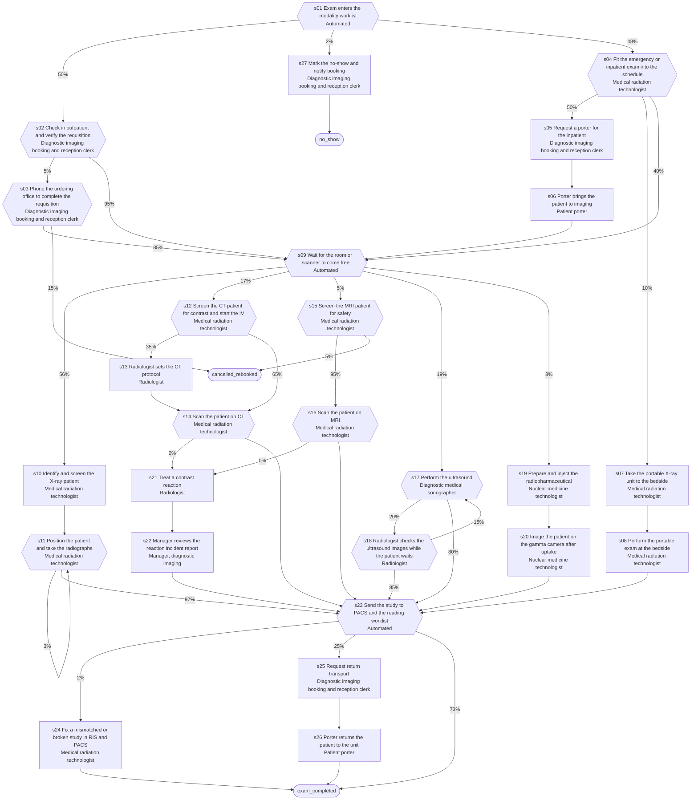

# Perform diagnostic imaging exams

`hosp-dx-imaging-exam` · health care (public hospital) · diagnostic imaging · part of `community-hospital-corp`

Medical radiation technologists, sonographers and nuclear medicine technologists perform about 24,000 X-ray, CT, MRI, ultrasound, mammography and nuclear medicine exams a month across the corporation's three hospitals. Each exam starts when an emergency or inpatient order reaches the radiology worklist or a booked or walk-in outpatient checks in, and ends when the images are in PACS on the radiologist's reading list. The technologist identifies and screens the patient (pregnancy, contrast, MRI safety), positions and scans, and checks the images. The work is slowed by emergency orders that must be fitted around booked outpatients, waits for porters to bring inpatients, scanner and room capacity, incomplete requisitions and no-shows.

| | |
|---|---|
| Unit of work | one imaging exam |
| Starts when | An emergency or inpatient imaging order reaches the radiology worklist, or a booked or walk-in outpatient arrives at imaging reception with a requisition. |
| Done when | The images are stored in PACS and on the radiologist's reading worklist and the patient has left or been returned to the unit; or the exam is cancelled for rebooking or recorded as a no-show. |
| Organisation | A three-site Ontario community hospital corporation with about 640 beds, an emergency department at each site and a hospital-wide RIS, PACS and voice recognition system. (5,790 employees, 2019-2022) |
| Volume | 23,500 cases a month (range 20,850 to 24,900) |

## Where it sits

- Starts with **imaging_order** from ed-physician-assessment (31% of cases)
- Starts with **imaging_order** from med-inpatient-medical-care (17% of cases)
- Starts with **imaging_order** from sx-fracture-clinic (8% of cases)
- Starts with **imaging_appointment** from dx-imaging-booking (25% of cases)
- Starts with **imaging_order** from primary_care (19% of cases)
- Sends **imaging_study** to dx-radiology-reporting (outcome: exam_completed)
- Sends **transport_request** to fs-patient-portering (outcome: exam_completed)
- Sends **imaging_order** to dx-imaging-booking (outcome: cancelled_rebooked)
- Sends **imaging_order** to dx-imaging-booking (outcome: no_show)

## Flow

## Roles

| Role | Department | Layer | FTE on this process | Loaded cost per hour | Evidence |
|---|---|---|---:|---:|---|
| Medical radiation technologist | Diagnostic imaging | individual contributor | 52 | 59 CAD | C |
| Diagnostic medical sonographer | Diagnostic imaging | individual contributor | 22 | 61 CAD | C |
| Nuclear medicine technologist | Diagnostic imaging | individual contributor | 5 | 61 CAD | C |
| Diagnostic imaging booking and reception clerk | Diagnostic imaging | individual contributor | 8 | 35 CAD | C |
| Radiologist | Medical, dental and midwifery staff | senior specialist | 1.5 | 280 CAD | C |
| Patient porter | Portering and security | individual contributor | 4 | 30 CAD | C |
| Manager, diagnostic imaging | Diagnostic imaging | manager | 1 | 78 CAD | C |
| Director, diagnostic services | Diagnostic services | director | 0.1 | 101 CAD | C |

## Steps

Hands-on time and the wait before each step show the most common value. Evidence tier A is a sourced number, B a sourced description, C the author's estimate.

| Step | Who | Kind | Hands-on | Wait before | Control | Evidence |
|---|---|---|---:|---:|---|---|
| **s01 Exam enters the modality worklist.** The order placed in the hospital information system, or the booked appointment for today, crosses the interface into the radiology information system and appears on the modality worklist with its priority (stat, urgent or routine), patient location and requisition image. | Automated | system auto | 0 min | 0 min |  | C |
| **s02 Check in outpatient and verify the requisition.** The imaging reception clerk takes the paper or faxed requisition, confirms the patient has been registered, checks that the requisition is signed by an authorised practitioner and names the exam and clinical question, and marks the patient arrived in the radiology system. | Diagnostic imaging booking and reception clerk | intake | 3 min | 10 min | Healing Arts Radiation Protection Act (Ontario): X-ray exams only on the order of a physician or other authorised practitioner | C |
| **s03 Phone the ordering office to complete the requisition.** The clerk phones or faxes the ordering physician's office for a signature, the missing clinical history or a corrected exam, while the patient waits in reception; if no one answers the patient is sent home and rebooked. | Diagnostic imaging booking and reception clerk | communication | 6 min | 45 min |  | C |
| **s04 Fit the emergency or inpatient exam into the schedule.** The charge or modality technologist looks at the worklist, ranks emergency and stat orders above inpatient routine orders and the booked outpatients already in the rooms, and decides when the exam can be done and whether the patient must be brought down or imaged at the bedside. | Medical radiation technologist | judgment | 2 min | 20 min |  | C |
| **s05 Request a porter for the inpatient.** The imaging clerk enters a transport request in the portering system or phones dispatch, giving the patient's unit, bed, mode (stretcher, wheelchair, bed) and isolation status, and phones the unit so nursing can prepare the patient. | Diagnostic imaging booking and reception clerk | coordination | 2 min | 2 min |  | C |
| **s06 Porter brings the patient to imaging.** A porter collects the patient from the inpatient unit or emergency stretcher, checks the armband against the request, moves the patient by stretcher or wheelchair to the imaging sub-waiting area and hands over to the technologist. | Patient porter | physical | 12 min | 20 min | Accreditation Canada required organizational practice on client identification: two identifiers before a service | C |
| **s07 Take the portable X-ray unit to the bedside.** The technologist collects a portable X-ray unit, checks its battery and detector, and wheels it through the corridors and elevators to the intensive care unit, emergency resuscitation bay or ward where the patient cannot be moved. | Medical radiation technologist | travel | 8 min | 30 min |  | C |
| **s08 Perform the portable exam at the bedside.** The technologist confirms the patient's identity from the armband with the nurse, clears bystanders or hands out lead aprons, positions the detector behind the patient with help from nursing, exposes the image and checks it on the unit's screen before sending it to PACS. | Medical radiation technologist | physical | 12 min | 2 min | Hospital radiation protection program under the Healing Arts Radiation Protection Act: shielding and clearing staff before exposure | C |
| **s09 Wait for the room or scanner to come free.** The patient waits in the department sub-waiting area or on a stretcher until the X-ray room, CT or MRI scanner, ultrasound room or nuclear medicine camera finishes the case ahead; emergency and stat patients are slotted in between booked outpatients. | Automated | external wait | 0 min | 10 min |  | C |
| **s10 Identify and screen the X-ray patient.** The technologist calls the patient in, confirms name and date of birth against the requisition and armband, asks women of child-bearing age about pregnancy, checks the clinical question against the views ordered and has the patient change into a gown if needed. | Medical radiation technologist | validation | 2 min | 2 min | Accreditation Canada required organizational practice on client identification: two identifiers before a service | C |
| **s11 Position the patient and take the radiographs.** The technologist positions the patient for each view, places the side marker, collimates, makes the exposures, checks each image on the console for positioning and exposure and repeats a view that is not diagnostic, then enters the exam as complete with any notes. | Medical radiation technologist | physical | 8 min | 0 min | Healing Arts Radiation Protection Act and hospital radiation safety program: collimation, shielding, dose records | C |
| **s12 Screen the CT patient for contrast and start the IV.** The CT technologist confirms identity, checks the protocol on the order, asks about contrast allergy, diabetes medication and kidney disease, looks up the latest creatinine or eGFR in the lab results, and inserts an intravenous line when contrast is planned. | Medical radiation technologist | validation | 8 min | 10 min | Hospital contrast administration policy and medical directive: renal function and allergy screening before iodinated contrast | C |
| **s13 Radiologist sets the CT protocol.** The radiologist reads the order and clinical history on the worklist, chooses the scan protocol (region, phases, contrast or not) or approves contrast for a patient with a borderline kidney result or prior reaction, and records it in the radiology system. | Radiologist | judgment | 2 min | 5 min | Radiologist responsibility for the imaging protocol and contrast decision (CPSO and hospital medical staff rules) | B [oag2018] |
| **s14 Scan the patient on CT.** The technologist positions the patient on the CT table, runs the scout images, sets the scan range, starts the contrast injector when required, watches the patient through the window, checks the reconstructed images and removes the IV after the observation period. | Medical radiation technologist | physical | 12 min | 0 min | Healing Arts Radiation Protection Act and hospital dose protocols for CT | C |
| **s15 Screen the MRI patient for safety.** The MRI technologist goes through the MRI safety questionnaire with the patient (pacemakers, implants, metal fragments, pregnancy, claustrophobia), looks up implant cards or prior reports, removes metal objects and decides whether the patient may enter the magnet room. | Medical radiation technologist | validation | 10 min | 10 min | MRI safety screening before entry to the magnet room (hospital MRI safety policy, Accreditation Canada diagnostic imaging standards) | C |
| **s16 Scan the patient on MRI.** Two technologists position the patient with the right coil, give hearing protection, run the sequences from the protocol, inject gadolinium when ordered, watch the patient on camera and check the images before taking the patient out of the magnet. | Medical radiation technologist | physical | 30 min | 5 min |  | A [oag2018] |
| **s17 Perform the ultrasound.** The sonographer confirms identity, reviews the requisition and prior reports, scans the region with the protocol views and measurements, saves images to PACS and fills in the worksheet of findings for the radiologist. | Diagnostic medical sonographer | physical | 30 min | 10 min | Accreditation Canada required organizational practice on client identification | C |
| **s18 Radiologist checks the ultrasound images while the patient waits.** The radiologist opens the images and worksheet on a reading station, decides whether the exam answers the question, and either releases the patient or asks for more views, sometimes scanning briefly themselves. | Radiologist | review | 4 min | 15 min |  | C |
| **s19 Prepare and inject the radiopharmaceutical.** The nuclear medicine technologist confirms identity and pregnancy or breastfeeding status, draws up the prescribed radiopharmaceutical dose from the hot lab, measures it in the dose calibrator, injects it and records the lot and activity. | Nuclear medicine technologist | physical | 15 min | 10 min | Canadian Nuclear Safety Commission licence conditions for nuclear substances: dose measurement and records | C |
| **s20 Image the patient on the gamma camera after uptake.** After the uptake period the technologist positions the patient on the camera, acquires the planar or SPECT images, checks them for motion and completeness and processes the study before sending it to PACS. | Nuclear medicine technologist | physical | 30 min | 1.5 h |  | C |
| **s21 Treat a contrast reaction.** When a patient reacts to contrast, the technologist stops the injection and calls the radiologist, who assesses the patient, gives antihistamine, steroid or epinephrine from the reaction kit as needed, and arranges transfer to the emergency department if the reaction is severe. | Radiologist | physical | 20 min | 2 min | Hospital contrast reaction management policy | C |
| **s22 Manager reviews the reaction incident report.** The imaging manager reads the incident report filed after the reaction, checks that the allergy has been added to the patient's record and the reaction kit restocked, and decides whether the event needs wider review. | Manager, diagnostic imaging | review | 30 min | 2.0 d | Accreditation Canada standards on patient safety incident management | C |
| **s23 Send the study to PACS and the reading worklist.** When the technologist completes the exam, the radiology system matches the images to the accession number, stores them in PACS and places the study on the radiologist's reading worklist with its priority. | Automated | system auto | 0 min | 0 min |  | C |
| **s24 Fix a mismatched or broken study in RIS and PACS.** The lead technologist works through the PACS exceptions list, matches orphan images to the right accession, merges studies sent under a duplicate order or moves images filed to the wrong patient, and tells the radiologist when a read report is affected. | Medical radiation technologist | data entry | 10 min | 4.0 h |  | C |
| **s25 Request return transport.** The imaging clerk enters a return transport request for the inpatient or stretcher patient and phones the unit to say the patient is on the way back. | Diagnostic imaging booking and reception clerk | coordination | 2 min | 2 min |  | C |
| **s26 Porter returns the patient to the unit.** A porter collects the patient from the imaging holding area, checks the armband, returns the patient to the unit or emergency department and hands over to the nurse, while the patient waits on a stretcher in imaging until then. | Patient porter | physical | 12 min | 20 min |  | C |
| **s27 Mark the no-show and notify booking.** After the grace period the reception clerk marks the booked appointment as a no-show in the radiology system, tries to fill the slot with a waiting emergency or inpatient case, and leaves the order on the booking list for rebooking. | Diagnostic imaging booking and reception clerk | data entry | 3 min | 30 min |  | B [oag2018] |

## Exceptions

| Exception | Share of cases | What happens |
|---|---:|---|
| Incomplete requisition | 2% | The outpatient's requisition is unsigned or lacks the clinical question; the clerk phones the ordering office and 15% of these patients go home to rebook. |
| Portable exam at the bedside | 5% | Critically ill or isolated patients are imaged with a portable unit, taking the technologist away from the department. |
| Contrast reaction | 0% | A patient reacts to iodinated or gadolinium contrast; the radiologist treats the patient and the manager reviews the incident. |
| Study mismatch | 2% | Images arrive in PACS without a matching order or under the wrong accession and must be corrected before or after reading. |
| MRI contraindication | 0% | Safety screening finds an unsafe implant or the patient cannot tolerate the scanner; the exam is cancelled and rebooked, sometimes with sedation. |

## Benchmarks

| Metric | Value | Unit | Population | Evidence |
|---|---|---|---|---|
| cycle_time_days | p50 0.06, p90 0.2 | calendar days from the order reaching the worklist (or outpatient arrival) to images on the reading worklist | All exams in an Ontario community hospital, 2019-2022 | C |
| mri_scan_minutes | without_contrast 20, with_contrast 40 | average minutes per scan | Ontario hospital MRI, 2017/18 | A [oag2018] |
| no_show_rate | mri_low 0.001, mri_high 0.134, ct_low 0.006, ct_high 0.13 | share of scheduled appointments | Ontario hospitals, 2017/18 | A [oag2018] |
| emergency_share_of_ct | 0.3 | share of CT scans (more than) | Ontario hospitals, 2017/18 | A [oag2018] |
| wait_time_measurement | order received date to scan date, average and 90th percentile | definition | Ontario MRI and CT | B [hsi_di] |

## Pain points

- Emergency CT and X-ray orders interrupt booked outpatient lists, so booked patients wait and inpatient routine exams slip to the evening or next day. (steps s04, s09; B [oag2018])
- Inpatients wait for porters both ways, and the scanner may sit idle while a booked inpatient is late. (steps s05, s06, s26; C)
- No-shows waste MRI time that is hard to fill at short notice; phone reminders confirm far fewer patients than text messages. (steps s27; A [oag2018])
- Scanners are funded for limited hours, so capacity rather than staff time sets the wait for CT and MRI. (steps s09, s14, s16; A [oag2018])

## Assumptions

- The case starts when the order is on the worklist (emergency and inpatient) or when the outpatient arrives; the weeks a booked outpatient waits for a CT or MRI slot belong to dx-imaging-booking.
- Modality mix is estimated (radiography and mammography 58%, CT 16%, MRI 5%, ultrasound 19%, nuclear medicine 3%); mammography is folded into the radiography path and fluoroscopy into the X-ray rooms.
- The step graph is memoryless: after the shared send-to-PACS step, return transport is drawn at 25% for all cases rather than only for those brought by porter. This slightly understates porter work for inpatients and overstates it for outpatients.
- Interface share of 19% from primary_care (walk-in outpatient X-ray and ultrasound with a community requisition) is not in the organisation file's triggers for this process; it is added because Ontario community hospitals take walk-in general X-ray. fs-patient-portering's transported_patient is a hand-off inside the case, not a trigger, so it is not listed in triggered_by.
- Portable X-ray units are not listed in the organisation file's resources; eight are assumed across three sites.
- Loaded costs come from the organisation file (wage times 1.35). Porter labour also appears in fs-patient-portering.
- Simulated median cycle time is about 0.09 days (2.2 hours), 1.5 times the tier C benchmark of 0.06 days. The gap comes from emergency and inpatient cases, which wait on the worklist and for porters both ways; the step graph adds the return trip to elapsed time although the images are in PACS before the patient leaves. Simulated hands-on time implies about 108 FTE against 94 FTE stated; the stated figure is kept because porter and radiologist minutes are mostly counted in other processes.

## Sources

- [oag2018] [2018 Annual Report, Volume 1, Chapter 3, Section 3.08: MRI and CT Scanning Services](https://www.auditor.on.ca/en/content/annualreports/arreports/en18/v1_308en18.pdf) (Office of the Auditor General of Ontario, 2018). Ministry priority levels for MRI and CT: emergency (P1, within 24 hours), urgent (P2, within 2 days), semi-urgent (P3, within 10 days), non-urgent (P4, within 28 days), targets set at the 90th percentile; before booking, radiologists assess the requisition, determine the type of scan and assign a priority, then a scheduler books a predefined slot; an MRI scan with contrast takes on average 40 minutes and needs at least two technologists on site, other MRI scans about 20 minutes with one; emergency scans were more than 30% of CT scans in 2017/18; MRI no-show rates 0.1% to 13.4% and CT 0.6% to 13% of scheduled appointments in 2017/18 (48,320 missed MRI and 57,916 missed CT appointments); 25-36% of patients confirmed after phone reminders versus 50% after text messages; studies found 6% to 12% of scans inappropriate under CAR referral guidelines; peer review of radiologist reports was not mandatory and three of four audited hospitals had a regular program; 69% of MRI machines ran below 16 hours a day, seven days a week; 65% of semi-urgent and non-urgent MRI patients and 33% of CT patients waited longer than target in 2017/18
- [hh2122] [2021-2022 Annual Community Report (Halton Healthcare by the numbers)](https://www.haltonhealthcare.on.ca/about/reports-and-publications/2021-2022-annual-community-report) (Halton Healthcare, 2022). 2021/22: 298,482 diagnostic imaging exams, 161,049 emergency visits, 45,256 surgeries, 4,690 births, 37,964 dialysis visits, 19,600 oncology visits, 62,508 mental health and addictions ambulatory visits, 40,428 fracture clinic visits, 3,220,658 laboratory tests, 5,228 staff, 931 physicians, dentists and midwives
- [hsi_di] [About the Diagnostic Imaging Wait Times Dashboard](https://hsihelp.ontariohealth.ca/hsi/About/About_the_Diagnostic_Imaging_Wait_Times_Dashboard.htm) (Ontario Health (Health System Information help pages), 2026). Ontario MRI and CT wait times run from the date the order is received to the scan date and are reported as an average and a 90th percentile, by priority, with scans counted within or over target

Written by claude-opus on 2026-11-24.
