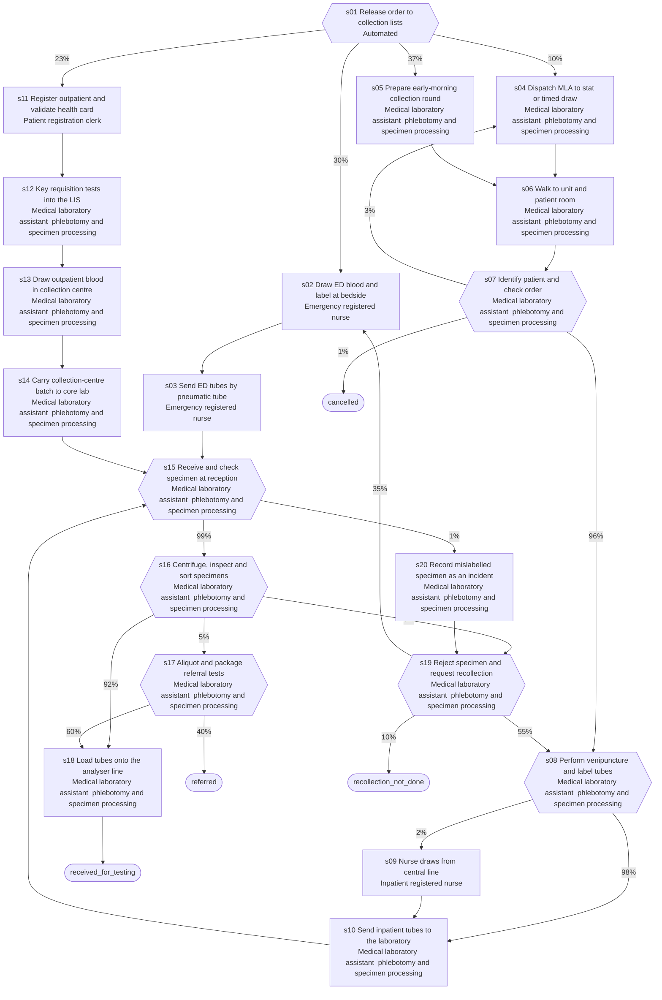

# Collect and receive laboratory specimens

`hosp-dx-lab-specimen-collection` · healthcare (acute care hospital) · laboratory medicine · part of `community-hospital-corp`

This process gets blood from the patient into the laboratory in a condition fit for testing. Laboratory assistants draw inpatients on an early-morning round and on stat calls, emergency nurses draw ED patients, often through the IV they are starting, and an outpatient collection centre registers patients, re-keys paper requisitions and draws them. Specimen reception scans each tube, checks the label, spins and sorts it and loads it on the analyser line. The main sources of delay and rework are the batching of routine inpatient draws into the early-morning round, patients who are off the unit, hemolysed ED samples drawn through IV catheters, and mislabelled tubes that must be rejected and redrawn.

| | |
|---|---|
| Unit of work | one specimen collection (one patient draw with its tubes) |
| Starts when | A laboratory order is released in the hospital information system, or an outpatient arrives at the collection centre with a requisition. |
| Done when | The specimen is accepted and loaded for in-house testing or packed for a reference laboratory, or the collection is cancelled. |
| Organisation | A three-site Ontario community hospital corporation of about 640 beds with one core laboratory, stat laboratories at the smaller sites, pneumatic tubes and a laboratory information system interfaced to the hospital information system. (5,790 employees, 2019-2022) |
| Volume | 30,000 cases a month (range 26,000 to 34,000) |

## Where it sits

- Starts with **lab_order** from ed-physician-assessment (31% of cases)
- Starts with **lab_order** from med-inpatient-medical-care (31% of cases)
- Starts with **lab_order** from sx-surgical-inpatient-care (10% of cases)
- Starts with **lab_order** from sx-preadmission-clinic (6% of cases)
- Starts with **lab_order** from amb-clinic-visit (8% of cases)
- Starts with **lab_order** from primary_care (12% of cases)
- Sends **lab_specimen** to dx-lab-testing (outcome: received_for_testing)
- Sends **lab_specimen** to dx-referral-testing (outcome: referred)

## Flow

## Roles

| Role | Department | Layer | FTE on this process | Loaded cost per hour | Evidence |
|---|---|---|---:|---:|---|
| Medical laboratory assistant (phlebotomy and specimen processing) | Laboratory medicine | individual contributor | 52 | 34 CAD | C |
| Emergency registered nurse | Emergency program | individual contributor | 9 | 61 CAD | C |
| Inpatient registered nurse | Inpatient medicine units | individual contributor | 1.5 | 61 CAD | C |
| Patient registration clerk | Patient registration and switchboard | individual contributor | 3 | 34 CAD | C |

## Steps

Hands-on time and the wait before each step show the most common value. Evidence tier A is a sourced number, B a sourced description, C the author's estimate.

| Step | Who | Kind | Hands-on | Wait before | Control | Evidence |
|---|---|---|---:|---:|---|---|
| **s01 Release order to collection lists.** When a physician or nurse enters a laboratory order in the hospital information system, the interface creates the order in the laboratory information system, assigns an accession number and either prints barcode labels at the ordering location or adds the draw to the phlebotomy collection list for the unit and time requested. | Automated | system auto | 0 min | 0 min |  | C |
| **s02 Draw ED blood and label at bedside.** The emergency nurse checks the patient's wristband against the printed labels using two identifiers, draws the tubes in order of draw, often through the IV catheter while starting the line, labels each tube at the bedside and initials the collection time. | Emergency registered nurse | physical | 7 min | 15 min | Accreditation Canada Required Organizational Practice on client identification: two person-specific identifiers before any procedure, labels applied in the presence of the patient | A [fernandes2004], [heyer2012] |
| **s03 Send ED tubes by pneumatic tube.** The nurse or a patient care assistant bags the tubes with the requisition, places the carrier in the ED pneumatic tube station and keys the laboratory destination; stat tubes go straight away rather than waiting for a batch. | Emergency registered nurse | physical | 1 min | 3 min |  | C |
| **s04 Dispatch MLA to stat or timed draw.** The laboratory assistant assigned to inpatient stat draws picks up the collection label printed in the laboratory or the page from the unit, groups it with any other pending stat draws on the same floor and sets off; timed draws such as drug levels wait for their scheduled time. | Medical laboratory assistant (phlebotomy and specimen processing) | coordination | 1 min | 30 min |  | C |
| **s05 Prepare early-morning collection round.** Before the round starts at about 05:00 the laboratory assistant prints the collection list and labels for the assigned units, sorts them by room, stocks the tray with tubes and needles and checks for special handling such as tubes on ice or fasting draws. | Medical laboratory assistant (phlebotomy and specimen processing) | coordination | 1 min | 9.0 h |  | C |
| **s06 Walk to unit and patient room.** The laboratory assistant walks or takes the elevator to the unit, checks with the nurse for patients in isolation or off the unit and goes from room to room with the tray, doing hand hygiene and putting on PPE where signage requires it. | Medical laboratory assistant (phlebotomy and specimen processing) | travel | 3 min | 2 min |  | C |
| **s07 Identify patient and check order.** The assistant asks the patient to state full name and date of birth, compares them and the wristband hospital number with the label and collection list, and confirms fasting status or timing; patients who are off the unit, refuse or have been discharged are recorded in the list. | Medical laboratory assistant (phlebotomy and specimen processing) | validation | 1 min | 0 min | Accreditation Canada Required Organizational Practice on client identification (two identifiers) | A [howanitz1994] |
| **s08 Perform venipuncture and label tubes.** The assistant applies the tourniquet, selects a vein, draws the tubes in the correct order of draw and volume, applies pressure and labels each tube at the bedside with the barcode label, writing collection time and initials before leaving the room. | Medical laboratory assistant (phlebotomy and specimen processing) | physical | 6 min | 0 min | Accreditation Canada client identification ROP; IQMH (Ontario laboratory accreditation) requirements for labelling at the time of collection | A [howanitz1994] |
| **s09 Nurse draws from central line.** When the assistant cannot get a sample, the patient's nurse draws it from a central or arterial line after discarding the dead-space volume, labels the tubes at the bedside and sends them; the assistant documents the failed attempt. | Inpatient registered nurse | physical | 8 min | 45 min | Accreditation Canada client identification ROP (two identifiers) | C |
| **s10 Send inpatient tubes to the laboratory.** The assistant sends stat tubes from the unit's pneumatic tube station straight away; on the early-morning round, tubes collect in the tray and go down in a few carriers or are carried back when the round ends. | Medical laboratory assistant (phlebotomy and specimen processing) | physical | 0.5 min | 15 min |  | C |
| **s11 Register outpatient and validate health card.** The registration clerk at the outpatient collection centre takes a number, scans or types the health card number, validates it online, confirms address and family physician and creates or updates the outpatient visit so that labels can be printed. | Patient registration clerk | data entry | 3 min | 20 min | Hospital registration policy and Ministry of Health eligibility check (health card validation) | C |
| **s12 Key requisition tests into the LIS.** The laboratory assistant reads the paper requisition from the community physician or clinic, enters each requested test and the ordering and copy-to physicians in the laboratory information system and prints the barcode labels for the tubes. | Medical laboratory assistant (phlebotomy and specimen processing) | data entry | 3 min | 15 min |  | C |
| **s13 Draw outpatient blood in collection centre.** The assistant calls the patient to a draw chair, confirms name and date of birth against the labels, performs the venipuncture, labels the tubes in front of the patient and gives any instructions for urine or stool containers. | Medical laboratory assistant (phlebotomy and specimen processing) | physical | 6 min | 5 min | Accreditation Canada client identification ROP; IQMH labelling requirements | C |
| **s14 Carry collection-centre batch to core lab.** Every 20 to 30 minutes an assistant carries the rack of collection-centre tubes, with any urine containers, to specimen reception in the core laboratory or sends it by tube station when the centre is on another floor. | Medical laboratory assistant (phlebotomy and specimen processing) | travel | 0.5 min | 15 min |  | C |
| **s15 Receive and check specimen at reception.** At specimen reception the laboratory assistant unpacks the carrier, scans each tube to record receipt time in the laboratory information system and compares the label with the order: two identifiers, collection time, collector and correct tube type. | Medical laboratory assistant (phlebotomy and specimen processing) | validation | 1 min | 5 min | Laboratory and Specimen Collection Centre Licensing Act (Ontario) and IQMH accreditation requirements for specimen acceptance and rejection criteria | C |
| **s16 Centrifuge, inspect and sort specimens.** The assistant loads serum and plasma tubes into the centrifuge, inspects the spun samples for visible hemolysis, clots or short volume, and sorts tubes by bench: automation line, hematology, coagulation, manual bench or referral. | Medical laboratory assistant (phlebotomy and specimen processing) | physical | 1 min | 3 min |  | A [heyer2012], [fernandes2004] |
| **s17 Aliquot and package referral tests.** For tests not done in house, the assistant pours off aliquots into labelled transport tubes, prints the reference laboratory requisition or manifest, packs specimens at the right temperature and places them in the courier box for the scheduled pick-up. | Medical laboratory assistant (phlebotomy and specimen processing) | physical | 4 min | 30 min |  | C |
| **s18 Load tubes onto the analyser line.** The assistant places the sorted tubes in the input module of the automated line or delivers racks to the hematology and coagulation benches, putting stat tubes in the priority lane so they are sampled first. | Medical laboratory assistant (phlebotomy and specimen processing) | physical | 0.5 min | 2 min |  | C |
| **s19 Reject specimen and request recollection.** The assistant cancels the affected tests in the laboratory information system with the rejection reason, adds a comment visible on the chart and phones the unit nurse, ED or collection centre to ask for a new specimen. | Medical laboratory assistant (phlebotomy and specimen processing) | communication | 4 min | 5 min |  | C |
| **s20 Record mislabelled specimen as an incident.** For an unlabelled or mislabelled specimen the assistant logs a safety incident in the incident reporting system naming the collecting area, so that the unit manager and laboratory manager can follow up, then proceeds to reject the specimen. | Medical laboratory assistant (phlebotomy and specimen processing) | drafting | 5 min | 2 min | Accreditation Canada patient safety incident management requirements; hospital incident reporting policy | C |

## Exceptions

| Exception | Share of cases | What happens |
|---|---:|---|
| Hemolysed ED sample | 2% | An ED sample drawn through an IV start is visibly hemolysed after spinning; the tests are cancelled and the nurse redraws, adding 30 to 90 minutes to the ED result. |
| Mislabelled or unlabelled tube | 1% | Reception finds a label that does not match the order or no label; an incident is logged and the specimen must be redrawn because it cannot be relabelled. |
| Patient off the unit on the round | 1% | The patient is in imaging, dialysis or the OR when the assistant arrives; the draw is retried later as a stat-style trip. |
| Failed venipuncture | 1% | The assistant cannot obtain blood and the nurse draws it from a central line. |

## Benchmarks

| Metric | Value | Unit | Population | Evidence |
|---|---|---|---|---|
| cycle_time_days | p50 0.06, p90 0.45 | calendar days from order release to specimen accepted in the laboratory | All collections in a community hospital; routine inpatient draws wait for the early-morning round, ED and stat draws arrive within about an hour | C |
| ed_hemolysis_rate | 0.058 | share of ED samples hemolysed | Academic tertiary ED in Hamilton, Ontario | A [fernandes2004] |
| hemolysis_share_of_routine_samples_max | 0.033 | share of routine samples received (upper value); ASCP benchmark 0.02 | Clinical laboratories (systematic review) | A [heyer2012] |
| inpatient_phlebotomy_success_rate | 0.932 | share of inpatient requests with successful venipuncture | 683 institutions, CAP Q-Probes | A [howanitz1994] |

## Pain points

- Routine inpatient draws are batched into one early-morning round, so tests ordered in the afternoon wait many hours and the round itself is a staffing peak. (steps s05, s10; C)
- ED nurses draw through IV catheters to save a second needle stick, which raises hemolysis and leads to redraws and delayed potassium results. (steps s02, s16, s19; A [heyer2012], [fernandes2004])
- Outpatient paper requisitions are re-keyed into the laboratory system, with transcription errors and copy-to physicians missed. (steps s12; C)
- Patients who are off the unit or already drawn waste a trip and push the draw later. (steps s07; A [howanitz1994])

## Assumptions

- One case is one collection event; a collection carries several tubes and on average about eight reported tests, so collections are about one-eighth of the test count.
- Routine inpatient draws are taken on an early-morning round; the 120 to 960 minute batch wait at s05 runs from order entry to the start of the round.
- ED nurses, not laboratory assistants, draw most ED blood, as is common in Ontario community EDs; some sites may place assistants in the ED during the day.
- Specimen reception and processing by laboratory assistants is included here; analysis starts in the laboratory testing process when tubes are on the line.
- Rejection for hemolysis is modelled at visual inspection after spinning; hemolysis detected by the analyser's index is handled in the laboratory testing process.
- Simulated median cycle time is dominated by ED, stat and outpatient draws that reach the laboratory within an hour; the 90th percentile reflects the early-morning round. The benchmark is an estimate, not a measured distribution.
- Staffing: stated FTE includes laboratory assistants' time on the round that is not tied to a single collection (tray stocking, waiting for elevators); the touch-time check is close to the stated FTE.
- Simulated median cycle time (about 0.09 days) is about 1.5 times the estimated 0.06 days: queues at outpatient registration and the wait for stat inpatient draws make up the gap. Neither figure is measured, so the gap was left rather than tuned away.
- Loaded costs come from the organisation file.
- Organisation file corrected on 2026-11-24: dialysis nurses draw the monthly blood work themselves and send specimens straight to the laboratory (hosp-med-hemodialysis), so med-hemodialysis no longer triggers collection; its 4% share is spread over the other sources.

## Sources

- [hh1819] [Halton Healthcare 2018/19 Annual Community Report (A Year in Numbers)](https://www.haltonhealthcare.on.ca/2018-19-annual-community-report) (Halton Healthcare, 2019). Laboratory tests 2,597,035 in 2018/19.
- [hh2122] [Halton Healthcare 2021-2022 Annual Community Report (by the numbers)](https://www.haltonhealthcare.on.ca/about/reports-and-publications/2021-2022-annual-community-report) (Halton Healthcare, 2022). Laboratory tests 3,220,658 in 2021/22.
- [fernandes2004] [Root cause analysis of laboratory turnaround times for patients in the emergency department (Fernandes, Worster, Hill, McCallum, Eva)](https://www.cambridge.org/core/journals/canadian-journal-of-emergency-medicine/article/root-cause-analysis-of-laboratory-turnaround-times-for-patients-in-the-emergency-department/649D08808DC2BE209592E5039E60C668) (Canadian Journal of Emergency Medicine 6(2):116-122, Cambridge University Press, 2004). ED hemolysis rate 5.8%; potassium turnaround 49 minutes and hemoglobin 18 minutes in an Ontario ED.
- [heyer2012] [Effectiveness of practices to reduce blood sample hemolysis in EDs: a laboratory medicine best practices systematic review and meta-analysis (Heyer et al.)](https://cdc.gov/labbestpractices/pdfs/lmbp_reducinghemolysissummary.pdf) (Clinical Biochemistry 45:1012-1032 (CDC Laboratory Medicine Best Practices), 2012). Hemolysed samples up to 3.3% of routine samples; ASCP benchmark 2%; straight needle versus IV start risk ratio 0.16.
- [howanitz1994] [Inpatient phlebotomy practices: a College of American Pathologists Q-Probes quality improvement study of 2,351,643 phlebotomy requests (Howanitz and Schifman)](https://experts.arizona.edu/en/publications/inpatient-phlebotomy-practices-a-college-of-american-pathologists/) (Archives of Pathology and Laboratory Medicine 118(6):601-605, 1994). Inpatient phlebotomy success 93.2%, unsuccessful 1.6%, partial 0.4%, not attempted 4.9% with reasons.

Written by claude-opus on 2026-11-24.
