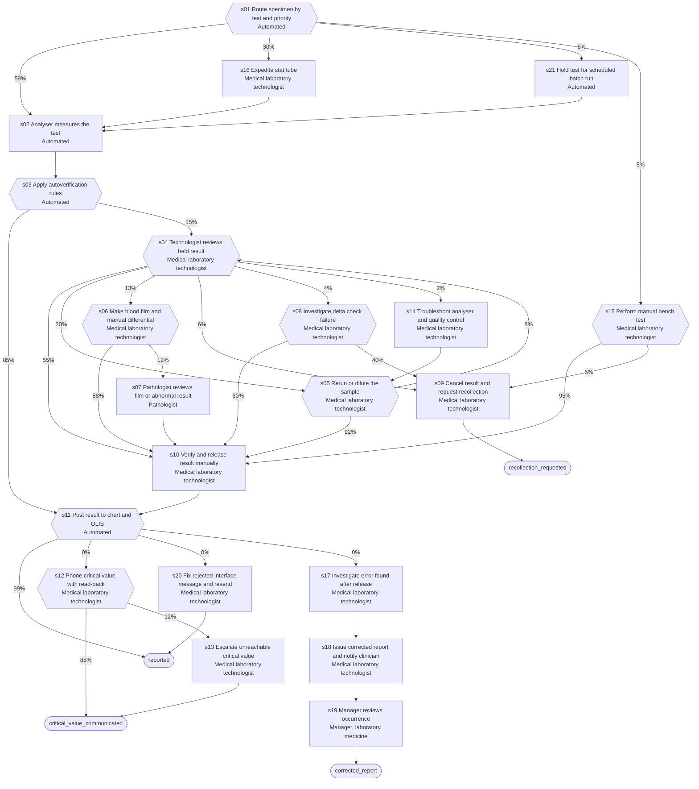

# Run and verify laboratory tests

`hosp-dx-lab-testing` · healthcare (acute care hospital) · laboratory medicine · part of `community-hospital-corp`

This process turns an accepted specimen into a verified result in the patient's chart. Automated chemistry and hematology lines measure most tests, and middleware rules release most results without a person; medical laboratory technologists review the rest, rerun or dilute samples, make blood films, phone critical values and verify results, with pathologists commenting on abnormal films. Results go to the hospital chart and the provincial laboratory information system. Turnaround for ED and stat tests is the main measure; delays come from queues on the line, held results, blood film backlogs overnight and unreachable caregivers for critical values.

| | |
|---|---|
| Unit of work | one laboratory test |
| Starts when | An accepted specimen is loaded on the analyser line or delivered to a bench. |
| Done when | The verified result is in the chart and OLIS (with any critical value phoned), or the test is cancelled and a new specimen requested. |
| Organisation | A three-site Ontario community hospital corporation of about 640 beds with a core laboratory running chemistry, immunoassay and hematology automation, stat laboratories at the smaller sites and microbiology referred out. (5,790 employees, 2019-2022) |
| Volume | 235,000 cases a month (range 216,000 to 268,000) |

## Where it sits

- Starts with **lab_specimen** from dx-lab-specimen-collection (100% of cases)
- Sends **lab_result** to ed-physician-assessment (outcome: reported)
- Sends **lab_result** to med-inpatient-medical-care (outcome: reported)
- Sends **lab_result** to sx-surgical-inpatient-care (outcome: reported)
- Sends **lab_result** to primary_care (outcome: reported)
- Sends **lab_result** to qp-ipac-surveillance (outcome: reported)
- Sends **lab_result** to ed-physician-assessment (outcome: critical_value_communicated)
- Sends **lab_result** to med-inpatient-medical-care (outcome: critical_value_communicated)
- Sends **lab_order** to dx-lab-specimen-collection (outcome: recollection_requested)

## Flow

## Roles

| Role | Department | Layer | FTE on this process | Loaded cost per hour | Evidence |
|---|---|---|---:|---:|---|
| Medical laboratory technologist | Laboratory medicine | individual contributor | 70 | 58 CAD | A [krasowski2014] |
| Pathologist | Medical, dental and midwifery staff | senior specialist | 0.4 | 220 CAD | C |
| Manager, laboratory medicine | Laboratory medicine | manager | 1 | 78 CAD | C |

## Steps

Hands-on time and the wait before each step show the most common value. Evidence tier A is a sourced number, B a sourced description, C the author's estimate.

| Step | Who | Kind | Hands-on | Wait before | Control | Evidence |
|---|---|---|---:|---:|---|---|
| **s01 Route specimen by test and priority.** Once a tube is on the line, the middleware reads the barcode, looks up the ordered tests in the laboratory information system and routes the tube to the chemistry, immunoassay, hematology or coagulation analyser, flagging stat priority and diverting tests run on a manual bench or in a scheduled batch. | Automated | system auto | 0 min | 0 min |  | C |
| **s02 Analyser measures the test.** The analyser aspirates the sample, runs the assay and sends the result with its instrument flags, hemolysis, icterus and lipemia indices and quality control status to the middleware. Waiting time covers the queue on the line and the assay time. | Automated | system auto | 0 min | 20 min |  | A [fernandes2004] |
| **s03 Apply autoverification rules.** The middleware compares the result with the laboratory's rules: instrument error flags, interference indices, delta check against the patient's previous result, manual review limits and absurd values. Results that pass are released without a person; the rest are held on the technologist's review screen. | Automated | system auto | 0 min | 0 min |  | A [krasowski2014] |
| **s04 Technologist reviews held result.** The medical laboratory technologist opens the held result on the middleware screen, reads the flag, compares it with the patient's previous results and diagnosis in the information system and decides whether to release, rerun, dilute, make a blood film or query the specimen. | Medical laboratory technologist | review | 1 min | 5 min | Medical laboratory technologists are regulated under the Medical Laboratory Technology Act, 1991 (CMLTO); IQMH accreditation requirements for result review | C |
| **s05 Rerun or dilute the sample.** The technologist pulls the tube from the line storage, makes a manual or on-board dilution or reruns the test on the same or the backup analyser, then waits for the repeat result to compare with the first. | Medical laboratory technologist | physical | 2 min | 20 min |  | C |
| **s06 Make blood film and manual differential.** For a hematology flag, the technologist makes and stains a blood film (or loads it on the slide maker), examines it under the microscope, counts and classifies cells and enters the manual differential and morphology comments. | Medical laboratory technologist | analysis | 10 min | 45 min |  | C |
| **s07 Pathologist reviews film or abnormal result.** The pathologist reviews the flagged film or abnormal result, compares it with the clinical history and earlier results, adds an interpretive comment and, for a new leukemia or other urgent finding, phones the responsible physician. | Pathologist | review | 8 min | 16.0 h | Pathologist interpretation required for abnormal peripheral blood films under the laboratory's IQMH-accredited procedures | C |
| **s08 Investigate delta check failure.** When a result differs sharply from the patient's last one, the technologist checks the chart for transfusion, dialysis or a new diagnosis and phones the unit to confirm the collection; an unexplained change suggests a wrong-blood-in-tube error. | Medical laboratory technologist | analysis | 6 min | 5 min |  | C |
| **s09 Cancel result and request recollection.** The technologist cancels the result with a coded reason such as 'hemolysed, please recollect' or 'specimen identity in doubt', which shows on the chart, and phones the unit or ED to ask for a new specimen. | Medical laboratory technologist | communication | 4 min | 3 min |  | A [krasowski2014] |
| **s10 Verify and release result manually.** After review, rerun, film or pathologist comment, the technologist enters any comments and verifies the result, which releases it from the laboratory information system. | Medical laboratory technologist | approval | 0.5 min | 2 min | Result verification by a regulated medical laboratory technologist (Medical Laboratory Technology Act, 1991) | C |
| **s11 Post result to chart and OLIS.** The laboratory information system sends the verified result to the patient's chart in the hospital information system, where it shows on the ED tracking board or results screen, and to the Ontario Laboratories Information System; copies go to the family physician. | Automated | system auto | 0 min | 1 min |  | C |
| **s12 Phone critical value with read-back.** For a critical result such as a potassium above 6.5 or a hemoglobin below 60, the technologist phones the patient's nurse or physician, gives the result, asks for read-back and records the name, time and read-back in the laboratory information system. | Medical laboratory technologist | communication | 3 min | 4 min | Accreditation Canada and IQMH requirements for timely notification of critical results with read-back | A [captoday2008] |
| **s13 Escalate unreachable critical value.** If no licensed caregiver answers, the technologist pages the charge nurse, the most responsible physician or the on-call physician through switchboard, repeats the calls and documents each attempt until a caregiver accepts the result. | Medical laboratory technologist | communication | 10 min | 15 min | Laboratory critical value escalation procedure | A [captoday2008] |
| **s14 Troubleshoot analyser and quality control.** When held results suggest a shift, the technologist checks quality control runs, recalibrates or replaces reagent, calls the vendor or biomedical engineering if needed, and reruns the patient samples tested since the last acceptable control. | Medical laboratory technologist | analysis | 30 min | 10 min | IQMH accreditation requirements for quality control and corrective action before patient results are released | C |
| **s15 Perform manual bench test.** The technologist performs tests not on the automated line, such as urine microscopy, body fluid cell counts, ESR or a manual coagulation assay, reading results by microscope or instrument and typing them into the laboratory information system. | Medical laboratory technologist | analysis | 5 min | 30 min |  | C |
| **s16 Expedite stat tube.** The technologist on the stat bench watches the priority lane and the ED pending list, makes sure stat tubes are sampled ahead of routine work and chases tubes that have been received but have no result after the expected time. | Medical laboratory technologist | coordination | 0.3 min | 2 min |  | A [fernandes2004] |
| **s17 Investigate error found after release.** When a clinician queries a result or the laboratory finds a wrong patient, unit or calculation after release, the technologist pulls the specimen and records, repeats the test if possible and identifies every affected result. | Medical laboratory technologist | analysis | 30 min | 1.0 d |  | C |
| **s18 Issue corrected report and notify clinician.** The technologist amends the result with a corrected-report comment, which flags the change in the chart and OLIS, and phones the responsible physician so that any treatment based on the wrong value can be reviewed. | Medical laboratory technologist | communication | 15 min | 30 min | IQMH requirements for amended reports and notification of the ordering physician | C |
| **s19 Manager reviews occurrence.** The laboratory manager reviews the occurrence report, interviews the staff involved, records root cause and corrective action in the incident system and, for harm events, reports to the quality and risk department. | Manager, laboratory medicine | review | 45 min | 3.0 d | IQMH occurrence management requirements; Accreditation Canada patient safety incident management | C |
| **s20 Fix rejected interface message and resend.** A senior technologist works the interface error queue: corrects a health card number or name mismatch, maps a new test code or re-links the ordering physician, then resends the result to the chart or OLIS. | Medical laboratory technologist | data entry | 10 min | 1.0 d |  | C |
| **s21 Hold test for scheduled batch run.** Low-volume tests such as protein electrophoresis, some drug levels and special chemistry are stored and run in a batch once a day or a few times a week to save reagent and calibration. | Automated | system auto | 0 min | 10.0 h |  | C |

## Exceptions

| Exception | Share of cases | What happens |
|---|---:|---|
| Hematology flag needing a blood film | 2% | A CBC with an abnormal flag waits for a film and manual differential; a share goes on to the pathologist, adding hours to days for routine samples. |
| Critical value caregiver not reached | 0% | The technologist cannot reach the nurse or physician on the first call and escalates through the charge nurse or on-call physician. |
| Suspected wrong blood in tube | 0% | An unexplained delta check failure leads to cancelling the result and requesting a new sample. |
| Corrected report | 0% | An error found after release leads to an amended result, a call to the physician and a manager review. |

## Benchmarks

| Metric | Value | Unit | Population | Evidence |
|---|---|---|---|---|
| cycle_time_days | p50 0.02, p90 0.12 | calendar days from specimen on the line to verified result | All tests in a community hospital core laboratory | C [fernandes2004] |
| ed_potassium_order_to_result_min | 49 | minutes, order to result | Academic tertiary ED, Hamilton, Ontario | A [fernandes2004] |
| autoverification_rate_core_chemistry | 0.995 | share of chemistry results auto-verified | Academic core chemistry laboratory (Iowa), 2013 | A [krasowski2014] |
| billable_tests_per_paid_hour | 19.7 | tests per paid hour | Academic core laboratory, 2010 | A [krasowski2014] |
| critical_value_result_to_call_min | 4 | median minutes from result known to call | CAP Q-Probes participants, 2007 | A [captoday2008] |

## Pain points

- ED results are slowed by queues on the line and by the volume of tests for admitted patients boarding in the ED. (steps s02, s16; A [fernandes2004])
- Hematology results that need a film wait for a technologist at the microscope, and abnormal films wait for a pathologist on the next working day. (steps s06, s07; C)
- Critical value calls go to ward clerks or to physicians who are no longer responsible, needing second calls. (steps s12, s13; A [captoday2008])
- Hemolysed samples drawn in the ED produce results that are suppressed and must be recollected. (steps s04, s09; A [krasowski2014])

## Assumptions

- One case is one reported test; a tube often carries several tests that move together, so the per-test minutes are small shares of shared work.
- Microbiology and most special testing are referred to Public Health Ontario or reference laboratories and are outside this process.
- Overall autoverification of 85% is lower than the best academic chemistry figure because hematology, coagulation and manual tests autoverify less often; community laboratories in 2019-2022 varied widely.
- Daily quality control, maintenance, calibration, proficiency testing, inventory and the transfusion bench are not modelled as case steps; they account for the gap between the touch-time FTE and the stated 70 technologist FTE.
- System steps carry no touch time; queue and assay time are in the wait before the analyser step (s02).
- The touch-time check implies about 51 FTE against 71 stated, a gap explained by quality control, maintenance and other non-case work.
- Loaded costs come from the organisation file; the director of diagnostic services, listed for this process in the organisation file, takes no part in individual tests.

## Sources

- [hh1819] [Halton Healthcare 2018/19 Annual Community Report (A Year in Numbers)](https://www.haltonhealthcare.on.ca/2018-19-annual-community-report) (Halton Healthcare, 2019). Laboratory tests 2,597,035 in 2018/19.
- [hh2122] [Halton Healthcare 2021-2022 Annual Community Report (by the numbers)](https://www.haltonhealthcare.on.ca/about/reports-and-publications/2021-2022-annual-community-report) (Halton Healthcare, 2022). Laboratory tests 3,220,658 in 2021/22.
- [fernandes2004] [Root cause analysis of laboratory turnaround times for patients in the emergency department (Fernandes, Worster, Hill, McCallum, Eva)](https://www.cambridge.org/core/journals/canadian-journal-of-emergency-medicine/article/root-cause-analysis-of-laboratory-turnaround-times-for-patients-in-the-emergency-department/649D08808DC2BE209592E5039E60C668) (Canadian Journal of Emergency Medicine 6(2):116-122, Cambridge University Press, 2004). ED potassium 49 min and hemoglobin 18 min turnaround; causes of delay; 43% of tests for admitted ED patients.
- [krasowski2014] [Autoverification in a core clinical chemistry laboratory at an academic medical center (Krasowski et al.)](https://pmc.ncbi.nlm.nih.gov/articles/PMC4023033) (Journal of Pathology Informatics 5:13, 2014). Autoverification 99.5% in core chemistry; rules that block it; 19.7 billable tests per paid hour.
- [captoday2008] [Good news on critical values, says Q-Probes audit](https://www.captodayonline.com/Archives/feature_stories/0208_Qprobe.html) (CAP Today, College of American Pathologists, 2008). Critical values called a median 4 minutes after result and 56 minutes after collection; read-back and escalation practice.

Written by claude-opus on 2026-11-24.
