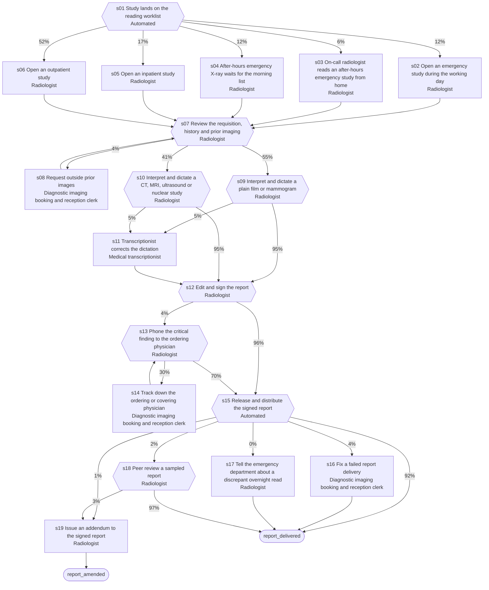

# Read and report imaging exams

`hosp-dx-radiology-reporting` · health care (public hospital) · diagnostic imaging · part of `community-hospital-corp`

Radiologists with hospital privileges read the corporation's roughly 24,000 imaging studies a month and turn each into a signed report that goes to the emergency physician, ward team, clinic or community doctor who ordered it. They pick studies from a shared worklist by priority, compare with prior images, dictate into voice recognition, edit and sign, and phone critical findings directly. Emergency CT is read within an hour or two, even at night by the on-call radiologist from home, but overnight emergency X-rays wait for the morning list and outpatient studies queue behind emergency and inpatient work for a day or more. Delays and errors come from that queue, from tracking down physicians to report critical results, failed faxes and voice recognition mistakes left in signed reports.

| | |
|---|---|
| Unit of work | one imaging report |
| Starts when | A completed imaging study arrives on the radiologists' reading worklist. |
| Done when | A signed report is in the hospital record and delivered to the ordering physician, with critical findings phoned and documented; or an addendum has been issued and resent. |
| Organisation | A three-site Ontario community hospital corporation whose imaging is read by a fee-for-service radiology group of about 30 radiologists holding privileges at all three sites, using a shared RIS, PACS and voice recognition. (5,790 employees, 2019-2022) |
| Volume | 23,500 cases a month (range 20,850 to 24,900) |

## Where it sits

- Starts with **imaging_study** from dx-imaging-exam (100% of cases)
- Sends **imaging_report** to ed-physician-assessment (outcome: any)
- Sends **imaging_report** to med-inpatient-medical-care (outcome: any)
- Sends **imaging_report** to primary_care (outcome: any)
- Sends **imaging_report** to referring_office (outcome: any)
- Sends **imaging_report** to sx-fracture-clinic (outcome: any)
- Sends **imaging_report** to amb-clinic-visit (outcome: any)

## Flow

## Roles

| Role | Department | Layer | FTE on this process | Loaded cost per hour | Evidence |
|---|---|---|---:|---:|---|
| Radiologist | Medical, dental and midwifery staff | senior specialist | 24 | 280 CAD | C |
| Diagnostic imaging booking and reception clerk | Diagnostic imaging | individual contributor | 1.5 | 35 CAD | C |
| Medical transcriptionist | Health information management | individual contributor | 0.3 | 36 CAD | C |

## Steps

Hands-on time and the wait before each step show the most common value. Evidence tier A is a sourced number, B a sourced description, C the author's estimate.

| Step | Who | Kind | Hands-on | Wait before | Control | Evidence |
|---|---|---|---:|---:|---|---|
| **s01 Study lands on the reading worklist.** When the technologist completes the exam, PACS and the radiology information system place the study on the radiologists' shared reading worklist, sorted by priority (stat and emergency, inpatient, outpatient), modality and site, with the requisition scanned in. | Automated | system auto | 0 min | 0 min |  | C |
| **s02 Open an emergency study during the working day.** The radiologist on the emergency or general reading list watches the stat flags on the worklist and opens emergency studies ahead of inpatient and outpatient work, usually within minutes for CT and within the hour for plain films. | Radiologist | intake | 0.5 min | 20 min |  | B [lamb2015] |
| **s03 On-call radiologist reads an after-hours emergency study from home.** The emergency physician or technologist pages the on-call radiologist, who logs into PACS from a home workstation, opens the CT or ultrasound and prepares to read it while the patient is still in the emergency department. | Radiologist | intake | 4 min | 30 min |  | C |
| **s04 After-hours emergency X-ray waits for the morning list.** Plain films taken in the emergency department overnight or on the weekend are interpreted by the emergency physician at the time and stay on the worklist until the radiologist arrives in the morning, when they are read first. | Radiologist | intake | 0.5 min | 8.0 h |  | C |
| **s05 Open an inpatient study.** The radiologist works through inpatient studies between emergency cases, usually the same day, choosing first those flagged urgent or needed for a discharge decision. | Radiologist | intake | 0.5 min | 3.0 h |  | C |
| **s06 Open an outpatient study.** Outpatient studies wait on the list until emergency and inpatient work is done; the radiologist reads them in batches by modality, so studies done late Friday are often read on Monday. | Radiologist | intake | 0.5 min | 16.0 h |  | C |
| **s07 Review the requisition, history and prior imaging.** The radiologist reads the clinical question on the requisition, opens prior exams and reports in PACS for comparison, and checks relevant lab results or notes in the hospital record or the provincial viewer. | Radiologist | lookup | 0.8 min | 0 min |  | C |
| **s08 Request outside prior images.** The imaging clerk asks another hospital or clinic to push prior images to PACS or upload them to the regional image repository, then tells the radiologist when they arrive. | Diagnostic imaging booking and reception clerk | communication | 10 min | 4.0 h |  | C |
| **s09 Interpret and dictate a plain film or mammogram.** The radiologist reviews the views, compares with priors, and dictates findings and an impression into voice recognition, using a template for normal studies. | Radiologist | analysis | 1.2 min | 0 min |  | C |
| **s10 Interpret and dictate a CT, MRI, ultrasound or nuclear study.** The radiologist scrolls through the series, uses reformats and measurements, compares with prior exams and the sonographer's worksheet, and dictates a structured report with findings and an impression. | Radiologist | analysis | 7 min | 0 min |  | C |
| **s11 Transcriptionist corrects the dictation.** For radiologists who do not self-edit, the voice file and draft text go to a medical transcriptionist, who listens to the dictation, corrects the recognition errors and returns the draft to the radiologist's signing queue. | Medical transcriptionist | drafting | 6 min | 8.0 h |  | C |
| **s12 Edit and sign the report.** The radiologist reads the recognised text, fixes misrecognised words, laterality and measurements, and signs the report electronically, which makes it final and releases it. | Radiologist | approval | 0.8 min | 0 min | Only a radiologist with hospital privileges may sign a diagnostic imaging report (Public Hospitals Act medical staff rules) | C |
| **s13 Phone the critical finding to the ordering physician.** The radiologist pages or phones the ordering or covering physician, reads out the finding, confirms it was understood and records who was told and when in the report. | Radiologist | communication | 6 min | 5 min | Hospital critical results communication policy (Accreditation Canada standard on timely communication of critical test results) | C |
| **s14 Track down the ordering or covering physician.** The imaging clerk looks up the referring office's number, the physician's answering service or the on-call schedule for the clinic or group, and calls until someone who can act on the result is on the line for the radiologist. | Diagnostic imaging booking and reception clerk | coordination | 15 min | 30 min |  | C |
| **s15 Release and distribute the signed report.** The radiology system sends the signed report to the hospital record and the emergency tracking board, faxes or sends it electronically to the ordering physician's office and copies listed on the requisition, and files it to the provincial imaging record. | Automated | system auto | 0 min | 5 min |  | C |
| **s16 Fix a failed report delivery.** The clerk works the failed-fax and unmatched-physician queue, finds the right fax number or adds the physician to the directory, resends the report and notes the delivery in the radiology system. | Diagnostic imaging booking and reception clerk | data entry | 8 min | 1.0 d |  | C |
| **s17 Tell the emergency department about a discrepant overnight read.** When the morning report of an overnight emergency X-ray differs from what the emergency physician saw, for example a missed fracture, the radiologist phones the emergency department so the patient can be called back. | Radiologist | communication | 10 min | 30 min | Hospital emergency discrepancy and patient callback policy | C |
| **s18 Peer review a sampled report.** A second radiologist opens a randomly sampled study, reads the images blind or against the report, scores agreement on a standard scale and refers significant discrepancies to the department chief and the original reader. | Radiologist | review | 5 min | 7.0 d | Diagnostic imaging quality program and peer review expected by Accreditation Canada and recommended by the Canadian Association of Radiologists | B [oag2018] |
| **s19 Issue an addendum to the signed report.** The original radiologist reopens the study, dictates an addendum that corrects or adds to the report, signs it, and phones the ordering physician when the change affects care; the system resends the amended report. | Radiologist | drafting | 6 min | 1.0 h | Only the radiologist may amend a signed report | C |

## Exceptions

| Exception | Share of cases | What happens |
|---|---:|---|
| Critical finding | 4% | The radiologist phones an unexpected or critical finding; in 30% of attempts the physician cannot be reached and the clerk tracks down a covering doctor. |
| Overnight emergency X-ray discrepancy | 0% | The morning read finds something the emergency physician missed overnight and the patient is called back. |
| Failed delivery | 4% | The fax fails or the referring physician is unknown, so the report sits undelivered until the clerk resends it. |
| Addendum | 1% | A referring physician's query or a peer review discrepancy leads to an amended report. |
| Outside priors | 4% | Comparison images from another hospital are requested before the study can be read. |

## Benchmarks

| Metric | Value | Unit | Population | Evidence |
|---|---|---|---|---|
| cycle_time_days | p50 0.8, p90 3.0 | calendar days from study on worklist to signed report | All studies in an Ontario community hospital, 2019-2022 | C |
| emergency_final_report_turnaround_hours | before 5.0, after 2.75 | median hours, emergency abdominal and pelvic CT and ultrasound | The Ottawa Hospital, 2008-2010 | A [lamb2015] |
| hospitals_with_regular_peer_review | 0.75 | share of audited hospitals (3 of 4) | Ontario hospitals audited in 2018 | A [oag2018] |

## Pain points

- Outpatient studies queue behind emergency and inpatient work and over weekends, so community physicians wait days for reports. (steps s06; C)
- Overnight emergency X-rays are not read until morning, so discrepancies with the emergency physician's reading lead to patient callbacks. (steps s04, s17; C)
- Reaching a community physician to report a critical finding, especially after hours, takes repeated calls by the radiologist and a clerk. (steps s13, s14; C)
- Peer review of reports was voluntary and uneven, so reading errors were found by chance rather than by a routine check. (steps s18; A [oag2018])

## Assumptions

- One report per exam; multi-part exams read together count once.
- The case starts when the study is on the worklist; protocolling and ultrasound checks happen during the exam and sit in dx-imaging-exam.
- The organisation file lists only the radiologist for this process; the imaging clerk and the transcriptionist are added because they handle outside priors, physician tracking, failed deliveries and the remaining transcribed dictations.
- Health Report Manager (hrm) is added as a system because it is not in the organisation file; reports for clinic orders go back to amb-clinic-visit, a link the organisation file lacks.
- Peer review and addenda happen after delivery but are drawn on the same path, which adds days to about 3% of simulated cases; this barely moves the median.
- Simulated median cycle time is 0.9 days against a tier C benchmark of 0.8 days, and the 90th percentile 2.9 days; the median is set by outpatient studies, which are half the volume and queue behind emergency and inpatient work.
- Simulated hands-on time implies about 30 FTE at 130 productive hours a month, of which about 27 are radiologist reading; 24 radiologist FTE are stated because fee-for-service radiologists work more than 130 reading hours a month, and the 30 radiologists in the organisation file (about 10,000 exams each a year) can cover the load.
- Radiologist cost is the organisation file's estimate of gross clinical earnings per hour; radiologists are paid by OHIP, not the hospital.

## Sources

- [hh2122] [2021-2022 Annual Community Report (Halton Healthcare by the numbers)](https://www.haltonhealthcare.on.ca/about/reports-and-publications/2021-2022-annual-community-report) (Halton Healthcare, 2022). 2021/22: 298,482 diagnostic imaging exams, 161,049 emergency visits, 45,256 surgeries, 4,690 births, 37,964 dialysis visits, 19,600 oncology visits, 62,508 mental health and addictions ambulatory visits, 40,428 fracture clinic visits, 3,220,658 laboratory tests, 5,228 staff, 931 physicians, dentists and midwives
- [lamb2015] [Impact of an in-house emergency radiologist on report turnaround time](https://www.cambridge.org/core/journals/canadian-journal-of-emergency-medicine/article/impact-of-an-inhouse-emergency-radiologist-on-report-turnaround-time/F8ED9A1B947799366EEB482985DBE5BC) (Canadian Journal of Emergency Medicine 17(1):21-26 (Lamb L, Kashani P, Ryan J, Hebert G, Sheikh A, Thornhill R, Fasih N), 2015). The Ottawa Hospital emergency department, 1,624 abdominal and pelvic CT and ultrasound reports: median final report turnaround 5.00 hours in 2008, 3.08 hours in 2009 and 2.75 hours in 2010 after an in-house emergency radiologist was added; median preliminary (resident) report 2.40, 2.08 and 2.05 hours
- [oag2018] [2018 Annual Report, Volume 1, Chapter 3, Section 3.08: MRI and CT Scanning Services](https://www.auditor.on.ca/en/content/annualreports/arreports/en18/v1_308en18.pdf) (Office of the Auditor General of Ontario, 2018). Ministry priority levels for MRI and CT: emergency (P1, within 24 hours), urgent (P2, within 2 days), semi-urgent (P3, within 10 days), non-urgent (P4, within 28 days), targets set at the 90th percentile; before booking, radiologists assess the requisition, determine the type of scan and assign a priority, then a scheduler books a predefined slot; an MRI scan with contrast takes on average 40 minutes and needs at least two technologists on site, other MRI scans about 20 minutes with one; emergency scans were more than 30% of CT scans in 2017/18; MRI no-show rates 0.1% to 13.4% and CT 0.6% to 13% of scheduled appointments in 2017/18 (48,320 missed MRI and 57,916 missed CT appointments); 25-36% of patients confirmed after phone reminders versus 50% after text messages; studies found 6% to 12% of scans inappropriate under CAR referral guidelines; peer review of radiologist reports was not mandatory and three of four audited hospitals had a regular program; 69% of MRI machines ran below 16 hours a day, seven days a week; 65% of semi-urgent and non-urgent MRI patients and 33% of CT patients waited longer than target in 2017/18

Written by claude-opus on 2026-11-24.
