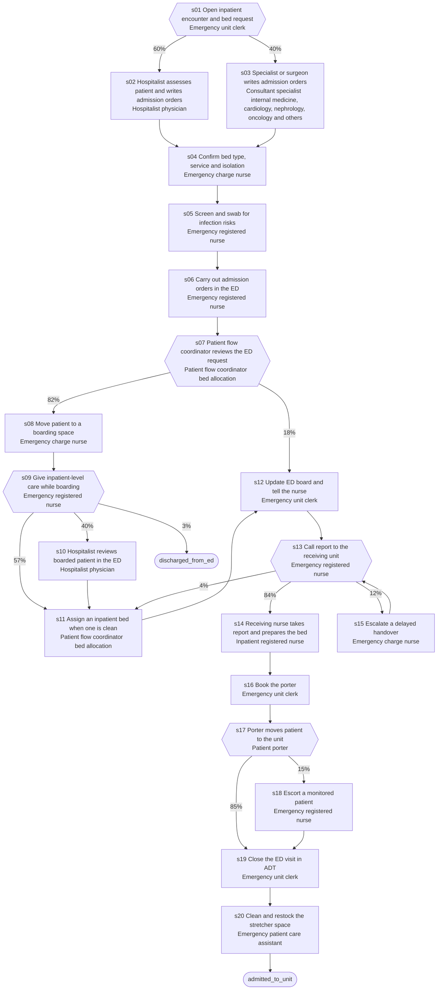

# Admit emergency patients and hold them in the ED until an inpatient bed is free

`hosp-ed-admission-boarding` · healthcare (acute care hospital) · emergency program · part of `community-hospital-corp`

Once the admitting physician decides that an emergency patient needs a hospital bed, the ED opens an inpatient encounter, the admitting physician writes orders and the patient flow coordinator looks for a bed. In most cases no clean bed of the right type is free, so the patient stays on an ED stretcher, often in a hallway, and ED nurses give inpatient-level care until a bed is assigned, report is given to the receiving unit and a porter moves the patient. The wait for a bed is the largest part of the time and it depends on inpatient discharges and bed cleaning, not on ED work. Boarded patients take ED treatment spaces and nursing time from new arrivals, which is the main reason Ontario EDs miss the 8-hour target for admitted patients.

| | |
|---|---|
| Unit of work | one admission from the ED (decision to admit to the patient leaving the ED for an inpatient bed) |
| Starts when | The ED physician or a consultant decides the patient needs admission and the admitting service accepts the patient. |
| Done when | The patient has left the ED for an inpatient bed, the ED visit is closed in ADT and the stretcher is cleaned; or, rarely, the patient improves and is discharged from the ED while still waiting. |
| Organisation | A not-for-profit Ontario community hospital corporation with three hospitals, about 640 inpatient beds and an emergency department at each site, on a single hospital information system with an electronic bed board. (5,790 employees, 2019-2022) |
| Volume | 1,400 cases a month (range 1,100 to 1,650) |

## Where it sits

- Starts with **admission_order** from ed-physician-assessment (55% of cases)
- Starts with **admission_order** from ed-specialist-consult (38% of cases)
- Starts with **admission_order** from mh-ed-crisis-assessment (7% of cases)
- Relies on **bed_assignment** from cs-bed-management (a standing input; it does not start a case)
- Sends **bed_request** to cs-bed-management (outcome: any)
- Sends **admitted_patient** to med-inpatient-medical-care (outcome: admitted_to_unit)
- Sends **admitted_patient** to sx-surgical-inpatient-care (outcome: admitted_to_unit)
- Sends **admitted_patient** to med-icu-critical-care (outcome: admitted_to_unit)
- Sends **admitted_patient** to mh-inpatient-psychiatry (outcome: admitted_to_unit)
- Sends **admitted_patient** to wc-paediatric-care (outcome: admitted_to_unit)
- Sends **transport_request** to fs-patient-portering (outcome: admitted_to_unit)
- Sends **ed_disposition** to ed-discharge-home (outcome: discharged_from_ed)

## Flow

## Roles

| Role | Department | Layer | FTE on this process | Loaded cost per hour | Evidence |
|---|---|---|---:|---:|---|
| Emergency unit clerk | Emergency program | individual contributor | 2.5 | 35 CAD | C |
| Hospitalist physician | Medical, dental and midwifery staff | senior specialist | 4.5 | 160 CAD | C |
| Consultant specialist (internal medicine, cardiology, nephrology, oncology and others) | Medical, dental and midwifery staff | senior specialist | 2.5 | 200 CAD | C |
| Emergency charge nurse | Emergency program | supervisor | 2.5 | 63 CAD | C |
| Emergency registered nurse | Emergency program | individual contributor | 30 | 61 CAD | C |
| Patient flow coordinator (bed allocation) | Patient flow and bed management | senior specialist | 1.5 | 63 CAD | C |
| Inpatient registered nurse | Inpatient medicine units | individual contributor | 2 | 61 CAD | C |
| Patient porter | Portering and security | individual contributor | 3 | 30 CAD | C |
| Emergency patient care assistant | Emergency program | individual contributor | 1.5 | 31 CAD | C |

## Steps

Hands-on time and the wait before each step show the most common value. Evidence tier A is a sourced number, B a sourced description, C the author's estimate.

| Step | Who | Kind | Hands-on | Wait before | Control | Evidence |
|---|---|---|---:|---:|---|---|
| **s01 Open inpatient encounter and bed request.** The ED unit clerk sees the admit flag on the ED tracking board, opens an inpatient encounter in ADT under the admitting physician and service, and enters a bed request on the electronic bed board with the service, bed type (medicine, telemetry, surgery, step-down) and any known isolation. This time stamp starts the provincial 'time to inpatient bed' clock in many hospitals. | Emergency unit clerk | intake | 6 min | 5 min |  | B [oh_ed] |
| **s02 Hospitalist assesses patient and writes admission orders.** The hospitalist comes to the ED, reviews the ED record, labs and imaging, examines the patient and writes the admission history and order set in the hospital information system: medications, diet, activity, monitoring, VTE prophylaxis and code status. The physician also does medication reconciliation with the patient or family when no pharmacy help is available. | Hospitalist physician | drafting | 30 min | 15 min | Only a physician with admitting privileges may write admission orders (hospital medical staff by-laws under the Public Hospitals Act). | C |
| **s03 Specialist or surgeon writes admission orders.** For patients admitted to cardiology, internal medicine, surgery, psychiatry or paediatrics, the on-call consultant who saw the patient writes the admission orders, often by phone order to the ED nurse when they are off site, and signs them later. The orders set the service, the bed type and any procedure planned for the next day. | Consultant specialist (internal medicine, cardiology, nephrology, oncology and others) | drafting | 20 min | 30 min | Admission orders by a physician with admitting privileges; verbal orders must be read back and countersigned (hospital medical staff rules). | C |
| **s04 Confirm bed type, service and isolation.** The ED charge nurse checks the bed request against the orders: the right service, whether telemetry or step-down is needed, and whether the patient needs a private room for isolation. The nurse corrects the bed board entry or phones the patient flow coordinator so the request goes into the right queue. | Emergency charge nurse | validation | 5 min | 5 min |  | C |
| **s05 Screen and swab for infection risks.** The ED nurse asks the antibiotic-resistant organism screening questions (recent hospital stay, MRSA, VRE or CPE history), collects screening swabs and, from 2020, a COVID-19 swab and symptom screen. A positive screen or pending COVID-19 result means the patient needs a single room on precautions, which narrows the beds that can be assigned. | Emergency registered nurse | validation | 10 min | 2 min | Hospital infection prevention policy on admission screening for antibiotic-resistant organisms and, from 2020, COVID-19 admission testing directives. | C |
| **s06 Carry out admission orders in the ED.** The ED nurse gives the first inpatient medications, hangs IV therapy, sends admission bloodwork and arranges any test ordered for the same day. Orders are checked against the ED treatment already given so doses are not repeated. | Emergency registered nurse | physical | 25 min | 5 min |  | C |
| **s07 Patient flow coordinator reviews the ED request.** The patient flow coordinator opens the new request on the bed board, checks service, bed type and isolation, and compares it with clean beds and beds where a discharge is expected. If a matching clean bed is free the coordinator assigns it at once; otherwise the request joins the list for the next bed meeting and the patient boards in the ED. | Patient flow coordinator (bed allocation) | lookup | 8 min | 0 min |  | C |
| **s08 Move patient to a boarding space.** The ED charge nurse decides where the admitted patient will wait: an ED room if the patient is unstable, otherwise a hallway stretcher or an admitted-patient holding area, freeing the treatment room for new arrivals. The patient is flagged as 'admitted, no bed' on the tracking board, which counts as a hallway patient in the daily bed census. | Emergency charge nurse | coordination | 8 min | 5 min |  | B [moh_dbcs], [oag2023] |
| **s09 Give inpatient-level care while boarding.** ED nurses give scheduled medications, vital signs, toileting, meals and repositioning to the boarded patient alongside their ED assignment, usually one nurse to four or more admitted patients. Touch time is the nursing time charged to this patient; the stretcher stays occupied for the whole wait. | Emergency registered nurse | physical | 40 min | 0 min |  | B [oag2023] |
| **s10 Hospitalist reviews boarded patient in the ED.** Patients still in the ED at morning rounds are seen by the admitting physician in the ED: progress note, adjusted orders and a check that tests are done. The physician walks between the ED and the wards for these patients, which lengthens rounds. | Hospitalist physician | review | 15 min | 10 min |  | C |
| **s11 Assign an inpatient bed when one is clean.** When a discharge on a matching unit is cleaned and marked available on the bed board, the patient flow coordinator assigns it, ranking the ED patient against PACU, ICU step-downs and transfers by the hospital's priority rules. The coordinator records the assignment, which sends the bed number to the ED tracking board. | Patient flow coordinator (bed allocation) | judgment | 8 min | 10 min |  | A [oag2023], [cihi_nacrs] |
| **s12 Update ED board and tell the nurse.** The ED unit clerk sees the bed number on the tracking board, confirms it in ADT and tells the patient's nurse and the family which unit and room the patient is going to. | Emergency unit clerk | communication | 3 min | 3 min |  | C |
| **s13 Call report to the receiving unit.** The ED nurse phones the receiving unit and gives a structured handover (SBAR) of diagnosis, orders, medications given, isolation status and lines. If the receiving nurse is busy, at break or in shift change, or the unit says the bed is not ready, the call is repeated. | Emergency registered nurse | communication | 10 min | 5 min | Accreditation Canada Required Organizational Practice on information transfer at care transitions. | C |
| **s14 Receiving nurse takes report and prepares the bed.** The inpatient nurse listens to report, checks the bed is made, sets up suction, oxygen and any monitor, and confirms the room signage for precautions. The receiving charge nurse then tells the ED the unit is ready. | Inpatient registered nurse | communication | 10 min | 2 min |  | C |
| **s15 Escalate a delayed handover.** When the unit has not taken report within the hospital's expected time (often 30 minutes), the ED charge nurse calls the patient flow coordinator or, after hours, the clinical administrator, who calls the unit to accept the patient. | Emergency charge nurse | coordination | 8 min | 30 min | Hospital transfer-of-accountability and escalation policy for admitted ED patients. | C |
| **s16 Book the porter.** The ED unit clerk enters a transport request for a stretcher move, with the isolation status and whether a nurse or monitor must go with the patient. | Emergency unit clerk | data entry | 2 min | 3 min |  | C |
| **s17 Porter moves patient to the unit.** A porter collects the patient on the stretcher, with belongings and chart, and takes them by elevator to the inpatient room, helps the unit staff slide the patient to the bed and returns the stretcher. The reserved bed sits empty until the patient arrives. | Patient porter | physical | 12 min | 10 min |  | C |
| **s18 Escort a monitored patient.** For patients on a cardiac monitor or with an unstable airway or infusion, an ED nurse goes with the porter, carries the transport monitor and gives a bedside handover on arrival. | Emergency registered nurse | physical | 15 min | 0 min |  | C |
| **s19 Close the ED visit in ADT.** The ED unit clerk records the time the patient left the ED and moves the patient from the ED to the inpatient unit in ADT, which removes the patient from the tracking board and sets the left-ED time used in NACRS reporting and the provincial wait-time measures. | Emergency unit clerk | data entry | 2 min | 3 min | Mandatory NACRS reporting of ED time stamps to CIHI and the Ontario wait time information system. | B [cihi_nacrs], [oh_ed] |
| **s20 Clean and restock the stretcher space.** An ED patient care assistant strips the stretcher, wipes it and the monitor with disinfectant, restocks the space and marks it available on the tracking board so the next patient can be placed. | Emergency patient care assistant | physical | 8 min | 5 min |  | C |

## Exceptions

| Exception | Share of cases | What happens |
|---|---:|---|
| Bed free at the time of request | 18% | A matching clean bed is free when the request arrives, so the patient skips boarding. |
| Long boarder seen on rounds in the ED | 33% | The patient is still in the ED at morning rounds and the admitting physician must review them there. |
| Handover refused or delayed | 12% | The unit cannot take report (shift change, staffing, bed not ready) and the charge nurse escalates. |
| Bed reassigned | 4% | The assigned bed turns out not to suit (isolation, telemetry, gender of room-mate) and a new bed is found. |
| Discharged from the ED while boarding | 2% | The patient improves while waiting and the physician discharges them home from the ED. |

## Benchmarks

| Metric | Value | Unit | Population | Evidence |
|---|---|---|---|---|
| cycle_time_days | p50 0.33, p90 1.0 | days from decision to admit to leaving the ED | Admitted ED patients, Ontario, 2019-2022 | B [oag2023], [cihi_nacrs] |
| average_wait_for_inpatient_bed_mississauga_halton_2021_22 | 10.8 | hours | Admitted ED patients in the Mississauga Halton LHIN sub-region, 2021/22 | A [oag2023] |
| average_wait_for_inpatient_bed_ontario_2022_23 | 13.5 | hours | Admitted ED patients, Ontario, 2022/23 | A [oag2023] |
| median_ed_length_of_stay_admitted | 2018_19 702, 2019_20 720, 2020_21 642, 2021_22 786 | minutes from registration to leaving the ED | Admitted patients, all NACRS-reporting EDs in Canada | A [cihi_nacrs] |
| provincial_target_admitted_ed_length_of_stay | 8 | hours (90th percentile) | Admitted ED patients, Ontario | B [oh_ed] |

## Pain points

- The wait for a clean bed of the right type dominates the cycle; it depends on discharges happening late in the day and on cleaning, both outside the ED's control. (steps s11; A [oag2023])
- Boarded patients occupy ED stretchers and nurse time, so new ambulance and walk-in patients wait longer for a space and a physician. (steps s08, s09; B [oag2023])
- Admitting physicians round on patients scattered in the ED as well as on their wards, which delays orders and discharges elsewhere. (steps s10; C)
- Handover delays at shift change and refused beds add an hour or more after a bed is assigned. (steps s13, s15; C)
- Isolation needs found late (screening not done, COVID-19 result pending) narrow the beds that can be assigned and cause reassignments. (steps s05, s11; C)

## Assumptions

- The process starts at the decision to admit and ends when the patient leaves the ED and the stretcher is cleaned; ED assessment and consultation before the decision belong to ed-physician-assessment and ed-specialist-consult.
- Hospital-wide bed search, bed meetings and surge decisions are documented in cs-bed-management; here they appear only as the wait before s11, which is calibrated to the published wait for an inpatient bed.
- Boarding nursing time (s09) is the share of an ED nurse's time charged to one patient at about 1:4, not the elapsed boarding time; the ED space is held for the whole boarding time through the resource entry.
- ED space occupancy in s09 and bed reservation in s17 are split across the three sites (55%, 30%, 15%) and across medicine (70%) and surgical (15%) beds by expected share, so the occupied minutes on each resource are the expected minutes per case, not the minutes of one patient. Admissions to ICU, psychiatry and paediatric beds are not given a bed resource here because the process map lists only medicine and surgical beds.
- The simulated mean (about 10.6 hours) matches the 10.8-hour average wait for an inpatient bed reported for the Mississauga Halton sub-region in 2021/22. The simulated median (about 10 hours) is above the benchmark p50 of 8 hours and the simulated 90th percentile (about 17 hours) is below the 21 to 35 hours reported at the provincial 90th percentile, because summed triangular waits are less skewed than the real distribution, which has many short waits and a long tail on gridlock days; the winter surge is recorded separately.
- Porter, receiving inpatient nurse and ED assistant are added from the organisation file's roles; the process map entry does not list them.
- Physician cost uses the organisation file's estimated clinical earnings; physicians are paid by OHIP, not the hospital.

## Sources

- [oag2023] [Value-for-Money Audit: Emergency Departments (2023 Annual Report)](https://www.auditor.on.ca/en/content/annualreports/arreports/en23/AR_emergencydepts_en23.pdf) (Office of the Auditor General of Ontario, 2023). Average wait for an inpatient bed after the decision to admit: about 8 to 10 hours before COVID-19, 13 hours (90th percentile 35 hours) in 2022/23, about 21 hours at the 90th percentile in 2013/14; Mississauga Halton sub-region average 10.8 hours in 2021/22 and 21.3 hours in 2022/23; 12% of ED visits admitted in 2022/23; ALC about 15% of patient days; at least 1,000 hallway patients a day in January 2019; ED Return Visit Quality Program (72-hour and 7-day returns).
- [cihi_nacrs] [NACRS Emergency Department Visits: Volumes and Median Lengths of Stay, 2003-2004 to 2021-2022, Supplementary Statistics (data tables)](https://www.cihi.ca/sites/default/files/document/emergency-department-visits-2003-2021-supplementary-data-tables-en.xlsx) (Canadian Institute for Health Information, 2022). Table 2, all reporting EDs: median ED length of stay for admitted patients 702, 720, 642 and 786 minutes and for patients discharged home 174, 180, 168 and 192 minutes in 2018/19 to 2021/22; admitted share of visits 10.6%, 10.6%, 12.4% and 11.2%; discharged home share 79.4%, 78.8%, 79.9% and 78.9%; left without being seen 4.5% to 6.9%.
- [oh_ed] [Time Spent in Emergency Departments](https://ontariohealth.ca/System-Performance/Time-Spent-in-Emergency-Departments) (Ontario Health, 2026). Provincial ED length-of-stay targets: 8 hours for admitted patients and high-urgency discharged patients, 4 hours for low-urgency discharged patients; admitted length of stay includes the wait for an inpatient bed.
- [moh_dbcs] [Conventional and Unconventional Spaces and Hallway Definitions](https://hsihelp.ontariohealth.ca/hsi/BCM/MOH_Documents/dBCS%20(Bed%20Segmentation)%20Conventional_Unonventional%20Revised%20Info%20Sheet.pdf) (Ontario Ministry of Health, Capacity Planning and Analytics Division, 2022). Definitions from February 18, 2020 of conventional and unconventional patient spaces; hallway patients counted as admitted patients held in the ED because no bed is available plus inpatients in unconventional spaces; reported through the daily bed census summary (segmented from October 2021).

Written by claude-opus on 2026-11-24.
