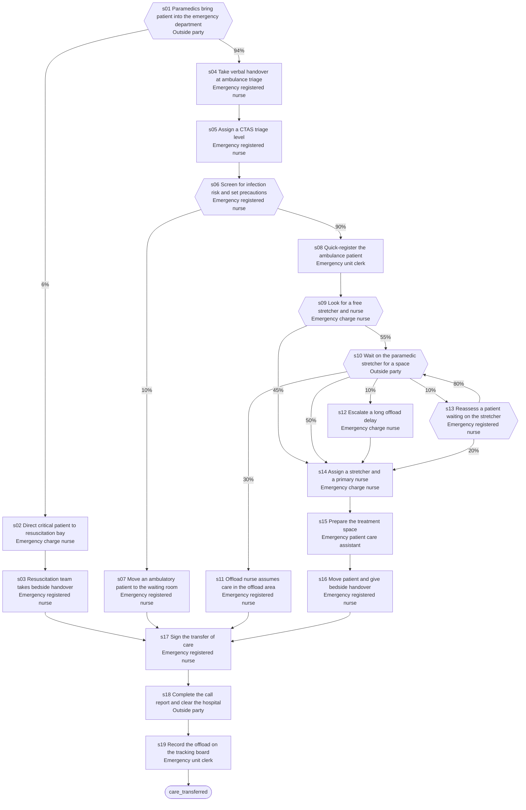

# Receive ambulance patients and transfer care

`hosp-ed-ambulance-offload` · public hospital (acute care) · emergency department · part of `community-hospital-corp`

When paramedics bring a patient to the emergency department, the hospital must take the patient off the ambulance stretcher and accept responsibility before the crew can return to 911 calls. A triage nurse takes a verbal handover and assigns a CTAS level, a clerk opens the visit and the charge nurse looks for a free stretcher and nurse. When none is free, the patient waits in the hallway on the paramedics' stretcher with the crew, which is the offload delay that paramedic services and the province track. A dedicated offload nurse, where funded, can take several waiting patients and release crews early.

| | |
|---|---|
| Unit of work | one ambulance arrival |
| Starts when | A paramedic crew arrives at the ambulance bay with a patient (a pre-arrival patch for critical patients). |
| Done when | The receiving nurse has accepted care and signed the call report, the patient is on a hospital stretcher, in the offload area or in the waiting room, and the crew has cleared the hospital. |
| Organisation | A three-site Ontario community hospital corporation with about 160,000 ED visits a year, one ambulance triage desk per site and partial Dedicated Offload Nurse Program coverage at the busiest site. (5,790 employees, 2019-2022) |
| Volume | 2,600 cases a month (range 2,100 to 2,700) |

## Where it sits

- Starts with **ambulance_patient** from paramedic_service (100% of cases)
- Relies on **staff_schedule** from hr-staff-scheduling (a standing input; it does not start a case)
- Relies on **bed_status_update** from cs-bed-management (a standing input; it does not start a case)
- Sends **ambulance_patient** to ed-patient-triage (outcome: care_transferred)

## Flow

## Roles

| Role | Department | Layer | FTE on this process | Loaded cost per hour | Evidence |
|---|---|---|---:|---:|---|
| Emergency registered nurse | Emergency program | individual contributor | 10 | 61 CAD | C |
| Emergency charge nurse | Emergency program | supervisor | 1.2 | 63 CAD | C |
| Emergency unit clerk | Emergency program | individual contributor | 1.5 | 35 CAD | C |
| Emergency patient care assistant | Emergency program | individual contributor | 0.8 | 31 CAD | C |

## Steps

Hands-on time and the wait before each step show the most common value. Evidence tier A is a sourced number, B a sourced description, C the author's estimate.

| Step | Who | Kind | Hands-on | Wait before | Control | Evidence |
|---|---|---|---:|---:|---|---|
| **s01 Paramedics bring patient into the emergency department.** The two-person paramedic crew parks in the ambulance bay, unloads the patient on the ambulance stretcher and wheels them to the ambulance triage desk. They note the hospital arrival time in their electronic patient care record, which starts the offload clock the region tracks. | Outside party | physical | 4 min | 0 min |  | C |
| **s02 Direct critical patient to resuscitation bay.** The charge nurse, who took the paramedic patch call through the switchboard before arrival, meets the crew at the door, confirms the resuscitation bay is ready and the emergency physician has been called, and waves the stretcher straight through without stopping at triage. | Emergency charge nurse | coordination | 2 min | 0 min |  | C |
| **s03 Resuscitation team takes bedside handover.** Three emergency nurses take the paramedics' verbal report at the resuscitation stretcher, slide the patient across, attach the monitor and start the resuscitation while the physician listens to the same report. The paramedics stay until the patient is moved and their equipment is removed. | Emergency registered nurse | physical | 6 min | 0 min |  | C |
| **s04 Take verbal handover at ambulance triage.** The ambulance triage nurse finishes the patient in front, then listens to the paramedic's structured report: complaint, history, vital signs, treatment given, medications and allergies. The nurse reads the paper or printed call report summary and asks questions to fill gaps. | Emergency registered nurse | intake | 4 min | 3 min |  | B [oag2023] |
| **s05 Assign a CTAS triage level.** The nurse picks the presenting complaint in eCTAS in the hospital system, enters the paramedic's vital signs and pain score plus a quick check of their own, and accepts or overrides the suggested Canadian Triage and Acuity Scale level from 1 to 5. The level sets the patient's priority for a stretcher and a physician. | Emergency registered nurse | judgment | 3 min | 0 min | Canadian Triage and Acuity Scale level recorded for every ED visit and reported to CIHI's National Ambulatory Care Reporting System; eCTAS promoted by Ontario Health | B [oag2023], [ctas2016] |
| **s06 Screen for infection risk and set precautions.** The nurse asks the screening questions for fever, cough and exposure and checks the paramedic's screening result. A positive screen means droplet and contact precautions and a single room or curtained space, which narrows the spaces the patient can go to. From 2020 to 2022 this followed the provincial COVID-19 screening rules. | Emergency registered nurse | validation | 2 min | 0 min | Hospital infection prevention and control policy (routine practices and additional precautions); provincial COVID-19 screening guidance 2020-2022 | C |
| **s07 Move an ambulatory patient to the waiting room.** For a low-acuity patient who can sit, the paramedic walks the patient to a waiting room chair near the triage desk and the triage nurse accepts responsibility for monitoring. The stretcher is freed without waiting for a bed. | Emergency registered nurse | physical | 3 min | 0 min |  | B [oag2023] |
| **s08 Quick-register the ambulance patient.** The unit clerk creates the emergency visit in the hospital system from the patient's name, date of birth and health card number read off the call report or wallet, so that orders and the triage note can be attached. Full registration with health card validation happens later at the bedside. | Emergency unit clerk | data entry | 4 min | 1 min |  | C |
| **s09 Look for a free stretcher and nurse.** The charge nurse checks the tracking board for an empty, cleaned stretcher in the right zone and a nurse with room in their assignment, and asks the bed flow team whether admitted patients are about to leave. If nothing is free, the patient stays on the paramedics' stretcher. | Emergency charge nurse | coordination | 2 min | 1 min |  | B [oag2023] |
| **s10 Wait on the paramedic stretcher for a space.** The patient lies on the ambulance stretcher in the offload hallway while the two paramedics stay with them, repeat vital signs and report changes to the triage nurse. The ambulance is out of service for 911 calls for the whole wait. Time here is the offload delay the paramedic service counts. | Outside party | external wait | 0 min | 20 min |  | B [oag2023], [halton_pmp] |
| **s11 Offload nurse assumes care in the offload area.** A nurse funded by the Dedicated Offload Nurse Program takes report, moves the patient onto a hospital stretcher in the offload area and monitors several ambulance patients at once, so the crew can leave before a treatment space opens. Coverage is limited to the hours the funding pays for. | Emergency registered nurse | physical | 8 min | 5 min |  | B [oag2023] |
| **s12 Escalate a long offload delay.** The charge nurse calls the patient care manager or administrator on call and the paramedic superintendent, moves admitted patients waiting for beds into hallway spaces, opens over-capacity stretchers and asks inpatient units to pull admitted patients up. The action is logged on the board. | Emergency charge nurse | coordination | 10 min | 0 min | Hospital overcapacity and ambulance offload escalation protocol agreed with the regional paramedic service | C |
| **s13 Reassess a patient waiting on the stretcher.** The triage nurse repeats the vital signs the paramedic reports as changed, re-checks the CTAS level and decides whether the patient must jump the queue for the next space or into the resuscitation bay. | Emergency registered nurse | validation | 4 min | 5 min |  | C |
| **s14 Assign a stretcher and a primary nurse.** The charge nurse assigns the free space and a primary nurse on the tracking board and tells the paramedics where to take the patient. Sicker patients get the monitored acute spaces. | Emergency charge nurse | coordination | 2 min | 1 min |  | C |
| **s15 Prepare the treatment space.** The patient care assistant strips and wipes the stretcher if cleaning has not been done, puts on clean linen, checks the monitor and oxygen at the space and brings a gown, while the charge nurse finishes the assignment. | Emergency patient care assistant | physical | 5 min | 1 min |  | C |
| **s16 Move patient and give bedside handover.** The paramedics wheel the patient to the space, slide them onto the hospital stretcher with the primary nurse and repeat the report. The nurse checks the identity band, takes a first set of vitals and looks for gaps in the medication and allergy history. | Emergency registered nurse | physical | 7 min | 2 min |  | C |
| **s17 Sign the transfer of care.** The receiving nurse signs or is named on the paramedics' call report, and the transfer-of-care time is recorded. From this moment the hospital is responsible for the patient and the offload interval ends. | Emergency registered nurse | approval | 1 min | 0 min | Ontario Ministry of Health ambulance documentation standards: call report records the time of transfer of care and the receiving clinician | C |
| **s18 Complete the call report and clear the hospital.** The paramedics finish and upload the electronic call report, strip, wipe and remake their stretcher, restock supplies from the hospital cart and tell the ambulance communications centre they are available again. | Outside party | data entry | 12 min | 0 min |  | B [halton_pmp] |
| **s19 Record the offload on the tracking board.** The unit clerk confirms the arrival and transfer-of-care times on the tracking board, which feed the hospital's offload report to the paramedic service and the Ontario Health ambulance offload indicator. | Emergency unit clerk | data entry | 2 min | 0 min | Ontario Health Pay-for-Results program: ambulance offload time indicator | B [oag2023] |

## Exceptions

| Exception | Share of cases | What happens |
|---|---:|---|
| Critical patient patched ahead | 6% | The crew bypasses ambulance triage and hands over in the resuscitation bay. |
| Offload delay | 55% | No stretcher or nurse is free and the patient waits on the ambulance stretcher with the crew. |
| Escalation for long delays | 6% | Several crews are held and the charge nurse escalates to management and opens over-capacity spaces. |
| Ambulatory patient to waiting room | 9% | A low-acuity patient who can sit is walked to the waiting room and the crew leaves quickly. |

## Benchmarks

| Metric | Value | Unit | Population | Evidence |
|---|---|---|---|---|
| cycle_time_days | p50 0.042, p90 0.104 | calendar days from ambulance arrival to the crew clearing the hospital (about 60 and 150 minutes) | Ontario community hospitals 2019-2022, author's estimate | C |
| offload_best_practice_minutes | 30 | minutes from arrival to transfer of care | Ontario paramedic services (industry best practice; no provincial target) | A [oag2023] |
| fit2sit_offload_minutes | 9 | minutes from arrival to transfer of care | Peel Regional Paramedic Services and William Osler Health System, low-acuity patients able to sit, from October 2020 | A [oag2023] |

## Pain points

- Paramedics wait with patients because no stretcher or nurse is free; the main causes are nurse availability and assessment space, often because admitted patients occupy ED stretchers. (steps s09, s10; A [oag2023])
- Offload nurse funding covers only part of the day, so long offloads continue even where the program exists. (steps s11; B [oag2023])
- Ambulance patients join the same triage queue as walk-ins, so the crew waits for the triage nurse before handover even when a space is free. (steps s04; B [oag2023])

## Assumptions

- The simulated median time at hospital (about 72 minutes) is about 1.2 times the estimated 60-minute benchmark; it is kept because Halton time at hospital was among the highest of benchmarked Ontario services (halton_pmp), and both figures are estimates.
- The process ends when the crew clears the hospital, so the simulated cycle time is the ambulance's time at hospital; the offload interval the province measures ends earlier, at step s17.
- Step times describe the large site; ED space use is booked against the large site's treatment spaces (ed_spaces_otmh) as the representative site.
- The ambulance crew resource is added because the crew and vehicle are what offload delay ties up; the count of 25 staffed ambulances on the road at peak in the region is the author's estimate.
- Triage of ambulance patients (CTAS) is done inside this process; the triage workflow (hosp-ed-patient-triage) picks ambulance patients up at bedside registration.
- The two paramedic steps with people = 2 count paramedic time in the simulated hands-on hours, which roughly doubles the FTE implied by touch time compared with hospital staff alone; stated FTE covers hospital roles only.
- Hospital staffing FTE includes idle triage-desk time between arrivals, so stated FTE exceeds hospital hands-on time.

## Sources

- [oag2023] [2023 Annual Report, Value-for-Money Audit: Emergency Departments](https://www.auditor.on.ca/en/content/annualreports/arreports/en23/AR_emergencydepts_en23.pdf) (Office of the Auditor General of Ontario, 2023). 20% of Ontario ED visits by ambulance in 2022/23; no provincial offload target, 30 minutes best practice; main causes of offload delay; Dedicated Offload Nurse Program since 2008; Fit2Sit offloads about nine minutes; offload time is a Pay-for-Results indicator; eCTAS override rates 14-16%.
- [ctas2016] [Revisions to the Canadian Emergency Department Triage and Acuity Scale (CTAS) Guidelines 2016 (CAEP position statement, CTAS National Working Group)](https://www.cambridge.org/core/product/E2CB3E2063C54E11259313FA4FEAE495) (Canadian Journal of Emergency Medicine, Cambridge University Press, 2017). CTAS time targets unchanged in 2016; level 1 seen immediately; first-order modifiers (vital signs, pain, mechanism).
- [halton_pmp] [Halton Region Paramedic Services Master Plan Update, Final Report (Attachment 1 to Report MO-14-24)](https://halton.ca/getmedia/3c363e12-bc51-428a-a149-94ccbe86bb01/HE-Paramedic-Services-Master-Plan-Update.aspx) (ORH for Halton Region Paramedic Services, 2024). Halton time at hospital rose 2021-2022 and was third-highest of Ontario services benchmarked by ORH; data 2019-2023.
- [hh1819] [Halton Healthcare 2018/19 Annual Community Report](https://www.haltonhealthcare.on.ca/2018-19-annual-community-report) (Halton Healthcare, 2019). 158,803 ED visits in 2018/19.
- [hh2021] [Halton Healthcare 2020-2021 Annual Community Report](https://www.haltonhealthcare.on.ca/about/reports-and-publications/2020-2021-annual-community-report) (Halton Healthcare, 2021). 126,357 ED visits in 2020/21.
- [hh2122] [Halton Healthcare 2021-2022 Annual Community Report](https://www.haltonhealthcare.on.ca/about/reports-and-publications/2021-2022-annual-community-report) (Halton Healthcare, 2022). 161,049 ED visits in 2021/22.

Written by claude-opus on 2026-11-24.
