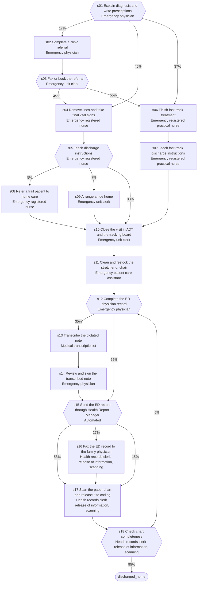

# Discharge emergency patients home with instructions and follow-up

`hosp-ed-discharge-home` · healthcare (acute care hospital) · emergency program · part of `community-hospital-corp`

When the emergency physician decides a patient can go home, the physician explains the diagnosis, writes prescriptions and, for about one patient in six, a referral to the fracture clinic or another hospital clinic. A nurse removes lines, takes final vital signs and goes over written instructions, the clerk closes the visit and the stretcher is cleaned for the next patient. Afterwards the physician's ED record is typed or dictated and transcribed, signed, and sent to the family physician through the provincial Health Report Manager or by fax, and the paper parts of the chart are scanned and released to coding. The patient part is short, but nurses are pulled to sicker patients, so discharged patients wait for line removal and teaching, and the record reaches the family physician a day or more later.

| | |
|---|---|
| Unit of work | one ED discharge (discharge decision to the ED record reaching the family physician and the chart released to coding) |
| Starts when | The ED physician (or a consultant) decides after assessment that the patient can go home. |
| Done when | The patient has left with instructions, prescriptions and any clinic appointment; the ED record has been sent to the family physician where there is one; and the chart is complete and released to health records for coding. |
| Organisation | A not-for-profit Ontario community hospital corporation with three hospitals, about 640 inpatient beds and an emergency department at each site, on a single hospital information system with an electronic bed board. (5,790 employees, 2019-2022) |
| Volume | 10,300 cases a month (range 8,300 to 10,700) |

## Where it sits

- Starts with **ed_disposition** from ed-physician-assessment (95% of cases)
- Starts with **ed_disposition** from ed-specialist-consult (5% of cases)
- Sends **discharge_instructions** to patient (outcome: any)
- Sends **discharge_summary** to primary_care (outcome: any)
- Sends **patient_chart** to dh-chart-coding (outcome: any)
- Sends **clinic_referral** to amb-clinic-referral-booking (outcome: any)
- Sends **clinic_referral** to sx-fracture-clinic (outcome: any)
- Sends **home_care_referral** to hccss (outcome: any)
- Sends **dictation** to dh-transcription (outcome: any)

## Flow

## Roles

| Role | Department | Layer | FTE on this process | Loaded cost per hour | Evidence |
|---|---|---|---:|---:|---|
| Emergency physician | Medical, dental and midwifery staff | senior specialist | 22 | 185 CAD | C |
| Emergency registered nurse | Emergency program | individual contributor | 22 | 61 CAD | C |
| Emergency registered practical nurse | Emergency program | individual contributor | 9 | 40 CAD | C |
| Emergency unit clerk | Emergency program | individual contributor | 7 | 35 CAD | C |
| Emergency patient care assistant | Emergency program | individual contributor | 8 | 31 CAD | C |
| Medical transcriptionist | Health information management | individual contributor | 2 | 36 CAD | C |
| Health records clerk (release of information, scanning) | Health information management | individual contributor | 3 | 34 CAD | C |

## Steps

Hands-on time and the wait before each step show the most common value. Evidence tier A is a sourced number, B a sourced description, C the author's estimate.

| Step | Who | Kind | Hands-on | Wait before | Control | Evidence |
|---|---|---|---:|---:|---|---|
| **s01 Explain diagnosis and write prescriptions.** The ED physician returns to the patient with the test results, explains the diagnosis and the plan, writes paper prescriptions and enters the discharge disposition and diagnosis in the hospital information system, choosing a standard instruction sheet for the condition (for example head injury, abdominal pain or a cast). | Emergency physician | judgment | 7 min | 5 min | Discharge decision and prescriptions by a physician or nurse practitioner (Medicine Act and hospital medical staff rules). | C |
| **s02 Complete a clinic referral.** For fractures, sprains, eye problems or abnormal results needing specialist review, the physician fills in the fracture clinic or specialty clinic referral form (paper or electronic) with the reason and urgency, and attaches the X-ray report or results. | Emergency physician | drafting | 5 min | 0 min |  | C |
| **s03 Fax or book the referral.** The ED unit clerk books the fracture clinic slot directly in the clinic schedule or faxes the referral to the specialty clinic or community specialist, and writes the appointment or 'clinic will call you' on the patient's instructions. | Emergency unit clerk | coordination | 6 min | 10 min |  | C |
| **s04 Remove lines and take final vital signs.** The ED nurse removes the IV and any monitoring, takes and records final vital signs and checks that ordered medications and pain control are done and the patient is safe to walk or be taken out. Discharged patients wait here when the nurse is caring for sicker patients. | Emergency registered nurse | physical | 8 min | 25 min |  | C |
| **s05 Teach discharge instructions.** The ED nurse goes over the printed instruction sheet and prescriptions with the patient and family, asks them to repeat the warning signs and when to return, and checks they have a way home. The patient signs that instructions were received. | Emergency registered nurse | communication | 7 min | 5 min |  | C |
| **s06 Finish fast-track treatment.** In the fast-track or minor-treatment area the RPN applies the dressing, splint or tensor bandage ordered, gives the last dose of medication and records final vital signs. | Emergency registered practical nurse | physical | 8 min | 15 min |  | C |
| **s07 Teach fast-track discharge instructions.** The RPN reviews the condition-specific instruction sheet, wound or cast care and prescriptions with the patient, explains when to return and gives the clinic appointment if one was booked. | Emergency registered practical nurse | communication | 5 min | 2 min |  | C |
| **s08 Refer a frail patient to home care.** For an older patient who can go home only with support, the ED nurse completes a home and community care referral in the Health Partner Gateway (or by fax) for nursing, personal support or a care coordinator visit, and confirms with the family. | Emergency registered nurse | data entry | 25 min | 15 min |  | C |
| **s09 Arrange a ride home.** When the patient has no ride (often at night or for older patients), the unit clerk phones family or arranges a taxi voucher, and the patient waits in a chair so the stretcher can be used. | Emergency unit clerk | coordination | 5 min | 30 min |  | C |
| **s10 Close the visit in ADT and the tracking board.** The ED unit clerk records the departure time, discharges the patient in ADT and removes them from the tracking board, which sets the ED length of stay reported to NACRS and starts the stretcher clean. | Emergency unit clerk | data entry | 2 min | 5 min | Mandatory NACRS reporting of ED visit time stamps to CIHI and the provincial wait time information system. | B [cihi_nacrs] |
| **s11 Clean and restock the stretcher or chair.** The ED patient care assistant strips the stretcher, wipes it and the equipment with disinfectant wipes, restocks supplies and marks the space ready on the tracking board. | Emergency patient care assistant | physical | 7 min | 10 min |  | C |
| **s12 Complete the ED physician record.** The physician completes the ED record: history, findings, results, diagnosis, treatment and follow-up plan, either typed into the hospital information system template or dictated by phone for transcription. Most physicians finish charts between patients or at the end of the shift. | Emergency physician | drafting | 6 min | 1.0 h | Public Hospitals Act Regulation 965 record-keeping and CPSO medical records expectations. | C |
| **s13 Transcribe the dictated note.** A medical transcriptionist types the dictated ED note into the hospital information system from the dictation queue, checking drug names and spelling, and sends it to the physician's inbox for signature. | Medical transcriptionist | data entry | 6 min | 12.0 h |  | C |
| **s14 Review and sign the transcribed note.** The physician opens the draft in the inbox, corrects errors and electronically signs it. Signatures are often batched at the start of the next shift, which may be days later. | Emergency physician | review | 2 min | 20.0 h | Physician authentication of the medical record (hospital medical staff rules on chart completion). | C |
| **s15 Send the ED record through Health Report Manager.** When the note is final, the hospital information system sends the ED report to the family physician named on the visit through Health Report Manager, which delivers it into the physician's EMR; an ED discharge eNotification may already have been sent at departure. | Automated | system auto | 1 min | 5 min |  | B [hrm_faq], [hrm_enotif] |
| **s16 Fax the ED record to the family physician.** For family physicians not on HRM, a health records clerk prints or queues the signed ED record and faxes it to the clinic's fax number, checking the number against the physician directory. | Health records clerk (release of information, scanning) | communication | 2 min | 4.0 h | Personal Health Information Protection Act safeguards for disclosure by fax. | B [hrm_faq] |
| **s17 Scan the paper chart and release it to coding.** A health records clerk collects the ED paper forms (triage sheet, nursing notes, signed instructions, consent), scans and indexes them to the visit in the document imaging system, checks the physician note is signed and releases the chart to the coding work queue. | Health records clerk (release of information, scanning) | data entry | 2 min | 10.0 h |  | C |
| **s18 Check chart completeness.** The clerk runs the incomplete-chart list for ED visits and returns charts with missing physician signatures or diagnoses to the physician's deficiency queue; complete charts go to coding for NACRS abstracting. | Health records clerk (release of information, scanning) | validation | 1 min | 30 min | NACRS abstracting requires a complete ED record; deficiency tracking under hospital health records policy. | C |

## Exceptions

| Exception | Share of cases | What happens |
|---|---:|---|
| Clinic referral | 17% | The physician refers the patient to the fracture clinic or another clinic and the clerk books or faxes the referral. |
| Home care referral | 2% | A frail patient goes home only with home care services arranged. |
| Ride needed | 4% | The patient waits in a chair while family or a taxi is arranged. |
| Dictated note | 35% | The ED note is dictated, transcribed and signed before it can be sent, adding one to several days. |
| Fax to family physician | 27% | The family physician is not on HRM and the record is faxed. |
| Incomplete chart returned | 5% | The chart is returned to the physician for a missing signature or diagnosis. |

## Benchmarks

| Metric | Value | Unit | Population | Evidence |
|---|---|---|---|---|
| cycle_time_days | p50 1.2, p90 4.0 | days from discharge decision to chart released to coding | ED discharges, Ontario community hospital, 2019-2022 | C |
| median_ed_length_of_stay_discharged_home | 2018_19 174, 2019_20 180, 2020_21 168, 2021_22 192 | minutes from registration to leaving the ED | Patients discharged home, all NACRS-reporting EDs in Canada | A [cihi_nacrs] |
| decision_to_departure_minutes | p50 35, p90 110 | minutes | ED patients discharged home | C |
| provincial_target_discharged_ed_length_of_stay | low_urgency 4, high_urgency 8 | hours (90th percentile) | Patients discharged from Ontario EDs | B [oh_ed] |

## Pain points

- Patients who are ready to go wait for a nurse to remove the IV and teach, because nurses are pulled to new and unstable patients; the stretcher stays occupied meanwhile. (steps s04, s06; C)
- Dictated notes wait for transcription and then for the physician to sign, so the family physician gets the record days later and the patient may be seen before it arrives. (steps s13, s14; C)
- Referrals and ED records sent by fax go missing or to the wrong number; patients are not called for clinic follow-up. (steps s03, s16; B [hrm_faq])
- Patients who leave without understanding warning signs or without follow-up return to the ED, some needing admission within 72 hours, which hospitals must audit. (steps s05, s07; A [oag2023])

## Assumptions

- The process starts when the physician decides to discharge; registration, triage, assessment and tests belong to earlier ED processes.
- Volume follows the CIHI discharged-home share (about 79%) applied to the organisation file's ED visits, which is lower than the organisation file's process map entry.
- ED space occupancy (s04, s06, s11) is split across the three sites by expected share (55%, 30%, 15%), so each figure is the expected minutes per case, not one patient's minutes.
- The split between dictated (35%) and typed (65%) notes, the HRM coverage of family physicians (about 68% of patients with a family physician) and the 15% of patients without one are author's estimates.
- Transcription and chart scanning are done by the transcriptionist and health records clerk roles from the organisation file; the process map entry lists neither. Transcription itself is the dh-transcription process; s13 is its share of the work.
- Physician cost uses the organisation file's estimated clinical earnings; physicians are paid by OHIP, not the hospital.

## Sources

- [cihi_nacrs] [NACRS Emergency Department Visits: Volumes and Median Lengths of Stay, 2003-2004 to 2021-2022, Supplementary Statistics (data tables)](https://www.cihi.ca/sites/default/files/document/emergency-department-visits-2003-2021-supplementary-data-tables-en.xlsx) (Canadian Institute for Health Information, 2022). Table 2, all reporting EDs: median ED length of stay for admitted patients 702, 720, 642 and 786 minutes and for patients discharged home 174, 180, 168 and 192 minutes in 2018/19 to 2021/22; admitted share of visits 10.6%, 10.6%, 12.4% and 11.2%; discharged home share 79.4%, 78.8%, 79.9% and 78.9%; left without being seen 4.5% to 6.9%.
- [oh_ed] [Time Spent in Emergency Departments](https://ontariohealth.ca/System-Performance/Time-Spent-in-Emergency-Departments) (Ontario Health, 2026). Provincial ED length-of-stay targets: 8 hours for admitted patients and high-urgency discharged patients, 4 hours for low-urgency discharged patients; admitted length of stay includes the wait for an inpatient bed.
- [hrm_faq] [Health Report Manager: frequently asked questions](https://www.ontariomd.ca/products-and-services/health-report-manager/faqs) (OntarioMD, 2026). HRM delivers hospital medical record reports (such as ED reports and discharge summaries) to the clinicians named on the report, in their EMR; provincial expansion began in 2013 and more than 200 hospital sites are connected; some facilities keep sending paper or fax alongside HRM; eNotifications on ED discharge.
- [hrm_enotif] [Health Report Manager eNotifications](https://www.ontariomd.ca/products-and-services/health-report-manager/enotifications) (OntarioMD, 2026). Near real-time HRM message to the primary care provider when a patient is discharged from the ED; discharge summaries and other reports follow once the hospital has prepared them; guideline of follow-up within 7 days of discharge.
- [oag2023] [Value-for-Money Audit: Emergency Departments (2023 Annual Report)](https://www.auditor.on.ca/en/content/annualreports/arreports/en23/AR_emergencydepts_en23.pdf) (Office of the Auditor General of Ontario, 2023). Average wait for an inpatient bed after the decision to admit: about 8 to 10 hours before COVID-19, 13 hours (90th percentile 35 hours) in 2022/23, about 21 hours at the 90th percentile in 2013/14; Mississauga Halton sub-region average 10.8 hours in 2021/22 and 21.3 hours in 2022/23; 12% of ED visits admitted in 2022/23; ALC about 15% of patient days; at least 1,000 hallway patients a day in January 2019; ED Return Visit Quality Program (72-hour and 7-day returns).

Written by claude-opus on 2026-11-24.
