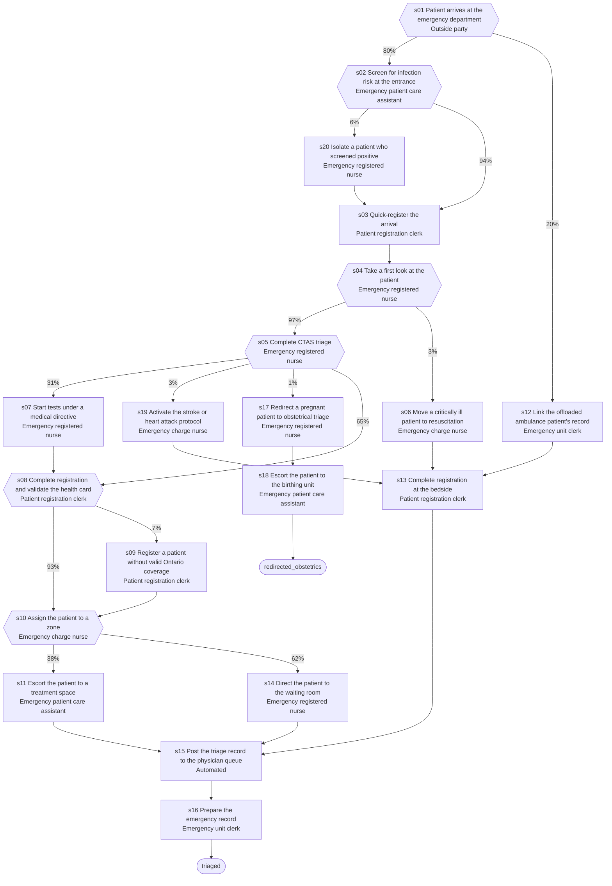

# Triage and register emergency patients

`hosp-ed-patient-triage` · public hospital (acute care) · emergency department · part of `community-hospital-corp`

Every emergency patient is triaged by a nurse who records the complaint and vital signs and assigns a Canadian Triage and Acuity Scale (CTAS) level from 1 to 5, which sets the order in which patients get a space and a physician. A registration clerk opens the visit, validates the Ontario health card and prints the wristband, and the charge nurse places the patient in a zone or the waiting room. Queues build at shift change and in the late morning and evening, nurses and the eCTAS software often disagree on the level, and from 2020 to 2022 infection screening added a step and narrowed the spaces available.

| | |
|---|---|
| Unit of work | one ED visit |
| Starts when | A patient walks into the emergency department, or an ambulance patient's care is transferred to the ED. |
| Done when | The patient has a CTAS level, a validated registration and a place in a treatment space or the waiting room, and appears in the physician queue (or has been redirected to obstetrical triage). |
| Organisation | A three-site Ontario community hospital corporation with about 160,000 ED visits a year, eCTAS triage and 24-hour registration desks at each site. (5,790 employees, 2019-2022) |
| Volume | 13,000 cases a month (range 10,500 to 13,450) |

## Where it sits

- Starts with **ed_patient** from patient (80% of cases)
- Starts with **ambulance_patient** from ed-ambulance-offload (20% of cases)
- Relies on **staff_schedule** from hr-staff-scheduling (a standing input; it does not start a case)
- Relies on **emergency_plan** from fs-emergency-preparedness (a standing input; it does not start a case)
- Sends **triage_record** to ed-physician-assessment (outcome: triaged)
- Sends **health_card_validation** to ministry_of_health (outcome: triaged)
- Sends **maternity_patient** to wc-obstetric-triage (outcome: redirected_obstetrics)

## Flow

## Roles

| Role | Department | Layer | FTE on this process | Loaded cost per hour | Evidence |
|---|---|---|---:|---:|---|
| Emergency registered nurse | Emergency program | individual contributor | 22 | 61 CAD | C |
| Patient registration clerk | Patient registration and switchboard | individual contributor | 20 | 34 CAD | C |
| Emergency charge nurse | Emergency program | supervisor | 2 | 63 CAD | C |
| Emergency unit clerk | Emergency program | individual contributor | 3 | 35 CAD | C |
| Emergency patient care assistant | Emergency program | individual contributor | 3 | 31 CAD | C |

## Steps

Hands-on time and the wait before each step show the most common value. Evidence tier A is a sourced number, B a sourced description, C the author's estimate.

| Step | Who | Kind | Hands-on | Wait before | Control | Evidence |
|---|---|---|---:|---:|---|---|
| **s01 Patient arrives at the emergency department.** A walk-in patient, often with a family member, comes through the emergency entrance and joins the line for triage, or an ambulance patient who was triaged at the ambulance desk is handed into this process after the transfer of care. | Outside party | intake | 2 min | 0 min |  | A [oag2023] |
| **s02 Screen for infection risk at the entrance.** A screener at the door asks about fever, cough, travel and contacts, hands out a mask and directs a patient who screens positive to a separate waiting area. Before 2020 this was a sign and a triage question; from March 2020 to 2022 it was active screening at every entrance. | Emergency patient care assistant | intake | 2 min | 1 min | Hospital infection prevention and control policy; provincial COVID-19 screening guidance for hospitals 2020-2022 | C |
| **s03 Quick-register the arrival.** The registration clerk at the front desk types the patient's name, date of birth and health card number and a few words of complaint to open the emergency visit and time-stamp the arrival, so the triage nurse can document against it. | Patient registration clerk | data entry | 3 min | 2 min |  | C |
| **s04 Take a first look at the patient.** The triage nurse glances up from the current patient at each new arrival to check colour, breathing and distress. A patient who looks critically ill is taken straight in ahead of the line. | Emergency registered nurse | judgment | 1 min | 3 min |  | C |
| **s05 Complete CTAS triage.** At the triage desk the nurse selects the presenting complaint, takes blood pressure, pulse, oxygen saturation, temperature and a pain score, asks about medications, allergies and history, and enters them in eCTAS, which suggests a CTAS level from 1 (resuscitation) to 5 (non-urgent). The nurse can raise the level by override and writes a short triage note. | Emergency registered nurse | judgment | 5 min | 4 min | CTAS level recorded for every visit and reported to CIHI's National Ambulatory Care Reporting System; Ontario Health eCTAS override monitoring above 10% | B [oag2023], [ctas2016] |
| **s06 Move a critically ill patient to resuscitation.** The charge nurse takes the patient straight to the resuscitation bay or an acute monitored space, calls the emergency physician to the bedside and assigns nurses. Triage and registration are finished at the bedside. | Emergency charge nurse | coordination | 2 min | 0 min |  | B [ctas2016] |
| **s07 Start tests under a medical directive.** Following a directive signed by the emergency physicians, the triage nurse orders standard bloodwork, an ECG, a urine test or an X-ray for the complaint, or gives acetaminophen or ibuprofen for pain or fever, so results are ready when the physician sees the patient. | Emergency registered nurse | data entry | 3 min | 0 min | Medical directives approved by the hospital's Medical Advisory Committee under the College of Nurses of Ontario directives practice standard | B [oag2023] |
| **s08 Complete registration and validate the health card.** The patient goes to the registration desk, where the clerk checks the photo health card, runs the provincial health card validation, confirms address, phone, family doctor and next of kin, prints the wristband and labels and checks two identifiers with the patient. | Patient registration clerk | data entry | 4 min | 5 min | Ontario Ministry of Health health card eligibility check before insured hospital services are recorded; hospital registration policy (two patient identifiers) | C |
| **s09 Register a patient without valid Ontario coverage.** The clerk records out-of-province coverage details for interprovincial billing, a third-party insurer, or an uninsured patient's agreement to pay, and flags the account for patient billing. Care is not delayed for this. | Patient registration clerk | data entry | 8 min | 0 min |  | C |
| **s10 Assign the patient to a zone.** The charge nurse reads the CTAS level and complaint on the tracking board and decides between the acute stretcher zone, the ambulatory or fast-track zone, the paediatric area or the waiting room, depending on which spaces and nurses are free. | Emergency charge nurse | coordination | 2 min | 2 min |  | C |
| **s11 Escort the patient to a treatment space.** The patient care assistant walks or wheels the patient to the assigned space, gives a gown, and tells the primary nurse the patient has arrived. | Emergency patient care assistant | physical | 3 min | 2 min |  | C |
| **s12 Link the offloaded ambulance patient's record.** The unit clerk checks that the quick-registration created during offload carries the triage note and CTAS level and that the patient shows in the right space on the tracking board. | Emergency unit clerk | data entry | 2 min | 2 min |  | C |
| **s13 Complete registration at the bedside.** When the patient is in a space or stretcher, the registration clerk does a round of the department, gets the health card from the patient or family, runs health card validation, completes demographics and fixes the wristband. | Patient registration clerk | data entry | 5 min | 25 min | Ontario Ministry of Health health card eligibility check before insured hospital services are recorded; hospital registration policy (two patient identifiers) | C |
| **s14 Direct the patient to the waiting room.** The triage nurse tells the patient to wait, not to eat or drink until seen, and to come back to the desk if symptoms get worse, and gives a specimen cup if a urine test was ordered. | Emergency registered nurse | communication | 2 min | 0 min |  | C |
| **s15 Post the triage record to the physician queue.** The tracking board places the patient in the queue for physicians, ordered by CTAS level and time since triage, and starts the clock for the time to physician initial assessment. | Automated | system auto | 0 min | 0 min |  | B [oag2023] |
| **s16 Prepare the emergency record.** The unit clerk prints labels and the paper parts of the emergency record (consent, nursing flow sheet and physician sheet where not electronic), puts them in the chart rack by zone and checks the board entry. | Emergency unit clerk | data entry | 3 min | 2 min |  | C |
| **s17 Redirect a pregnant patient to obstetrical triage.** For a patient more than about 20 weeks pregnant whose complaint is pregnancy-related, the triage nurse confirms she is stable, phones the birthing unit and documents the transfer to obstetrical triage. | Emergency registered nurse | coordination | 5 min | 0 min |  | B [ctas2016] |
| **s18 Escort the patient to the birthing unit.** A patient care assistant takes the patient by wheelchair to the birthing unit and hands over to the obstetrical triage nurse. | Emergency patient care assistant | travel | 8 min | 3 min |  | C |
| **s19 Activate the stroke or heart attack protocol.** For a suspected stroke within the treatment window or an ECG showing a STEMI, the charge nurse calls the physician, the stroke team or cardiology and CT, and moves the patient to an acute space; registration is finished at the bedside. | Emergency charge nurse | communication | 4 min | 0 min | Hospital stroke and STEMI protocols (time-critical treatment pathways) | C |
| **s20 Isolate a patient who screened positive.** The nurse places the patient in a single room or a separate waiting area with droplet and contact precautions, puts an isolation flag on the board and triages them there. | Emergency registered nurse | physical | 5 min | 2 min | Hospital infection prevention and control policy (additional precautions) | C |

## Exceptions

| Exception | Share of cases | What happens |
|---|---:|---|
| Critically ill at first look | 2% | The patient is taken straight to resuscitation and registered at the bedside. |
| No valid Ontario health card | 5% | Out-of-province, third-party or uninsured patients need payer details recorded. |
| Positive infection screen | 5% | The patient is isolated before triage and registration (mainly 2020-2022). |
| Pregnant patient redirected | 1% | Pregnancy complaints after about 20 weeks go to obstetrical triage in the birthing unit. |

## Benchmarks

| Metric | Value | Unit | Population | Evidence |
|---|---|---|---|---|
| cycle_time_days | p50 0.035, p90 0.08 | calendar days from arrival to triaged, registered and placed (about 50 and 115 minutes) | Ontario community hospital EDs 2019-2022, author's estimate | C |
| ctas_override_rate | low 0.14, high 0.16 | share of eCTAS triages where the nurse overrides the suggested level, Ontario average | Ontario EDs using eCTAS, five years to 2022/23 | A [oag2023] |
| triage_to_physician_benchmark_hours | p50 1, p90 3 | hours from triage to physician initial assessment (proposed CTAS benchmark) | Canadian EDs | A [ctas2016] |

## Pain points

- One triage nurse per desk becomes the bottleneck at peaks; patients wait to be triaged and ambulance crews queue behind walk-ins. (steps s04, s05; B [oag2023])
- Triage levels vary between nurses; frequent overrides of the eCTAS level suggest inconsistent triage and training gaps. (steps s05; A [oag2023])
- Medical directives that let triage nurses start tests are used unevenly, so many patients wait for the physician before any test is ordered. (steps s07; A [oag2023])
- Registration is done twice for many patients (quick registration, then full registration or a bedside round), re-keying the same identifiers. (steps s03, s08, s13; C)

## Assumptions

- The simulated median (about 70 minutes from arrival to placement) is about 1.4 times the estimated benchmark, mainly because ambulance patients wait for the registration clerk's bedside round; walk-in patients finish in about 45-60 minutes.
- Ambulance patients' CTAS triage is counted in the offload workflow (hosp-ed-ambulance-offload); here they get only record linking and bedside registration.
- The process ends when the patient is placed and queued for a physician; waiting-room reassessment and the wait for a physician belong to the physician assessment workflow.
- Quick registration before triage is assumed; some sites triage first and register after, which moves the same work rather than removing it.
- Stated FTE reflects staffed triage and registration posts, which include idle time between arrivals overnight, so it exceeds hands-on time by design.
- Patients who leave before triage are rare and not modelled.

## Sources

- [oag2023] [2023 Annual Report, Value-for-Money Audit: Emergency Departments](https://www.auditor.on.ca/en/content/annualreports/arreports/en23/AR_emergencydepts_en23.pdf) (Office of the Auditor General of Ontario, 2023). 20% of visits by ambulance; triage content and eCTAS; override rates 14-16%; medical directives 9-37 per site and about 50% of visits at one hospital; time to physician initial assessment measured from triage.
- [ctas2016] [Revisions to the Canadian Emergency Department Triage and Acuity Scale (CTAS) Guidelines 2016 (CAEP position statement, CTAS National Working Group)](https://www.cambridge.org/core/product/E2CB3E2063C54E11259313FA4FEAE495) (Canadian Journal of Emergency Medicine, Cambridge University Press, 2017). CTAS level 1 seen immediately; modifiers; proposed median 1 h and 90th percentile 3 h triage-to-physician benchmark; alignment with the Obstetrical Triage Acuity Scale.
- [hh1819] [Halton Healthcare 2018/19 Annual Community Report](https://www.haltonhealthcare.on.ca/2018-19-annual-community-report) (Halton Healthcare, 2019). 158,803 ED visits in 2018/19.
- [hh2021] [Halton Healthcare 2020-2021 Annual Community Report](https://www.haltonhealthcare.on.ca/about/reports-and-publications/2020-2021-annual-community-report) (Halton Healthcare, 2021). 126,357 ED visits in 2020/21.
- [hh2122] [Halton Healthcare 2021-2022 Annual Community Report](https://www.haltonhealthcare.on.ca/about/reports-and-publications/2021-2022-annual-community-report) (Halton Healthcare, 2022). 161,049 ED visits in 2021/22.

Written by claude-opus on 2026-11-24.
