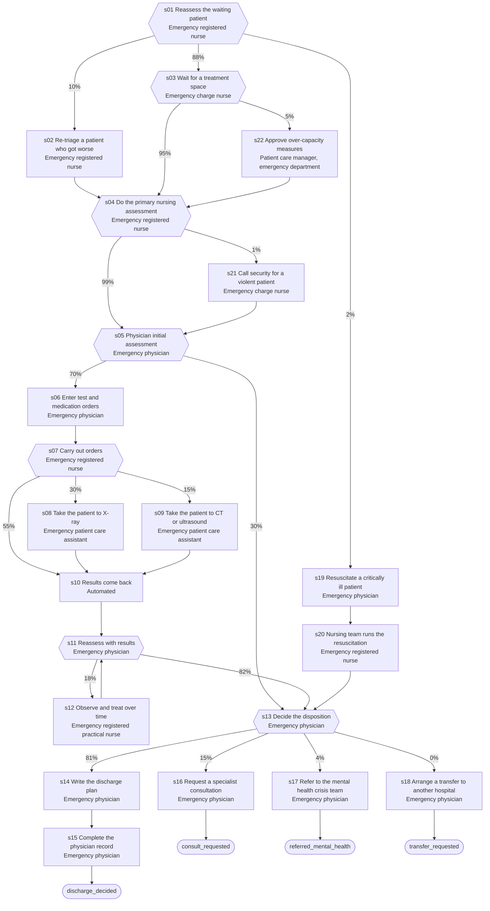

# Assess, investigate and treat emergency patients

`hosp-ed-physician-assessment` · public hospital (acute care) · emergency department · part of `community-hospital-corp`

After triage, patients wait for a treatment space and an emergency physician, who sees them in order of acuity and time waited. The physician takes a history, examines the patient, orders blood tests, imaging and medications, and reassesses when results return before deciding to discharge, consult a specialist, refer to the mental health team or transfer. Most of the elapsed time is waiting: for a space held by admitted patients, for the physician, for results and for repeat tests. Ontario reports time to physician initial assessment and length of stay for every hospital, and the corporation's large site was among the slower ones in 2022/23.

| | |
|---|---|
| Unit of work | one ED visit seen by a physician |
| Starts when | A triaged patient appears in the physician queue on the tracking board. |
| Done when | The physician has decided the disposition: discharge plan written, consultation requested, crisis team referral made or transfer requested. |
| Organisation | A three-site Ontario community hospital corporation with about 160,000 ED visits a year, emergency physicians on alternate funding or fee-for-service, computerized order entry and a tracking board. (5,790 employees, 2019-2022) |
| Volume | 12,600 cases a month (range 10,200 to 13,100) |

## Where it sits

- Starts with **triage_record** from ed-patient-triage (100% of cases)
- Relies on **lab_result** from dx-lab-testing (a standing input; it does not start a case)
- Relies on **imaging_report** from dx-radiology-reporting (a standing input; it does not start a case)
- Relies on **consult_note** from ed-specialist-consult (a standing input; it does not start a case)
- Sends **lab_order** to dx-lab-specimen-collection (outcome: any)
- Sends **imaging_order** to dx-imaging-exam (outcome: any)
- Sends **medication_order** to cs-pharmacy-order-verification (outcome: any)
- Sends **security_call** to fs-security-response (outcome: any)
- Sends **blood_order** to dx-blood-transfusion (outcome: any)
- Sends **consult_request** to ed-specialist-consult (outcome: consult_requested)
- Sends **consult_request** to mh-ed-crisis-assessment (outcome: referred_mental_health)
- Sends **ed_disposition** to ed-discharge-home (outcome: discharge_decided)
- Sends **transfer_request** to ed-interfacility-transfer (outcome: transfer_requested)

## Flow

## Roles

| Role | Department | Layer | FTE on this process | Loaded cost per hour | Evidence |
|---|---|---|---:|---:|---|
| Emergency physician | Medical, dental and midwifery staff | senior specialist | 42 | 185 CAD | C |
| Emergency registered nurse | Emergency program | individual contributor | 70 | 61 CAD | C |
| Emergency registered practical nurse | Emergency program | individual contributor | 8 | 40 CAD | C |
| Emergency patient care assistant | Emergency program | individual contributor | 6 | 31 CAD | C |
| Emergency charge nurse | Emergency program | supervisor | 4 | 63 CAD | C |
| Patient care manager, emergency department | Emergency program | manager | 0.3 | 78 CAD | C |

## Steps

Hands-on time and the wait before each step show the most common value. Evidence tier A is a sourced number, B a sourced description, C the author's estimate.

| Step | Who | Kind | Hands-on | Wait before | Control | Evidence |
|---|---|---|---:|---:|---|---|
| **s01 Reassess the waiting patient.** While the patient waits for a space or a physician, the triage nurse checks the waiting room list against the reassessment interval for each CTAS level, repeats vital signs for patients waiting longest and asks whether symptoms have changed. | Emergency registered nurse | validation | 2 min | 10 min |  | C |
| **s02 Re-triage a patient who got worse.** The nurse raises the CTAS level in the system, tells the charge nurse and moves the patient up the list for the next stretcher, starting any directive orders that now apply. | Emergency registered nurse | judgment | 4 min | 0 min |  | C |
| **s03 Wait for a treatment space.** The charge nurse brings the next patient from the waiting room when a stretcher or chair and a nurse come free, choosing by CTAS level and time waited. Admitted patients waiting for inpatient beds hold many ED stretchers, so this wait grows when the hospital is full. | Emergency charge nurse | coordination | 2 min | 10 min |  | B [oag2023] |
| **s04 Do the primary nursing assessment.** The primary nurse checks the identity band, takes a full set of vital signs, does a focused assessment for the complaint, starts a cardiac monitor or IV if needed and documents in the nursing record. The treatment space stays occupied by this patient until they leave. | Emergency registered nurse | analysis | 10 min | 3 min |  | B [oag2023] |
| **s05 Physician initial assessment.** The emergency physician picks the next patient from the tracking board by CTAS level and wait, reads the triage note and any directive results, takes a history and examines the patient, and forms a working diagnosis. This is the time-to-physician the province reports. | Emergency physician | analysis | 9 min | 30 min | Diagnosis and orders by a physician holding emergency privileges (Regulated Health Professions Act controlled acts; hospital medical staff by-laws) | A [oag2023] |
| **s06 Enter test and medication orders.** The physician enters laboratory, imaging and medication orders in the hospital system, choosing from ED order sets for chest pain, abdominal pain or sepsis, and flags urgent ones to the nurse. | Emergency physician | data entry | 2 min | 0 min |  | C |
| **s07 Carry out orders.** The nurse starts an IV, draws and labels blood, sends specimens to the laboratory by pneumatic tube, takes medications from the automated dispensing cabinet and gives them, and books the patient for imaging. | Emergency registered nurse | physical | 12 min | 5 min | Two patient identifiers at specimen collection and medication administration (hospital policy; Accreditation Canada required organizational practice) | C |
| **s08 Take the patient to X-ray.** A patient care assistant or porter takes the patient to the emergency X-ray room and back once imaging calls for them, waiting while the technologist does the films. | Emergency patient care assistant | travel | 10 min | 20 min |  | C |
| **s09 Take the patient to CT or ultrasound.** A patient care assistant, with a nurse for monitored patients, takes the patient to CT or ultrasound once the scanner is free, waits during the scan and brings the patient back. | Emergency patient care assistant | travel | 15 min | 30 min |  | C |
| **s10 Results come back.** Laboratory results flow from the laboratory system into the hospital record and the radiologist's report appears after dictation; the tracking board shows a results-ready flag. No one works on the case while it waits. | Automated | system auto | 0 min | 45 min |  | B [oag2023] |
| **s11 Reassess with results.** When the physician gets to the patient again, they read the results and images, re-examine the patient and decide whether the diagnosis is settled or more time, treatment or tests are needed. | Emergency physician | analysis | 5 min | 15 min |  | C |
| **s12 Observe and treat over time.** The nurse gives further fluids, analgesia or nebulizers, repeats vital signs and draws the repeat troponin or other timed test, then flags the physician when the patient is ready for review. Stable patients in the sub-acute zone are often cared for by a practical nurse. | Emergency registered practical nurse | physical | 20 min | 1.5 h |  | C |
| **s13 Decide the disposition.** The physician decides whether the patient can go home, needs a specialist's opinion or admission, needs the mental health crisis team, or must be transferred to another hospital, and tells the patient and nurse. | Emergency physician | judgment | 3 min | 5 min |  | B [oag2023] |
| **s14 Write the discharge plan.** The physician writes the diagnosis, prescriptions and follow-up (family doctor, fracture clinic, return if worse) and the discharge instructions the nurse will go through with the patient. | Emergency physician | drafting | 4 min | 0 min |  | C |
| **s15 Complete the physician record.** The physician finishes the emergency record, signs orders and records the diagnosis used for the CIHI ambulatory care record and for OHIP or alternate-funding billing. | Emergency physician | drafting | 3 min | 0 min | Public Hospitals Act record requirements and CIHI NACRS reporting of emergency visits | C |
| **s16 Request a specialist consultation.** The physician decides a specialist must see or admit the patient and asks the unit clerk to page the on-call physician for that service, noting the question to be answered. | Emergency physician | communication | 2 min | 0 min |  | C |
| **s17 Refer to the mental health crisis team.** For a patient in mental health crisis, the physician completes a risk assessment, decides whether to hold the patient under a Mental Health Act form and refers to the crisis clinician and psychiatrist on call. | Emergency physician | communication | 10 min | 0 min | Ontario Mental Health Act (application for psychiatric assessment by a physician) | C |
| **s18 Arrange a transfer to another hospital.** For a patient needing a service the site lacks, the physician calls CritiCall Ontario, presents the case to the accepting physician at the receiving hospital and writes the transfer note. | Emergency physician | communication | 20 min | 5 min |  | C |
| **s19 Resuscitate a critically ill patient.** The emergency physician leads the resuscitation in the resuscitation bay: airway, breathing and circulation, drugs and procedures, while ordering urgent tests and calling ICU or other services. | Emergency physician | physical | 40 min | 0 min | Physician-led resuscitation under hospital medical staff by-laws | B [ctas2016] |
| **s20 Nursing team runs the resuscitation.** Three nurses work alongside the physician: one records, one gives drugs and fluids, one does compressions, monitoring and procedures, with a respiratory therapist for airway support. | Emergency registered nurse | physical | 40 min | 0 min |  | C |
| **s21 Call security for a violent patient.** The charge nurse calls a code white, security officers attend, and staff use de-escalation and, only if needed, physical or chemical restraint on a physician's order with documented monitoring. | Emergency charge nurse | communication | 10 min | 0 min | Ontario Patient Restraints Minimization Act and hospital least-restraint policy | C |
| **s22 Approve over-capacity measures.** The patient care manager (the administrator on call at night) approves opening over-capacity stretchers, placing admitted patients in hallways or on inpatient units early, and calling in extra staff. | Patient care manager, emergency department | approval | 20 min | 20 min | Hospital over-capacity (surge) protocol | B [oag2023] |

## Exceptions

| Exception | Share of cases | What happens |
|---|---:|---|
| Repeat testing and observation | 13% | Chest pain and similar patients wait hours for a repeat timed test before a decision. |
| Resuscitation | 2% | Critically ill patients go straight to the resuscitation bay with a physician-led team. |
| Department over capacity | 4% | No spaces are free and the manager approves surge measures. |
| Violent or high-risk behaviour | 1% | Security is called and restraint may be used. |

## Benchmarks

| Metric | Value | Unit | Population | Evidence |
|---|---|---|---|---|
| cycle_time_days | p50 0.16, p90 0.354 | calendar days from triage record to disposition decision (about 3.8 and 8.5 hours) | Ontario community hospital EDs 2019-2022, author's estimate | C |
| time_to_physician_initial_assessment_minutes | mean 118, p90 257 | minutes from triage to physician initial assessment | Ontario EDs, 2022/23 | A [oag2023] |
| time_to_physician_initial_assessment_hours_by_site | mid_size_site 1.5, small_site 2.5, large_site 3.3 | average hours from triage to physician initial assessment | The corporation's three hospitals, 2022/23 | A [oag2023] |
| ed_length_of_stay_hours_non_admitted | mean 4.2 | average hours from triage to leaving the ED, patients not admitted | Ontario EDs, 2022/23 | A [oag2023] |
| provincial_length_of_stay_targets_hours | low_urgency_not_admitted 4, high_urgency_not_admitted 8, admitted 8 | maximum hours in the ED | Ontario EDs | A [oh_ed] |

## Pain points

- Admitted patients waiting for inpatient beds occupy ED stretchers, so new patients wait in the waiting room for a space. (steps s03, s22; A [oag2023])
- Time to physician initial assessment is long and varies widely between hospitals, and the large site was among the slower ones. (steps s05; A [oag2023])
- Waiting for laboratory and imaging results, and for timed repeat tests, makes up much of the visit. (steps s10, s12; B [oag2023])
- Low-acuity patients without timely primary care use the ED, adding to physician queues in evenings and weekends. (steps s05; A [oag2023])

## Assumptions

- The simulated median (about 4.8 hours) is about 1.25 times the benchmark built from provincial averages; the corporation's large site averaged 3.3 hours to physician assessment in 2022/23 against 2.0 hours for Ontario, so a longer median than the provincial anchor is expected.
- Laboratory results, imaging reports and consult notes are inputs that return within a case, not separate case triggers, so they are listed under interfaces.inputs rather than triggered_by (the organisation file lists them as triggers).
- The process ends at the disposition decision; discharge teaching, consultation and boarding are separate workflows, so simulated cycle time is shorter than the provincial length-of-stay measures.
- Patients who leave without being seen (about 3%) leave during the waits before s05 and are excluded from the volume, as in the organisation file.
- Specimen collection, imaging exams and pharmacy verification are separate processes; here only the ED staff's part and the wait are modelled.
- ED treatment space use is booked to the large site's spaces (ed_spaces_otmh) as the representative site; occupancy at s04 covers the whole visit to disposition.
- Stated nursing FTE counts only the share of primary nursing on assessment and orders; total ED nursing is much larger because of ongoing care and admitted patients boarding in the ED.
- The 2019-2022 period mixes pre-pandemic crowding, the 2020/21 drop in visits and the 2021-2022 staffing shortages; times are a blend, with the 2022/23 provincial figures as the upper anchor.

## Sources

- [oag2023] [2023 Annual Report, Value-for-Money Audit: Emergency Departments](https://www.auditor.on.ca/en/content/annualreports/arreports/en23/AR_emergencydepts_en23.pdf) (Office of the Auditor General of Ontario, 2023). Time to physician initial assessment (118 min average, 257 min 90th percentile, 2022/23) and by hospital including the corporation's three sites; non-admitted length of stay 4.2 h; 12% admitted; inpatient bed waits; medical directives; patient flow steps; CTAS 4-5 share 23%.
- [oh_ed] [Time Spent in Emergency Departments](https://ontariohealth.ca/System-Performance/Time-Spent-in-Emergency-Departments) (Ontario Health, 2026). Provincial ED length-of-stay targets: 4 h low-urgency, 8 h high-urgency, 8 h admitted.
- [ctas2016] [Revisions to the Canadian Emergency Department Triage and Acuity Scale (CTAS) Guidelines 2016 (CAEP position statement, CTAS National Working Group)](https://www.cambridge.org/core/product/E2CB3E2063C54E11259313FA4FEAE495) (Canadian Journal of Emergency Medicine, Cambridge University Press, 2017). CTAS level 1 seen immediately.
- [hh1819] [Halton Healthcare 2018/19 Annual Community Report](https://www.haltonhealthcare.on.ca/2018-19-annual-community-report) (Halton Healthcare, 2019). 158,803 ED visits in 2018/19.
- [hh2021] [Halton Healthcare 2020-2021 Annual Community Report](https://www.haltonhealthcare.on.ca/about/reports-and-publications/2020-2021-annual-community-report) (Halton Healthcare, 2021). 126,357 ED visits in 2020/21.
- [hh2122] [Halton Healthcare 2021-2022 Annual Community Report](https://www.haltonhealthcare.on.ca/about/reports-and-publications/2021-2022-annual-community-report) (Halton Healthcare, 2022). 161,049 ED visits in 2021/22.

Written by claude-opus on 2026-11-24.
