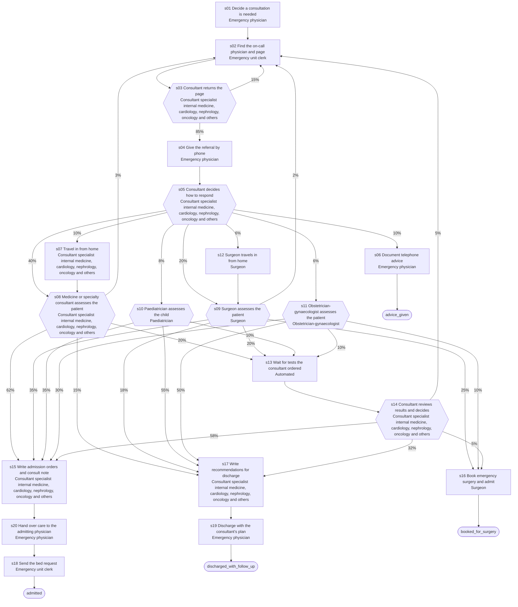

# Obtain specialist consultations in the emergency department

`hosp-ed-specialist-consult` · public hospital (acute care) · emergency department · part of `community-hospital-corp`

When an emergency physician needs a specialist to see, operate on or admit a patient, the unit clerk pages the on-call internist, hospitalist, surgeon, paediatrician or obstetrician, who calls back, takes a phone referral and then comes to the ED. Consultants are usually busy on the wards, in clinic or in the operating room and often come in from home at night, so the patient waits on an ED stretcher for hours. The consultant may order more tests before deciding to admit, operate or discharge with follow-up, and some referrals bounce to another service.

| | |
|---|---|
| Unit of work | one ED consultation |
| Starts when | An emergency physician decides that a specialist must see, operate on or admit the patient. |
| Done when | The specialist has given phone advice, admitted the patient (bed request sent), booked emergency surgery, or returned the patient to the emergency physician for discharge with a follow-up plan. |
| Organisation | A three-site Ontario community hospital corporation with about 160,000 ED visits a year, on-call specialists with admitting privileges paid by OHIP, and no resident trainees. (5,790 employees, 2019-2022) |
| Volume | 1,900 cases a month (range 1,600 to 2,300) |

## Where it sits

- Starts with **consult_request** from ed-physician-assessment (100% of cases)
- Sends **admission_order** to ed-admission-boarding (outcome: admitted)
- Sends **surgical_booking_request** to sx-emergency-surgery (outcome: booked_for_surgery)
- Sends **admission_order** to ed-admission-boarding (outcome: booked_for_surgery)
- Sends **ed_disposition** to ed-discharge-home (outcome: discharged_with_follow_up)
- Sends **clinic_referral** to amb-clinic-referral-booking (outcome: discharged_with_follow_up)
- Sends **consult_note** to ed-physician-assessment (outcome: advice_given)

## Flow

## Roles

| Role | Department | Layer | FTE on this process | Loaded cost per hour | Evidence |
|---|---|---|---:|---:|---|
| Emergency physician | Medical, dental and midwifery staff | senior specialist | 2.5 | 185 CAD | C |
| Emergency unit clerk | Emergency program | individual contributor | 1.5 | 35 CAD | C |
| Consultant specialist (internal medicine, cardiology, nephrology, oncology and others) | Medical, dental and midwifery staff | senior specialist | 9 | 200 CAD | C |
| Surgeon | Medical, dental and midwifery staff | senior specialist | 3 | 240 CAD | C |
| Paediatrician | Medical, dental and midwifery staff | senior specialist | 1 | 185 CAD | C |
| Obstetrician-gynaecologist | Medical, dental and midwifery staff | senior specialist | 0.5 | 215 CAD | C |

## Steps

Hands-on time and the wait before each step show the most common value. Evidence tier A is a sourced number, B a sourced description, C the author's estimate.

| Step | Who | Kind | Hands-on | Wait before | Control | Evidence |
|---|---|---|---:|---:|---|---|
| **s01 Decide a consultation is needed.** The emergency physician, having seen the patient and the first results, decides that a specialist must see the patient or accept them for admission, picks the service and asks the unit clerk to page the on-call physician. | Emergency physician | communication | 2 min | 0 min |  | C |
| **s02 Find the on-call physician and page.** The unit clerk looks up the service's on-call schedule on the intranet or the switchboard list, pages or phones the physician and records the page time on the tracking board. | Emergency unit clerk | lookup | 3 min | 3 min |  | C |
| **s03 Consultant returns the page.** The on-call physician, often in clinic, on the ward or in the operating room, calls back when free. If there is no answer within about 15-30 minutes the clerk pages again or escalates to the backup. | Consultant specialist (internal medicine, cardiology, nephrology, oncology and others) | communication | 2 min | 15 min | Hospital professional staff rules: on-call physicians must answer pages and attend the ED within set times (Public Hospitals Act medical staff by-laws) | B [lee2014] |
| **s04 Give the referral by phone.** The emergency physician presents the patient by phone: complaint, findings, results, what has been done and the question for the specialist, such as admission, surgery or follow-up advice. | Emergency physician | communication | 5 min | 0 min |  | C |
| **s05 Consultant decides how to respond.** The specialist decides whether to give advice by phone, come and see the patient now, or come after finishing the current list, and whether they need to travel in from home after hours. | Consultant specialist (internal medicine, cardiology, nephrology, oncology and others) | judgment | 2 min | 0 min |  | C |
| **s06 Document telephone advice.** The emergency physician records the specialist's advice, changes treatment or arranges clinic follow-up as advised, and keeps responsibility for the patient. | Emergency physician | drafting | 3 min | 5 min |  | C |
| **s07 Travel in from home.** After hours the on-call specialist drives in from home, usually 15 to 40 minutes, after finishing any phone orders for the ward. | Consultant specialist (internal medicine, cardiology, nephrology, oncology and others) | travel | 25 min | 10 min |  | C |
| **s08 Medicine or specialty consultant assesses the patient.** The internist, hospitalist or other specialist reviews the ED record and results, takes their own history and examines the patient, often after finishing ward rounds or clinic patients first. | Consultant specialist (internal medicine, cardiology, nephrology, oncology and others) | analysis | 40 min | 40 min | Hospital professional staff rules: on-call physicians must answer pages and attend the ED within set times (Public Hospitals Act medical staff by-laws) | B [lee2014] |
| **s09 Surgeon assesses the patient.** The general surgeon or orthopaedic surgeon on call sees the patient between operating room cases or after the list ends, examines them and reviews imaging. | Surgeon | analysis | 25 min | 50 min | Hospital professional staff rules: on-call physicians must answer pages and attend the ED within set times (Public Hospitals Act medical staff by-laws) | B [lee2014] |
| **s10 Paediatrician assesses the child.** The paediatrician on call sees the child in the ED, often coming from the paediatric ward or the nursery, and decides on admission or discharge with follow-up. | Paediatrician | analysis | 30 min | 40 min | Hospital professional staff rules: on-call physicians must answer pages and attend the ED within set times (Public Hospitals Act medical staff by-laws) | B [lee2014] |
| **s11 Obstetrician-gynaecologist assesses the patient.** The obstetrician on call, usually in the birthing unit, sees early-pregnancy bleeding, ectopic pregnancy or gynaecological pain in the ED. | Obstetrician-gynaecologist | analysis | 25 min | 40 min | Hospital professional staff rules: on-call physicians must answer pages and attend the ED within set times (Public Hospitals Act medical staff by-laws) | B [lee2014] |
| **s12 Surgeon travels in from home.** After hours the surgeon on call drives in from home, usually 15 to 40 minutes, to see a patient who may need an operation, sometimes after arranging the operating room team by phone. | Surgeon | travel | 25 min | 10 min |  | C |
| **s13 Wait for tests the consultant ordered.** The consultant orders further blood work, ultrasound or CT and the patient waits on the stretcher for the results before the specialist decides. No one works on the consultation while it waits. | Automated | system auto | 0 min | 1.2 h |  | B [lee2014] |
| **s14 Consultant reviews results and decides.** The specialist reviews the new results, re-examines if needed and decides on admission, surgery or discharge with follow-up, or hands the patient to a more suitable service. | Consultant specialist (internal medicine, cardiology, nephrology, oncology and others) | judgment | 6 min | 20 min |  | C |
| **s15 Write admission orders and consult note.** The admitting physician writes the consultation note and admission orders in the hospital system, choosing the unit and level of care, and the patient becomes their responsibility. | Consultant specialist (internal medicine, cardiology, nephrology, oncology and others) | drafting | 15 min | 5 min | Admission only by a physician with admitting privileges (Public Hospitals Act and medical staff by-laws) | C |
| **s16 Book emergency surgery and admit.** The surgeon books the case with the operating room charge nurse by priority category, gets consent, writes pre-operative and admission orders and tells anaesthesia. | Surgeon | coordination | 20 min | 5 min | Informed consent to treatment (Ontario Health Care Consent Act) | C |
| **s17 Write recommendations for discharge.** The specialist writes a consult note with treatment recommendations and arranges a clinic appointment or fracture clinic follow-up, then hands the patient back to the emergency physician. | Consultant specialist (internal medicine, cardiology, nephrology, oncology and others) | drafting | 10 min | 5 min |  | C |
| **s18 Send the bed request.** The unit clerk enters the bed request from the admission orders into the bed board, tells the charge nurse and the bed flow coordinator, and changes the most responsible physician on the tracking board. | Emergency unit clerk | data entry | 5 min | 5 min |  | C |
| **s19 Discharge with the consultant's plan.** The emergency physician reads the consultant's note, writes the discharge plan and prescriptions and confirms the follow-up appointment with the patient. | Emergency physician | drafting | 4 min | 10 min |  | C |
| **s20 Hand over care to the admitting physician.** The emergency physician and the admitting physician agree the time responsibility changes, and the emergency nurse tells the patient and family the admission plan. | Emergency physician | communication | 2 min | 0 min |  | C |

## Exceptions

| Exception | Share of cases | What happens |
|---|---:|---|
| Page not answered | 15% | The on-call physician does not call back in time and is paged again or the backup is called. |
| Consultant orders more tests | 17% | The specialist wants more blood work or imaging before deciding, adding hours on the stretcher. |
| Referral bounced to another service | 3% | The specialist decides the patient belongs to another service, and the paging starts again. |
| Consultant comes in from home | 16% | After hours the specialist travels in before seeing the patient. |

## Benchmarks

| Metric | Value | Unit | Population | Evidence |
|---|---|---|---|---|
| cycle_time_days | p50 0.125, p90 0.33 | calendar days from consultation request to the consultant's disposition decision (about 3 and 8 hours) | Ontario community hospitals 2019-2022, author's estimate | C |
| consult_total_time_minutes | p50 138, p25 82, p75 239 | minutes from consultation request to disposition decision | 285 ED patients at three Canadian tertiary care centres | A [lee2014] |
| consult_response_minutes | p50 55, p25 21, p75 115 | minutes from consultation request to consultant arrival | 285 ED patients at three Canadian tertiary care centres | A [lee2014] |
| share_admitted_after_consult | 0.543 | share of consulted patients admitted | 1,930 ED patients at two Canadian tertiary care EDs | A [cjem_consult_rates] |

## Pain points

- Consultants finish ward rounds, clinics or operating lists before coming to the ED, so the patient waits on a stretcher for hours. (steps s08, s09; B [lee2014])
- Consultants often order further tests before deciding, adding a second wait for results. (steps s13, s14; B [lee2014])
- Paging depends on accurate on-call lists and callbacks; unanswered pages and referrals bounced between services restart the clock. (steps s02, s03; C)

## Assumptions

- The simulated median (about 3.8 hours) is about 1.3 times the estimated 3-hour benchmark and about 1.7 times the tertiary-centre median of 138 minutes (lee2014); the gap reflects community on-call consultants without residents, which is an estimate rather than a measured figure.
- Hospitalists who admit most medical patients in Ontario community hospitals are folded into consultant_specialist because the organisation file does not list hospitalist among this process's roles; the hospitalist role exists in the organisation file.
- Steps s14 and s15 use consultant_specialist for whichever specialist is deciding or admitting; surgeons, paediatricians and obstetricians do this work for their own patients, so their labour cost is slightly understated.
- The consultation ends at the disposition decision with orders written; boarding until an inpatient bed is free is the admission-boarding workflow.
- Mental health crisis consultations are in a separate process (mh-ed-crisis-assessment) and are excluded here.
- The cycle-time benchmark is an estimate; the only Canadian timing study opened was at tertiary centres with residents, where consultants respond faster than community on-call physicians.
- Stated FTE is the consultant time spent on ED consultations, an estimate cross-checked against hands-on time x volume.

## Sources

- [lee2014] [Assessment of consultation impact on emergency department operations through novel metrics of responsiveness and decision-making efficiency](https://www.cambridge.org/core/journals/canadian-journal-of-emergency-medicine/article/assessment-of-consultation-impact-on-emergency-department-operations-through-novel-metrics-of-responsiveness-and-decisionmaking-efficiency/37BFD3C9C7DD952AD88F8A2D11293B6C) (Canadian Journal of Emergency Medicine, Cambridge University Press, 2014). Median 55 min request to consultant arrival, 58 min arrival to decision, 138 min total consultation time, ED length of stay 778 min, 285 patients at three Canadian tertiary centres; delay causes: urgent ward issues, simultaneous ED consultations, additional tests.
- [cjem_consult_rates] [Consultation outcomes in the emergency department: exploring rates and complexity](https://www.cambridge.org/core/journals/canadian-journal-of-emergency-medicine/article/consultation-outcomes-in-the-emergency-department-exploring-rates-and-complexity/D11726D741D9380615A4AE3413F4E90B) (Canadian Journal of Emergency Medicine, Cambridge University Press, 2008). At least one consultation for 38% of 1,930 patients at two tertiary EDs; 54.3% of consulted patients admitted; 92% had one consultation.

Written by claude-opus on 2026-11-24.
