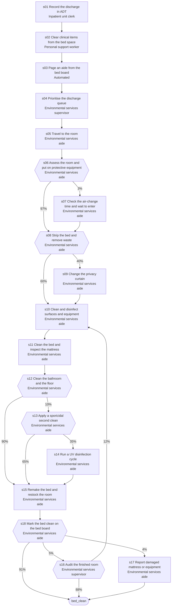

# Clean inpatient beds and rooms after discharge or transfer

`hosp-fs-environmental-cleaning` · healthcare (acute care hospital) · facilities and support services (environmental services) · part of `community-hospital-corp`

When a patient leaves an inpatient bed, the unit clerk records the discharge, nursing staff clear out supplies and equipment, and the bed board pages an environmental services aide to do a discharge clean: strip the bed, disinfect every surface from high to low, clean and inspect the mattress, the bathroom and the floor, change curtains where required and remake the bed. Rooms of patients on isolation precautions need extra steps, such as a sporicidal second clean for C. difficile, a wait for air changes after airborne precautions, or a UV disinfection cycle. The aide marks the bed clean so patient flow can assign it. Beds wait dirty when discharges are entered late, when the aide is busy with other jobs, and in the evening and at night when fewer aides are on shift, while admitted patients wait in the ED.

| | |
|---|---|
| Unit of work | one discharge or transfer clean of an inpatient bed space |
| Starts when | A patient is discharged, transferred or dies, or isolation precautions end, and the unit clerk records it in ADT so the bed shows dirty on the bed board. |
| Done when | The bed space is cleaned, disinfected, made up and marked clean on the bed board; any damaged mattress or equipment is reported to maintenance. |
| Organisation | A not-for-profit Ontario community hospital corporation with three hospitals, about 640 inpatient beds and an emergency department at each site, on a single hospital information system with an electronic bed board. (5,790 employees, 2019-2022) |
| Volume | 3,500 cases a month (range 3,000 to 4,200) |

## Where it sits

- Starts with **cleaning_request** from cs-discharge-planning (80% of cases)
- Starts with **cleaning_request** from med-end-of-life-care (4% of cases)
- Starts with **cleaning_request** from qp-ipac-surveillance (8% of cases)
- Starts with **cleaning_request** from cs-bed-management (8% of cases)
- Relies on **staff_schedule** from hr-staff-scheduling (a standing input; it does not start a case)
- Sends **clean_bed** to cs-bed-management (outcome: bed_clean)
- Sends **work_order** to fs-maintenance (outcome: any)

## Flow

## Roles

| Role | Department | Layer | FTE on this process | Loaded cost per hour | Evidence |
|---|---|---|---:|---:|---|
| Environmental services aide | Environmental services | individual contributor | 26 | 30 CAD | C |
| Environmental services supervisor | Environmental services | supervisor | 2 | 43 CAD | C |
| Manager, support services (environmental, food, plant, security) | Facilities and support services | manager | 0.1 | 76 CAD | C |
| Inpatient unit clerk | Inpatient medicine units | individual contributor | 1 | 35 CAD | C |
| Personal support worker | Inpatient medicine units | individual contributor | 3 | 30 CAD | C |

## Steps

Hands-on time and the wait before each step show the most common value. Evidence tier A is a sourced number, B a sourced description, C the author's estimate.

| Step | Who | Kind | Hands-on | Wait before | Control | Evidence |
|---|---|---|---:|---:|---|---|
| **s01 Record the discharge in ADT.** After the patient leaves the room, the inpatient unit clerk discharges or transfers the patient in ADT, which changes the bed status to dirty on the bed board. Clerks often enter discharges in batches between other tasks, so the bed can sit empty but not yet dirty on the board. | Inpatient unit clerk | data entry | 2 min | 10 min |  | B [khsc_beds] |
| **s02 Clear clinical items from the bed space.** A personal support worker or nurse removes and discards supplies, takes away IV pumps, oxygen and suction equipment, empties bedpans, commodes and suction containers, and bags or discards personal items left behind, as infection control guidance assigns these tasks to clinical staff before the cleaner arrives. | Personal support worker | physical | 8 min | 3 min | PIDAC Best Practices for Environmental Cleaning (2018) section 10.2.1.2 division of discharge tasks between clinical staff and cleaners, adopted in hospital IPAC policy. | B [pidac_env] |
| **s03 Page an aide from the bed board.** The bed board adds the bed to the environmental services discharge queue and pages or calls the wireless phone of the aide assigned to the area, with the room's isolation status. | Automated | system auto | 0 min | 0 min |  | B [khsc_beds] |
| **s04 Prioritise the discharge queue.** The environmental services supervisor watches the queue of dirty beds, moves beds wanted for ED or recovery room patients to the top at the request of patient flow, and moves aides from routine cleaning to discharges when the queue builds. In the evening and at night the supervisor covers several sites by phone. | Environmental services supervisor | coordination | 2 min | 3 min |  | C |
| **s05 Travel to the room.** The aide finishes or pauses the current job, collects the cart and a linen bag and walks to the room, sometimes on another floor or wing. Most of the delay before a clean starts is the aide finishing other work. | Environmental services aide | travel | 5 min | 10 min |  | B [khsc_beds] |
| **s06 Assess the room and put on protective equipment.** The aide checks the precaution sign on the door, walks through the room to see what needs replacing and whether special supplies are needed, removes clutter, prepares fresh disinfectant, cleans hands and puts on gloves and any gown, mask or eye protection the precautions require. | Environmental services aide | physical | 3 min | 0 min | Hospital IPAC policy and Occupational Health and Safety Act duties for PPE use on additional precautions. | B [pidac_env] |
| **s07 Check the air-change time and wait to enter.** After a patient on airborne precautions (tuberculosis, measles, and aerosol-generating care for COVID-19) leaves, the door stays closed with the sign up until enough air changes have cleared the room; the aide waits or goes to another job, unless the bed is urgently needed and the aide cleans in an N95 respirator. | Environmental services aide | validation | 1 min | 45 min | PIDAC environmental cleaning section 11.2 and PIDAC Routine Practices and Additional Precautions: keep the door closed until air changes clear the room or wear an N95 respirator. | B [pidac_env] |
| **s08 Strip the bed and remove waste.** The aide strips the bed, rolling sheets into the soiled linen bag without shaking them, removes and replaces waste and linen bags, checks the sharps container and changes it when three-quarters full, then changes gloves and cleans hands. | Environmental services aide | physical | 4 min | 0 min |  | B [pidac_env] |
| **s09 Change the privacy curtain.** The aide unhooks the privacy curtain, bags it for laundry and hangs a clean one using a step stool. PIDAC added a recommendation in 2018 to change curtains after all discharges, but many hospitals changed them only for isolation rooms or when visibly soiled during this period. | Environmental services aide | physical | 8 min | 0 min | PIDAC Best Practices for Environmental Cleaning (2018) recommendation that privacy curtains be changed after all discharges. | B [pidac_env], [ankrum2019] |
| **s10 Clean and disinfect surfaces and equipment.** Working from clean to dirty and high to low with a fresh disinfectant cloth for each bed space, the aide cleans the door and handles, light switches, wall-mounted dispensers, the over-bed and bedside tables, chairs, call bell, telephone and television, IV pole and other equipment left in the room, and the inside and outside of the patient locker. | Environmental services aide | physical | 9 min | 0 min |  | B [pidac_env], [remi_caem] |
| **s11 Clean the bed and inspect the mattress.** The aide cleans the top and sides of the mattress, turns it to clean the underside, checks it for cracks, holes and fluid ingress, cleans the bed frame, rails, controls, headboard, footboard and casters, and leaves the mattress to dry. | Environmental services aide | physical | 5 min | 0 min |  | B [pidac_env] |
| **s12 Clean the bathroom and the floor.** The aide cleans and disinfects the sink, toilet, grab bars, shower and bedpan cleaner, changing cloths after the toilet, then dust-mops and damp-mops the room floor, putting out a wet-floor sign. | Environmental services aide | physical | 7 min | 0 min |  | B [pidac_env] |
| **s13 Apply a sporicidal second clean.** For rooms of patients with C. difficile, VRE or CPE, two aides do a second full clean of the room and bathroom with a sporicidal agent, discard and replace all paper products, soap and the toilet brush, remove the curtains and leave surfaces wet for the product's contact time. | Environmental services aide | physical | 20 min | 0 min | PIDAC Best Practices for Environmental Cleaning (2018): sporicide after each C. difficile discharge, required policies for C. difficile, VRE and CPE rooms (recommendation 85); hospitals must follow PIDAC under their IPAC accountability. | B [pidac_env] |
| **s14 Run a UV disinfection cycle.** The aide wheels the ultraviolet disinfection device into the empty room, positions it for line of sight to high-touch surfaces, seals the door with a warning sign, starts the cycle and returns to move and restart it for the bathroom. The room cannot be used during the cycle. | Environmental services aide | physical | 8 min | 20 min | Manufacturer and hospital safety procedure: no one in the room during UV exposure. | B [ankrum2019], [pidac_env] |
| **s15 Remake the bed and restock the room.** The aide removes gloves and cleans hands, makes the bed with clean linen, replenishes gloves, hand rub, soap and paper towels, and returns cleaned equipment such as IV poles and commodes to the clean storage room. | Environmental services aide | physical | 5 min | 0 min |  | B [pidac_env] |
| **s18 Mark the bed clean on the bed board.** The aide enters the bed's clean status on the bed board by phone code or terminal before leaving the unit, which tells patient flow the bed can be assigned and closes the cleaning job with a completion time used for turnaround reports. | Environmental services aide | data entry | 1 min | 0 min |  | B [khsc_beds] |
| **s16 Audit the finished room.** The supervisor checks a sample of finished discharge cleans with a checklist and fluorescent marker dots placed before cleaning, records which high-touch items were cleaned and gives the aide feedback; a failed room is recleaned before it is used. | Environmental services supervisor | review | 8 min | 5 min | PIDAC audit and feedback recommendations and Accreditation Canada infection prevention and control standards for cleaning audits. | B [pidac_env], [remi_caem] |
| **s17 Report damaged mattress or equipment.** The aide phones or enters a work order in the maintenance system for a torn mattress, broken bed control or damaged furniture, takes a damaged mattress out of service and asks for a replacement so the bed can be used. | Environmental services aide | data entry | 5 min | 0 min |  | B [pidac_env] |

## Exceptions

| Exception | Share of cases | What happens |
|---|---:|---|
| Isolation room with sporicidal clean | 10% | C. difficile, VRE or CPE rooms get a two-person sporicidal second clean, sometimes followed by UV disinfection. |
| Airborne precautions room | 3% | The room stays closed until air changes clear it before the aide can enter. |
| Curtain change | 40% | The privacy curtain is changed for isolation, soiling or by hospital policy. |
| Audit failure | 1% | An audited room fails and is recleaned. |
| Damaged mattress | 4% | A damaged mattress or bed part is reported to maintenance and replaced. |

## Benchmarks

| Metric | Value | Unit | Population | Evidence |
|---|---|---|---|---|
| cycle_time_days | p50 0.07, p90 0.15 | days from patient leaving to bed marked clean | Inpatient discharge cleans, Ontario community hospital, 2019-2022 | B [khsc_beds], [ankrum2019] |
| discharge_clean_hands_on_minutes | typical 25, range_low 25, range_high 57 | minutes | Discharge clean of one room | A [khsc_beds], [ankrum2019] |
| response_time_to_bed | 40 | minutes from page to aide at bed (average) | Kingston Health Sciences Centre discharge team, 2014 | A [khsc_beds] |
| routine_daily_clean_minutes | private 17, semi_private 24, ward 38 | minutes | Canadian hospitals surveyed by CAEM | A [remi_caem] |

## Pain points

- Most of the turnaround is waiting for an aide to finish other work and reach the room, not the clean itself; evening and night shifts have fewer aides when many discharges happen. (steps s05; B [khsc_beds])
- Discharges entered late in ADT leave beds empty but not on the cleaning queue. (steps s01; C)
- Equipment and body-fluid containers left by clinical staff delay the aide and blur who does what. (steps s02, s06; B [pidac_env])
- Isolation cleans take two aides and longer, plus air-change waits and UV cycles, and isolation rooms are the ones most needed for new isolated patients. (steps s07, s13, s14; A [ankrum2019])
- Canadian EVS departments were often short-staffed for the cleaning standard expected, which lengthens waits and risks missed surfaces. (steps s05, s10; B [pidac_env], [remi_caem])

## Assumptions

- The process covers discharge and transfer cleans of inpatient bed spaces; routine daily cleaning, ED stretcher cleaning and operating room turnover are other work.
- The bed is held from the discharge entry to clean (s01, s18); the occupied minutes are split across medicine (65%) and surgical (25%) beds by expected share, so each figure is the expected minutes per case. Maternity, paediatric and mental health beds are not given a resource here because the process map lists none for this process.
- A UV disinfection device is added as a resource not in the organisation file; three devices across the corporation is the author's estimate, and its use on 35% of sporicidal cleans is tier C.
- PIDAC's 3rd edition (2018) text was opened in a file revised in November 2025 whose pages are still marked April 2018; only 2018 content is relied on.
- The 40% curtain-change share reflects partial adoption of PIDAC's 2018 recommendation to change curtains after every discharge.
- The unit clerk and personal support worker steps are included though the process map entry lists only EVS roles, because the clean cannot start until the discharge is entered and the room is cleared.
- The simulated median (about 2.6 hours from the patient leaving to the bed marked clean) is above the benchmark p50 of 100 minutes. The 65-minute Kingston figure was for a dedicated day and evening discharge team measured from the page; this model adds discharge-entry lag, clinical clearing and evening and night cleans by aides who also do routine cleaning, and sums the cleaning tasks in sequence (about 45 minutes) where an experienced aide overlaps them. The gap is kept rather than shortening every task below the published cleaning procedure.
- Shares of the triggers are the author's split: about 80% discharges via discharge planning, 8% isolation changes, 8% internal transfers requested through patient flow and 4% deaths.

## Sources

- [pidac_env] [Best Practices for Environmental Cleaning for Prevention and Control of Infections in All Health Care Settings, 3rd Edition (April 2018 text, opened in the 2025 revised file)](https://www.publichealthontario.ca/-/media/documents/b/2018/bp-environmental-cleaning.pdf) (Public Health Ontario, Provincial Infectious Diseases Advisory Committee (PIDAC), 2018). Section 10.2.1.2 and Appendix 6: split of discharge tasks between clinical staff (remove supplies, equipment, body fluids, personal articles) and cleaners; discharge clean steps (assess, PPE, strip linen, clean high to low, clean and inspect mattress, bathroom, floor, remake bed, replenish); sporicide after each C. difficile discharge; airborne rooms kept closed until enough air changes; privacy curtains changed after all discharges (new 2018 recommendation); staffing levels set from average cleaning times; audits with fluorescent markers and feedback.
- [remi_caem] [Canadian study examines hospital cleaning times](https://www.reminetwork.com/?p=13326) (REMI Network (MediaEdge Communications), 2016). Canadian Association of Environmental Management survey of Canadian hospitals: routine daily clean 17 minutes for a private room, 24 for semi-private, 38 for a ward; benchmarks of 25 to 30 minutes (CDC), 14 to 16 (1985 Canadian program), 12 to 21 (ISSA); more than half of EVS managers reported too few staff to meet cleaning standards.
- [khsc_beds] [Preventing gridlock: New bed notification system helping smooth patient flow](https://kingstonhsc.ca/node/2927) (Kingston Health Sciences Centre, 2014). Ontario hospital discharge cleaning team: unit clerks update the patient care system at discharge, which pages a discharge-team cleaner; just under 40 minutes on average to reach the bed and about 25 minutes to clean, about 65 minutes in total; bed allocators assign the next patient while the bed is being cleaned and keep the ED informed.
- [ankrum2019] [Reduced isolation room turnover time using Lean methodology](https://www.cambridge.org/core/journals/infection-control-and-hospital-epidemiology/article/abs/reduced-isolation-room-turnover-time-using-lean-methodology/67F36F4EEBEF64610F1BDED4079B3E8E) (Infection Control & Hospital Epidemiology 40(10), Cambridge University Press, 2019). Isolation room turnover (patient exits to end of UV disinfection) at a US paediatric hospital: median 130 minutes (range 93 to 294) at baseline and 65 after Lean changes; cleaning plus curtain change 57 minutes at baseline; 36 minutes median from end of cleaning to start of UV disinfection at baseline.

Written by claude-opus on 2026-11-24.
