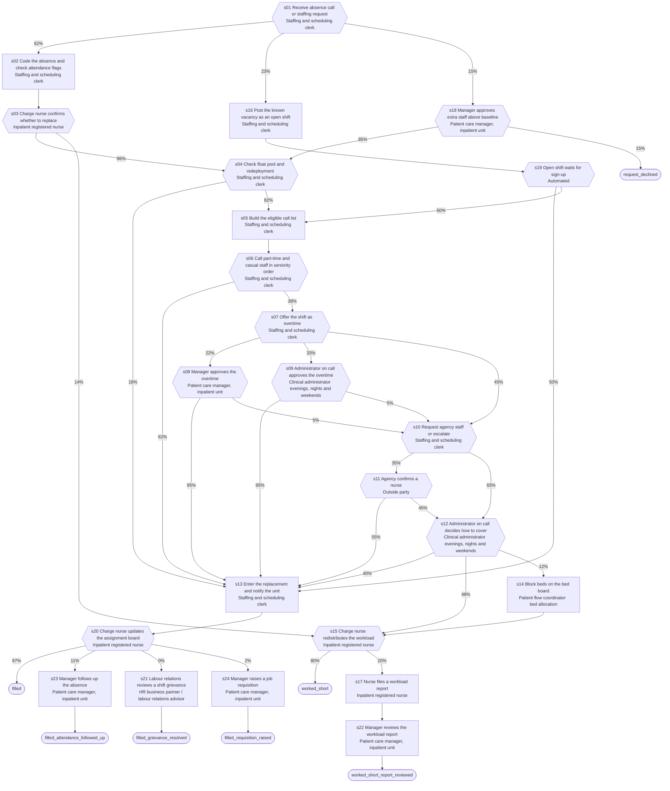

# Schedule shifts and fill sick calls

`hosp-hr-staff-scheduling` · hospitals · human resources (staffing office) · part of `community-hospital-corp`

A central staffing office fills each shift that opens up after the six-week schedule is posted: sick calls a few hours before a shift, known leaves and vacant lines, and requests for extra staff when acuity or census rises. Clerks confirm with the charge nurse that the shift must be filled, then phone or text part-time and casual staff in seniority order, offer overtime, ask for approval, call an agency or escalate to the administrator on call. The work is slow because calls go one at a time with response windows and collective agreement rules on seniority, hours and rest, and mistakes lead to grievances, pay errors or units working short.

| | |
|---|---|
| Unit of work | one shift vacancy to fill |
| Starts when | An employee calls in sick or absent, a leave or vacant line leaves a hole in the posted schedule, or a unit asks for staff above its baseline plan. |
| Done when | The shift is filled and the replacement is recorded with a pay code, or the shift is covered by working short or closing beds, or the request is declined; any grievance, workload report or attendance follow-up is recorded. |
| Organisation | A three-site Ontario community hospital corporation with about 4,900 employees, most of them unionized (ONA, OPSEU, CUPE, SEIU), and a central staffing office open about 16 hours a day using a staff scheduling and time-and-attendance system with phone, text and voicemail. (5,790 employees, 2019-2022) |
| Volume | 4,000 cases a month (range 3,000 to 6,000) |

## Where it sits

- Starts with **staffing_request** from med-inpatient-medical-care (40% of cases)
- Starts with **staffing_request** from ed-patient-triage (12% of cases)
- Starts with **staffing_request** from med-icu-critical-care (6% of cases)
- Starts with **staffing_request** from wc-labour-delivery (7% of cases)
- Starts with **staffing_request** from sx-perioperative-case (8% of cases)
- Starts with **staffing_request** from fs-environmental-cleaning (7% of cases)
- Starts with **staffing_request** from cs-bed-management (12% of cases)
- Starts with **work_status_update** from hr-occupational-health (8% of cases)
- Relies on **collective_agreement** from hr-labour-relations (a standing input; it does not start a case)
- Relies on **new_hire** from hr-recruitment-onboarding (a standing input; it does not start a case)
- Sends **staff_schedule** to med-inpatient-medical-care (outcome: any)
- Sends **staff_schedule** to ed-patient-triage (outcome: any)
- Sends **staff_schedule** to med-icu-critical-care (outcome: any)
- Sends **staff_schedule** to wc-labour-delivery (outcome: any)
- Sends **staff_schedule** to sx-perioperative-case (outcome: any)
- Sends **staff_schedule** to fs-environmental-cleaning (outcome: any)
- Sends **timesheet** to hr-payroll (outcome: filled)
- Sends **timesheet** to hr-payroll (outcome: filled_attendance_followed_up)
- Sends **timesheet** to hr-payroll (outcome: filled_grievance_resolved)
- Sends **timesheet** to hr-payroll (outcome: filled_requisition_raised)
- Sends **job_requisition** to hr-recruitment-onboarding (outcome: filled_requisition_raised)
- Sends **bed_status_update** to cs-bed-management (outcome: worked_short)
- Sends **grievance** to hr-labour-relations (outcome: filled_grievance_resolved)

## Flow

## Roles

| Role | Department | Layer | FTE on this process | Loaded cost per hour | Evidence |
|---|---|---|---:|---:|---|
| Staffing and scheduling clerk | Staffing office | individual contributor | 16.5 | 35 CAD | B [src4], [src3] |
| Inpatient registered nurse | Inpatient medicine units | individual contributor | 6.3 | 61 CAD | B [src2] |
| Patient care manager, inpatient unit | Medicine and critical care program | manager | 2 | 78 CAD | C |
| Clinical administrator (evenings, nights and weekends) | Patient flow and bed management | supervisor | 1.4 | 68 CAD | B [src2] |
| Patient flow coordinator (bed allocation) | Patient flow and bed management | senior specialist | 0.1 | 63 CAD | C |
| HR business partner / labour relations advisor | Human resources and labour relations | senior specialist | 0.3 | 61 CAD | C |

## Steps

Hands-on time and the wait before each step show the most common value. Evidence tier A is a sourced number, B a sourced description, C the author's estimate.

| Step | Who | Kind | Hands-on | Wait before | Control | Evidence |
|---|---|---|---:|---:|---|---|
| **s01 Receive absence call or staffing request.** The staffing clerk answers the staffing line or plays back voicemail from an employee calling in sick, or takes a request from a unit for extra staff, or picks up an unfilled line on the posted schedule. The clerk notes the employee, unit, shift, job class and reason, and sorts the case as a short-notice absence, a known vacancy or a request above the baseline staffing plan. | Staffing and scheduling clerk | intake | 3 min | 5 min |  | B [src4], [src1] |
| **s02 Code the absence and check attendance flags.** The clerk opens the employee's schedule in the scheduling system, replaces the shift with an absence code (sick, family emergency, bereavement, WSIB), checks the sick-time balance and whether the absence triggers the attendance support threshold, and notes when the employee expects to return. | Staffing and scheduling clerk | data entry | 2 min | 0 min | Hospital attendance support program and sick leave plan rules in the collective agreements | B [src4] |
| **s03 Charge nurse confirms whether to replace.** The clerk phones or pages the RN in charge of the unit, who looks at the census, expected admissions and discharges and patient acuity against the unit's staffing pattern, and decides whether the shift must be filled, can be covered by moving patients between the remaining staff, or needs a different job class. | Inpatient registered nurse | judgment | 5 min | 15 min |  | B [src2] |
| **s04 Check float pool and redeployment.** The clerk looks in the scheduling system for float or resource-pool staff already booked for the shift, and for staff on overstaffed units who could be moved, and checks that they are oriented to the unit before assigning them. | Staffing and scheduling clerk | lookup | 3 min | 5 min |  | C |
| **s05 Build the eligible call list.** The clerk pulls the seniority list for the unit and job class and filters it to part-time and casual staff who submitted availability for that date, are under their commitment or hours cap, would not be on overtime, have twelve hours' rest since their last shift and are oriented to the unit. | Staffing and scheduling clerk | lookup | 4 min | 0 min | Collective agreement order for offering additional shifts (regular part-time by seniority and availability, then casual, then full-time at overtime), hours equalization and minimum rest between shifts | B [src1], [src2] |
| **s06 Call part-time and casual staff in seniority order.** The clerk phones or texts each person on the list in turn, leaves a message, and waits a set response window (for example five minutes when the shift starts within eight hours) before moving to the next name, logging each call and answer for grievance protection. | Staffing and scheduling clerk | communication | 12 min | 15 min | Collective agreement order for offering additional shifts (regular part-time by seniority and availability, then casual, then full-time at overtime), hours equalization and minimum rest between shifts | B [src5], [src1], [src6] |
| **s07 Offer the shift as overtime.** When no one accepts at straight time, the clerk offers the shift at premium rates to full-time staff and to part-time staff who would go over their hours, again in seniority order, or asks staff on the shift before to stay over part of the shift. | Staffing and scheduling clerk | communication | 8 min | 10 min | Collective agreement order for offering additional shifts (regular part-time by seniority and availability, then casual, then full-time at overtime), hours equalization and minimum rest between shifts | B [src1], [src7] |
| **s08 Manager approves the overtime.** On weekdays the clerk phones or emails the unit's patient care manager, who checks the overtime against the unit budget and whether another unit could lend staff, then approves or declines the premium shift. | Patient care manager, inpatient unit | approval | 3 min | 30 min | Hospital overtime pre-approval policy (budget holder approval for premium hours) | C |
| **s09 Administrator on call approves the overtime.** Outside office hours the clerk pages the clinical administrator on call, who weighs the overtime against staffing across the site that shift and approves or declines it by phone; the clerk records the approver's name. | Clinical administrator (evenings, nights and weekends) | approval | 4 min | 20 min | Hospital overtime pre-approval policy (administrator on call approves after hours) | C |
| **s10 Request agency staff or escalate.** If the unit is one where agency nurses are allowed (often critical care, emergency or maternity), the clerk phones or emails the contracted nursing agency with the shift, unit and skills needed; otherwise the clerk reports the unfilled shift to the administrator on call. | Staffing and scheduling clerk | communication | 8 min | 5 min |  | C |
| **s11 Agency confirms a nurse.** The nursing agency searches its roster for a nurse with the required experience and orientation to the hospital and calls back to confirm a name, or says no one is available for that shift. | Outside party | external wait | 0 min | 2.0 h |  | C |
| **s12 Administrator on call decides how to cover.** The administrator on call reviews staffing across all units for the shift, then moves a nurse from a less busy unit, approves a unit to work short with adjusted assignments, or, when staffing is unsafe, closes or holds beds so the bed flow team stops sending admissions. | Clinical administrator (evenings, nights and weekends) | judgment | 20 min | 30 min | Hospital safe staffing and staffing escalation policy: administrator decides redeployment, working short or bed closure | C |
| **s13 Enter the replacement and notify the unit.** The clerk books the replacement into the shift in the scheduling system with the right pay code (straight time, overtime, redeployment or agency), updates the daily staffing sheet and phones the unit so the charge nurse knows who is coming. | Staffing and scheduling clerk | data entry | 4 min | 2 min |  | B [src4] |
| **s14 Block beds on the bed board.** A patient flow coordinator marks the closed or held beds as unavailable on the electronic bed board, tells the emergency department and the admitting physicians, and sets a time to review whether the beds can reopen at the next shift. | Patient flow coordinator (bed allocation) | data entry | 10 min | 10 min |  | C |
| **s15 Charge nurse redistributes the workload.** The RN in charge reassigns patients among the nurses on shift, takes a patient assignment personally if needed, asks for help with breaks from other units and documents the short staffing on the unit staffing record. | Inpatient registered nurse | coordination | 20 min | 10 min |  | C |
| **s16 Post the known vacancy as an open shift.** For a vacancy known days or weeks ahead, the clerk posts the shift on the open-shift list (paper board or scheduling system) when the six-week schedule is posted or when the leave is approved, so eligible staff can sign up. | Staffing and scheduling clerk | data entry | 5 min | 4.0 h | Collective agreement order for offering additional shifts (regular part-time by seniority and availability, then casual, then full-time at overtime), hours equalization and minimum rest between shifts | B [src1] |
| **s17 Nurse files a workload report.** After the shift a nurse who felt patient care was put at risk completes the union's professional responsibility workload report form, describing the staffing and patient acuity, and gives it to the manager. | Inpatient registered nurse | drafting | 25 min | 8.0 h | ONA hospital collective agreement professional responsibility workload process | C |
| **s18 Manager approves extra staff above baseline.** The unit manager (or the administrator on call after hours) checks the reason for the extra-staff request, such as a patient needing one-to-one observation, high acuity or surge beds opened, against the staffing budget and approves or declines it. | Patient care manager, inpatient unit | approval | 6 min | 1.0 h | Hospital staffing budget and approval policy for staffing above the baseline plan | B [src2] |
| **s19 Open shift waits for sign-up.** The posted shift stays on the open-shift list until an eligible employee signs up or the clerk starts calling within a few days of the shift date; the scheduling system shows who has requested it. | Automated | system auto | 0 min | 2.0 d |  | B [src6] |
| **s20 Charge nurse updates the assignment board.** Once told who is coming, the RN in charge adds the replacement to the patient assignment sheet and adjusts assignments if the replacement is from another unit or an agency and needs a lighter or familiar assignment. | Inpatient registered nurse | coordination | 4 min | 0 min |  | C |
| **s21 Labour relations reviews a shift grievance.** An employee who was not offered a shift in seniority order files a grievance through the union; the labour relations advisor reviews the call log and seniority list, meets the union and settles, often by paying the missed shift. | HR business partner / labour relations advisor | review | 3.0 h | 7.0 d | Collective agreement grievance procedure under the Ontario Labour Relations Act and hospital arbitration rules | B [src2] |
| **s22 Manager reviews the workload report.** The unit manager reads the workload report, discusses it with the nurse and the union representative at the next workload meeting, and records any changes to the staffing pattern or escalation. | Patient care manager, inpatient unit | review | 30 min | 5.0 d | ONA hospital collective agreement professional responsibility workload process | C |
| **s23 Manager follows up the absence.** The manager reviews the employee's absence record flagged by the staffing office, and if it crosses the attendance support threshold, meets the employee or asks for a medical note, or refers a longer absence to occupational health. | Patient care manager, inpatient unit | review | 10 min | 3.0 d | Hospital attendance support program | C |
| **s24 Manager raises a job requisition.** When the same line keeps going vacant because of a long leave or resignation, the manager completes a requisition in the HR system to post a permanent or temporary position. | Patient care manager, inpatient unit | drafting | 20 min | 3.0 d |  | C |

## Exceptions

| Exception | Share of cases | What happens |
|---|---:|---|
| Nobody accepts and the unit works short | 7% | Straight-time and overtime offers fail, no agency nurse is available and no other unit can lend staff, so the charge nurse redistributes patients; about one in five such shifts leads to a workload report. |
| Beds closed for lack of staff | 1% | The administrator on call closes or holds beds for the shift so the unit is safe with the staff it has; the bed board is updated and admissions wait in the emergency department. |
| Shift offered out of seniority order | 0% | A senior part-time employee was skipped or not given the response window; the union grieves and the hospital usually pays the missed shift. |
| Long absence referred to occupational health | 3% | A sick call becomes a multi-week absence; the manager refers the employee to occupational health and the staffing office books replacements for every shift until a work status update arrives. |

## Benchmarks

| Metric | Value | Unit | Population | Evidence |
|---|---|---|---|---|
| cycle_time_days | p50 0.15, p90 4.0 | calendar days from the vacancy being reported to the shift being filled or closed | Shift vacancies at an Ontario community hospital, 2019-2022 | C [src1] |
| relief_shifts_filled_per_scheduler_day | low 12, high 20 | shifts per scheduler per day with sequential phone call-out | Island Health, British Columbia, before automated call-out (about 2015) | A [src5] |
| posted_shift_fill_rate | 0.7 | share of shifts posted through an app that were filled | Stevenson Memorial Hospital (Ontario) pilot, 2017-2018 | A [src6] |
| sick_days_per_year | 2021 14.7, 2022 19.0 | days absent for illness or disability per employee | Nurses and allied health professionals, Canada | A [src7] |

## Pain points

- Calling staff one at a time with response windows takes most of the clerks' day; a scheduler could fill only about 12-20 shifts a day by phone. (steps s06, s07; B [src5], [src6])
- Seniority, availability, hours-equalization and rest rules are applied by hand from lists; a slip leads to a grievance and a paid missed shift. (steps s05, s06, s21; B [src2])
- Overtime and agency use need a manager or administrator on call to approve, which adds waiting at the busiest times of day. (steps s08, s09, s10; C)
- When nobody can be found, the unit works short or beds close, which slows admissions from the emergency department. (steps s12, s14, s15; C)

## Assumptions

- One case is one shift vacancy. Building and posting the six-week master schedule (a batch job done per unit) is not walked step by step. Clerk hands-on time per vacancy is set to about 30-40 minutes so that 4,000 vacancies a month fit within the 20 staffing clerks in the organisation file, consistent with Island Health schedulers filling 12-20 shifts a day by phone; clerk time on schedule building and payroll data is outside this file.
- The charge nurse is represented by the inpatient RN role (med_rn) and the approving manager by the medicine patient care manager role (med_manager), although the same steps happen on emergency, critical care, maternity, surgical and support-service units with their own managers.
- Pay codes and time entries flow to payroll each pay period through the scheduling system; manager timecard approval belongs to the payroll process and is not included.
- Shares of sick calls, known vacancies and extra-staff requests, the acceptance rates at each stage and all step times are the author's estimates unless a step cites a source; Ontario collective agreement rules come from a 2025 college textbook quoting a 2021-2023 local appendix and are assumed to match 2019-2022 practice.
- The simulated median cycle time is a few hours, driven by short-notice sick calls; the 90th percentile of several days comes from known vacancies posted ahead and from attendance follow-ups and grievances that finish later.
- Loaded costs come from the organisation file (wage times 1.35). Agency invoices and overtime premiums are not labour cost in this file.

## Sources

- [src1] [Staffing and Scheduling Provisions in a Collective Agreement (Hospital Unit Administration, chapter 3)](https://ecampusontario.pressbooks.pub/hospitalunitadministration/chapter/staffing-and-scheduling-provisions-in-collective-agreement/) (eCampusOntario Pressbooks (N. Weatherhead), 2025). Typical Ontario hospital collective agreement rules: schedules posted 3 to 6 weeks ahead and 4 to 8 weeks long; additional shifts offered by seniority to regular part-time, then casual, then full-time at overtime; ONA cancellation notice 24 h part-time and 48 h full-time; sick calls ideally 4 h before shift; 12 h between shifts; example of a 5-minute response window before calling the next person (ONA and Grand River Hospital local appendix 2021-2023).
- [src2] [Adjusting the Master Schedule Based on Unit Requirements (Hospital Unit Administration, chapter 3)](https://ecampusontario.pressbooks.pub/hospitalunitadministration/chapter/adjusting-the-master-schedule-based-upon-unit-requirements/) (eCampusOntario Pressbooks (N. Weatherhead), 2025). Unit clerk and charge nurse project census, apply staffing ratios, compare with booked staff and sick calls and add or cancel staff by collective agreement order; RN staffing reviewed 24-48 h ahead; seniority plus hours equalization rules; daily staffing errors lead to individual grievances.
- [src3] [Introduction to Staff Scheduling (Hospital Unit Administration, chapter 3)](https://ecampusontario.pressbooks.pub/hospitalunitadministration/chapter/introduction-to-staff-scheduling/) (eCampusOntario Pressbooks (N. Weatherhead), 2025). Centralized, decentralized and hybrid hospital staffing offices; scheduling clerks assigned to units working with unit managers; hospitals moving to automated call-out and scheduling apps.
- [src4] [Provincial Job Description: (213) Staff Scheduler](https://www.working-for-health.ca/media/pdf/213%20JD%20Staff%20Scheduler.pdf) (Saskatchewan Association of Health Organizations and health unions (working-for-health.ca), 2024). Staff scheduler duties: maintain master rotation under collective agreements, call and schedule replacements for short-notice absences, adjust schedules in a computerized system, maintain seniority lists, post replacement lists, submit data and pay codes to payroll.
- [src5] [Relief nurse scheduling improved using Vocantas](https://www.canhealth.com/2016/02/17/relief-nurse-scheduling-improved-using-vocantas/) (Canadian Healthcare Technology, 2016). Island Health (BC): schedulers phoning staff one at a time filled about 12 to 20 relief shifts per day each; short-notice replacement often arranged at the last minute; 119 schedulers; after automated call-out some filled 40 a day.
- [src6] [ShiftLink app fills shifts at Stevenson hospital](https://www.canhealth.com/2018/12/05/shiftlink-app-fills-shifts-at-stevenson-hospital/) (Canadian Healthcare Technology, 2018). Ontario community hospital: staff previously made dozens of calls to fill a shift; app pilot from November 2017 reported a 70% fill rate for posted shifts, about three responses per post and an 82.5% reduction in call-outs.
- [src7] [Nurses: Working harder, more hours amid increased labour shortage](https://statcan.gc.ca/o1/en/plus/4165-nurses-working-harder-more-hours-amid-increased-labour-shortage) (Statistics Canada, 2023). Nurses and allied health professionals averaged 14.7 days absent for illness or disability in 2021 and 19 days in 2022; nurses had the largest increase of any occupation group from 2019 to 2020 (+4.2 days); 30.3% of nursing employees worked overtime in 2022, averaging 8.2 overtime hours a week; RN vacancies rose 117% from Q4 2019 to Q4 2021.

Written by claude-opus on 2026-11-24.
