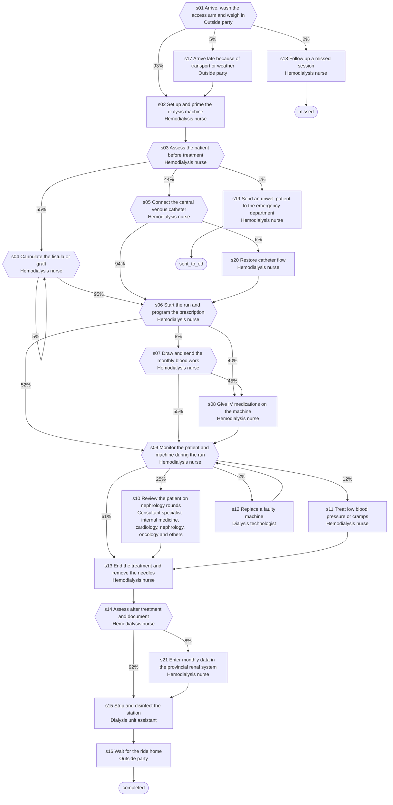

# Provide in-centre hemodialysis

`hosp-med-hemodialysis` · healthcare (public hospital) · medicine and critical care program · part of `community-hospital-corp`

People whose kidneys have failed come to the hospital's dialysis unit three times a week for treatments of about four hours, on a fixed chair and shift. A hemodialysis nurse, usually caring for three patients at once, sets up the machine, assesses the patient, puts two needles into the fistula or connects the central catheter, runs and watches the treatment, gives medications and monthly blood work, and ends the run; an assistant then cleans the station for the next patient, and nephrologists review patients on weekly rounds. Late patient transport, low blood pressure on the machine, access problems and machine faults push back the whole shift.

| | |
|---|---|
| Unit of work | one dialysis session |
| Starts when | A patient on the unit's standing schedule arrives for a booked chair and shift under a nephrologist's dialysis prescription. |
| Done when | The treatment is complete and documented, the patient has left the unit and the station is cleaned for the next shift; or the patient was sent to the emergency department or missed the session. |
| Organisation | A three-site Ontario community hospital corporation running about 40 in-centre hemodialysis stations on three patient shifts a day, six days a week, with a home dialysis program. (5,790 employees, 2019-2022) |
| Volume | 3,130 cases a month (range 3,095 to 3,165) |

## Where it sits

- Starts with **dialysis_prescription** from amb-clinic-visit (100% of cases)
- Sends **lab_specimen** to dx-lab-testing (outcome: any)
- Sends **renal_activity_report** to ontario_health (outcome: any)
- Sends **cleaning_request** to fs-environmental-cleaning (outcome: completed)
- Sends **ed_patient** to ed-patient-triage (outcome: sent_to_ed)
- Sends **medication_order** to cs-pharmacy-order-verification (outcome: any)
- Sends **device_service_request** to fs-biomedical-equipment (outcome: any)

## Flow

## Roles

| Role | Department | Layer | FTE on this process | Loaded cost per hour | Evidence |
|---|---|---|---:|---:|---|
| Hemodialysis nurse | Renal dialysis program | individual contributor | 42 | 62 CAD | B [blake2020], [lhsc_renal] |
| Dialysis technologist | Renal dialysis program | individual contributor | 2 | 40 CAD | C |
| Dialysis unit assistant | Renal dialysis program | individual contributor | 6 | 31 CAD | B [blake2020] |
| Consultant specialist (internal medicine, cardiology, nephrology, oncology and others) | Medical, dental and midwifery staff | senior specialist | 2 | 200 CAD | C |
| Patient care manager, inpatient unit | Medicine and critical care program | manager | 0.5 | 78 CAD | C |

## Steps

Hands-on time and the wait before each step show the most common value. Evidence tier A is a sourced number, B a sourced description, C the author's estimate.

| Step | Who | Kind | Hands-on | Wait before | Control | Evidence |
|---|---|---|---:|---:|---|---|
| **s01 Arrive, wash the access arm and weigh in.** The patient arrives by car, taxi, accessible transit or patient transport, washes the fistula arm, steps on the unit scale, and waits in the waiting room until the station from the previous shift has been cleaned. | Outside party | intake | 5 min | 5 min |  | C |
| **s02 Set up and prime the dialysis machine.** The nurse checks the station's machine passed its self-test and disinfection, hangs the dialyser and blood lines, primes them with saline and sets the dialysate bath to the patient's prescription. Often this is done while the patient is weighing in. | Hemodialysis nurse | physical | 10 min | 5 min | Pre-treatment machine safety check (alarm, conductivity and disinfectant-residual tests) | B [grundler2021] |
| **s03 Assess the patient before treatment.** The nurse compares the weight with the target dry weight to set the fluid removal goal, takes blood pressure, pulse and temperature, asks about symptoms since the last run, screens for infection, and looks, listens and feels the access for a thrill or signs of infection. | Hemodialysis nurse | judgment | 10 min | 5 min |  | C |
| **s04 Cannulate the fistula or graft.** The nurse cleans the skin, inserts the arterial and venous needles using the patient's usual sites or buttonholes, tapes them, and checks flow with a saline flush. A missed or infiltrated needle needs another attempt, often by a more senior nurse. | Hemodialysis nurse | physical | 8 min | 0 min | Vascular access cannulation protocol and infection prevention (skin antisepsis) | B [blake2020] |
| **s05 Connect the central venous catheter.** Wearing mask and sterile gloves, the nurse removes the caps, scrubs the hubs, withdraws the lock solution, checks both lumens flush and draw, and connects the lines; poor flow is reversed or treated. | Hemodialysis nurse | physical | 10 min | 0 min | Central line access protocol (aseptic technique) per IPAC best practice | C |
| **s06 Start the run and program the prescription.** The nurse connects the blood lines, starts the blood pump, gives the heparin dose, and programs treatment time, blood flow, fluid removal and dialysate settings, then checks pressures and that every alarm is armed before documenting the start. | Hemodialysis nurse | physical | 6 min | 0 min |  | B [blake2020] |
| **s07 Draw and send the monthly blood work.** On the unit's monthly blood-work day the nurse draws pre-dialysis samples from the access before heparin and post-dialysis urea afterwards, labels them from the standing order in the laboratory system and sends them to the laboratory. | Hemodialysis nurse | physical | 8 min | 0 min | Two-identifier specimen labelling at the bedside | C |
| **s08 Give IV medications on the machine.** The nurse checks the electronic medication record and gives the scheduled intravenous medications into the blood line: the erythropoiesis-stimulating agent, iron and vitamin D analogue doses set by the anaemia and bone protocols, recording each in the eMAR. | Hemodialysis nurse | physical | 5 min | 0 min | Medication administration policy (eMAR, two identifiers) | C |
| **s09 Monitor the patient and machine during the run.** Through the treatment the nurse checks blood pressure and pulse about every 30 to 60 minutes, watches arterial and venous pressures and the fluid removal rate, answers alarms, checks needle sites stay visible and taped, and charts each check while watching two other patients. | Hemodialysis nurse | physical | 20 min | 0 min | Venous needle dislodgement precautions: access site kept visible, venous pressure alarm limits | B [kleijn2015], [blake2020] |
| **s10 Review the patient on nephrology rounds.** On the patient's weekly rounds day the nephrologist reviews the run sheets, weights, blood pressures and the monthly blood results with the nurse, examines the patient at the chair and adjusts the dry weight, prescription and medications. | Consultant specialist (internal medicine, cardiology, nephrology, oncology and others) | review | 6 min | 0 min | Dialysis prescription and medication orders signed by the nephrologist | C |
| **s11 Treat low blood pressure or cramps.** The nurse lays the patient flat, slows or stops fluid removal, gives a saline bolus, rechecks blood pressure, and calls the nephrologist if it does not recover; the run may be shortened. | Hemodialysis nurse | physical | 10 min | 0 min |  | C |
| **s12 Replace a faulty machine.** When a machine alarms repeatedly or fails a check, the nurse returns the patient's blood if possible and calls the dialysis technologist, who swaps in a spare machine, primes it with the nurse and tags the faulty one for repair in the maintenance system. | Dialysis technologist | physical | 25 min | 15 min |  | C |
| **s13 End the treatment and remove the needles.** When the prescribed time is up the nurse returns the blood to the patient with saline, removes the needles and holds pressure until bleeding stops (or flushes and locks the catheter with the prescribed lock solution and caps it). | Hemodialysis nurse | physical | 12 min | 3.2 h |  | B [blake2020] |
| **s14 Assess after treatment and document.** The nurse weighs the patient, takes standing and sitting blood pressure, checks the access sites have stopped bleeding, and completes the treatment record (fluid removed, blood volume processed, problems) in the hospital information system. | Hemodialysis nurse | data entry | 8 min | 0 min |  | C |
| **s15 Strip and disinfect the station.** After the patient leaves the chair the unit assistant removes and discards the lines and dialyser, wipes the machine, chair, table and scale with disinfectant, starts the machine's heat or chemical disinfection cycle and sets up clean linen for the next shift. | Dialysis unit assistant | physical | 15 min | 0 min | Infection prevention and control routine practices: clean and disinfect the station between patients | C |
| **s16 Wait for the ride home.** The patient waits in the lounge for family, taxi or accessible transit; rides booked for a fixed time often arrive late or early, and patients who feel faint stay longer under observation. | Outside party | external wait | 0 min | 5 min |  | C |
| **s17 Arrive late because of transport or weather.** A storm, a late transit pickup or traffic makes the patient arrive late; the shift then starts late, or the treatment is shortened so the next shift can start on time. | Outside party | external wait | 0 min | 40 min |  | C |
| **s18 Follow up a missed session.** When a patient does not arrive, the nurse phones the patient and family, checks for illness or hospital admission, offers a make-up session on another shift if a chair is free, tells the nephrologist, and records the missed treatment. | Hemodialysis nurse | communication | 15 min | 30 min |  | C |
| **s19 Send an unwell patient to the emergency department.** If the patient has chest pain, shortness of breath from fluid overload, a fever with a catheter, or a very high potassium, the nurse calls the nephrologist and arranges transfer to the emergency department with a written report; urgent dialysis then happens as an inpatient. | Hemodialysis nurse | communication | 20 min | 5 min |  | C |
| **s20 Restore catheter flow.** For a catheter that will not draw, the nurse repositions the patient, flushes and reverses the lines, and if the nephrologist orders it instils a clot-dissolving lock and tries again, documenting the dysfunction for the access team. | Hemodialysis nurse | physical | 15 min | 5 min |  | C |
| **s21 Enter monthly data in the provincial renal system.** Once a month per patient the nurse or unit clerk updates the patient's dialysis modality, access type and treatment counts in the Ontario Renal Reporting System from the unit's records. | Hemodialysis nurse | data entry | 10 min | 0 min | Ontario Renal Network funding and reporting requirements for dialysis programs | C |

## Exceptions

| Exception | Share of cases | What happens |
|---|---:|---|
| Intradialytic hypotension | 12% | Blood pressure falls during the run; fluid removal is stopped and saline given, and the run may be shortened. |
| Late arrival | 5% | Weather or transport delays the patient; the treatment starts late or is shortened. |
| Missed session | 2% | The patient does not come; the nurse follows up and offers a make-up session. |
| Access problem | 6% | A needle infiltrates or a catheter will not flow, delaying the start. |
| Machine fault | 2% | A machine fails during the run and the technologist swaps it. |

## Benchmarks

| Metric | Value | Unit | Population | Evidence |
|---|---|---|---|---|
| cycle_time_days | p50 0.22, p90 0.25 | calendar days from arrival to leaving the unit | Canadian in-centre hemodialysis sessions | B [blake2020] |
| nursing_care_minutes_per_treatment | 59.23 | minutes per treatment per patient | 242 patients in 12 Dutch dialysis centres | A [kleijn2015] |
| nurse_to_patient_ratio | 0.333 | nurses per patient on the machine | Canadian in-centre hemodialysis units | A [blake2020], [lhsc_renal] |

## Pain points

- Patients on one shift all start within the same half hour, so each nurse sets up, assesses and needles three patients back to back and starts run late. (steps s02, s03, s04; C)
- Late transport, storms and long between-shift cleaning push each shift later, leading to shortened treatments or evening overtime. (steps s01, s15, s17; B [lhsc_renal])
- High central catheter use brings poor flow, extra aseptic steps and infection risk. (steps s05, s20; C)
- Treatment data are kept in the hospital record and re-entered monthly in the provincial renal system and unit spreadsheets. (steps s14, s21; C)

## Assumptions

- Describes the common practice of an Ontario hospital in-centre hemodialysis unit in 2019-2022, not Halton Healthcare's own procedures.
- Station cleaning is done by a dialysis unit assistant (added as dialysis_assistant, not in the organisation file). If nurses or the 8 technologists did it instead, the technologist headcount would not cover 15 minutes for 3,130 sessions a month (about 6 FTE at 130 productive hours).
- The trigger is the standing dialysis prescription from the nephrology clinic, as in the organisation file; each session is in practice started by the standing schedule.
- Monthly blood work is drawn by dialysis nurses from the access and sent directly to the laboratory (dx-lab-testing, lab_specimen), not as a lab order to specimen collection as the organisation file has it. The workflow also adds outputs to the ED (unwell patients), pharmacy (medication orders), biomedical equipment (faulty machines) and environmental cleaning.
- The provincial renal data system (orrs) is added as a system; its name is from general knowledge and was not checked against an Ontario Renal Network page.
- Dialysis nurse FTE (42) is set by the 1:3 ratio over about five hours of chair time per session; the simulated hands-on minutes (about 70 nurse minutes per session) imply fewer FTE because nurses also supervise their other patients between tasks.
- 40 stations on three shifts a day, six days a week give about 3,120 session slots a month, so the unit runs close to full; the station is held for about 4.5 hours per session including set-up and cleaning.
- Shares (catheter 44%, late 5%, missed 2%, hypotension 12%, machine fault 2%, sent to ED 1%) are tier C estimates.

## Sources

- [halton2122] [Halton Healthcare 2021-2022 Annual Community Report (By the Numbers)](https://www.haltonhealthcare.on.ca/about/reports-and-publications/2021-2022-annual-community-report) (Halton Healthcare, 2022). 2021/22: 4,690 babies born; 161,049 emergency department visits; 37,964 dialysis visits; 62,508 mental health and addictions ambulatory visits; 5,228 staff.
- [halton2021] [Halton Healthcare 2020-2021 Annual Community Report (By the Numbers)](https://www.haltonhealthcare.on.ca/about/reports-and-publications/2020-2021-annual-community-report) (Halton Healthcare, 2021). 2020/21: 4,277 babies born; 126,357 emergency department visits; 37,171 dialysis visits; 89,823 addictions and mental health visits; top five in Ontario for patients on home dialysis (Ontario Renal Network, March 2021).
- [blake2020] [Global Dialysis Perspective: Canada (P. G. Blake), Kidney360 1(2):115-118](https://pmc.ncbi.nlm.nih.gov/articles/PMC8809102) (American Society of Nephrology / PubMed Central, 2020). Canadian in-centre hemodialysis units are staffed by registered nurses; staffing ratios of one nurse to three patients are now common (one to two was frequent earlier); typical treatment lasts 3-4 hours driven by measured urea clearance; centre units typically run three shifts a day and most patients dialyse three times a week; non-clinical tasks are increasingly given to lower-paid staff but needling by non-nurses is rare.
- [lhsc_renal] [Renal Care Program (nursing program description)](https://lhsc.on.ca/nursing/renal-care-program) (London Health Sciences Centre, 2026). Ontario hospital renal program: 1 nurse to 3 patients for in-centre hemodialysis; in-centre and most satellite units staffed with 8, 10 and 12 hour shifts covering 07:30 to 23:00, with on-call cover after hours.
- [kleijn2015] [Prediction of care burden of patients undergoing haemodialysis: development of a measuring tool (R. Kleijn et al.), Journal of Renal Care 41(2):119-125](https://repub.eur.nl/pub/79366) (Erasmus University Repository (RePub), 2015). Observational study of 242 patients in 12 Dutch centres: average nursing care time for four routine domains was 59.23 minutes (SD 24.30) per treatment per patient.
- [grundler2021] [Less Complexity in Hemodialysis Machines Reduces Time and Physical Load for Operator Actions (U. Gruendler, E. Ekesbo, M. Loewe, A. Gauly), Medical Devices: Evidence and Research 14:379-387](https://dovepress.com/less-complexity-in-hemodialysis-machines-reduces-time-and-physical-loa-peer-reviewed-fulltext-article-MDER) (Dove Medical Press, 2021). Time-motion study: machine set-up including priming took 3.70 minutes on a Fresenius 5008 CorDiax and 1.94 minutes on a 6008 CareSystem; the newer machine cut total operator time per treatment by about 2.6 to 2.8 minutes.

Written by claude-opus on 2026-11-24.
