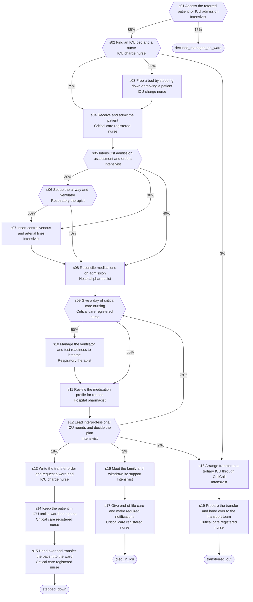

# Provide intensive care

`hosp-med-icu-critical-care` · hospital care · critical care · part of `community-hospital-corp`

This process follows one patient from referral to the intensive care unit until they step down to a ward, die or are transferred to a tertiary ICU. An intensivist decides on admission and leads daily rounds, critical care nurses care for one or two patients each around the clock, respiratory therapists run ventilators and a pharmacist reviews infusions. Beds are few and usually full, so admissions wait for a bed to be freed and patients ready to leave wait in the ICU for a ward bed; the COVID-19 waves of 2020-2022 multiplied demand and forced transfers between hospitals.

| | |
|---|---|
| Unit of work | one ICU admission |
| Starts when | An emergency physician or the rapid response team refers a critically ill patient to the intensivist. |
| Done when | The patient leaves the ICU: stepped down to a ward, transferred to another hospital, or died; or the intensivist decides the patient does not need ICU care. |
| Organisation | A three-site Ontario community hospital corporation with about 30 adult ICU beds (a larger unit at the main site and small units at the others), community intensivists and critical care nurses at 1:1 to 1:2. (5,790 employees, 2019-2022) |
| Volume | 150 cases a month (range 120 to 190) |

## Where it sits

- Starts with **admitted_patient** from ed-admission-boarding (70% of cases)
- Starts with **admitted_patient** from med-rapid-response (30% of cases)
- Relies on **staff_schedule** from hr-staff-scheduling (a standing input; it does not start a case)
- Relies on **lab_result** from dx-lab-testing (a standing input; it does not start a case)
- Relies on **dispensed_medication** from cs-pharmacy-order-verification (a standing input; it does not start a case)
- Sends **medication_order** to cs-pharmacy-order-verification (outcome: any)
- Sends **bed_request** to cs-bed-management (outcome: stepped_down)
- Sends **admitted_patient** to med-inpatient-medical-care (outcome: stepped_down)
- Sends **transfer_request** to ed-interfacility-transfer (outcome: transferred_out)
- Sends **donation_referral** to donation_agency (outcome: died_in_icu)
- Sends **death_notification** to coroner (outcome: died_in_icu)

## Flow

## Roles

| Role | Department | Layer | FTE on this process | Loaded cost per hour | Evidence |
|---|---|---|---:|---:|---|
| Intensivist | Medical, dental and midwifery staff | senior specialist | 4 | 210 CAD | B [src3] |
| Critical care registered nurse | Intensive care units | individual contributor | 90 | 63 CAD | B [src3] |
| Respiratory therapist | Allied health | individual contributor | 5 | 55 CAD | C |
| Hospital pharmacist | Pharmacy | senior specialist | 1.5 | 81 CAD | C |
| ICU charge nurse | Intensive care | supervisor | 6 | 63 CAD | C |
| Patient care manager, inpatient unit | Medicine and critical care program | manager | 1 | 78 CAD | C |

## Steps

Hands-on time and the wait before each step show the most common value. Evidence tier A is a sourced number, B a sourced description, C the author's estimate.

| Step | Who | Kind | Hands-on | Wait before | Control | Evidence |
|---|---|---|---:|---:|---|---|
| **s01 Assess the referred patient for ICU admission.** The intensivist takes the call from the emergency physician or the rapid response team, reviews vital signs, blood gases and imaging, sees the patient and decides whether ICU care will help, starting resuscitation where needed. | Intensivist | judgment | 30 min | 30 min |  | C |
| **s02 Find an ICU bed and a nurse.** The ICU charge nurse checks the bed board and the nursing assignment, decides whether a nurse can take the patient one-to-one or a second patient, and calls patient flow if a bed must be freed first. | ICU charge nurse | coordination | 10 min | 5 min |  | B [src1] |
| **s03 Free a bed by stepping down or moving a patient.** The charge nurse and intensivist pick the most stable ICU patient, ask patient flow to expedite a ward bed or move that patient to another site's ICU, and keep the new patient in the ED or recovery room until the bed is clean. | ICU charge nurse | coordination | 30 min | 3.0 h |  | B [src1] |
| **s04 Receive and admit the patient.** Two ICU nurses move the patient onto the ICU bed, connect cardiac, oxygen and pressure monitoring, check lines and drains, start or take over infusions on smart pumps, do a full assessment and begin the flowsheet. | Critical care registered nurse | physical | 1.0 h | 30 min | Accreditation Canada ROPs: client identification, information transfer at care transitions, infusion pump safety | B [src4] |
| **s05 Intensivist admission assessment and orders.** The intensivist examines the patient, reviews results, writes the admission note and orders for sedation, vasopressors, ventilation targets, fluids, antimicrobials, nutrition and VTE prophylaxis, and talks with the family about goals of care. | Intensivist | judgment | 45 min | 0 min | Ontario Public Hospitals Act, Regulation 965: treatment on the order of an authorized practitioner | B [src1] |
| **s06 Set up the airway and ventilator.** The respiratory therapist prepares airway equipment, assists the intensivist with intubation, connects and sets the ventilator, takes an arterial blood gas and adjusts settings to the targets ordered. | Respiratory therapist | physical | 45 min | 5 min |  | B [src1] |
| **s07 Insert central venous and arterial lines.** The intensivist inserts a central venous catheter and an arterial line under ultrasound with full barrier precautions, following the insertion checklist with the nurse, and orders a chest X-ray to confirm position. | Intensivist | physical | 45 min | 15 min | Central line insertion bundle and checklist (Safer Healthcare Now) | C |
| **s08 Reconcile medications on admission.** The pharmacist compares the patient's home medication list with the ICU orders, flags home drugs to continue or hold, checks antimicrobial doses against kidney function and records the reconciliation. | Hospital pharmacist | validation | 15 min | 2.0 h | Accreditation Canada ROP: medication reconciliation at care transitions | B [src4] |
| **s09 Give a day of critical care nursing.** Over each 24 hours the ICU nurse assesses the patient hourly, titrates sedation and vasopressor infusions, manages lines, turns and mouth-cares the patient, draws blood, records the flowsheet and checks the ventilator-associated pneumonia, line infection and pressure injury bundles; the bed is occupied all day. | Critical care registered nurse | physical | 15.0 h | 9.0 h | ICU care bundles (ventilator-associated pneumonia, central line infection, pressure injury) and independent double checks of high-alert infusions | B [src3], [src5] |
| **s10 Manage the ventilator and test readiness to breathe.** The respiratory therapist checks the ventilator and airway each shift, suctions, takes blood gases, adjusts settings and, when the patient meets criteria, runs a spontaneous breathing trial with the nurse lightening sedation, reporting the result at rounds. | Respiratory therapist | physical | 1.5 h | 0 min |  | B [src1] |
| **s11 Review the medication profile for rounds.** The pharmacist reviews infusions, antimicrobials, sedation and drug levels against the latest labs, and prepares dose changes and stop dates to raise at rounds. | Hospital pharmacist | analysis | 10 min | 0 min |  | C |
| **s12 Lead interprofessional ICU rounds and decide the plan.** The intensivist leads rounds with the nurse, respiratory therapist and pharmacist, examines the patient, reviews overnight events and results, sets the day's goals and decides whether the patient stays, can step down to a ward, should move to comfort care or needs transfer to a tertiary ICU. | Intensivist | judgment | 20 min | 0 min |  | B [src1] |
| **s13 Write the transfer order and request a ward bed.** The intensivist writes the transfer order and summary, and the charge nurse enters the bed request on the bed board for the right ward, then chases patient flow at bed meetings. | ICU charge nurse | coordination | 10 min | 1.0 h |  | C |
| **s14 Keep the patient in ICU until a ward bed opens.** The patient, now well enough for a ward, waits in the ICU bed; the nurse continues lower-intensity care, often with two patients, and the new admission the ICU needs waits for this bed. | Critical care registered nurse | physical | 3.0 h | 4.0 h |  | A [src2] |
| **s15 Hand over and transfer the patient to the ward.** The ICU nurse gives a structured report to the ward nurse, reconciles medications for the transfer, removes lines no longer needed, and goes with the porter to the ward; about one transfer in fourteen happens at night. | Critical care registered nurse | communication | 30 min | 15 min | Accreditation Canada ROPs: information transfer and medication reconciliation at care transitions | B [src1], [src4] |
| **s16 Meet the family and withdraw life support.** The intensivist meets the family, explains that treatment is no longer helping, agrees a plan for comfort care, and writes orders to stop vasopressors and ventilation with medication for comfort. | Intensivist | communication | 1.0 h | 12.0 h |  | C |
| **s17 Give end-of-life care and make required notifications.** The ICU nurse stays with the patient and family while life support is withdrawn, manages symptoms, and after death notifies the organ and tissue donation agency, contacts the coroner when required, and prepares the body and the paperwork. | Critical care registered nurse | physical | 4.0 h | 30 min | Ontario Trillium Gift of Life Network Act: hospitals notify the donation agency of every death and imminent death | B [src1] |
| **s18 Arrange transfer to a tertiary ICU through CritiCall.** The intensivist calls CritiCall Ontario, which conferences an accepting intensivist at a tertiary hospital; the intensivist presents the case and waits while the receiving hospital finds a bed. | Intensivist | communication | 30 min | 15 min |  | B [src3] |
| **s19 Prepare the transfer and hand over to the transport team.** The ICU nurse copies the chart and images, prepares infusions and a transport ventilator with the respiratory therapist, gives report to the critical care transport paramedics and sends the patient. | Critical care registered nurse | coordination | 45 min | 3.0 h | Accreditation Canada ROP: information transfer at care transitions | C |

## Exceptions

| Exception | Share of cases | What happens |
|---|---:|---|
| No bed free on referral | 22% | The ICU is full; the most stable patient is stepped down early or moved to another site while the new patient waits in the ED or recovery room. |
| Delayed step-down | 69% | A patient ready for the ward waits in the ICU bed for hours or days until a ward bed opens. |
| Comfort care and death in ICU | 9% | Life support is withdrawn after a family meeting and the patient dies in the ICU. |
| Transfer to a tertiary ICU | 7% | The patient needs care the community ICU cannot give, or no ICU bed exists at any site, and is moved through CritiCall. |

## Benchmarks

| Metric | Value | Unit | Population | Evidence |
|---|---|---|---|---|
| cycle_time_days | p50 3, p90 10 | days from ICU admission to ICU discharge | Adult ICU stays in Canada (outside Quebec), 2013-2014 | B [src1], [src2] |
| icu_mortality | 0.09 | share of ICU stays ending in death in ICU | Canadian ICUs, 2013-2014 | A [src1] |
| invasive_ventilation_share | 0.34 | share of ICU patients invasively ventilated (Ontario: 9% long-term, 25% short-term) | Ontario ICUs, 2013-2014 | A [src1] |
| avoidable_discharge_delay | p50 7.2 | hours, median, among the 69.1% of patients delayed | 17 Alberta ICUs, 2012-2016 | A [src2] |
| icu_readmission_48h | 0.01 | share of ICU discharges to a ward readmitted within 48 hours | Canadian ICUs, 2013-2014 | A [src1] |
| night_discharge_share | 0.07 | share of ICU discharges at night | Canadian ICUs, 2013-2014 | A [src1] |

## Pain points

- Patients ready for the ward wait in ICU beds for a ward bed, which blocks new admissions from the ED and operating rooms. (steps s13, s14; A [src2])
- When the ICU is full, stable patients are stepped down early or moved to another hospital to make room. (steps s02, s03, s18; A [src1])
- During COVID-19 waves, nurses took two ventilated patients or led teams of redeployed ward nurses, and patients were moved between regions. (steps s09, s18, s19; A [src3])
- Small ICUs at the smaller sites rely on an intensivist on call from home at night, delaying admission decisions. (steps s01; C)

## Assumptions

- Loaded costs come from the organisation file. The intensivist cost is an equivalent hourly cost; intensivists bill OHIP or receive an alternative funding stipend.
- Daily exit probabilities (18.5% step-down, 2% comfort care, 1.5% transfer out) give a mean ICU stay of about 5 days, between CIHI's national figure of about 3 days, which includes step-down units, and the 4-6 day means reported in Alberta (src2). A community ICU without a separate step-down unit keeps lower-acuity patients longer.
- ICU nursing time per day assumes an average ratio of about 1:1.5 (one-to-one for ventilated patients, one-to-two for others), so the ICU RN workload here needs about 90 FTE; the organisation file's 110 ICU RN headcount supports this only with mostly full-time staff.
- The share of patients entering from the rapid response team versus the ED (30/70) is the author's estimate. Planned admissions after surgery (about 18% of Ontario ICU stays in src1) have no link from the surgical program in the organisation file and are counted within the ED share here.
- The organisation file has no ICU charge nurse role; icu_charge_nurse is added (not_in_org_file).
- About 15% of cases are referrals the intensivist does not admit; they are counted in the volume because they consume intensivist time, so actual ICU admissions are about 128 a month and simulated ICU bed use is about 80% of available bed-hours.
- Readmission to ICU within 48 hours (1%, src1) is not modelled as a loop; such patients enter again as new cases.

## Sources

- [src1] [Care in Canadian ICUs](https://www.cihi.ca/sites/default/files/document/care-canadian-icu-report-en.pdf) (Canadian Institute for Health Information, 2016). 230,800 adult ICU admissions in 2013-2014; 8 in 10 ICU stays follow urgent hospital admission (Ontario: 52% urgent medical, 28% urgent surgical); ICU mortality 9%; 48-hour ICU readmission 1%; length of ICU stay approximately 3 days; 33% invasively ventilated (Ontario 9% long-term, 25% short-term); 19% of invasively ventilated patients died in ICU vs 4% of others; night discharge 7%; large and teaching ICUs over capacity 45-51 days a year and discharge-to-admission ratio 1.7 when over capacity.
- [src2] [Assessment of Costs of Avoidable Delays in Intensive Care Unit Discharge](https://jamanetwork.com/journals/jamanetworkopen/fullarticle/2769505) (JAMA Network Open (Bagshaw SM, Tran DT, Opgenorth D and others), 2020). 17 adult ICUs in Alberta, 28,904 patients: 69.1% had avoidable ICU discharge delay (time from decision to transfer to discharge, minus 4 hours), median 7.2 hours (IQR 2.4-27.7); 12.8% of ICU patient-days avoidable; mean ICU stay 142.4 hours with delay and 87.1 hours without.
- [src3] [Critical Care Capacity During the COVID-19 Pandemic (Ontario COVID-19 Science Advisory Table science brief, summary page)](https://pandemics.utoronto.ca/?p=4957) (Institute for Pandemics, University of Toronto, 2021). Ontario had 2,012 adult ICU beds before the pandemic; peak COVID-19 ICU census 283, 450 and 940 in waves 1-3; 976 critically ill patients transferred January-July 2021; level 3 ICUs typically assign one critical care nurse per ventilated patient, with two-patient assignments and team models under a critical care nurse during surges; intensivist loads 12-15 patients in large ICUs; nurse vacancy rose from 5.8% to 9%; 32.8% of COVID-19 ICU patients died in ICU.
- [src4] [Required Organizational Practices 2021 Handbook](https://vitalitenb.ca/images/files/documents/medecins/2021_rop_handbook.pdf) (Accreditation Canada (copy hosted by Vitalite Health Network), 2021). Accreditation Canada ROPs include client identification with two identifiers, information transfer at care transitions, medication reconciliation at care transitions (best possible medication history at admission), concentrated electrolytes, heparin safety, high-alert medications, infusion pump safety, narcotics safety, falls prevention, pressure ulcer prevention and venous thromboembolism prophylaxis.
- [src5] [Intravenous Medication Safety: A Multi-Incident Analysis (ISMP Canada Safety Bulletin vol. 20 no. 7)](https://ismpcanada.ca/wp-content/uploads/ISMPCSB2020-i7-IVMedsAnalysis.pdf) (Institute for Safe Medication Practices Canada, 2020). 1,583 IV medication incidents from Canadian reporting systems (2015-2018); about one-third were administration errors (wrong patient, drug, dose, route or rate); lack of an independent double check and over-reliance on smart pumps and barcode technology contributed; about 1 in 6 involved pump programming or accessories; MAR and pharmacy label mismatches and portering delays also contributed.

Written by claude-opus on 2026-11-24.
