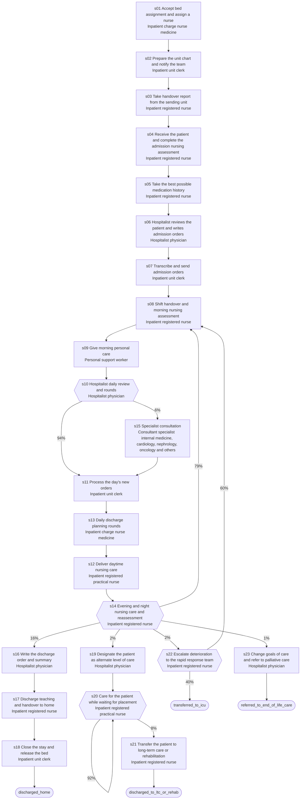

# Provide daily inpatient medical and nursing care

`hosp-med-inpatient-medical-care` · hospital care · inpatient medicine · part of `community-hospital-corp`

This process covers one patient's stay on a medicine unit, from arriving with a bed assignment to leaving home, to long-term care or rehabilitation, to intensive care or to end-of-life care. Hospitalists see the patient each day and write orders, registered and practical nurses assess and treat the patient every shift, personal support workers give personal care, and a charge nurse runs daily discharge rounds. Most patients are frail older adults with several conditions, so plans change daily, orders pass through clerks, scanners and pharmacy, and stays grow when a patient no longer needs acute care but waits for a long-term care bed.

| | |
|---|---|
| Unit of work | one inpatient stay on a medicine unit |
| Starts when | An admitted patient is given a medicine bed by patient flow, usually from the emergency department and sometimes on step-down from intensive care or repatriation from a tertiary hospital. |
| Done when | The patient is discharged home, transferred to long-term care or rehabilitation, moved to intensive care, or referred to end-of-life care, and the bed is released. |
| Organisation | A three-site Ontario community hospital corporation with about 300 inpatient medicine beds run by a hospitalist group, mixed RN/RPN nursing and a hospital information system with partly paper or scanned orders. (5,790 employees, 2019-2022) |
| Volume | 1,150 cases a month (range 1,000 to 1,300) |

## Where it sits

- Starts with **admitted_patient** from ed-admission-boarding (88% of cases)
- Starts with **admitted_patient** from med-icu-critical-care (9% of cases)
- Starts with **repatriation_request** from tertiary_hospital (3% of cases)
- Relies on **bed_assignment** from cs-bed-management (a standing input; it does not start a case)
- Relies on **lab_result** from dx-lab-testing (a standing input; it does not start a case)
- Relies on **imaging_report** from dx-radiology-reporting (a standing input; it does not start a case)
- Relies on **blood_product** from dx-blood-transfusion (a standing input; it does not start a case)
- Relies on **meal_tray** from fs-food-services (a standing input; it does not start a case)
- Relies on **supplies** from fin-materials-management (a standing input; it does not start a case)
- Relies on **mar_record** from med-medication-administration (a standing input; it does not start a case)
- Relies on **staff_schedule** from hr-staff-scheduling (a standing input; it does not start a case)
- Sends **lab_order** to dx-lab-specimen-collection (outcome: any)
- Sends **imaging_order** to dx-imaging-exam (outcome: any)
- Sends **medication_order** to cs-pharmacy-order-verification (outcome: any)
- Sends **allied_health_referral** to cs-allied-health-referral (outcome: any)
- Sends **diet_order** to fs-food-services (outcome: any)
- Sends **transport_request** to fs-patient-portering (outcome: any)
- Sends **supply_requisition** to fin-materials-management (outcome: any)
- Sends **discharge_plan** to cs-discharge-planning (outcome: discharged_home)
- Sends **discharge_plan** to cs-discharge-planning (outcome: discharged_to_ltc_or_rehab)
- Sends **rapid_response_call** to med-rapid-response (outcome: transferred_to_icu)
- Sends **palliative_referral** to med-end-of-life-care (outcome: referred_to_end_of_life_care)

## Flow

## Roles

| Role | Department | Layer | FTE on this process | Loaded cost per hour | Evidence |
|---|---|---|---:|---:|---|
| Hospitalist physician | Medical, dental and midwifery staff | senior specialist | 24 | 160 CAD | C |
| Consultant specialist (internal medicine, cardiology, nephrology, oncology and others) | Medical, dental and midwifery staff | senior specialist | 4 | 200 CAD | C |
| Inpatient registered nurse | Inpatient medicine units | individual contributor | 160 | 61 CAD | C |
| Inpatient registered practical nurse | Inpatient medicine units | individual contributor | 70 | 40 CAD | C |
| Personal support worker | Inpatient medicine units | individual contributor | 50 | 30 CAD | C |
| Inpatient unit clerk | Inpatient medicine units | individual contributor | 22 | 35 CAD | C |
| Inpatient charge nurse (medicine) | Inpatient medicine | supervisor | 18 | 63 CAD | C |
| Patient care manager, inpatient unit | Medicine and critical care program | manager | 3 | 78 CAD | C |
| Director, medicine and critical care | Medicine and critical care program | director | 0.3 | 101 CAD | C |

## Steps

Hands-on time and the wait before each step show the most common value. Evidence tier A is a sourced number, B a sourced description, C the author's estimate.

| Step | Who | Kind | Hands-on | Wait before | Control | Evidence |
|---|---|---|---:|---:|---|---|
| **s01 Accept bed assignment and assign a nurse.** The charge nurse sees the bed assignment on the electronic bed board or takes the call from patient flow, checks that the cleaned bed suits the patient (isolation, telemetry, falls risk) and assigns the patient to an RN or RPN whose workload can absorb a new admission. | Inpatient charge nurse (medicine) | intake | 5 min | 0 min |  | C |
| **s02 Prepare the unit chart and notify the team.** The unit clerk opens the admission in the hospital information system, prints labels and the paper chart forms still used on the unit, adds the patient to the unit census board and pages the admitting hospitalist that the patient has a bed. | Inpatient unit clerk | data entry | 12 min | 10 min |  | C |
| **s03 Take handover report from the sending unit.** The receiving nurse takes a structured verbal report (SBAR) by phone from the emergency or ICU nurse: diagnosis, vital signs, lines, medications given, isolation status, code status and outstanding tests, and notes questions to check on arrival. | Inpatient registered nurse | communication | 10 min | 45 min | Accreditation Canada ROP: information transfer at care transitions | B [src3] |
| **s04 Receive the patient and complete the admission nursing assessment.** When the porter brings the patient, the nurse confirms identity with two identifiers, takes vital signs, does a head-to-toe assessment, screens falls risk, skin (Braden score) and delirium, records belongings and allergies and starts the nursing care plan in the electronic record. | Inpatient registered nurse | physical | 1.0 h | 1.0 h | Accreditation Canada ROPs: client identification, falls prevention, pressure ulcer prevention | B [src3] |
| **s05 Take the best possible medication history.** The nurse interviews the patient and family about every home medication, checks pill bottles or the community pharmacy list, and where the patient cannot say, phones or faxes the community pharmacy, then records the list on the medication reconciliation form. | Inpatient registered nurse | lookup | 25 min | 30 min | Accreditation Canada ROP: medication reconciliation at care transitions (BPMH at admission) | B [src3] |
| **s06 Hospitalist reviews the patient and writes admission orders.** The hospitalist reads the ED record and results, sees the patient, compares the BPMH with the admission medication orders, decides which home medications to continue, and writes or revises orders for medications, diet, activity, monitoring, tests and code status. | Hospitalist physician | judgment | 30 min | 3.0 h | Ontario Public Hospitals Act, Regulation 965: treatment only on the written order of a physician or other authorized practitioner | C |
| **s07 Transcribe and send admission orders.** The unit clerk flags new orders, enters or requisitions tests, books imaging, scans or faxes medication orders to pharmacy and sends diet orders to food services; the nurse then checks the transcription against the signed orders. | Inpatient unit clerk | data entry | 12 min | 20 min |  | C |
| **s08 Shift handover and morning nursing assessment.** At the start of each day, the oncoming nurse takes bedside handover, reviews overnight events and new results, assesses the patient, takes vital signs and an early-warning score, and updates the plan for the day. The bed stays occupied for the whole hospital day. | Inpatient registered nurse | physical | 30 min | 8.0 h |  | C |
| **s09 Give morning personal care.** The personal support worker helps the patient wash, toilet, dress and get to a chair, sets up breakfast and helps with eating, repositions bed-bound patients and reports changes in skin, intake or behaviour to the nurse. | Personal support worker | physical | 45 min | 0 min |  | C |
| **s10 Hospitalist daily review and rounds.** The hospitalist reviews overnight notes, vital signs, lab and imaging results, sees and examines the patient, writes a progress note, adjusts medication and test orders and decides whether a specialist consult is needed. | Hospitalist physician | judgment | 15 min | 2.5 h |  | C |
| **s11 Process the day's new orders.** The unit clerk picks up the new orders, enters lab and imaging requisitions, calls or emails for bookings, scans medication orders to pharmacy and updates the census board with tests and expected discharge date. | Inpatient unit clerk | data entry | 6 min | 30 min |  | C |
| **s12 Deliver daytime nursing care.** The nurse carries out treatments and monitoring through the day: wound care, IV and line care, intake and output, blood glucose checks, mobilising, collecting specimens, preparing the patient for tests off the unit and documenting assessments and care in the record. | Inpatient registered practical nurse | physical | 1.5 h | 1.0 h |  | C |
| **s13 Daily discharge planning rounds.** The charge nurse leads a short standing meeting with the nurse, social worker, physiotherapist, occupational therapist and discharge planner, confirms the expected discharge date, flags barriers such as home care or a long-term care bed, and records actions on the whiteboard and bed board. | Inpatient charge nurse (medicine) | coordination | 3 min | 2.0 h |  | C |
| **s14 Evening and night nursing care and reassessment.** The evening and night nurse reassesses the patient, monitors vital signs and early-warning scores, manages pain, toileting and confusion, documents the shift and decides with the hospitalist on call whether the patient is deteriorating, ready for discharge, waiting for another setting or needs comfort care. | Inpatient registered nurse | physical | 1.2 h | 5.0 h |  | B [src1] |
| **s15 Specialist consultation.** The consultant specialist (cardiology, nephrology, gastroenterology or another service) reviews the chart, sees the patient, writes recommendations and sometimes books a procedure, then the hospitalist adopts the recommendations as orders. | Consultant specialist (internal medicine, cardiology, nephrology, oncology and others) | judgment | 45 min | 6.0 h |  | C |
| **s16 Write the discharge order and summary.** At morning rounds the hospitalist confirms the patient is ready, writes the discharge order and prescriptions, completes discharge medication reconciliation and dictates or types the discharge summary for the family physician. | Hospitalist physician | drafting | 30 min | 12.0 h | Accreditation Canada ROP: medication reconciliation at care transitions (discharge) | B [src3] |
| **s17 Discharge teaching and handover to home.** The nurse reviews the medication list and warning signs with the patient and family, removes IV lines, confirms home care start dates and follow-up appointments, gives the written instructions and copies of prescriptions, and documents the discharge. | Inpatient registered nurse | communication | 30 min | 1.5 h |  | C |
| **s18 Close the stay and release the bed.** Once the family arrives, the unit clerk discharges the patient in the ADT module, which updates the bed board and sends a cleaning request; the clerk files remaining paper forms for scanning. | Inpatient unit clerk | data entry | 5 min | 2.0 h |  | C |
| **s19 Designate the patient as alternate level of care.** The hospitalist documents that the patient no longer needs acute care but cannot be discharged safely, records the ALC designation and the planned destination (long-term care, rehabilitation or convalescent care), and the discharge planner starts the application. | Hospitalist physician | judgment | 10 min | 12.0 h | Provincial ALC designation guidance and CIHI Discharge Abstract Database ALC reporting | B [src1], [src2] |
| **s20 Care for the patient while waiting for placement.** Each day the nurse and personal support worker give care, mobilisation and meals to the ALC patient in an acute bed, while the discharge planner and home and community care coordinator wait for a long-term care or rehabilitation bed offer. | Inpatient registered practical nurse | physical | 2.5 h | 21.5 h |  | B [src1] |
| **s21 Transfer the patient to long-term care or rehabilitation.** The nurse prepares the transfer package (medication list, care plan, recent notes), gives report by phone to the receiving home or unit, books non-urgent patient transport and sends the patient with belongings and medications. | Inpatient registered nurse | coordination | 45 min | 4.0 h | Accreditation Canada ROPs: information transfer and medication reconciliation at care transitions | B [src3] |
| **s22 Escalate deterioration to the rapid response team.** When the early-warning score or the nurse's concern triggers escalation, the nurse calls the rapid response team, stays at the bedside giving oxygen and monitoring, and gives report; the team either stabilises the patient on the ward or moves them to intensive care. | Inpatient registered nurse | communication | 45 min | 10 min |  | C |
| **s23 Change goals of care and refer to palliative care.** The hospitalist meets the patient and family to discuss prognosis, records a change to comfort-focused care, stops non-beneficial tests and treatments, writes symptom-control orders and refers to the palliative care team. | Hospitalist physician | communication | 45 min | 4.0 h |  | B [src1] |

## Exceptions

| Exception | Share of cases | What happens |
|---|---:|---|
| Alternate level of care wait | 11% | The patient no longer needs acute care but cannot go home; the stay continues in an acute bed until a long-term care or rehabilitation bed is offered, often for weeks. |
| Specialist consultation | 30% | The hospitalist asks a specialist to see the patient; recommendations arrive later the same day or the next day. |
| Deterioration on the ward | 7% | The nurse calls the rapid response team; about four in ten such patients go to intensive care. |
| Comfort care | 6% | Goals of care change and the patient is referred to end-of-life care. |

## Benchmarks

| Metric | Value | Unit | Population | Evidence |
|---|---|---|---|---|
| cycle_time_days | p50 4.6, p90 14 | days from admission to discharge (acute portion for p50) | General internal medicine admissions, 7 Toronto-area hospitals, 2010-2015 | B [src1] |
| average_acute_length_of_stay | 7.2 | days | All acute hospitalizations in Canada, 2021-2022 | A [src2] |
| alc_share_of_admissions | 0.124 | share of GIM admissions with ALC days | GEMINI cohort | A [src1] |
| in_hospital_mortality | 0.065 | share of GIM admissions | GEMINI cohort | A [src1] |
| icu_use | 0.099 | share of GIM admissions with an ICU stay | GEMINI cohort | A [src1] |
| nurse_time_on_medication_administration | 0.265 | share of nurse time | Medical, surgical and ICU nurses, one US tertiary hospital, 2005 | A [src4] |

## Pain points

- Patients who no longer need acute care wait in acute beds for long-term care or rehabilitation, holding a fifth of medicine bed-days and backing up admissions in the emergency department. (steps s19, s20; A [src1])
- Discharge decisions made at night or late morning wait for the next hospitalist round and for family transport, so beds are released in the afternoon after the morning surge of ED admissions. (steps s16, s17, s18; C)
- Orders pass from the hospitalist to the clerk, scanner and pharmacy queue, so a medication change made on morning rounds can take hours to reach the medication record. (steps s07, s10, s11; C)
- Handover between ED and ward nurses is verbal and rushed, and pending results or medications already given are missed. (steps s03; B [src3])

## Assumptions

- Loaded costs are taken from the organisation file (wage plus about 25-30% benefits and overhead). Physician costs are an equivalent hourly cost; hospitalists and consultants bill OHIP or are paid by stipend and are not on payroll.
- Nursing minutes exclude medication passes (about a quarter of nurse time, src4), which are documented in hosp-med-medication-administration, so the labour here understates the full nursing cost of a stay.
- The daily loop (s08-s14) is about 1,440 minutes of elapsed time. Daily exit probabilities (16% discharge-ready, 2.2% ALC, 1.5% deterioration, 1.3% comfort care) reproduce the GEMINI median and interquartile range of acute stay; real exit chances are higher on weekdays and lower on weekends.
- Weekend discharges are fewer in practice; the model spreads exits evenly across days.
- The organisation file has no inpatient charge nurse role; med_charge_nurse is added here (not_in_org_file).
- The bed is tied up for each hospital day through the resource entries on s04, s08 and s20; mean bed-hours per stay in the simulation should be close to 300 beds x about 715 available hours / 1,150 stays (about 185 hours).
- ICU transfer here covers only deterioration on the medicine unit (about 3% of stays); most of GEMINI's 9.9% ICU use happens before the patient reaches the unit.
- The simulated median includes ALC and discharge-day waits, so it runs slightly above the GEMINI median of the acute portion alone.

## Sources

- [src1] [Patient characteristics, resource use and outcomes associated with general internal medicine hospital care: the General Medicine Inpatient Initiative (GEMINI) retrospective cohort study](https://pmc.ncbi.nlm.nih.gov/articles/PMC5741428) (CMAJ Open, 2017). 136,208 general internal medicine admissions at 7 Toronto hospitals 2010-2015: median age 73, median 6 comorbidities, median acute length of stay 4.6 days (IQR 2.5-8.6), ALC on 12.4% of admissions and 22.0% of bed-days, ICU use 9.9%, in-hospital death 6.5%, 30-day readmission 10.9%, discharged home 70.8%, nursing home or rehabilitation 18.9%; GIM is 38.8% of admissions from the ED; radiography 83.0%, CT 52.2%, transfusion 9.2% of admissions.
- [src2] [Hospital stays in Canada, 2021-2022](https://www.cihi.ca/en/hospital-stays-in-canada-2021-2022) (Canadian Institute for Health Information, 2022). About 2.9 million acute hospitalizations in 2021-2022; average acute length of stay 7.2 days; heart failure 9.2 days, COVID-19 10.1 days; 5.8% of stays included alternate level of care days.
- [src3] [Required Organizational Practices 2021 Handbook](https://vitalitenb.ca/images/files/documents/medecins/2021_rop_handbook.pdf) (Accreditation Canada (copy hosted by Vitalite Health Network), 2021). Accreditation Canada ROPs include client identification with two identifiers, information transfer at care transitions, medication reconciliation at care transitions (best possible medication history at admission), concentrated electrolytes, heparin safety, high-alert medications, infusion pump safety, narcotics safety, falls prevention, pressure ulcer prevention and venous thromboembolism prophylaxis.
- [src4] [Impact of Barcode Medication Administration Technology on How Nurses Spend Their Time On Clinical Care](https://pmc.ncbi.nlm.nih.gov/articles/PMC1839328) (AMIA Annual Symposium Proceedings (Poon EG, Keohane C and others), 2006). Time-motion study, 232 two-hour sessions on medical, surgical and intensive care units of a 735-bed hospital: nurses spent 26.5% of their time on medication administration before barcode administration and 24.5% after (not significant); direct care unrelated to medications 20.1% and 23.7%.

Written by claude-opus on 2026-11-24.
