# Administer medications on inpatient units

`hosp-med-medication-administration` · hospital care · inpatient nursing · part of `community-hospital-corp`

This process covers one inpatient's medications for one day: the scheduled passes at about 08:00, 12:00, 17:00 and 22:00, as-needed doses, IV infusions and the overnight check of the medication record. The assigned nurse takes doses from the automated dispensing cabinet, checks them against the medication record, confirms the patient's identity, gives them and documents each one. It is slow and error-prone because every nurse on the unit does the same pass at the same time, interruptions are frequent, high-alert drugs need a second nurse, and missing doses mean calls to pharmacy.

| | |
|---|---|
| Unit of work | one inpatient day of medication passes |
| Starts when | A new hospital day begins for an admitted patient with active medication orders dispensed by pharmacy. |
| Done when | Every dose due in the day has been given, held with a reason or reported as an incident, and the 24-hour medication record is checked. |
| Organisation | A three-site Ontario community hospital with automated dispensing cabinets on inpatient units, an electronic or pharmacy-printed medication administration record and partial barcode scanning at the bedside. (5,790 employees, 2019-2022) |
| Volume | 18,500 cases a month (range 17,500 to 19,500) |

## Where it sits

- Starts with **dispensed_medication** from cs-pharmacy-order-verification (100% of cases)
- Relies on **system_release** from dh-system-change (a standing input; it does not start a case)
- Relies on **medication_order** from med-inpatient-medical-care (a standing input; it does not start a case)
- Sends **mar_record** to med-inpatient-medical-care (outcome: any)
- Sends **incident_report** to qp-incident-management (outcome: incident_reported)

## Flow

```mermaid
flowchart TD
    s01["s01 Review the medication record at the start of the shift<br/>Inpatient registered nurse"]
    s02{{"s02 Withdraw the morning doses from the dispensing cabinet<br/>Inpatient registered nurse"}}
    s03["s03 Call pharmacy about a missing dose<br/>Inpatient registered nurse"]
    s04["s04 Pharmacy sends the missing dose<br/>Pharmacy technician"]
    s05["s05 Prepare the doses at the medication cart<br/>Inpatient registered nurse"]
    s06{{"s06 Give and document the morning doses at the bedside<br/>Inpatient registered nurse"}}
    s07{{"s07 Independent double check of a high-alert dose<br/>Inpatient registered nurse"}}
    s08["s08 Program the infusion pump and hang the IV medication<br/>Inpatient registered nurse"]
    s09{{"s09 Give the midday doses<br/>Inpatient registered practical nurse"}}
    s10["s10 Give an as-needed dose on request<br/>Inpatient registered practical nurse"]
    s11["s11 Reassess the effect of the as-needed dose<br/>Inpatient registered practical nurse"]
    s12{{"s12 Give the late-afternoon doses<br/>Inpatient registered nurse"}}
    s13["s13 Hold a dose and page the prescriber<br/>Inpatient registered nurse"]
    s14["s14 Prescriber answers and changes the order<br/>Hospitalist physician"]
    s15["s15 Count controlled drugs and hand over at shift change<br/>Inpatient registered nurse"]
    s16{{"s16 Give the bedtime doses<br/>Inpatient registered nurse"}}
    s17["s17 Give an overnight dose<br/>Inpatient registered nurse"]
    s18{{"s18 Check the 24-hour medication record<br/>Inpatient registered nurse"}}
    s19["s19 Report the medication incident<br/>Inpatient registered nurse"]
    s01 --> s02
    s02 -->|"90%"| s05
    s02 -->|"10%"| s03
    s03 --> s04
    s04 --> s05
    s05 --> s06
    s06 -->|"20%"| s07
    s06 -->|"30%"| s08
    s06 -->|"50%"| s09
    s07 -->|"50%"| s08
    s07 -->|"50%"| s09
    s08 --> s09
    s09 -->|"65%"| s10
    s09 -->|"35%"| s12
    s10 --> s11
    s11 --> s12
    s12 -->|"10%"| s13
    s12 -->|"90%"| s15
    s13 --> s14
    s14 --> s15
    s15 --> s16
    s16 -->|"40%"| s17
    s16 -->|"60%"| s18
    s17 --> s18
    s18 -->|"99%"| end0
    s18 -->|"1%"| s19
    s19 --> end1
    end0(["mar_complete"])
    end1(["incident_reported"])
```

## Roles

| Role | Department | Layer | FTE on this process | Loaded cost per hour | Evidence |
|---|---|---|---:|---:|---|
| Inpatient registered nurse | Inpatient medicine units | individual contributor | 70 | 61 CAD | B [src1] |
| Inpatient registered practical nurse | Inpatient medicine units | individual contributor | 35 | 40 CAD | B [src1] |
| Surgical inpatient registered nurse | Surgical inpatient units | individual contributor | 18 | 61 CAD | B [src1] |
| Surgical inpatient registered practical nurse | Surgical inpatient units | individual contributor | 8 | 40 CAD | B [src1] |
| Critical care registered nurse | Intensive care units | individual contributor | 10 | 63 CAD | B [src1] |
| Mental health registered nurse | Inpatient psychiatry | individual contributor | 8 | 61 CAD | B [src1] |
| Mother-baby (postpartum) nurse | Maternity (birthing and mother-baby units) | individual contributor | 8 | 61 CAD | B [src1] |
| Paediatric registered nurse | Neonatal and paediatric care | individual contributor | 4 | 61 CAD | B [src1] |
| Hospitalist physician | Medical, dental and midwifery staff | senior specialist | 0.5 | 160 CAD | C |
| Pharmacy technician | Pharmacy | individual contributor | 1.5 | 38 CAD | C |

## Steps

Hands-on time and the wait before each step show the most common value. Evidence tier A is a sourced number, B a sourced description, C the author's estimate.

| Step | Who | Kind | Hands-on | Wait before | Control | Evidence |
|---|---|---|---:|---:|---|---|
| **s01 Review the medication record at the start of the shift.** At 07:00 the assigned nurse opens the patient's electronic medication administration record, reads new and changed orders verified overnight, notes doses due, held or awaiting pharmacy verification, and plans the timing of the morning pass around tests and meals. | Inpatient registered nurse | lookup | 5 min | 0 min |  | B [src5] |
| **s02 Withdraw the morning doses from the dispensing cabinet.** The nurse logs into the automated dispensing cabinet with a fingerprint, selects the patient, removes each due dose from its pocket or the patient's drawer, enters a blind count for controlled drugs, and notes any dose that is not stocked or not yet profiled by pharmacy. | Inpatient registered nurse | physical | 5 min | 45 min | Narcotic Control Regulations and hospital controlled-drug policy: counted withdrawal of controlled substances | B [src5] |
| **s03 Call pharmacy about a missing dose.** The nurse checks the patient's drawer and the cabinet again, then phones pharmacy to ask whether the order is verified and when the dose will come, and notes the delay on the medication record. | Inpatient registered nurse | communication | 5 min | 0 min |  | C |
| **s04 Pharmacy sends the missing dose.** A pharmacy technician finds the order in the pharmacy queue, picks or prepares the dose once a pharmacist has verified the order, labels it and sends it by pneumatic tube or carries it to the unit. | Pharmacy technician | physical | 5 min | 45 min |  | C |
| **s05 Prepare the doses at the medication cart.** The nurse checks each dose against the record (drug, dose, route, time), crushes or splits tablets where ordered, draws up injections and dilutes IV push doses, checks expiry dates and allergies, and labels anything drawn up away from the bedside. | Inpatient registered nurse | validation | 5 min | 5 min |  | B [src2] |
| **s06 Give and document the morning doses at the bedside.** At the bedside the nurse confirms identity with two identifiers, scans the armband and each dose where barcode scanning is in place, checks vital signs or blood glucose before drugs that need them, gives the doses, watches the patient swallow, and documents each administration in the record. | Inpatient registered nurse | physical | 8 min | 5 min | Accreditation Canada ROP: client identification with two identifiers before giving medications | B [src2], [src4] |
| **s07 Independent double check of a high-alert dose.** The nurse asks a second nurse to check the order, drug, concentration, dose calculation and pump settings for insulin, heparin or an opioid infusion without seeing the first nurse's working, and both sign the record. | Inpatient registered nurse | validation | 5 min | 10 min | Accreditation Canada ROP: high-alert medications; ISMP Canada independent double check recommendation | B [src3], [src4] |
| **s08 Program the infusion pump and hang the IV medication.** The nurse traces the line from bag to patient, selects the drug in the smart pump library, enters rate and volume, confirms the program against the label and order, starts the infusion and documents it. | Inpatient registered nurse | physical | 6 min | 5 min | Accreditation Canada ROP: infusion pump safety | B [src3] |
| **s09 Give the midday doses.** Around noon the nurse withdraws, checks and gives the midday doses, often insulin with lunch after a glucose check, and documents them; for stable patients this nurse is often a registered practical nurse. | Inpatient registered practical nurse | physical | 7 min | 3.5 h |  | C |
| **s10 Give an as-needed dose on request.** When the patient asks for pain, nausea or sleep medicine, the nurse assesses the symptom score, checks the last dose time and limits on the record, withdraws the dose (with a count for opioids), gives it and documents the reason. | Inpatient registered practical nurse | judgment | 6 min | 2.0 h |  | C |
| **s11 Reassess the effect of the as-needed dose.** Thirty to sixty minutes later the nurse returns, asks about the pain or nausea score, checks sedation after an opioid, and records the effect. | Inpatient registered practical nurse | physical | 2 min | 45 min |  | C |
| **s12 Give the late-afternoon doses.** Around 17:00 the nurse withdraws, checks and gives the late-afternoon doses, checking blood pressure, heart rate or blood glucose before drugs with hold parameters. | Inpatient registered nurse | physical | 7 min | 4.0 h |  | C |
| **s13 Hold a dose and page the prescriber.** When the patient's blood pressure is low, the patient is fasting for a test or vomiting, the nurse holds the dose, pages the physician with the reading and the question, and records the held dose. | Inpatient registered nurse | communication | 5 min | 5 min |  | C |
| **s14 Prescriber answers and changes the order.** The hospitalist calls back, decides whether to give, hold or change the dose, and writes or gives a verbal order that the nurse reads back and records for pharmacy verification. | Hospitalist physician | judgment | 3 min | 45 min | Ontario Public Hospitals Act, Regulation 965: orders by an authorized practitioner; verbal orders read back and countersigned | C |
| **s15 Count controlled drugs and hand over at shift change.** At 19:00 the outgoing and oncoming nurses reconcile the unit's controlled-drug count and review which doses are due, held or late for each patient; the per-patient share of this work is small. | Inpatient registered nurse | validation | 3 min | 1.5 h | Narcotic Control Regulations and hospital controlled-drug policy: count at each shift change | C |
| **s16 Give the bedtime doses.** Around 21:00 to 22:00 the night nurse withdraws, checks and gives bedtime doses such as anticoagulants, sedatives and evening insulin, and documents them. | Inpatient registered nurse | physical | 7 min | 2.5 h |  | C |
| **s17 Give an overnight dose.** During the night the nurse hangs a scheduled IV antibiotic or gives an as-needed dose for pain or sleep, documenting it in the record. | Inpatient registered nurse | physical | 6 min | 4.0 h |  | C |
| **s18 Check the 24-hour medication record.** Before morning the night nurse reviews the record for the past day, looks for doses not signed for, documents reasons for late or omitted doses, and reports a medication incident if a dose was missed, wrong or given to the wrong patient. | Inpatient registered nurse | review | 3 min | 5.0 h |  | C |
| **s19 Report the medication incident.** The nurse assesses the patient, informs the physician, enters a report in the safety incident system describing the drug, dose, error type and harm, and tells the charge nurse; the manager follows up through incident management. | Inpatient registered nurse | drafting | 20 min | 30 min | Ontario Public Hospitals Act, Regulation 965: disclosure of critical incidents; hospital incident reporting policy | C |

## Exceptions

| Exception | Share of cases | What happens |
|---|---:|---|
| Missing dose | 10% | A due dose is not in the cabinet or drawer, usually because the order is not yet verified or the patient-specific dose has not arrived; the nurse calls pharmacy and the dose is given late. |
| High-alert medication | 20% | Insulin, heparin or an opioid infusion needs an independent double check by a second nurse. |
| Held dose | 10% | A dose is held for low blood pressure, fasting or vomiting and the prescriber is paged. |
| Medication incident | 1% | An omitted, wrong or wrong-patient dose is found and reported. |

## Benchmarks

| Metric | Value | Unit | Population | Evidence |
|---|---|---|---|---|
| nurse_time_on_medication_administration | 0.265 | share of nurse working time (24.5% after barcode administration) | Medical, surgical and ICU nurses at one 735-bed US tertiary hospital, 2005 | A [src1] |
| administrations_interrupted | 0.5 | share of administrations with at least one interruption (reported as more than half) | Two Australian teaching hospitals, 2006-2008 | A [src2] |
| order_to_administration_minutes | p50 300 | minutes from prescriber writing an order to nurse giving the first dose | Two Canadian hospital sites, 2011 | A [src6] |
| hospitals_using_emar | 0.54 | share of Ontario respondent hospitals, 2020/21 | CSHP Hospital Pharmacy in Canada survey | A [src5] |

## Pain points

- All nurses on a unit start the 08:00 pass at once, so they queue at the dispensing cabinet and late doses pile up. (steps s02, s06; C)
- Interruptions during preparation and administration are frequent and raise the error rate. (steps s05, s06; A [src2])
- Doses missing from the cabinet or drawer because pharmacy has not yet verified or delivered them cause phone calls and late doses. (steps s03, s04; B [src5], [src6])
- Finding a free second nurse for high-alert double checks delays insulin and infusions; skipped checks appear in incident reports. (steps s07; B [src3])

## Assumptions

- Loaded costs come from the organisation file. The medicine RN and RPN roles stand for all inpatient nurses in the steps; their costs are the same as the surgical, mental health, postpartum and paediatric nurses' and close to the ICU nurses'.
- A typical patient day has four scheduled passes, an as-needed dose on about two-thirds of days, an IV dose on about four in ten days and a high-alert drug on one in five days (author's estimates).
- About 70-75 minutes of nurse time per patient day, which is roughly a quarter of the RN and RPN time per inpatient day in an Ontario community hospital, matching the 24.5-26.5% share in src1.
- The medication incident rate here (0.7% of patient days) is the reported rate. Observational studies find errors in a quarter of administrations (src2), most of them minor and never reported.
- No cycle-time benchmark exists for a patient day of medications; the simulated elapsed time (about 22 hours from the first review to the overnight record check) follows the pass schedule.
- The organisation file does not list the hospitalist or pharmacy technician for this process; both are added from the organisation's role list for held-dose calls and missing-dose deliveries.

## Sources

- [src1] [Impact of Barcode Medication Administration Technology on How Nurses Spend Their Time On Clinical Care](https://pmc.ncbi.nlm.nih.gov/articles/PMC1839328) (AMIA Annual Symposium Proceedings (Poon EG, Keohane C and others), 2006). Time-motion study, 232 two-hour sessions on medical, surgical and intensive care units of a 735-bed hospital: nurses spent 26.5% of their time on medication administration before barcode administration and 24.5% after (not significant); direct care unrelated to medications 20.1% and 23.7%.
- [src2] [Association of interruptions with an increased risk and severity of medication administration errors (PSNet summary of Westbrook JI and others, Arch Intern Med 2010)](https://psnet.ahrq.gov/issue/association-interruptions-increased-risk-and-severity-medication-administration-errors) (AHRQ Patient Safety Network, 2010). Interruptions occurred in more than half of observed medication administrations; each interruption was associated with a 12.1% increase in procedural failures and a 12.7% increase in clinical errors; administrations without interruption still had a 25% clinical error rate.
- [src3] [Intravenous Medication Safety: A Multi-Incident Analysis (ISMP Canada Safety Bulletin vol. 20 no. 7)](https://ismpcanada.ca/wp-content/uploads/ISMPCSB2020-i7-IVMedsAnalysis.pdf) (Institute for Safe Medication Practices Canada, 2020). 1,583 IV medication incidents from Canadian reporting systems (2015-2018); about one-third were administration errors (wrong patient, drug, dose, route or rate); lack of an independent double check and over-reliance on smart pumps and barcode technology contributed; about 1 in 6 involved pump programming or accessories; MAR and pharmacy label mismatches and portering delays also contributed.
- [src4] [Required Organizational Practices 2021 Handbook](https://vitalitenb.ca/images/files/documents/medecins/2021_rop_handbook.pdf) (Accreditation Canada (copy hosted by Vitalite Health Network), 2021). Accreditation Canada ROPs include client identification with two identifiers, information transfer at care transitions, medication reconciliation at care transitions (best possible medication history at admission), concentrated electrolytes, heparin safety, high-alert medications, infusion pump safety, narcotics safety, falls prevention, pressure ulcer prevention and venous thromboembolism prophylaxis.
- [src5] [Hospital Pharmacy in Canada Survey 2020/21 Report](https://www.cshp.ca/common/Uploaded%20files/PDFs/HPCS-2020-21-Report-ENG-rev.Jan.14.2026.pdf) (Canadian Society of Hospital Pharmacists, 2022). 142 hospital pharmacy departments (hospitals of 50+ acute beds): pharmacies open an average 86 hours a week (96 for hospitals over 500 beds, 89 for 201-500 beds); only 9% open 24/7 (7 of 13 in Ontario); pharmacists review orders before the first dose in most (50-99%) areas in 76% of hospitals; only 2-3% review routine orders before after-hours night cupboard, ADC or ward stock access, 17% before the order reaches the MAR; 89% use automated dispensing cabinets; 77% use centralized unit dose; 19% had operational CPOE; 61% print MARs from the pharmacy system and 25% use eMAR (54% in Ontario); technical staff check patient-specific IV admixtures in 72% and ADC replenishment in 97% of hospitals.
- [src6] [Decreasing Medication Turnaround Time with Digital Scanning Technology in a Canadian Health Region](https://www.cjhp-online.ca/index.php/cjhp/article/view/1402) (Canadian Journal of Hospital Pharmacy (Neville H, Nodwell L, Alsharif S), 2014). Two hospital sites, 548 orders audited in 2011: median time from prescriber writing the order to pharmacy verification fell from 143 to 93 minutes after scanned orders replaced the previous transmission; median time from order to nurse administration 315 and 300 minutes (not significant).

Written by claude-opus on 2026-11-24.
