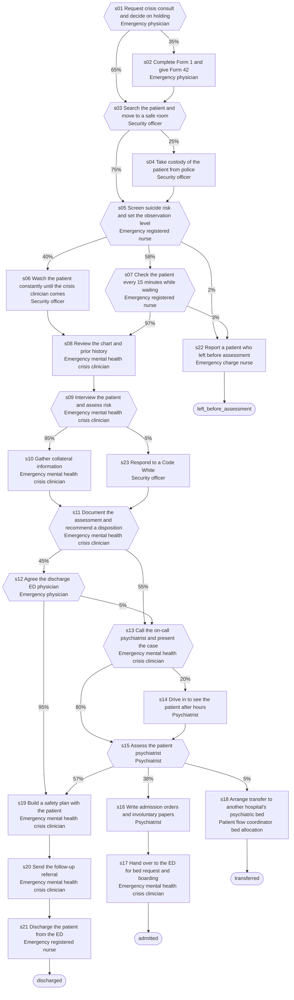

# Assess mental health crises in the emergency department

`hosp-mh-ed-crisis-assessment` · healthcare (public hospital) · mental health and addictions program · part of `community-hospital-corp`

When a person comes to the emergency department in a mental health crisis, the emergency physician first rules out a medical cause and then asks the hospital's crisis team for an assessment. A crisis clinician interviews the patient and family, assesses suicide and violence risk, and either arranges discharge with a safety plan and follow-up or asks the on-call psychiatrist to decide on admission, which may be involuntary under the Mental Health Act. Patients at risk are searched, held on a Form 1 and watched constantly, often for many hours, because crisis clinicians are not on site overnight, psychiatrists are on call, and psychiatric beds are scarce.

| | |
|---|---|
| Unit of work | one ED mental health crisis assessment |
| Starts when | After medical assessment the emergency physician requests a mental health crisis consult in the hospital information system and by phone. |
| Done when | The patient is discharged with a safety plan and a referral, an admission order is written for the inpatient psychiatry unit, or a transfer to another hospital's psychiatric bed is requested. |
| Organisation | A three-site Ontario community hospital corporation with about 130,000 to 160,000 ED visits a year, an extended-hours emergency mental health crisis team and a 40-bed inpatient psychiatry unit. (5,790 employees, 2019-2022) |
| Volume | 450 cases a month (range 380 to 560) |

## Where it sits

- Starts with **consult_request** from ed-physician-assessment (100% of cases)
- Sends **admission_order** to ed-admission-boarding (outcome: admitted)
- Sends **transfer_request** to ed-interfacility-transfer (outcome: transferred)
- Sends **clinic_referral** to mh-outpatient-clinic (outcome: discharged)
- Sends **discharge_instructions** to patient (outcome: discharged)
- Sends **ed_disposition** to ed-discharge-home (outcome: discharged)
- Sends **police_report** to police (outcome: left_before_assessment)
- Sends **security_call** to fs-security-response (outcome: any)
- Sends **incident_report** to qp-incident-management (outcome: any)

## Flow

## Roles

| Role | Department | Layer | FTE on this process | Loaded cost per hour | Evidence |
|---|---|---|---:|---:|---|
| Emergency mental health crisis clinician | Emergency mental health crisis team | individual contributor | 8 | 59 CAD | C |
| Emergency physician | Medical, dental and midwifery staff | senior specialist | 1 | 185 CAD | C |
| Emergency registered nurse | Emergency program | individual contributor | 6 | 61 CAD | C |
| Emergency charge nurse | Emergency program | supervisor | 0.2 | 63 CAD | C |
| Security officer | Portering and security | individual contributor | 7 | 31 CAD | C |
| Psychiatrist | Medical, dental and midwifery staff | senior specialist | 2.5 | 195 CAD | C |
| Patient flow coordinator (bed allocation) | Patient flow and bed management | senior specialist | 0.3 | 63 CAD | C |

## Steps

Hands-on time and the wait before each step show the most common value. Evidence tier A is a sourced number, B a sourced description, C the author's estimate.

| Step | Who | Kind | Hands-on | Wait before | Control | Evidence |
|---|---|---|---:|---:|---|---|
| **s01 Request crisis consult and decide on holding.** The emergency physician finishes the medical assessment (vital signs, blood alcohol or drug screen when indicated, physical causes ruled out), documents medical clearance and orders the crisis consult. The physician decides whether the patient's risk means they must be held if they try to leave. | Emergency physician | judgment | 10 min | 0 min |  | C |
| **s02 Complete Form 1 and give Form 42.** The physician fills in Form 1 (Application by Physician for Psychiatric Assessment), choosing the Box A serious-harm grounds or Box B, records the facts observed and reported, signs it, and gives the patient Form 42, the notice of the reasons and of the right to a lawyer. | Emergency physician | drafting | 10 min | 0 min | Mental Health Act (Ontario) s.15 and Form 1: physician examination within 7 days; detention for psychiatric assessment up to 72 hours | B [form1], [psychdb_f1] |
| **s03 Search the patient and move to a safe room.** Two security officers explain the search, check the patient and belongings for weapons, medications and ligature risks, store the belongings, have the patient change into a hospital gown and move them to a safe room or a stretcher in view of the nursing station. | Security officer | physical | 15 min | 10 min | ED mental health safety policy: search for weapons and ligature risks, safe room | C |
| **s04 Take custody of the patient from police.** For a patient brought in by police under the Mental Health Act, security and the nurse complete the joint risk form with the officers, take their report and documentation, and release them once hospital security can safely watch the patient. Much of the police wait happens earlier, during triage and medical assessment. | Security officer | communication | 10 min | 15 min | Police-hospital transition protocol (joint risk assessment before officers leave) | B [hd_police] |
| **s05 Screen suicide risk and set the observation level.** The emergency nurse completes the suicide risk screening tool, checks the safe room, and sets the observation level with the physician: constant one-to-one observation for high-risk or Form 1 patients, or checks every 15 minutes for others. | Emergency registered nurse | judgment | 15 min | 0 min | Accreditation Canada required organizational practice: suicide risk assessment | C |
| **s06 Watch the patient constantly until the crisis clinician comes.** A security officer stays within sight of the patient, logs behaviour on the observation sheet every 15 minutes, and calls the nurse if the patient becomes agitated or tries to leave. Overnight the patient waits until the crisis team starts in the morning. | Security officer | physical | 1.0 h | 0 min |  | C |
| **s07 Check the patient every 15 minutes while waiting.** The nurse or assistant checks the voluntary patient every 15 minutes, offers food and fluids, and reassesses if the patient's mood or behaviour changes, while the patient waits on a stretcher or in the waiting area for the crisis clinician. | Emergency registered nurse | physical | 10 min | 1.0 h |  | C |
| **s08 Review the chart and prior history.** The crisis clinician reads the ED notes and labs, looks up previous visits, psychiatric admissions and outpatient notes in the hospital information system and the ConnectingOntario viewer, and checks whether the patient has a community case manager or a current treatment team. | Emergency mental health crisis clinician | lookup | 15 min | 10 min |  | C |
| **s09 Interview the patient and assess risk.** The crisis clinician interviews the patient in a private room: the events leading to the visit, mood and psychotic symptoms, substance use, suicide and violence risk factors and protective factors, supports and what the patient wants. A security officer stays nearby when risk is high. | Emergency mental health crisis clinician | judgment | 45 min | 0 min |  | C |
| **s10 Gather collateral information.** With consent where possible (or without it when risk is serious), the clinician phones family, the family physician, the community mental health worker or group home staff to confirm the history, the safety of going home and who can support the patient. | Emergency mental health crisis clinician | communication | 20 min | 10 min | Personal Health Information Protection Act: consent or a permitted disclosure to reduce serious risk of harm | C |
| **s11 Document the assessment and recommend a disposition.** The clinician writes the crisis assessment note with a risk formulation and recommends either discharge with follow-up or psychiatric assessment, and discusses it with the emergency physician. | Emergency mental health crisis clinician | drafting | 20 min | 0 min |  | C |
| **s12 Agree the discharge (ED physician).** The emergency physician reads the crisis note, reassesses the patient briefly and agrees to discharge; if the patient was on a Form 1 the physician ends the detention and documents why. | Emergency physician | approval | 5 min | 20 min | Mental Health Act: only a physician can end a Form 1 detention; discharge on physician order | C |
| **s13 Call the on-call psychiatrist and present the case.** The crisis clinician pages the psychiatrist on call, presents the history, risk and collateral by phone and agrees when the psychiatrist will see the patient. | Emergency mental health crisis clinician | communication | 10 min | 15 min |  | C |
| **s14 Drive in to see the patient after hours.** For urgent after-hours cases the on-call psychiatrist leaves home and drives to the hospital, usually 20 to 40 minutes away. | Psychiatrist | travel | 25 min | 1.0 h |  | C |
| **s15 Assess the patient (psychiatrist).** The psychiatrist reviews the crisis note, interviews the patient, decides on the diagnosis and risk, and chooses admission (voluntary or involuntary), discharge with follow-up, or transfer when no bed is available. Overnight non-urgent patients are seen on morning rounds. | Psychiatrist | judgment | 45 min | 2.0 h | Psychiatric assessment by a physician before involuntary admission (Mental Health Act s.20) | B [baia2019] |
| **s16 Write admission orders and involuntary papers.** The psychiatrist writes the admission orders and, for an involuntary patient, completes Form 3 (Certificate of Involuntary Admission), gives the patient Form 30 notice and notifies the rights adviser; a Form 33 is added when the patient is found incapable of consenting to treatment. | Psychiatrist | drafting | 15 min | 0 min | Mental Health Act: Form 3 by a second physician, Form 30 notice and rights adviser | B [psychdb_f1] |
| **s17 Hand over to the ED for bed request and boarding.** The crisis clinician tells the ED charge nurse and the patient flow coordinator about the admission, enters the bed request on the bed board, and updates the patient and family on what happens next while the patient waits for a psychiatric bed. | Emergency mental health crisis clinician | coordination | 10 min | 10 min |  | C |
| **s18 Arrange transfer to another hospital's psychiatric bed.** When the corporation's psychiatry unit is full, the patient flow coordinator phones other hospitals with psychiatric beds, sends the consult notes and forms by fax, and waits for an acceptance; the patient stays in the ED until then. | Patient flow coordinator (bed allocation) | coordination | 1.0 h | 4.0 h |  | C |
| **s19 Build a safety plan with the patient.** The crisis clinician works through a written safety plan with the patient and family: warning signs, coping steps, people and crisis lines to call, removing means such as medications, and when to return. | Emergency mental health crisis clinician | drafting | 20 min | 5 min |  | C |
| **s20 Send the follow-up referral.** The clinician completes the referral to the hospital's outpatient mental health clinic, a rapid-access addiction clinic or a community agency, faxes it with the crisis note, and books or requests a follow-up appointment. | Emergency mental health crisis clinician | data entry | 10 min | 0 min |  | C |
| **s21 Discharge the patient from the ED.** The nurse gives the discharge instructions and safety plan, returns belongings from the security locker, confirms a safe ride home and closes the visit on the tracking board. | Emergency registered nurse | communication | 10 min | 10 min |  | C |
| **s22 Report a patient who left before assessment.** If a patient leaves before the crisis assessment, the charge nurse informs the physician, phones the police with a description when the patient is on a Form 1 or at high risk, calls the family where appropriate, and files an incident report. | Emergency charge nurse | communication | 20 min | 5 min | Missing patient / elopement policy; Mental Health Act return of a person under Form 1 | C |
| **s23 Respond to a Code White.** When the patient becomes violent, staff call a Code White; four security officers and the nurse de-escalate, and if needed hold the patient while the physician orders restraint or emergency medication. The event is documented and reported as an incident. | Security officer | physical | 25 min | 2 min | Code White procedure and least-restraint policy (Patient Restraints Minimization Act, 2001) | C |

## Exceptions

| Exception | Share of cases | What happens |
|---|---:|---|
| Overnight arrival | 25% | A patient cleared after midnight waits until the crisis team starts in the morning, under constant observation if held on a Form 1. |
| Involuntary admission | 12% | The psychiatrist certifies the patient on Form 3 and the patient boards in the ED waiting for a psychiatric bed. |
| No psychiatric bed in the corporation | 3% | The patient flow coordinator searches other hospitals for a bed while the patient waits in the ED. |
| Patient leaves before assessment | 4% | The patient walks out; police are called if the patient was on a Form 1. |
| Violence during assessment | 5% | A Code White interrupts the assessment. |

## Benchmarks

| Metric | Value | Unit | Population | Evidence |
|---|---|---|---|---|
| cycle_time_days | p50 0.35, p90 1.0 | calendar days from crisis consult request to ED discharge, admission order or transfer request | Ontario community hospital EDs, 2019-2022 | B [baia2019] |
| ed_los_p90_mental_health_admitted | 52.6 | hours | Toronto Western Hospital mental health ED visits, 2012-2017 | A [baia2019] |
| ed_los_p90_mental_health_discharged | 11.4 | hours | Toronto Western Hospital mental health ED visits, 2012-2017 | A [baia2019] |
| provincial_target_ed_los_admitted | 8 | hours (90th percentile target) | Ontario hospitals | A [oh_ed] |
| police_wait_in_ed | 80 | minutes average after a joint protocol (125 before) | St. Joseph's Healthcare Hamilton | A [hd_police] |

## Pain points

- Patients cleared overnight wait until the crisis team arrives in the morning, and psychiatrists see non-urgent patients on morning rounds, so the ED stretcher and a security officer are tied up for hours. (steps s06, s07, s15; B [baia2019])
- Constant observation of Form 1 patients by security officers or sitters is a large hidden labour cost. (steps s06; C)
- Police officers wait in the ED until custody can be handed over. (steps s04; B [hd_police])
- Paper Mental Health Act forms are error-prone; a defective Form 1 or Form 3 can make a detention unlawful. (steps s02, s16; B [form1], [psychdb_f1])
- When the psychiatric unit is full, bed searches at other hospitals and boarding keep admitted patients in the ED for a day or more. (steps s17, s18; B [baia2019])

## Assumptions

- Describes the common practice of an Ontario community hospital ED crisis service in 2019-2022, not Halton Healthcare's own procedures.
- Crisis clinicians work extended hours (roughly 08:00 to midnight), not overnight, as the organisation file's shift pattern says; overnight the ED physician holds high-risk patients until morning.
- The process ends when the admission order is handed to ed-admission-boarding; the wait for a psychiatric bed is counted there, not here.
- The organisation file's process map lists four roles; this workflow also uses ed_rn, ed_charge_nurse and bed_flow_coordinator, which exist in the organisation file. It also adds outputs to ed-discharge-home (ed_disposition), police (police_report) and qp-incident-management (incident_report), and the transfer request to ed-interfacility-transfer, which the map lacks.
- Only the large-site ED resource (ed_spaces_otmh) is used; the same steps run at the two smaller sites.
- Shares (Form 1 35%, police-brought 25%, constant observation 40%, psychiatry 55%, admission 38% of psychiatry patients, transfer 5%, elopement 4%, Code White 5%) are tier C estimates.
- Simulated cycle time runs longer than the benchmark median because overnight waits for the crisis team and morning psychiatry rounds are included; the benchmark itself is a derivation from a downtown academic hospital with 24-hour psychiatry cover.
- Loaded costs are the organisation file's (wage times 1.35; physician figures are gross OHIP earnings).

## Sources

- [baia2019] [Analysis of emergency department length of stay for mental health visits: a case study of a Canadian academic hospital (D. T. Baia Medeiros, S. Hahn-Goldberg, E. O'Connor, D. M. Aleman), CJEM 21(3):374-383](https://www.cambridge.org/core/product/DB5FBD33DA227D013CB20D4F2586CFCA) (Cambridge University Press (Canadian Journal of Emergency Medicine), 2019). Toronto Western Hospital, April 2012 to March 2017: 24,972 of 308,016 ED visits (8.1%) were mental health visits; 90th percentile ED length of stay 11.4 h for discharged mental health visits versus 7.3 h for others, and 52.6 h versus 29.3 h for admitted visits; 90th percentile time from physician assessment to admission decision 19.1 h versus 10.9 h.
- [hd_police] [Improving hand offs between police and emergency departments (K. Born, A. Laupacis, M. Tierney)](https://healthydebate.ca/2014/02/topic/wait-times-access-to-care/police_emergency_departments/) (Healthy Debate, 2014). A joint police-hospital protocol at St. Joseph's Healthcare Hamilton cut the average police wait in the ED from 125 to 80 minutes; under the Hamilton and Ottawa protocols hospital security takes over monitoring once a joint risk assessment or medical assessment allows the officer to leave; no provincial data on police wait times exist.
- [form1] [Form 1, Mental Health Act: Application by Physician for Psychiatric Assessment (6427-41)](https://forms.mgcs.gov.on.ca/dataset/0202a2c2-e7c3-4e60-bb80-4e6fc49c4a8f/resource/b024dcd2-66e9-409d-8c0a-b26fdda02d58/download/txt_6427-41e.htm) (Government of Ontario, Ministry of Health, 2000). A physician may sign Form 1 only after personally examining the person within the past seven days; it authorizes apprehension for 7 days and detention in a psychiatric facility for a maximum of 72 hours; the physician completes Box A (serious harm test) or Box B (incapable patient with a recurring disorder).
- [psychdb_f1] [Form 1 and Form 42 (Ontario Mental Health Act teaching page)](https://www.psychdb.com/teaching/on-mha/form-1-42) (PsychDB, 2025). In an ED of a Schedule 1 facility the physician issues Form 1 and Form 42 at the same time and Form 42 must be given to the patient immediately; a Form 3 involuntary admission must be signed by a different physician after a separate assessment; Form 33 when the patient is found incapable.
- [oh_ed] [Time Spent in Emergency Departments](https://ontariohealth.ca/System-Performance/Time-Spent-in-Emergency-Departments) (Ontario Health, 2026). Provincial ED length-of-stay targets: 4 hours for low-urgency patients not admitted, 8 hours for high-urgency patients not admitted and 8 hours for admitted patients (the reported averages on the page are for 2025-2026, outside the reference period, and are not used).

Written by claude-opus on 2026-11-24.
