# Report and review patient safety incidents

`hosp-qp-incident-management` · hospitals · quality and patient safety · part of `community-hospital-corp`

Staff who see a patient safety incident or near miss give immediate care and then enter a report in the hospital's safety reporting system. A quality specialist screens new reports each business day and the unit manager follows up and closes most of them, but serious harm is escalated at once for a preliminary review, disclosure to the patient, a concise or comprehensive analysis, an approved action plan and, for critical incidents, reports to the Medical Advisory Committee, the board quality committee and, for medication events, a provincial reporting system. Delays come from managers' follow-up queues, booking review teams and committee calendars, and under-reporting and weak actions limit what the hospital learns.

| | |
|---|---|
| Unit of work | one incident report |
| Starts when | A staff member, physician or volunteer sees a patient safety incident or near miss and enters a report. |
| Done when | The report is followed up and closed by the manager, or, for serious harm, the analysis is done, the patient has been told, actions are tracked to completion, required committee and external reports are filed and the file is closed. |
| Organisation | A three-site Ontario community hospital corporation with about 640 beds, a quality and risk team of about 20 and a commercial web-based incident reporting system used by all staff. (5,790 employees, 2019-2022) |
| Volume | 600 cases a month (range 450 to 800) |

## Where it sits

- Starts with **incident_report** from med-medication-administration (30% of cases)
- Starts with **incident_report** from med-inpatient-medical-care (25% of cases)
- Starts with **incident_report** from ed-physician-assessment (10% of cases)
- Starts with **incident_report** from sx-perioperative-case (8% of cases)
- Starts with **incident_report** from sx-surgical-inpatient-care (6% of cases)
- Starts with **incident_report** from dx-lab-testing (6% of cases)
- Starts with **incident_report** from mh-inpatient-psychiatry (5% of cases)
- Starts with **incident_report** from wc-labour-delivery (4% of cases)
- Starts with **incident_report** from fs-security-response (4% of cases)
- Starts with **incident_report** from qp-patient-relations (2% of cases)
- Sends **disclosure_letter** to patient (outcome: closed_after_review)
- Sends **disclosure_letter** to patient (outcome: closed_with_system_change)
- Sends **insurer_notice** to insurer (outcome: closed_after_review)
- Sends **quality_report** to ms-medical-advisory-committee (outcome: closed_after_review)
- Sends **quality_report** to ex-board-governance (outcome: closed_after_review)
- Sends **change_request** to dh-system-change (outcome: closed_with_system_change)
- Sends **quality_report** to qp-quality-improvement-plan (outcome: any)

## Flow

```mermaid
flowchart TD
    s01["s01 Give immediate care and tell the charge nurse<br/>Inpatient registered nurse"]
    s02{{"s02 Enter the incident report<br/>Inpatient registered nurse"}}
    s03["s03 System routes the report<br/>Automated"]
    s04{{"s04 Quality specialist screens new reports<br/>Quality and patient safety specialist"}}
    s05["s05 Unit manager follows up  medicine and other units<br/>Patient care manager, inpatient unit"]
    s06["s06 Unit manager follows up  emergency<br/>Patient care manager, emergency department"]
    s07["s07 Unit manager follows up  surgery<br/>Patient care manager, perioperative or surgical unit"]
    s08{{"s08 Quality specialist checks and closes the report<br/>Quality and patient safety specialist"}}
    s09["s09 Chase the manager for overdue follow-up<br/>Quality and patient safety specialist"]
    s10["s10 Escalate to leaders and secure items<br/>Clinical administrator  evenings, nights and weekends"]
    s11["s11 Preliminary review of a serious incident<br/>Quality and patient safety specialist"]
    s12["s12 Physician discloses the incident to the patient<br/>Hospitalist physician"]
    s13{{"s13 Director decides the type of review<br/>Director, quality, risk and patient experience"}}
    s14{{"s14 Notify the insurer<br/>Quality and patient safety specialist"}}
    s15["s15 Concise analysis<br/>Quality and patient safety specialist"]
    s16["s16 Set up the comprehensive review<br/>Quality and patient safety specialist"]
    s17["s17 Interview staff and build the timeline<br/>Quality and patient safety specialist"]
    s18["s18 Chair the quality of care review meeting<br/>Director, quality, risk and patient experience"]
    s19["s19 Physician leaders take part in the review<br/>Department chief / medical director"]
    s20["s20 Unit managers take part in the review<br/>Patient care manager, inpatient unit"]
    s21["s21 Draft recommendations and action plan<br/>Quality and patient safety specialist"]
    s22{{"s22 Director approves the action plan<br/>Director, quality, risk and patient experience"}}
    s23{{"s23 Disclose findings and system changes to the patient<br/>Hospitalist physician"}}
    s24{{"s24 Report to the Medical Advisory Committee and quality committee<br/>Quality and patient safety specialist"}}
    s25["s25 Report the medication critical incident to NSIR<br/>Quality and patient safety specialist"]
    s26{{"s26 Track completion of actions<br/>Quality and patient safety specialist"}}
    s27["s27 Submit a system change request<br/>Quality and patient safety specialist"]
    s28["s28 Close the incident file<br/>Quality and patient safety specialist"]
    s01 --> s02
    s02 -->|"96%"| s03
    s02 -->|"4%"| s10
    s03 --> s04
    s04 -->|"52%"| s05
    s04 -->|"20%"| s06
    s04 -->|"26%"| s07
    s04 -->|"2%"| s11
    s05 --> s08
    s06 --> s08
    s07 --> s08
    s08 -->|"88%"| end0
    s08 -->|"10%"| s09
    s08 -->|"2%"| s11
    s09 --> s08
    s10 --> s11
    s11 --> s12
    s12 --> s13
    s13 -->|"30%"| s14
    s13 -->|"64%"| s15
    s13 -->|"6%"| s16
    s14 -->|"91%"| s15
    s14 -->|"9%"| s16
    s15 --> s21
    s16 --> s17
    s17 --> s18
    s18 --> s19
    s19 --> s20
    s20 --> s21
    s21 --> s22
    s22 -->|"65%"| s23
    s22 -->|"5%"| s24
    s22 -->|"30%"| s26
    s23 -->|"6%"| s24
    s23 -->|"94%"| s26
    s24 -->|"5%"| s25
    s24 -->|"95%"| s26
    s25 --> s26
    s26 -->|"15%"| s27
    s26 -->|"85%"| s28
    s27 --> end1
    s28 --> end2
    end0(["closed_by_manager"])
    end1(["closed_with_system_change"])
    end2(["closed_after_review"])
```

## Roles

| Role | Department | Layer | FTE on this process | Loaded cost per hour | Evidence |
|---|---|---|---:|---:|---|
| Inpatient registered nurse | Inpatient medicine units | individual contributor | 3 | 61 CAD | B [src7], [src4] |
| Patient care manager, inpatient unit | Medicine and critical care program | manager | 1.4 | 78 CAD | C |
| Patient care manager, emergency department | Emergency program | manager | 0.5 | 78 CAD | C |
| Patient care manager, perioperative or surgical unit | Surgical and perioperative program | manager | 0.6 | 78 CAD | C |
| Quality and patient safety specialist | Quality, risk and patient relations | senior specialist | 5 | 68 CAD | B [src3], [src1] |
| Director, quality, risk and patient experience | Quality, patient safety and professional practice | director | 0.4 | 101 CAD | B [src1] |
| Clinical administrator (evenings, nights and weekends) | Patient flow and bed management | supervisor | 0.1 | 68 CAD | B [src4] |
| Hospitalist physician | Medical, dental and midwifery staff | senior specialist | 0.4 | 160 CAD | B [src4] |
| Department chief / medical director | Medical, dental and midwifery staff | director | 0.2 | 210 CAD | C |

## Steps

Hands-on time and the wait before each step show the most common value. Evidence tier A is a sourced number, B a sourced description, C the author's estimate.

| Step | Who | Kind | Hands-on | Wait before | Control | Evidence |
|---|---|---|---:|---:|---|---|
| **s01 Give immediate care and tell the charge nurse.** The nurse or other staff member who finds the incident (a fall, a wrong dose, a mislabelled specimen) checks the patient, gets the physician to assess if needed, tells the charge nurse and documents the facts of the event in the patient's chart without mentioning the incident report. | Inpatient registered nurse | physical | 15 min | 0 min |  | B [src7], [src4], [src3] |
| **s02 Enter the incident report.** Usually later in the shift, the staff member logs into the safety reporting system, picks the incident type, location and patient, writes what happened, rates the apparent harm and names any equipment or medication involved; the report goes to the unit manager. | Inpatient registered nurse | data entry | 15 min | 4.0 h | Accreditation Canada Required Organizational Practice: patient safety incident management | B [src7], [src4], [src6] |
| **s03 System routes the report.** The incident system files the report under the unit and incident type, emails the responsible manager and the quality team, and adds it to the manager's open follow-up queue. | Automated | system auto | 0 min | 0 min |  | C |
| **s04 Quality specialist screens new reports.** Each business morning a quality and patient safety specialist reads the new reports, corrects the type or routing, checks the harm rating, and pulls out any that look more serious than rated for escalation. | Quality and patient safety specialist | review | 3 min | 20.0 h |  | C |
| **s05 Unit manager follows up (medicine and other units).** The patient care manager opens the report from the incident system queue, talks to the staff involved and, where needed, the patient, confirms the harm level and contributing factors, records actions taken (staff coaching, equipment fix, process reminder) and marks the follow-up complete. | Patient care manager, inpatient unit | review | 25 min | 5.0 d | Accreditation Canada Required Organizational Practice: patient safety incident management | C |
| **s06 Unit manager follows up (emergency).** The emergency department patient care manager opens the report from the incident system queue, talks to the staff involved and, where needed, the patient, confirms the harm level and contributing factors, records actions taken (staff coaching, equipment fix, process reminder) and marks the follow-up complete. | Patient care manager, emergency department | review | 25 min | 5.0 d | Accreditation Canada Required Organizational Practice: patient safety incident management | C |
| **s07 Unit manager follows up (surgery).** The perioperative or surgical patient care manager opens the report from the incident system queue, talks to the staff involved and, where needed, the patient, confirms the harm level and contributing factors, records actions taken (staff coaching, equipment fix, process reminder) and marks the follow-up complete. | Patient care manager, perioperative or surgical unit | review | 25 min | 5.0 d | Accreditation Canada Required Organizational Practice: patient safety incident management | C |
| **s08 Quality specialist checks and closes the report.** In a weekly pass the specialist checks that the follow-up is documented and the harm level and contributing factors are coded consistently for trend reports, then closes the report or sends it back to the manager. | Quality and patient safety specialist | validation | 5 min | 3.0 d |  | C |
| **s09 Chase the manager for overdue follow-up.** The specialist emails or raises at the program quality meeting the reports still open past the hospital's target, and the manager adds the missing follow-up before the report comes back for checking. | Quality and patient safety specialist | communication | 10 min | 7.0 d |  | C |
| **s10 Escalate to leaders and secure items.** For serious harm the charge nurse phones the manager or, after hours, the administrator on call, who makes sure the patient is safe, the physician and family are informed, and the equipment, medication or supplies involved are kept aside and tagged out of service. | Clinical administrator (evenings, nights and weekends) | coordination | 30 min | 20 min | CIAF immediate response: secure items and reduce the risk of imminent recurrence; hospital remove-from-service (tag-out) procedure for equipment | B [src4], [src3] |
| **s11 Preliminary review of a serious incident.** A quality and patient safety specialist reads the chart and the report, phones the staff involved, decides whether the event meets the critical incident definition, and identifies whether a device or medication report to an outside body may be needed. | Quality and patient safety specialist | analysis | 2.0 h | 1.0 d |  | B [src3], [src1] |
| **s12 Physician discloses the incident to the patient.** The most responsible physician, with a nurse or manager present, meets the patient or family, explains what happened and its consequences, apologizes, says what will be done next and records the disclosure in the chart. | Hospitalist physician | communication | 30 min | 12.0 h | Public Hospitals Act, Regulation 965 (hospital management): disclosure of critical incidents to the patient, the medical advisory committee and the administrator | B [src4], [src1] |
| **s13 Director decides the type of review.** The director of quality reviews the preliminary findings and decides on a concise review led by one facilitator or a comprehensive review by a team, whether to run it as a protected quality of care review, and whether the insurer must be notified. | Director, quality, risk and patient experience | judgment | 30 min | 1.0 d |  | B [src3], [src4] |
| **s14 Notify the insurer.** The specialist writes a short factual notice of the incident and the possible claim to the hospital's liability insurer and keeps the reference number on the incident file. | Quality and patient safety specialist | drafting | 1.0 h | 1.0 d | Liability insurance subscription terms: prompt notice of incidents that may lead to a claim | B [src1] |
| **s15 Concise analysis.** The specialist, acting as facilitator, gathers the facts from the chart and short interviews with staff, the patient and family, identifies the main contributing factors and drafts actions with the unit manager over a few days. | Quality and patient safety specialist | analysis | 4.0 h | 5.0 d |  | B [src3] |
| **s16 Set up the comprehensive review.** The specialist picks the review team (physician lead, managers, staff from the unit, an outside expert if needed), books interviews and a meeting room, and has members sign the quality of care confidentiality agreement. | Quality and patient safety specialist | coordination | 1.0 h | 3.0 d |  | B [src3] |
| **s17 Interview staff and build the timeline.** The specialist interviews the staff, physicians and patient or family involved, collects policies, equipment logs and orders, and builds a timeline and contributing factor diagram for the team. | Quality and patient safety specialist | analysis | 8.0 h | 5.0 d |  | B [src3] |
| **s18 Chair the quality of care review meeting.** The director of quality chairs the protected review meeting, walks the team through the timeline, and leads the discussion of how and why the incident happened and which system changes would prevent it. | Director, quality, risk and patient experience | analysis | 3.0 h | 7.0 d | Public Hospitals Act, Regulation 965 (hospital management): disclosure of critical incidents to the patient, the medical advisory committee and the administrator | B [src1], [src3] |
| **s19 Physician leaders take part in the review.** Two department chiefs or physician leads from the services involved attend the same meeting, explain the clinical decisions and agree the medical findings and recommendations. | Department chief / medical director | analysis | 3.0 h | 0 min |  | C |
| **s20 Unit managers take part in the review.** Two managers or educators from the units involved attend the same meeting, describe staffing, equipment and workflow on the day and take on actions for their units. | Patient care manager, inpatient unit | analysis | 3.0 h | 0 min |  | C |
| **s21 Draft recommendations and action plan.** The specialist writes the findings, contributing factors and recommended actions with an owner and due date for each, using the hierarchy of effectiveness to favour system fixes over reminders. | Quality and patient safety specialist | drafting | 2.0 h | 2.0 d |  | B [src3] |
| **s22 Director approves the action plan.** The director of quality reviews the action plan with the program director, confirms owners and dates, and signs it off for tracking. | Director, quality, risk and patient experience | approval | 30 min | 3.0 d | Hospital incident management policy: leadership approval of recommendations | C |
| **s23 Disclose findings and system changes to the patient.** The physician, with the manager or director, meets or phones the patient or family to share the facts learned and the system steps the hospital is taking, within what a protected quality of care review allows, and records the date in the chart. | Hospitalist physician | communication | 45 min | 5.0 d | Public Hospitals Act, Regulation 965 (hospital management): disclosure of critical incidents to the patient, the medical advisory committee and the administrator | B [src4], [src1] |
| **s24 Report to the Medical Advisory Committee and quality committee.** The specialist summarizes the incident, findings and actions for the next Medical Advisory Committee meeting and adds it to the aggregated critical incident report the board quality committee receives at least twice a year. | Quality and patient safety specialist | drafting | 1.0 h | 21.0 d | Public Hospitals Act, Regulation 965 (hospital management): disclosure of critical incidents to the patient, the medical advisory committee and the administrator | A [src1] |
| **s25 Report the medication critical incident to NSIR.** The specialist enters the de-identified incident, harm level and contributing factors into CIHI's National System for Incident Reporting as the ministry directive requires for medication and IV fluid critical incidents, and answers any follow-up questions from ISMP Canada. | Quality and patient safety specialist | data entry | 1.0 h | 2.0 d | Ontario Ministry of Health directive (October 2011) to report critical incidents involving medications and IV fluids to CIHI NSIR | A [src2], [src1] |
| **s26 Track completion of actions.** The specialist follows up each action owner until the change is in place (a new pump setting, a revised order set, a policy update), checks early evidence that it works and records completion in the incident file. | Quality and patient safety specialist | coordination | 30 min | 21.0 d |  | B [src3] |
| **s27 Submit a system change request.** Where the fix needs a change to the hospital information system (an order set, an alert, a default dose), the specialist submits a change request to digital health with the incident reference and closes the incident file once it is accepted. | Quality and patient safety specialist | drafting | 30 min | 1.0 d |  | C |
| **s28 Close the incident file.** The specialist completes the closing fields in the incident system (final harm level, contributing factors, actions, disclosure dates) so the case counts in quarterly trend reports, and closes the file. | Quality and patient safety specialist | data entry | 15 min | 1.0 d |  | C |

## Exceptions

| Exception | Share of cases | What happens |
|---|---:|---|
| Critical incident with comprehensive review | 1% | Death or serious harm not caused by the illness or a known risk: leaders are phoned at once, items secured, the patient told, a team review held under quality of care protection, and the case reported to the Medical Advisory Committee and the board quality committee. |
| Medication critical incident reported to NSIR | 0% | A medication or IV fluid critical incident is also entered in CIHI's national system under the 2011 ministry directive; Ontario hospitals together filed 17 such reports in 2015. |
| Overdue manager follow-up | 10% | The report sits in the manager's queue past the target and the quality specialist chases it, sometimes more than once. |
| Serious event first rated as minor | 3% | The screening specialist or the closing check finds harm or a pattern that the reporter or manager rated low and starts a preliminary review late. |

## Benchmarks

| Metric | Value | Unit | Population | Evidence |
|---|---|---|---|---|
| cycle_time_days | p50 12, p90 40 | calendar days from the incident to the report being closed | All incident reports at an Ontario community hospital, 2019-2022 | C [src3] |
| reports_per_1000_patient_days | 27.9 | event reports per 1,000 patient days | Pennsylvania hospitals, 2022 (mandatory reporting) | A [src5] |
| share_of_reports_with_harm | 0.038 | share of reports that are serious events (harm) | Pennsylvania acute care facilities, 2022 | A [src6] |
| medication_critical_incidents_reported_ontario | 17 | reports to NSIR from all Ontario hospitals in 2015 | Ontario hospitals | A [src2] |

## Pain points

- Reports wait in unit managers' queues for days or weeks because managers also run staffing, budgets and patient flow, so feedback to the reporter is slow. (steps s05, s06, s07, s09; C)
- Harm levels and incident types are misclassified at entry, so serious events can be missed until screening or closure. (steps s02, s04, s08; C)
- Comprehensive reviews wait weeks for interviews and a meeting date that suits physicians, managers and staff, and committee reporting follows monthly and quarterly calendars. (steps s16, s17, s18, s24; B [src3])
- Incident reports capture only part of the harm that occurs, and lessons are not shared between hospitals. (steps s02, s26; B [src1], [src2])

## Assumptions

- The reporting staff member is represented by the inpatient RN role (med_rn), and the managers of medicine, mental health, maternity, paediatrics and support units by med_manager; the most responsible physician is represented by the hospitalist role.
- Immediate clinical care after the incident (s01) is counted here in short form; any treatment of injuries belongs to the clinical process.
- About 3.5% of reports are phoned in as serious at once and a further 3% are upgraded at screening or closing, so about 6.5-7% get a preliminary review; about 0.6% of reports (roughly 40 a year) get a comprehensive review and about 0.6% (roughly 40 a year) are written up individually for the Medical Advisory Committee and quality committee; about one a year is a medication critical incident reported to NSIR, which is in line with harmful-event shares in a large mandatory system (3.8% harmful, 0.19% high harm).
- Insurer notices, committee reports and disclosure letters are produced only on the serious-incident path (outcome closed_after_review); the quality_report to the quality improvement plan process is the aggregated trend data from every report.
- Device-related incidents also go to biomedical engineering, which files Health Canada device reports in its own process; that handoff is not drawn here.
- The simulated median cycle time is driven by the manager follow-up queue (mode five days, up to three weeks) and the weekly closing check; the 90th percentile includes chased reports and serious incidents that take one to three months.
- Regulation 965 requirements are taken from the Auditor General and ISMP Canada descriptions; the provincial e-Laws page could not be opened, so no section numbers are cited.

## Sources

- [src1] [Acute-Care Hospital Patient Safety and Drug Administration (2019 Annual Report, Volume 1, Chapter 3, Section 3.01)](https://www.auditor.on.ca/en/content/annualreports/arreports/en19/v1_301en19.pdf) (Office of the Auditor General of Ontario, 2019). Ontario hospital patient safety governance: the CEO must establish a system for reviewing and disclosing critical incidents, implementing measures against recurrence and giving aggregated critical incident data to the board Quality Committee at least twice a year; a committee required by the Public Hospitals Act reviews critical incidents; optional Quality of Care Committee under QCIPA; staff are expected to report patient safety incidents; Accreditation Canada required practice on patient safety incident management; 154 medication critical incidents reported to NSIR from October 2011 to 2018; HIROC as insurer has access to incident cases.
- [src2] [Ontario Hospital Critical Incidents Related to Medications or IV Fluids: Analysis Report, January to December 2015](https://www.ismp-canada.org/download/ocil/Ontario-Critical-Incident-Analysis-Report-2016.pdf) (Institute for Safe Medication Practices Canada (for Health Quality Ontario), 2016). October 2011 ministry directive that all critical incidents involving medications and IV fluids be reported to CIHI's National System for Incident Reporting; Regulation 965 definition of a critical incident; boards must ensure a system for analysing critical incidents and a plan to reduce recurrence; 17 such reports from all Ontario hospitals in 2015.
- [src3] [Canadian Incident Analysis Framework](https://ualberta.scholaris.ca/bitstreams/bd7a09f1-aab5-4e21-8116-fe4c6ac0f0ad/download) (Canadian Patient Safety Institute, ISMP Canada, Saskatchewan Health and Patients for Patient Safety Canada, 2012). Incident management stages: immediate response (care for patient, report, secure items, begin disclosure, reduce risk of recurrence), prepare for analysis (preliminary investigation, choose method, team, meetings, interviews), analysis, follow through, close the loop; concise analysis by one facilitator over hours to days for no or low harm; comprehensive analysis by an interdisciplinary team over up to 90 days; system versus accountability review triage.
- [src4] [Policy B-301: Disclosing Adverse Events (revised January 2019)](https://qch.on.ca/uploads/Your%20Hospital%20Visit%20Group/Patient%20Rights/B-301%20Disclosure%20of%20Adverse%20Event%20January%202019.pdf) (Queensway Carleton Hospital, Ottawa, 2019). Ontario community hospital practice: every adverse event documented in the chart and an incident report completed; significant harm reported to chief of staff, VP patient care and director of risk management, administrator on call after hours; disclosure in two stages (initial, then post-analysis) by the most responsible physician with a second person present; QCIPA limits what a quality of care review can disclose; facts of the disclosure recorded in the health record.
- [src5] [2022 Pennsylvania Patient Safety Reporting: Updated Rates for Acute Care Event Reports](https://doi.org/10.33940/001c.88054) (Patient Safety (Pennsylvania Patient Safety Authority), 2023). Hospital event report rate of 27.9 reports per 1,000 patient days in 2022 in a mandatory statewide reporting system, the third annual decrease and 5.4% below 2021.
- [src6] [Patient Safety Trends in 2022: An Analysis of 256,679 Serious Events and Incidents From the Nation's Largest Event Reporting Database](https://doi.org/10.33940/001c.74752) (Patient Safety (Pennsylvania Patient Safety Authority), S. Kepner and R. Jones, 2023). Of 256,679 acute care reports in 2022, 96.2% were incidents (no harm) and 3.8% (9,741) serious events with harm; 489 (0.19%) were high harm.
- [src7] [Safety Incident Management (harmonized policy)](https://hpaoht.ca/wp-content/uploads/2024/02/2023-11-01-Safety-Incident-Management-HPA-OHT-FINAL.pdf) (Huron Perth and Area Ontario Health Team, 2023). Ontario hospital policy: first priority is the immediate needs of the patient; all staff report incidents, hazards and near misses promptly, inform their supervisor and complete a report; incidents reviewed and tracked to identify trends; Public Hospitals Act definition of a critical incident.

Written by claude-opus on 2026-11-24.
