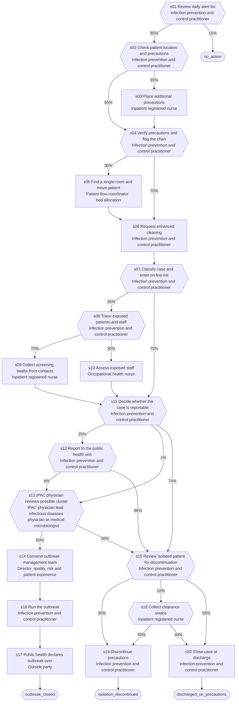

# Prevent and control infections (isolation cases and outbreaks)

`hosp-qp-ipac-surveillance` · healthcare (acute care hospital) · quality, patient safety and infection prevention and control · part of `community-hospital-corp`

This process stops infections spreading inside the hospital. Infection prevention and control practitioners review new positive results and flagged admissions, make sure nurses have placed the right precautions, arrange single rooms and enhanced cleaning, trace exposed patients and staff, report diseases of public health significance and, when cases cluster, declare and run an outbreak with the public health unit. Each isolated patient is reviewed until precautions can stop or the patient goes home. It is slow and error-prone because practitioners work weekday hours while results arrive around the clock, single rooms are scarce, and outbreak work in respiratory season and the COVID-19 waves of 2020-2022 crowds out routine surveillance.

| | |
|---|---|
| Unit of work | one isolation case or outbreak action |
| Starts when | A positive laboratory result, an admission flagged with an organism, or a public health notice reaches the IPAC team. |
| Done when | Precautions are discontinued, the patient is discharged with the case closed, the outbreak is declared over, or no action is needed. |
| Organisation | A three-site Ontario community hospital corporation of about 640 beds with a central IPAC team in the quality department, an IPAC physician lead and a regional public health unit. (5,790 employees, 2019-2022) |
| Volume | 300 cases a month (range 200 to 500) |

## Where it sits

- Starts with **lab_result** from dx-lab-testing (65% of cases)
- Starts with **lab_result** from dx-referral-testing (30% of cases)
- Starts with **outbreak_notice** from public_health_unit (5% of cases)
- Sends **isolation_order** to cs-bed-management (outcome: any)
- Sends **cleaning_request** to fs-environmental-cleaning (outcome: any)
- Sends **reportable_disease_report** to public_health_unit (outcome: any)
- Sends **exposure_notice** to hr-occupational-health (outcome: any)
- Sends **outbreak_notice** to public_health_unit (outcome: outbreak_closed)

## Flow

## Roles

| Role | Department | Layer | FTE on this process | Loaded cost per hour | Evidence |
|---|---|---|---:|---:|---|
| Infection prevention and control practitioner | Infection prevention and control | senior specialist | 7 | 63 CAD | B [bryce2008], [pidac_rpap] |
| Inpatient registered nurse | Inpatient medicine units | individual contributor | 1.5 | 61 CAD | C |
| Patient flow coordinator (bed allocation) | Patient flow and bed management | senior specialist | 0.6 | 63 CAD | C |
| Occupational health nurse | Occupational health and safety | senior specialist | 1 | 61 CAD | C |
| Director, quality, risk and patient experience | Quality, patient safety and professional practice | director | 0.1 | 101 CAD | C |
| IPAC physician lead (infectious diseases physician or medical microbiologist) |  | senior specialist | 0.2 | 210 CAD | C |

## Steps

Hands-on time and the wait before each step show the most common value. Evidence tier A is a sourced number, B a sourced description, C the author's estimate.

| Step | Who | Kind | Hands-on | Wait before | Control | Evidence |
|---|---|---|---:|---:|---|---|
| **s01 Review daily alert list.** Each morning the infection prevention and control practitioner opens the list of new positive results (MRSA, VRE, CPE, C. difficile, influenza, COVID-19, tuberculosis and others) from the laboratory system and faxed or OLIS reference results, plus admissions flagged with an organism, and decides which need action. | Infection prevention and control practitioner | lookup | 4 min | 6.0 h |  | C |
| **s02 Check patient location and precautions.** The practitioner finds the patient's current room on the bed board, checks whether additional precautions are already ordered in the chart and phones the unit charge nurse to confirm signage and room type. | Infection prevention and control practitioner | lookup | 5 min | 5 min |  | B [pidac_rpap] |
| **s03 Place additional precautions.** The patient's nurse posts the precaution sign at the door, sets up a PPE cart with gowns, gloves and masks, dedicates equipment such as a stethoscope and commode, and tells the patient and family what the precautions mean. | Inpatient registered nurse | physical | 15 min | 30 min | PIDAC Routine Practices and Additional Precautions in All Health Care Settings (Public Health Ontario); Accreditation Canada infection prevention and control standards | B [pidac_rpap] |
| **s04 Verify precautions and flag the chart.** The practitioner confirms the type of precautions suits the organism, enters an organism alert in the hospital information system so it shows on future visits and adds the case to the isolation list used by bed management. | Infection prevention and control practitioner | data entry | 5 min | 5 min | PIDAC Routine Practices and Additional Precautions in All Health Care Settings (Public Health Ontario): ICP verification of additional precautions | B [pidac_rpap] |
| **s05 Find a single room and move patient.** The patient flow coordinator looks for a free single room on the bed board, negotiates with unit managers to swap patients if none is free, and books the move and the cleaning of the vacated bed. | Patient flow coordinator (bed allocation) | coordination | 20 min | 4.0 h |  | C |
| **s06 Request enhanced cleaning.** The practitioner asks environmental services to switch the room to enhanced or sporicidal cleaning, for example twice-daily cleaning for C. difficile, and to clean the vacated bed space if the patient moved. | Infection prevention and control practitioner | communication | 3 min | 10 min |  | C |
| **s07 Classify case and enter on line list.** The practitioner reviews admission date, symptom onset and earlier results in the chart to decide whether the infection is hospital-acquired under surveillance definitions, and enters the case in the surveillance spreadsheet used for monthly rates and public reporting. | Infection prevention and control practitioner | analysis | 10 min | 1.0 h | Ontario Ministry of Health public reporting of hospital patient safety indicators (C. difficile, MRSA/VRE bacteremia) | A [oh_psi] |
| **s08 Trace exposed patients and staff.** The practitioner lists roommates and patients who shared a bathroom or were on the unit during the infectious period, pulls staff assignments for airborne or unprotected exposures, and decides who needs screening or assessment. | Infection prevention and control practitioner | analysis | 30 min | 1.0 h |  | C |
| **s09 Collect screening swabs from contacts.** The unit nurses collect nasal, rectal or respiratory swabs from the listed contacts under a medical directive, label them and send them to the laboratory, placing contacts on precautions until results return where policy requires. | Inpatient registered nurse | physical | 15 min | 4.0 h |  | C |
| **s10 Assess exposed staff.** The occupational health nurse contacts each exposed staff member, checks immunity and fit-test records, arranges baseline or follow-up testing and decides on any work restriction, telling the manager and scheduling office. | Occupational health nurse | judgment | 1.0 h | 1.0 d | Occupational Health and Safety Act (Ontario) and Regulation 67/93 (Health Care and Residential Facilities): employer duty to protect workers from infectious exposure | C |
| **s11 Decide whether the case is reportable.** The practitioner checks the organism against the list of diseases of public health significance and looks for links to other recent cases on the same unit that could signal a cluster. | Infection prevention and control practitioner | judgment | 5 min | 0 min |  | C |
| **s12 Report to the public health unit.** The practitioner phones or faxes the regional public health unit with the case details on the provincial reporting form, answers the investigator's questions and records the report in the case file. | Infection prevention and control practitioner | communication | 15 min | 1.0 h | Health Protection and Promotion Act (Ontario): hospital duty to report diseases of public health significance to the medical officer of health | C |
| **s13 IPAC physician reviews possible cluster.** The IPAC physician lead reviews the line list with the practitioner, compares onset dates and locations against outbreak case definitions and, with the public health unit, decides whether to declare an outbreak. | IPAC physician lead (infectious diseases physician or medical microbiologist) | judgment | 30 min | 8.0 h | Health Protection and Promotion Act (Ontario): institutional outbreaks declared and managed with the medical officer of health | C |
| **s14 Convene outbreak management team.** The director of quality chairs the first outbreak meeting with IPAC, the unit manager, environmental services, occupational health, patient flow and public health, agreeing on admissions closure, visiting limits, staff cohorting and communication. | Director, quality, risk and patient experience | coordination | 1.5 h | 4.0 h |  | C |
| **s15 Review isolated patient for discontinuation.** Each day the practitioner reviews patients on the isolation list against discontinuation criteria such as 48 hours without diarrhea for C. difficile or the end of the infectious period, and notes who is about to be discharged. | Infection prevention and control practitioner | review | 5 min | 2.0 d |  | B [pidac_rpap] |
| **s16 Run the outbreak.** Two practitioners keep the daily line list, send it to public health, swab new symptomatic patients, audit PPE and hand hygiene on the unit, update signage and admission restrictions and report to the outbreak team until no new cases appear. | Infection prevention and control practitioner | coordination | 15.0 h | 1.0 h | Health Protection and Promotion Act (Ontario): outbreak reporting to the medical officer of health | C |
| **s17 Public health declares outbreak over.** The public health unit reviews the final line list and declares the outbreak over once two incubation periods have passed without new cases; the hospital then reopens the unit to admissions. | Outside party | external wait | 0 min | 10.0 d |  | C |
| **s18 Collect clearance swabs.** The unit nurse collects the follow-up swabs needed to clear an antibiotic-resistant organism, on the schedule set by policy, and sends them to the laboratory; precautions stay until the results are back. | Inpatient registered nurse | physical | 15 min | 5.0 d |  | C |
| **s19 Discontinue precautions.** The practitioner tells the unit and the attending physician that precautions can stop, removes or updates the organism alert in the chart and requests a discharge-level clean of the room before the next patient. | Infection prevention and control practitioner | communication | 8 min | 4.0 h | PIDAC Routine Practices and Additional Precautions in All Health Care Settings (Public Health Ontario): discontinuation in consultation with the ICP | B [pidac_rpap] |
| **s20 Close case at discharge.** When an isolated patient is discharged, the practitioner checks that the organism alert stays on the chart, that the receiving long-term care home or hospital is told, and that environmental services do a terminal clean of the room. | Infection prevention and control practitioner | communication | 8 min | 2.0 h |  | C |

## Exceptions

| Exception | Share of cases | What happens |
|---|---:|---|
| Outbreak declared | 1% | Linked cases on a unit lead to an outbreak with admission closure, daily line lists to public health and two to four weeks of extra work. |
| Staff exposure | 6% | An unprotected exposure (tuberculosis, measles, COVID-19) means occupational health assesses and may restrict staff. |
| No single room | 25% | The patient waits in a shared room with precautions until a single room or swap is found. |
| Clearance swabs | 7% | An antibiotic-resistant organism carrier stays on precautions through a series of clearance swabs, often longer than the stay. |

## Benchmarks

| Metric | Value | Unit | Population | Evidence |
|---|---|---|---|---|
| cycle_time_days | p50 5, p90 14 | calendar days from positive result to precautions discontinued, discharge or outbreak closed | Isolation cases in a community hospital | C |
| icp_per_beds_ontario | 90 | beds per ICP (average) | Ontario acute care hospitals, about 2006 | A [bryce2008] |
| c_difficile_rate_ontario | 0.2 | hospital-acquired cases per 1,000 inpatient days | Ontario hospitals (current public reporting) | A [oh_psi] |

## Pain points

- Practitioners work weekday days while results arrive around the clock, so cases found on Friday evening wait for Monday unless the unit calls. (steps s01; C)
- Single rooms are scarce, so isolation patients wait in shared rooms or block beds while swaps are negotiated. (steps s05; C)
- Surveillance line lists and public health reports are kept in spreadsheets and sent by fax and phone, re-keying the same case details several times. (steps s07, s12, s16; C)
- Outbreaks in respiratory season and the COVID-19 waves take two practitioners for weeks and push routine surveillance and audits aside. (steps s16; C)

## Assumptions

- One case is one new isolation case; an outbreak is reached from a case and its work is counted on that case.
- The IPAC physician lead is added because the organisation file has no such role.
- ICP stated FTE (7 of 12) covers case work only; audits, education, construction reviews and COVID-19 screening and vaccination programmes take the rest.
- s16 minutes are one practitioner's total over the whole outbreak, with two practitioners (people = 2).
- The wait before s15 is the time until the patient meets discontinuation criteria, the length of the infectious period or stay, not a queue.
- The touch-time check implies about 3.7 FTE against 10.4 stated; the difference is daily rounds on isolated patients beyond the logged minutes, and audit and education time linked to cases.
- Loaded costs come from the organisation file; the IPAC physician cost is set like a department chief.

## Sources

- [pidac_rpap] [Routine Practices and Additional Precautions in All Health Care Settings, 3rd edition (PIDAC; fourth revision June 2025)](https://www.publichealthontario.ca/-/media/documents/b/2012/bp-rpap-healthcare-settings.pdf?la=en) (Public Health Ontario, Provincial Infectious Diseases Advisory Committee, 2012). Initiation and discontinuation of additional precautions, ICP role, signage and accommodation, ICP training and certification requirements.
- [bryce2008] [Staff perception and institutional reporting: two views of infection control compliance in British Columbia and Ontario three years after an outbreak of severe acute respiratory syndrome (Bryce et al.)](https://pmc.ncbi.nlm.nih.gov/articles/PMC7118975/) (Journal of Hospital Infection 69(2):169-176, 2008). Ontario hospitals averaged 1 ICP per 90 beds (range 62 to 135).
- [oh_psi] [Hospital patient safety (public reporting of C. difficile, MRSA/VRE bloodstream infections and hand hygiene)](https://ontariohealth.ca/system/reporting/performance/hospital-patient-safety) (Ontario Health, 2026). Ontario public reporting of C. difficile (0.20 per 1,000 inpatient days), MRSA/VRE bloodstream infections (0.037) and hand hygiene.

Written by claude-opus on 2026-11-24.
