# Build the operating room schedule

`hosp-sx-or-scheduling` · healthcare (acute care hospital) · surgical and perioperative services · part of `community-hospital-corp`

Each week the OR schedulers turn surgeons' allocated blocks and the booked cases into daily slates for about 17 rooms across three sites, check equipment, loaner instruments, beds and staffing, and publish the schedule to every department that prepares for surgery. Every afternoon a huddle revises the next day's slate for add-on emergencies, cancellations and staff gaps. Rooms run close to full when open, so urgent cases bump electives and over-running lists, late starts and day-of-surgery cancellations are the main sources of lost time.

| | |
|---|---|
| Unit of work | one weekly OR schedule |
| Starts when | About three weeks before a surgical week, the scheduler starts the week from the master block schedule and the cases released by the booking office. |
| Done when | The week's surgery is done and its utilization and cancellations have been reviewed by the perioperative manager (and monthly by the department chiefs). |
| Organisation | A three-site Ontario community hospital corporation with about 17 operating rooms, four OR schedulers, a perioperative manager per site and an OR scheduling module in the hospital information system. (5,790 employees, 2019-2022) |
| Volume | 4.3 cases a month (range 4.3 to 4.3) |

## Where it sits

- Starts with **surgical_case** from sx-surgical-booking (100% of cases)
- Relies on **or_block_allocation** from sx-surgical-recovery-planning (a standing input; it does not start a case)
- Relies on **staff_schedule** from hr-staff-scheduling (a standing input; it does not start a case)
- Sends **or_schedule** to sx-perioperative-case (outcome: any)
- Sends **or_schedule** to sx-sterile-reprocessing (outcome: any)
- Sends **or_schedule** to referring_office (outcome: any)

## Flow

```mermaid
flowchart TD
    s01["s01 Confirm the block schedule for the surgical week<br/>Operating room scheduler"]
    s02["s02 Release unfilled block time at the cut-off<br/>Operating room scheduler"]
    s03["s03 Surgeons' offices confirm case order for their blocks<br/>Outside party"]
    s04["s04 Build the draft daily slates<br/>Operating room scheduler"]
    s05["s05 Check equipment, implants and instrument set conflicts<br/>Operating room scheduler"]
    s06["s06 Vendors confirm loaner sets and implants<br/>Outside party"]
    s07["s07 Check inpatient and ICU bed needs with patient flow<br/>Patient flow coordinator  bed allocation"]
    s08["s08 Assign anaesthesiologists to rooms<br/>Anesthesiologist"]
    s09{{"s09 Assign nurses and attendants to rooms<br/>Patient care manager, perioperative or surgical unit"}}
    s10["s10 Department chief settles the week's conflicts<br/>Department chief / medical director"]
    s11["s11 Publish the weekly OR schedule<br/>Operating room scheduler"]
    s12["s12 Check pre-operative readiness for next week's cases<br/>Operating room scheduler"]
    s13["s13 Generate case cart pick lists and supply requests<br/>Automated"]
    s14["s14 Run the daily OR huddle for the next day's slate<br/>Patient care manager, perioperative or surgical unit"]
    s15{{"s15 Fit add-on and urgent cases into the slate<br/>Operating room scheduler"}}
    s16["s16 Anaesthesia lead and surgeons agree which elective case is bumped<br/>Anesthesiologist"]
    s17["s17 Fill cancellations from the short-notice list<br/>Operating room scheduler"]
    s18{{"s18 Publish the final next-day slate<br/>Operating room scheduler"}}
    s19["s19 Record actual times and compile utilization<br/>Operating room scheduler"]
    s20{{"s20 Manager reviews the weekly utilization and cancellation report<br/>Patient care manager, perioperative or surgical unit"}}
    s21["s21 Department chiefs review OR use at the surgical services committee<br/>Department chief / medical director"]
    s01 --> s02
    s02 --> s03
    s03 --> s04
    s04 --> s05
    s05 --> s06
    s06 --> s07
    s07 --> s08
    s08 --> s09
    s09 -->|"65%"| s10
    s09 -->|"35%"| s11
    s10 --> s11
    s11 --> s12
    s12 --> s13
    s13 --> s14
    s14 --> s15
    s15 -->|"40%"| s16
    s15 -->|"60%"| s17
    s16 --> s17
    s17 --> s18
    s18 -->|"80%"| s14
    s18 -->|"20%"| s19
    s19 --> s20
    s20 -->|"25%"| s21
    s20 -->|"75%"| end0
    s21 --> end0
    end0(["week_closed"])
```

## Roles

| Role | Department | Layer | FTE on this process | Loaded cost per hour | Evidence |
|---|---|---|---:|---:|---|
| Operating room scheduler | Perioperative services | individual contributor | 3.6 | 38 CAD | C |
| Patient care manager, perioperative or surgical unit | Surgical and perioperative program | manager | 0.6 | 78 CAD | C |
| Anesthesiologist | Medical, dental and midwifery staff | senior specialist | 0.15 | 220 CAD | C |
| Department chief / medical director | Medical, dental and midwifery staff | director | 0.05 | 210 CAD | C |
| Patient flow coordinator (bed allocation) | Patient flow and bed management | senior specialist | 0.05 | 63 CAD | C |

## Steps

Hands-on time and the wait before each step show the most common value. Evidence tier A is a sourced number, B a sourced description, C the author's estimate.

| Step | Who | Kind | Hands-on | Wait before | Control | Evidence |
|---|---|---|---:|---:|---|---|
| **s01 Confirm the block schedule for the surgical week.** About three weeks ahead, the OR scheduler opens the master block schedule for each site and checks which rooms run on each weekday, which surgeon or service holds each block, and which rooms are closed for statutory holidays, March break or summer. Changes from the latest block allocation, such as rooms closed during COVID-19 ramp-downs, are applied. | Operating room scheduler | lookup | 1.0 h | 0 min |  | B [oag2016] |
| **s02 Release unfilled block time at the cut-off.** At the booking cut-off the scheduler lists blocks that surgeons have not filled and, under the release rule, offers the time to other surgeons in the same service and then to anyone with long waits. Surgeons' offices are phoned or emailed with the open time. | Operating room scheduler | coordination | 1.0 h | 3.0 d | OR block release policy set by the surgical services or OR committee | C |
| **s03 Surgeons' offices confirm case order for their blocks.** Surgeons' secretaries confirm which booked patients go into each block and in what order, take released time, and phone back changes. Work in the offices is outside the hospital's labour; only a few minutes of handling are counted. | Outside party | external wait | 20 min | 2.0 d |  | B [oag2016] |
| **s04 Build the draft daily slates.** One scheduler per site places each booked case into a room and time: case length from the surgeon's history in the OR module, order rules (children and diabetics first, latex-allergic first, isolation cases last), anaesthesia type and turnover. Over-booked blocks are trimmed or flagged. | Operating room scheduler | analysis | 12.0 h | 12.0 h |  | B [oag2016] |
| **s05 Check equipment, implants and instrument set conflicts.** The scheduler checks each day's slate against scarce equipment (laparoscopic towers, C-arms, microscopes, power tools) and instrument sets so that the same set is not needed in two rooms without time to reprocess it, and lists implants and vendor loaner sets to order. | Operating room scheduler | validation | 4.0 h | 2.0 h |  | C |
| **s06 Vendors confirm loaner sets and implants.** Implant and instrument vendors confirm delivery of loaner sets to medical device reprocessing, which needs them a day or more before surgery to clean and sterilize them. Late confirmations are chased by phone. | Outside party | external wait | 20 min | 2.0 d |  | B [pidac2013] |
| **s07 Check inpatient and ICU bed needs with patient flow.** The patient flow coordinator compares the number of patients on each day's slate who need a surgical or ICU bed after surgery with the bed forecast, and flags days where elective admissions would exceed beds. | Patient flow coordinator (bed allocation) | coordination | 40 min | 12.0 h |  | C |
| **s08 Assign anaesthesiologists to rooms.** The anaesthesia department's scheduling lead fills the anaesthesia roster against the rooms running each day, including the on-call anaesthesiologist for the emergency room, and notes rooms needing regional blocks or paediatric expertise. | Anesthesiologist | coordination | 2.0 h | 1.0 d |  | C |
| **s09 Assign nurses and attendants to rooms.** Each site's perioperative manager or charge nurse matches the staff schedule to the rooms running, assigns scrub and circulating nurses with the right specialty skills, and asks the staffing office to fill vacancies, sick calls and vacation gaps. | Patient care manager, perioperative or surgical unit | coordination | 3.0 h | 12.0 h |  | C |
| **s10 Department chief settles the week's conflicts.** The chief of surgery or of the affected department decides which cases or rooms give way when staffing, beds or time fall short, using urgency and target dates, and tells the surgeons involved. | Department chief / medical director | approval | 45 min | 1.0 d | Medical staff by-laws and OR committee rules giving department chiefs authority over their service's OR time | B [oag2016] |
| **s11 Publish the weekly OR schedule.** The scheduler finalizes the week in the OR module and sends it to medical device reprocessing, the pre-admission clinic, same-day surgery, the surgical units, pharmacy, the blood bank, the staffing office and the surgeons' offices. | Operating room scheduler | communication | 1.0 h | 4.0 h |  | C |
| **s12 Check pre-operative readiness for next week's cases.** During the week before surgery the schedulers check each case for pre-admission clearance, consent, blood work and group and screen, and remove or swap cases the anaesthesiologist has deferred. | Operating room scheduler | validation | 4.0 h | 2.0 d |  | B [leslie2013] |
| **s13 Generate case cart pick lists and supply requests.** The OR module prints the instrument and supply pick lists for each case from the surgeons' preference cards, and medical device reprocessing and stores build case carts for the next day. | Automated | system auto | 0 min | 1.0 h |  | C |
| **s14 Run the daily OR huddle for the next day's slate.** Each afternoon the site manager, the charge nurse, the scheduler and the anaesthesia lead review tomorrow's slate: staffing, bed availability, equipment, cancellations and add-on cases waiting. | Patient care manager, perioperative or surgical unit | coordination | 20 min | 1.0 d |  | C |
| **s15 Fit add-on and urgent cases into the slate.** The scheduler places urgent and emergency add-on cases in the emergency room or after elective lists, re-times lists that will over-run, and moves cases between rooms. | Operating room scheduler | coordination | 2.0 h | 30 min |  | B [oag2016] |
| **s16 Anaesthesia lead and surgeons agree which elective case is bumped.** When an urgent case cannot wait for the evening, the anaesthesiologist in charge and the surgeons agree which elective case is delayed or cancelled, and the patient is told. | Anesthesiologist | judgment | 15 min | 30 min | Hospital OR booking policy: emergency priority classes and authority to bump elective cases | B [oag2016] |
| **s17 Fill cancellations from the short-notice list.** The scheduler phones patients on the short-notice list who are cleared for surgery to take a cancelled slot, or releases the time to an add-on case. | Operating room scheduler | communication | 45 min | 30 min |  | B [leslie2013] |
| **s18 Publish the final next-day slate.** The scheduler prints and sends the final slate to the rooms, same-day surgery, recovery, portering and medical device reprocessing, and updates the OR module. | Operating room scheduler | communication | 20 min | 30 min |  | C |
| **s19 Record actual times and compile utilization.** After the week the scheduler checks that start, end and turnover times were entered for every case, then runs the utilization report: first-case on-time starts, over-runs, turnover, cancellations and their reasons. | Operating room scheduler | analysis | 2.0 h | 2.0 d |  | B [wright2010] |
| **s20 Manager reviews the weekly utilization and cancellation report.** The perioperative manager reviews the report with the director, follows up repeated late starts and cancellations with the services involved, and adjusts the next schedules. | Patient care manager, perioperative or surgical unit | review | 1.0 h | 3.0 d |  | C |
| **s21 Department chiefs review OR use at the surgical services committee.** Once a month the department chiefs review block use by surgeon and service; persistently under-used blocks can be reallocated at the next block review. | Department chief / medical director | review | 1.0 h | 5.0 d | Medical staff by-laws: OR committee oversight of block allocation | B [oag2016] |

## Exceptions

| Exception | Share of cases | What happens |
|---|---:|---|
| Staffing, bed or time conflict needs a chief's decision | 65% | A room cannot be staffed, elective admissions exceed forecast beds or a block is over-booked, so the department chief decides which cases give way. |
| Urgent case bumps an elective case | 40% | Share of surgical days on which an urgent case cannot wait for the evening and an elective case is delayed or cancelled. |

## Benchmarks

| Metric | Value | Unit | Population | Evidence |
|---|---|---|---|---|
| cycle_time_days | p50 26, p90 33 | calendar days from starting the week's schedule (about three weeks ahead) to the manager's review after the week | Weekly OR schedule, Ontario community hospital | C |
| or_utilization_when_open | low 0.92, high 1.0 | share of open OR time used | Three large Ontario community hospitals, 2014/15 | A [oag2016] |
| first_case_on_time_start_share | before 0.06, after 0.6 | share of first cases with the patient in the room by 08:00 | One Ontario hospital, 2005-2007 | A [wright2010] |

## Pain points

- Rooms run at 92-100% of open time, so add-on emergencies wait for elective lists to finish or bump booked patients. (steps s04, s15, s16; A [oag2016])
- Case lengths come from surgeons' estimates and history, so lists over-run or cases are cancelled late in the day. (steps s04, s15, s17; C)
- Staffing gaps from 2020 to 2022 forced rooms closed at short notice and required daily re-planning with the staffing office. (steps s09, s10, s14; C)
- Late first-case starts from anaesthesiologist, surgeon or patient readiness lose time every day. (steps s08, s12, s19; A [wright2010])

## Assumptions

- The unit of work is one corporation-wide weekly schedule; steps that one scheduler or manager does at each of the three sites use people = 3.
- The cycle starts about three weeks before the surgical week and ends with the review after it; the daily huddle loop (s14 to s18) repeats about five times per week (loop probability 0.8).
- The bed flow coordinator and staffing office take part in the weekly check though the organisation file lists only the scheduler, manager, anaesthesiologist and department chief for this process.
- Block release rules, case ordering rules and huddle timing are common Ontario practice described from the author's general knowledge, not from a source opened for this hospital.
- The organisation file gives 17 operating rooms at 130-250 hours a month each (about 2,800 room-hours a month at the mode). At 3,700 cases a month this leaves about 45 minutes of room time per case including turnover, which is only possible if many of the reported surgeries are short procedures or endoscopies done outside these rooms; the schedule work here does not depend on that figure.

## Sources

- [oag2016] [2016 Annual Report, Chapter 3, Section 3.08: Large Community Hospital Operations](https://www.auditor.on.ca/en/content/annualreports/arreports/en16/v1_308en16.pdf) (Office of the Auditor General of Ontario, 2016). Block allocation by department and surgeon, weekday elective schedule, planned closures, 92-100% utilization, emergency case share and bumping policies, three of six sites without daytime emergency room time.
- [wright2010] [Improving on-time surgical starts in an operating room (Wright JG, Roche A, Khoury AE), Can J Surg 53(3):167-170](https://www.canjsurg.ca/content/53/3/167) (Canadian Journal of Surgery, Canadian Medical Association, 2010). First-case on-time start rates and causes of late starts in an Ontario hospital.
- [leslie2013] [Day of surgery cancellation rates in urology: identification of modifiable factors (Leslie RJ, Beiko D, van Vlymen J, Siemens DR), CUAJ 7(5-6):167-73](https://cuaj.ca/index.php/journal/article/view/1345) (Canadian Urological Association Journal, 2013). Day-of-surgery cancellation rate and causes (structural, patient, process).
- [pidac2013] [Best Practices for Cleaning, Disinfection and Sterilization of Medical Equipment/Devices in All Health Care Settings, 3rd edition (May 2013)](https://www.publichealthontario.ca/-/media/documents/B/2013/bp-cleaning-disinfection-sterilization-hcs.pdf) (Provincial Infectious Diseases Advisory Committee (PIDAC), Public Health Ontario, 2013). Loaned instruments must be tracked, logged and reprocessed before use.

Written by claude-opus on 2026-11-24.
