# Perform a surgical case from admission to recovery

`hosp-sx-perioperative-case` · healthcare (acute care hospital) · surgical and perioperative services · part of `community-hospital-corp`

On the day of surgery the patient is registered and admitted to same-day surgery, seen by the anaesthesiologist and surgeon, taken to the operating room and operated on by a team of surgeon, anaesthesiologist and two nurses who run the mandatory three-phase surgical safety checklist. The patient recovers in the post-anaesthesia care unit and goes home the same day or to a ward bed. Day-of-surgery cancellations, late starts, waits for the room to be turned over, defective instrument trays and holds in recovery while waiting for a ward bed set how many cases a room completes in a day.

| | |
|---|---|
| Unit of work | one surgical case |
| Starts when | A booked patient arrives for surgery on the day on the final slate, or an add-on urgent case is called to the OR. |
| Done when | The patient leaves recovery for home or a ward bed, or the case is cancelled on the day. |
| Organisation | A three-site Ontario community hospital corporation with about 17 operating rooms, a same-day surgery unit and recovery room at each site, surgeons and anaesthesiologists with privileges paid by OHIP, and unionized perioperative nurses and attendants. (5,790 employees, 2019-2022) |
| Volume | 2,450 cases a month (range 2,200 to 2,600) |

## Where it sits

- Starts with **or_schedule** from sx-or-scheduling (65% of cases)
- Starts with **preop_assessment** from sx-preadmission-clinic (23% of cases)
- Starts with **surgical_case** from sx-emergency-surgery (12% of cases)
- Relies on **staff_schedule** from hr-staff-scheduling (a standing input; it does not start a case)
- Relies on **instrument_tray** from sx-sterile-reprocessing (a standing input; it does not start a case)
- Relies on **supplies** from fin-materials-management (a standing input; it does not start a case)
- Relies on **blood_product** from dx-blood-transfusion (a standing input; it does not start a case)
- Sends **used_instruments** to sx-sterile-reprocessing (outcome: discharged_home)
- Sends **used_instruments** to sx-sterile-reprocessing (outcome: admitted_to_ward)
- Sends **pathology_specimen** to dx-pathology (outcome: discharged_home)
- Sends **pathology_specimen** to dx-pathology (outcome: admitted_to_ward)
- Sends **admitted_patient** to sx-surgical-inpatient-care (outcome: admitted_to_ward)
- Sends **discharge_instructions** to patient (outcome: discharged_home)
- Sends **patient_chart** to dh-chart-coding (outcome: any)
- Sends **supply_requisition** to fin-materials-management (outcome: any)
- Sends **transport_request** to fs-patient-portering (outcome: admitted_to_ward)
- Sends **incident_report** to qp-incident-management (outcome: any)
- Sends **surgical_booking_request** to sx-surgical-booking (outcome: cancelled_day_of_surgery)

## Flow

```mermaid
flowchart TD
    s01["s01 Register the patient at surgical admitting<br/>Patient registration clerk"]
    s02{{"s02 Admit the patient to same-day surgery<br/>Recovery room and day surgery nurse"}}
    s03{{"s03 Anaesthesiologist and surgeon decide to proceed or cancel<br/>Anesthesiologist"}}
    s04["s04 Anaesthesiologist assesses the patient in the holding area<br/>Anesthesiologist"]
    s05{{"s05 Surgeon confirms consent and marks the site<br/>Surgeon"}}
    s06["s06 Walk or wheel the patient to the operating room<br/>Operating room attendant"]
    s07{{"s07 Set up the room and open the sterile trays<br/>Perioperative registered nurse"}}
    s08["s08 Replace a defective or incomplete tray<br/>Operating room attendant"]
    s09["s09 Run the briefing<br/>Perioperative registered nurse"]
    s10["s10 Induce anaesthesia<br/>Anesthesiologist"]
    s11["s11 Pause for the time out<br/>Perioperative registered nurse"]
    s12["s12 Perform the operation<br/>Surgeon"]
    s13["s13 Scrub and circulate during the operation<br/>Perioperative registered nurse"]
    s14["s14 Maintain anaesthesia during the operation<br/>Anesthesiologist"]
    s15{{"s15 Do the final count and send specimens<br/>Perioperative registered nurse"}}
    s16["s16 Resolve a count discrepancy<br/>Perioperative registered nurse"]
    s17["s17 Wake the patient and run the debriefing<br/>Anesthesiologist"]
    s18["s18 Transfer to recovery and hand over<br/>Recovery room and day surgery nurse"]
    s19["s19 Clean and turn over the room<br/>Operating room attendant"]
    s20["s20 Complete the intraoperative record and supply charges<br/>Perioperative registered nurse"]
    s21["s21 Write the operative note and post-operative orders<br/>Surgeon"]
    s22{{"s22 Recover the patient in the post-anaesthesia care unit<br/>Recovery room and day surgery nurse"}}
    s23["s23 Recover in the day surgery unit and discharge home<br/>Recovery room and day surgery nurse"]
    s24["s24 Request an inpatient bed<br/>Patient flow coordinator  bed allocation"]
    s25["s25 Porter takes the patient to the ward<br/>Patient porter"]
    s01 --> s02
    s02 -->|"92%"| s04
    s02 -->|"8%"| s03
    s03 -->|"45%"| s04
    s03 -->|"55%"| end0
    s04 --> s05
    s05 -->|"98%"| s06
    s05 -->|"2%"| end0
    s06 --> s07
    s07 -->|"96%"| s09
    s07 -->|"4%"| s08
    s08 --> s09
    s09 --> s10
    s10 --> s11
    s11 --> s12
    s12 --> s13
    s13 --> s14
    s14 --> s15
    s15 -->|"99%"| s17
    s15 -->|"1%"| s16
    s16 --> s17
    s17 --> s18
    s18 --> s19
    s19 --> s20
    s20 --> s21
    s21 --> s22
    s22 -->|"70%"| s23
    s22 -->|"30%"| s24
    s23 --> end1
    s24 --> s25
    s25 --> end2
    end0(["cancelled_day_of_surgery"])
    end1(["discharged_home"])
    end2(["admitted_to_ward"])
```

## Roles

| Role | Department | Layer | FTE on this process | Loaded cost per hour | Evidence |
|---|---|---|---:|---:|---|
| Surgeon | Medical, dental and midwifery staff | senior specialist | 23.18 | 240 CAD | C |
| Anesthesiologist | Medical, dental and midwifery staff | senior specialist | 26.49 | 220 CAD | C |
| Perioperative registered nurse | Perioperative services | individual contributor | 66.22 | 62 CAD | C |
| Recovery room and day surgery nurse | Perioperative services | individual contributor | 36.42 | 62 CAD | C |
| Operating room attendant | Perioperative services | individual contributor | 14.57 | 31 CAD | C |
| Patient registration clerk | Patient registration and switchboard | individual contributor | 1.99 | 34 CAD | C |
| Patient flow coordinator (bed allocation) | Patient flow and bed management | senior specialist | 0.66 | 63 CAD | C |
| Patient porter | Portering and security | individual contributor | 1.99 | 30 CAD | C |
| Patient care manager, perioperative or surgical unit | Surgical and perioperative program | manager | 1.99 | 78 CAD | C |
| Director, surgical and perioperative services | Surgical and perioperative program | director | 0.2 | 101 CAD | C |

## Steps

Hands-on time and the wait before each step show the most common value. Evidence tier A is a sourced number, B a sourced description, C the author's estimate.

| Step | Who | Kind | Hands-on | Wait before | Control | Evidence |
|---|---|---|---:|---:|---|---|
| **s01 Register the patient at surgical admitting.** The patient arrives 1.5 to 2 hours before the scheduled time. The registration clerk confirms identity and health card, activates the pre-registered surgical visit in the hospital information system, prints the wristband and labels and sends the patient to same-day surgery. | Patient registration clerk | intake | 6 min | 10 min |  | C |
| **s02 Admit the patient to same-day surgery.** The day surgery nurse checks the wristband, allergies, fasting, medications taken, escort home, consent and pre-admission results, takes vital signs, starts the IV and completes the pre-operative checklist in the chart. | Recovery room and day surgery nurse | validation | 20 min | 15 min | Accreditation Canada required organizational practices: two patient identifiers and medication reconciliation at admission | B [leslie2013], [wright2010] |
| **s03 Anaesthesiologist and surgeon decide to proceed or cancel.** The anaesthesiologist reviews the problem with the surgeon: a missing result may be done urgently, a patient who ate may be moved later in the list, while an unwell or unescorted patient is cancelled and returned to the booking office for a new date. | Anesthesiologist | judgment | 10 min | 30 min |  | B [leslie2013] |
| **s04 Anaesthesiologist assesses the patient in the holding area.** Between cases the anaesthesiologist reviews the pre-admission notes, examines the airway, confirms fasting and medications, explains the anaesthetic plan and obtains consent for anaesthesia or a regional block. | Anesthesiologist | judgment | 8 min | 20 min |  | B [wright2010] |
| **s05 Surgeon confirms consent and marks the site.** The surgeon sees the patient, confirms the procedure and side against the consent and booking, marks the operative site and answers last questions. Late lists may be cancelled here when an earlier case over-runs. | Surgeon | validation | 4 min | 10 min | Accreditation Canada and hospital policy: surgical site marking by the operating surgeon before the patient enters the OR | B [wright2010] |
| **s06 Walk or wheel the patient to the operating room.** When the room is ready the OR attendant collects the patient from the holding area and takes them on a stretcher to the operating room, handing the chart to the circulating nurse. | Operating room attendant | travel | 6 min | 10 min |  | C |
| **s07 Set up the room and open the sterile trays.** The scrub and circulating nurses open the instrument trays and supplies from the case cart, check each tray's external and internal sterilization indicators and wrapper integrity, lay out instruments and do the first count. | Perioperative registered nurse | physical | 18 min | 0 min | CSA Z314 and PIDAC best practice: check chemical indicators and package integrity before opening sterile items | B [pidac2013] |
| **s08 Replace a defective or incomplete tray.** The OR attendant fetches a backup set from sterile storage or medical device reprocessing; if none exists, reprocessing runs the set urgently and the case waits. The defect is reported to reprocessing. | Operating room attendant | physical | 15 min | 0 min | PIDAC best practice and CSA Z314: immediate-use steam sterilization not used for complete sets or implants | B [pidac2013] |
| **s09 Run the briefing.** With the patient in the room, the circulating nurse as checklist coordinator leads the briefing with the surgeon and anaesthesiologist: identity, procedure, site, allergies, expected blood loss, antibiotic prophylaxis, equipment and implants. | Perioperative registered nurse | review | 3 min | 3 min | Ontario Ministry of Health mandatory three-phase surgical safety checklist (briefing, time out, debriefing) with public reporting of completion; Accreditation Canada required organizational practice | A [oh_ssc] |
| **s10 Induce anaesthesia.** The anaesthesiologist applies monitors, gives the induction drugs or performs the spinal or block, secures the airway and positions the patient with the nurses. | Anesthesiologist | physical | 8 min | 0 min |  | C |
| **s11 Pause for the time out.** Before incision the whole team stops: the coordinator reads out patient, procedure, side and site, and the team confirms antibiotics given, imaging displayed and implants available. | Perioperative registered nurse | review | 2 min | 2 min | Ontario Ministry of Health mandatory three-phase surgical safety checklist (briefing, time out, debriefing) with public reporting of completion; Accreditation Canada required organizational practice | A [oh_ssc] |
| **s12 Perform the operation.** The surgeon performs the procedure, from incision to closure, with the scrub nurse passing instruments; specimens are handed off for labelling. | Surgeon | physical | 35 min | 0 min |  | C |
| **s13 Scrub and circulate during the operation.** The scrub nurse passes instruments and keeps the count; the circulating nurse fetches supplies, labels specimens, documents implants and times, and runs the count at closure. | Perioperative registered nurse | physical | 35 min | 0 min |  | C |
| **s14 Maintain anaesthesia during the operation.** The anaesthesiologist keeps the patient anaesthetized and stable, gives fluids, blood products and drugs, and records vital signs in the anaesthetic record. | Anesthesiologist | physical | 35 min | 0 min |  | C |
| **s15 Do the final count and send specimens.** Before skin closure the scrub and circulating nurses count sponges, sharps and instruments against the record; specimens are bagged with the requisition and sent to pathology. | Perioperative registered nurse | validation | 5 min | 0 min | ORNAC perioperative standards and hospital surgical count policy (sponges, sharps, instruments) | C |
| **s16 Resolve a count discrepancy.** The team searches the field, drapes and room; if the item is not found, an intraoperative X-ray is taken before the patient leaves, and an incident report is filed. | Perioperative registered nurse | physical | 20 min | 0 min | ORNAC perioperative standards and hospital surgical count policy | C |
| **s17 Wake the patient and run the debriefing.** The anaesthesiologist reverses the anaesthetic and extubates the patient while the coordinator runs the debriefing: procedure done, counts, specimens, equipment problems and concerns for recovery. | Anesthesiologist | physical | 7 min | 0 min | Ontario Ministry of Health mandatory three-phase surgical safety checklist (briefing, time out, debriefing) with public reporting of completion; Accreditation Canada required organizational practice | A [oh_ssc] |
| **s18 Transfer to recovery and hand over.** The anaesthesiologist and circulating nurse wheel the patient to the post-anaesthesia care unit and give the recovery nurse a structured handover. If no recovery bay or nurse is free, the patient is held in the operating room. | Recovery room and day surgery nurse | communication | 5 min | 3 min |  | C |
| **s19 Clean and turn over the room.** Two OR attendants remove waste, linen and the soiled case cart, wipe surfaces and equipment, mop the floor and bring in the next case cart. | Operating room attendant | physical | 18 min | 0 min | PIDAC environmental cleaning best practice and hospital OR cleaning procedure between cases | C |
| **s20 Complete the intraoperative record and supply charges.** The circulating nurse finishes the intraoperative record in the OR module: times, staff, counts, implants with lot numbers, specimens and supplies used, which feed the supply reorder. | Perioperative registered nurse | data entry | 8 min | 0 min |  | C |
| **s21 Write the operative note and post-operative orders.** The surgeon dictates or writes the operative note, writes post-operative orders and the discharge prescription for day patients, and talks to the family. | Surgeon | drafting | 8 min | 5 min |  | C |
| **s22 Recover the patient in the post-anaesthesia care unit.** The recovery nurse monitors airway, breathing, pain, nausea and the wound, gives medications and scores the patient against the discharge criteria before release. | Recovery room and day surgery nurse | physical | 45 min | 0 min | PACU discharge criteria (score-based) approved by the department of anaesthesia | C |
| **s23 Recover in the day surgery unit and discharge home.** The day surgery nurse sits the patient up, gives fluids, checks pain and walking, reviews written discharge instructions and prescriptions with the patient and escort, and discharges them. | Recovery room and day surgery nurse | communication | 25 min | 10 min |  | C |
| **s24 Request an inpatient bed.** The recovery nurse calls the patient flow coordinator for the bed booked on the slate; when no bed is clean, the coordinator finds one on another unit and the patient waits in recovery. | Patient flow coordinator (bed allocation) | coordination | 5 min | 10 min |  | C |
| **s25 Porter takes the patient to the ward.** When the bed is ready a porter comes to recovery and wheels the patient on the stretcher to the surgical unit, where the recovery nurse's report has already been phoned through. | Patient porter | travel | 15 min | 45 min |  | C |

## Exceptions

| Exception | Share of cases | What happens |
|---|---:|---|
| Problem found at admission | 8% | The patient is not fasting, results are missing, consent is unsigned, the patient is unwell or has no escort; about half are cancelled. |
| Defective or incomplete instrument tray | 4% | A tray is wet, torn, missing an instrument or has a failed indicator; a replacement is fetched while the room waits. |
| Count discrepancy | 1% | The final count does not match; the team searches and takes an X-ray before the patient leaves. |
| Recovery hold waiting for a ward bed | 30% | Inpatients wait in recovery for a clean bed and a porter, holding a recovery bay and sometimes the OR. |

## Benchmarks

| Metric | Value | Unit | Population | Evidence |
|---|---|---|---|---|
| cycle_time_days | p50 0.23, p90 0.35 | calendar days from arrival at surgical admitting to leaving recovery (about 5.5 and 8.5 hours) | Community hospital surgical cases, mixed day and inpatient | C |
| day_of_surgery_cancellation_rate | 0.0807 | share of elective cases | Kingston, Ontario, general surgery, gynaecology and urology, 2005-2009 | A [leslie2013] |
| surgical_safety_checklist_completion | low 0.984, high 0.993 | share of surgeries with all three phases completed | Ontario hospitals, half-years 2019-2022 | A [oh_ssc] |
| first_case_on_time_start_share | before 0.06, after 0.6 | share of first cases in the room by 08:00 | One Ontario hospital, 2005-2007 | A [wright2010] |

## Pain points

- Cases are cancelled on the day for problems that could have been caught earlier: missing results, unsigned consent, fasting errors, no escort or no bed. (steps s02, s03; A [leslie2013])
- Late first-case starts while waiting for the anaesthesiologist, the surgeon or patient readiness lose room time every morning. (steps s04, s05, s06; A [wright2010])
- Room turnover between cases depends on two attendants and the next case cart; delays are common when attendants cover several rooms. (steps s19, s06; C)
- Inpatients wait in recovery for a ward bed, which fills recovery bays and can stop the OR from sending the next patient. (steps s18, s24, s25; C)
- Wet, incomplete or wrongly assembled instrument trays hold the room while a replacement is found. (steps s07, s08; C)

## Assumptions

- The simulated median (about 7.4 hours) is about 1.35 times the 5.5-hour estimate because the waits before surgery include cases later in the day that wait for earlier cases to finish; the estimate itself is the author's, not a measured figure. The case mix is a community hospital blend: skin-to-skin time 10-130 minutes (mode 35), about 70% day surgery. Endoscopy done in separate rooms is a separate process; if the organisation file's 3,700 surgeries a month include endoscopy and minor procedures, the long cases here overstate the average.
- Work done together is split into parallel steps for each role (s12 surgeon, s13 two nurses, s14 anaesthesiologist; s19 to s22 room turnover, record, operative note and the start of recovery) linked with concurrent_with, so labour is counted per role and elapsed time once. Room turnover therefore runs while the patient is in recovery and does not lengthen the patient's cycle.
- The briefing, time out and count are attributed to the circulating nurse as checklist coordinator; the surgeon's and anaesthesiologist's few minutes in them are not counted separately.
- Operating room occupancy is counted from tray opening (s07) to the start of room cleaning, plus turnover; this is about 1.5 hours per case at the mode. Against the organisation file's 17 rooms at about 165 hours a month each (about 2,800 room-hours), 3,700 cases would need about 5,500 room-hours, so the organisation file's OR count or hours look low, or a large share of reported surgeries are short procedures outside the main ORs.
- Surgical assistants (family physicians or second surgeons) who help in larger cases are not modelled.
- Registration clerks, the bed flow coordinator and porters do steps in this process but are not in the organisation file's role list for it.
- Hands-on time x volume implies about 230 FTE against about 265 stated. Stated nursing FTE is higher than hands-on time because perioperative nurses are scheduled for whole room days and stay with the room through turnover, late starts and gaps between cases. Anaesthesiologists' implied time (about 40 FTE at 130 hours) equals the organisation file's headcount of 40, which leaves little room for their obstetric, ICU and on-call work unless they work well over 130 hours a month, as physicians commonly do.
- Organisation file corrected on 2026-11-24: operating room cases are the reported surgeries less endoscopies (about 1,300 a month, counted in sx-endoscopy and done in the endoscopy rooms), about 2,450 a month. Previously all 3,700 reported surgeries went through the operating rooms, which needed about twice the room hours the 17 rooms have. Stated FTE on this process were scaled to the new volume.

## Sources

- [oh_ssc] [Hospital patient safety: Surgical safety checklist completion](https://ontariohealth.ca/system/reporting/performance/hospital-patient-safety/surgical-safety) (Ontario Health, 2025). Three-phase surgical safety checklist (briefing, time out, debriefing), coordinator confirmation and Ontario completion rates 2019-2022.
- [leslie2013] [Day of surgery cancellation rates in urology: identification of modifiable factors (Leslie RJ, Beiko D, van Vlymen J, Siemens DR), CUAJ 7(5-6):167-73](https://cuaj.ca/index.php/journal/article/view/1345) (Canadian Urological Association Journal, 2013). Day-of-surgery cancellation rate and causes in an Ontario hospital.
- [wright2010] [Improving on-time surgical starts in an operating room (Wright JG, Roche A, Khoury AE), Can J Surg 53(3):167-170](https://www.canjsurg.ca/content/53/3/167) (Canadian Journal of Surgery, Canadian Medical Association, 2010). Causes of late first-case starts (anaesthesiologist, patient readiness, surgeon, transport) in an Ontario hospital.
- [pidac2013] [Best Practices for Cleaning, Disinfection and Sterilization of Medical Equipment/Devices in All Health Care Settings, 3rd edition (May 2013)](https://www.publichealthontario.ca/-/media/documents/B/2013/bp-cleaning-disinfection-sterilization-hcs.pdf) (Provincial Infectious Diseases Advisory Committee (PIDAC), Public Health Ontario, 2013). Checking sterilization indicators and package integrity; restrictions on immediate-use steam sterilization.

Written by claude-opus on 2026-11-24.
