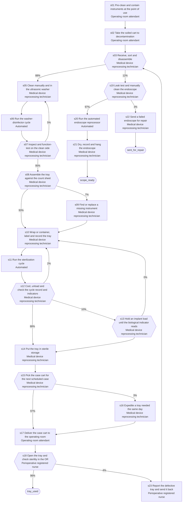

# Reprocess surgical instruments and scopes

`hosp-sx-sterile-reprocessing` · healthcare (acute care hospital) · surgical and perioperative services (medical device reprocessing) · part of `community-hospital-corp`

Used surgical instruments and flexible endoscopes come back from the operating rooms and endoscopy suites and the medical device reprocessing department cleans, inspects, assembles, packages, sterilizes or high-level disinfects and stores them for the next case. Technicians work around the clock to Canadian standards that require cleaning before sterilization, inspection of every instrument, recorded sterilizer loads, daily biological testing and quarantine of implant loads. Missing instruments, wet or torn packs, scarce sets needed twice in a day and surges at the end of the operating day are the main causes of delay and of incomplete trays reaching the OR.

| | |
|---|---|
| Unit of work | one instrument tray (or one flexible endoscope) |
| Starts when | A surgical case or endoscopy ends and the used instruments or scope are contained for return to reprocessing. |
| Done when | The sterile tray is opened and accepted for the next case (or the scope is hung ready for use, or sent for repair). |
| Organisation | A three-site Ontario community hospital corporation with a medical device reprocessing department at each hospital, about 60 reprocessing technicians on rotating shifts, pass-through washer-disinfectors, steam and low-temperature sterilizers and paper count sheets or an instrument tracking system. (5,790 employees, 2019-2022) |
| Volume | 9,500 cases a month (range 8,000 to 11,000) |

## Where it sits

- Starts with **used_instruments** from sx-perioperative-case (85% of cases)
- Starts with **used_instruments** from sx-endoscopy (12% of cases)
- Starts with **delivered_goods** from suppliers (3% of cases)
- Relies on **or_schedule** from sx-or-scheduling (a standing input; it does not start a case)
- Sends **instrument_tray** to sx-perioperative-case (outcome: tray_used)
- Sends **instrument_tray** to sx-endoscopy (outcome: scope_ready)
- Sends **device_service_request** to fs-biomedical-equipment (outcome: sent_for_repair)
- Sends **incident_report** to qp-incident-management (outcome: any)

## Flow

## Roles

| Role | Department | Layer | FTE on this process | Loaded cost per hour | Evidence |
|---|---|---|---:|---:|---|
| Medical device reprocessing technician | Medical device reprocessing department | individual contributor | 50 | 34 CAD | C |
| Operating room attendant | Perioperative services | individual contributor | 7 | 31 CAD | C |
| Perioperative registered nurse | Perioperative services | individual contributor | 3 | 62 CAD | C |
| Patient care manager, perioperative or surgical unit | Surgical and perioperative program | manager | 0.5 | 78 CAD | C |

## Steps

Hands-on time and the wait before each step show the most common value. Evidence tier A is a sourced number, B a sourced description, C the author's estimate.

| Step | Who | Kind | Hands-on | Wait before | Control | Evidence |
|---|---|---|---:|---:|---|---|
| **s01 Pre-clean and contain instruments at the point of use.** At the end of the case the OR attendant wipes gross soil off the instruments, opens hinged instruments, removes sharps, sprays the trays with enzymatic foam or covers them with a moist towel so soil does not dry, and closes them in the soiled case cart. | Operating room attendant | physical | 2 min | 10 min | CSA Z314 series (Canadian medical device reprocessing standards) as applied in PIDAC Best Practices for Cleaning, Disinfection and Sterilization (2013): keep soiled devices moist and contained | B [pidac2013] |
| **s02 Take the soiled cart to decontamination.** The attendant pushes the closed soiled case cart through the soiled corridor or dedicated elevator to the reprocessing department's decontamination area. Carts are often taken in batches at the end of a list. | Operating room attendant | physical | 2 min | 30 min | CSA Z314 series (Canadian medical device reprocessing standards) as applied in PIDAC Best Practices for Cleaning, Disinfection and Sterilization (2013): soiled devices transported in closed containers separate from sterile supplies | B [pidac2013] |
| **s03 Receive, sort and disassemble.** In the decontamination room the reprocessing technician, in gown, gloves and face shield, checks the tray against its count sheet, separates delicate and powered instruments and scopes, and takes apart instruments that come apart. | Medical device reprocessing technician | intake | 3 min | 20 min |  | B [pidac2013] |
| **s05 Clean manually and in the ultrasonic washer.** The technician brushes lumens and box locks under water, flushes cannulated instruments and runs delicate instruments through the ultrasonic cleaner, following each manufacturer's instructions. | Medical device reprocessing technician | physical | 6 min | 10 min | CSA Z314 series (Canadian medical device reprocessing standards) as applied in PIDAC Best Practices for Cleaning, Disinfection and Sterilization (2013): cleaning before disinfection or sterilization according to the manufacturer's instructions | B [pidac2013] |
| **s06 Run the washer-disinfector cycle.** The technician loads the instrument racks into a pass-through washer-disinfector, which washes, rinses, thermally disinfects and dries them and releases them on the clean side. | Automated | system auto | 0 min | 15 min |  | C |
| **s07 Inspect and function-test on the clean side.** On the clean side the technician inspects every instrument under a lighted magnifier for residual soil, corrosion and damage, checks hinges, tips and insulation, and lubricates as required. | Medical device reprocessing technician | validation | 4 min | 15 min | CSA Z314 series (Canadian medical device reprocessing standards) as applied in PIDAC Best Practices for Cleaning, Disinfection and Sterilization (2013): inspection of every device after cleaning | B [pidac2013] |
| **s08 Assemble the tray against the count sheet.** The technician lays out the tray following the count sheet or tracking screen, places each instrument in its place, adds an internal chemical indicator and notes any instrument that is missing or was swapped. | Medical device reprocessing technician | physical | 13 min | 30 min |  | B [chin2014], [pidac2013] |
| **s09 Find or replace a missing instrument.** The technician searches the returned carts and other trays, asks the OR for the missing piece or takes a spare from stock; if no spare exists the tray is labelled incomplete and the OR is told, or a replacement is ordered. | Medical device reprocessing technician | coordination | 12 min | 10 min |  | C |
| **s10 Wrap or container, label and record the tray.** The technician wraps the tray in sterilization wrap or places it in a rigid container, adds the external indicator and a label with tray name, sterilizer and load number, and records the tray in the load log or tracking system. | Medical device reprocessing technician | data entry | 3 min | 5 min | CSA Z314 series (Canadian medical device reprocessing standards) as applied in PIDAC Best Practices for Cleaning, Disinfection and Sterilization (2013): each package labelled and each load recorded for recall and patient tracing | B [pidac2013] |
| **s11 Run the sterilization cycle.** When a load is full the technician loads the steam sterilizer (or a low-temperature sterilizer for heat-sensitive items) and starts the cycle; the first load of the day follows the air removal test and daily biological indicator test. | Automated | system auto | 0 min | 30 min | CSA Z314 series (Canadian medical device reprocessing standards) as applied in PIDAC Best Practices for Cleaning, Disinfection and Sterilization (2013): daily air removal and biological indicator testing of sterilizers | B [pidac2013] |
| **s12 Cool, unload and check the cycle record and indicators.** After the load cools the technician checks the printout for time, temperature and pressure, signs it, checks the external indicators and looks for wet packs before releasing the load. | Medical device reprocessing technician | validation | 2 min | 30 min | CSA Z314 series (Canadian medical device reprocessing standards) as applied in PIDAC Best Practices for Cleaning, Disinfection and Sterilization (2013): signed review of each load's physical and chemical monitoring before release | B [pidac2013] |
| **s13 Hold an implant load until the biological indicator reads.** The load stays in quarantine until the biological indicator from the load reads negative; the technician then records the result and releases it. A positive result triggers a recall of the load. | Medical device reprocessing technician | validation | 2 min | 3.0 h | CSA Z314 series (Canadian medical device reprocessing standards) as applied in PIDAC Best Practices for Cleaning, Disinfection and Sterilization (2013): implant loads released only after a negative biological indicator | B [pidac2013] |
| **s14 Put the tray in sterile storage.** The technician places the tray on its labelled shelf in the sterile storage room, rotating stock so older trays are used first. | Medical device reprocessing technician | physical | 1 min | 15 min |  | C |
| **s15 Pick the case cart for the next scheduled case.** The evening before, the technician picks each case's trays and supplies against the OR schedule's pick list and preference card and puts them on the case cart. | Medical device reprocessing technician | physical | 3 min | 16.0 h |  | C |
| **s16 Expedite a tray needed the same day.** The technician pulls the tray through washing, assembly and a priority sterilizer load ahead of the queue; for a single dropped instrument the OR may use immediate-use steam sterilization, which is logged to the patient. | Medical device reprocessing technician | coordination | 10 min | 0 min | PIDAC best practice (2013): immediate-use steam sterilization only in emergencies, never for implants or complete sets, recorded to the patient | B [pidac2013] |
| **s17 Deliver the case cart to the operating room.** The OR attendant takes the case cart through the clean corridor or elevator to the operating room core before the case starts. | Operating room attendant | physical | 2 min | 1.0 h |  | B [pidac2013] |
| **s18 Open the tray and check sterility in the OR.** The OR nurse checks the external indicator, wrapper or container seal and dryness, opens the tray, checks the internal indicator and counts the instruments; a defective tray is set aside. | Perioperative registered nurse | validation | 2 min | 0 min | CSA Z314 series (Canadian medical device reprocessing standards) as applied in PIDAC Best Practices for Cleaning, Disinfection and Sterilization (2013): check package integrity and indicators before use | B [pidac2013] |
| **s19 Leak test and manually clean the endoscope.** For a flexible endoscope the technician performs the leak test before cleaning, then brushes and flushes every channel with detergent following the manufacturer's instructions. | Medical device reprocessing technician | physical | 18 min | 15 min | CSA Z314 series (Canadian medical device reprocessing standards) as applied in PIDAC Best Practices for Cleaning, Disinfection and Sterilization (2013) (Z314.8 and endoscope provisions): leak test and manual cleaning before high-level disinfection | B [pidac2013] |
| **s20 Run the automated endoscope reprocessor.** The technician connects the cleaned scope to an automated endoscope reprocessor, which runs a high-level disinfection cycle with a monitored disinfectant concentration, then rinses and air-purges every channel. | Automated | system auto | 0 min | 15 min |  | C |
| **s21 Dry, record and hang the endoscope.** The technician dries the channels, records the scope's serial number, the reprocessor cycle and the patient it was used on, and hangs it vertically in the ventilated storage cabinet. | Medical device reprocessing technician | data entry | 5 min | 5 min | CSA Z314 series (Canadian medical device reprocessing standards) as applied in PIDAC Best Practices for Cleaning, Disinfection and Sterilization (2013): endoscope storage and reprocessing record linked to the patient | B [pidac2013] |
| **s22 Send a failed endoscope for repair.** The technician tags the scope out of service, records the failure and arranges repair with the manufacturer or biomedical engineering; the endoscopy unit is told it is down a scope. | Medical device reprocessing technician | communication | 10 min | 30 min |  | C |
| **s23 Report the defective tray and send it back.** The OR nurse files a report in the incident system or on the defect slip, and the tray goes back to decontamination to be fully reprocessed. | Perioperative registered nurse | communication | 4 min | 10 min |  | C |

## Exceptions

| Exception | Share of cases | What happens |
|---|---:|---|
| Missing or out-of-service instrument at assembly | 7% | An instrument is missing from the returned tray or fails inspection; the technician searches, substitutes or flags the tray incomplete. |
| Implant load quarantine | 10% | Loads with implants are held until the biological indicator reads negative. |
| Tray needed again the same day | 3% | A scarce set is booked twice in a day or not yet processed, so it is expedited through a priority load. |
| Defective tray found in the OR | 4% | The tray is wet, torn, incomplete or has a failed indicator and returns for full reprocessing. |
| Endoscope fails leak test | 0% | About 3% of scopes (12% of items) fail the leak test and go out for repair. |

## Benchmarks

| Metric | Value | Unit | Population | Evidence |
|---|---|---|---|---|
| cycle_time_days | p50 1.1, p90 3.0 | calendar days from end of case to the tray being opened for its next case | Community hospital reprocessing, mixed instrument trays | C |
| tray_packing_time_per_instrument | 17.7 | seconds per instrument | Central processing department, St Joseph's Hospital, London, Ontario, 2013 | A [chin2014] |

## Pain points

- Trays carry many instruments that are rarely used, so assembly and inspection time is spent on instruments that are opened and returned unused. (steps s07, s08; A [chin2014])
- Missing or swapped instruments make trays incomplete; the OR finds them only when the tray is opened. (steps s03, s08, s09, s18; C)
- Soiled carts arrive in a rush when lists finish in the afternoon, while morning trays must be ready by 07:30, so evening shifts carry the peak and scarce sets get expedited. (steps s02, s15, s16; C)
- Implant loads wait for biological indicator results before release, and loaner sets that arrive late from vendors cannot be released in time. (steps s13; B [pidac2013])

## Assumptions

- One unit of work is one tray or scope; a case usually returns several trays, and the organisation file's 9,500 trays a month is kept.
- Point-of-use pre-cleaning for endoscopes is done by the endoscopy nurse and for loaner sets is not needed; the labour of step s01 is attributed to the OR attendant for all items, which slightly overstates attendant time.
- Washer-disinfectors and automated endoscope reprocessors are not in the organisation file's resources; six of each across three sites is the author's estimate.
- The organisation file has no instrument tracking system; it is added here as a workflow system covering either a tracking product or paper count sheets and load logs, both common in 2019-2022.
- The simulated median is compared with an estimated benchmark only; the shelf wait (s15) is a triangular estimate of 4 hours to 3 days, mode 16 hours. The cycle time includes the time a tray waits on the sterile shelf for its next scheduled case (s15), which dominates the elapsed time; processing alone is about 4 to 6 hours.
- Steam sterilizer cycle times of 45-90 minutes include drying; low-temperature cycles for heat-sensitive devices are folded into the same step.
- Hands-on time x volume implies about 68 FTE against 60.5 stated; reprocessing technicians alone come to about 57 FTE at 130 productive hours, close to the organisation file's headcount of 60 people on rotating 24/7 shifts, which leaves little slack for case carts for other departments, restocking and audits. The simulated median (about 1.5 days) is about 1.4 times the estimated 1.1-day benchmark because of the shelf wait.
- Vendor loaner sets that arrive from suppliers enter at decontamination like used trays; the organisation file's process map does not list suppliers as a trigger for this process.

## Sources

- [pidac2013] [Best Practices for Cleaning, Disinfection and Sterilization of Medical Equipment/Devices in All Health Care Settings, 3rd edition (May 2013)](https://www.publichealthontario.ca/-/media/documents/B/2013/bp-cleaning-disinfection-sterilization-hcs.pdf) (Provincial Infectious Diseases Advisory Committee (PIDAC), Public Health Ontario, 2013). Reprocessing steps and requirements: keep soiled devices moist, separate transport, cleaning before sterilization, inspection, internal and external indicators, load records and traceability, daily biological indicator and air removal tests, implant load quarantine, restrictions on immediate-use steam sterilization, endoscope leak testing and storage; references to CSA Z314.
- [chin2014] [Reducing otolaryngology surgical inefficiency via assessment of tray redundancy (Chin et al.), Journal of Otolaryngology - Head & Neck Surgery (full text via Europe PMC, PMC4263198)](https://www.ebi.ac.uk/europepmc/webservices/rest/PMC4263198/fullTextXML) (Journal of Otolaryngology - Head & Neck Surgery (BioMed Central), 2014). Tray packing time of 17.7 seconds per instrument and 27.8% instrument utilization in an Ontario hospital.

Written by claude-opus on 2026-11-24.
