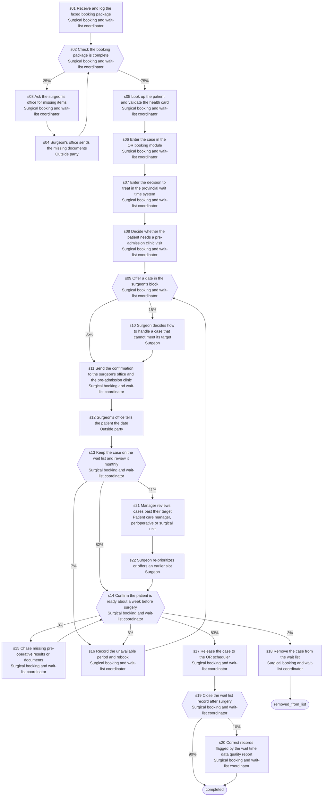

# Book elective surgery and manage the wait list

`hosp-sx-surgical-booking` · healthcare (acute care hospital) · surgical and perioperative services · part of `community-hospital-corp`

After a surgeon and patient decide on an operation, the surgeon's office faxes a booking package to the hospital's surgical booking office. A booking coordinator checks the package is complete, enters the case in the OR scheduling module and again in the provincial Wait Time Information System, agrees a date in the surgeon's block and keeps the case on the wait list until its surgical week. Incomplete faxed packages, double entry into two systems, patients who defer and missing pre-operative results cause rework, and in 2020-2022 COVID-19 pauses stretched the wait list.

| | |
|---|---|
| Unit of work | one surgical booking |
| Starts when | A surgeon's office faxes a booking package after the surgeon and patient decide to proceed with elective surgery. |
| Done when | The case has been operated on and its wait list record is closed in the provincial system, or the case has been removed from the wait list. |
| Organisation | A three-site Ontario community hospital corporation doing about 40,000 to 45,000 surgeries a year, with a central perioperative booking office at each site, an OR scheduling module in the hospital information system and paper or electronic fax. (5,790 employees, 2019-2022) |
| Volume | 2,150 cases a month (range 1,900 to 2,300) |

## Where it sits

- Starts with **surgical_booking_request** from referring_office (75% of cases)
- Starts with **surgical_booking_request** from amb-clinic-visit (15% of cases)
- Starts with **surgical_booking_request** from sx-fracture-clinic (10% of cases)
- Sends **wait_time_record** to ontario_health (outcome: any)
- Sends **surgical_case** to sx-preadmission-clinic (outcome: completed)
- Sends **surgical_case** to sx-or-scheduling (outcome: completed)
- Sends **surgical_case** to dh-patient-registration (outcome: completed)

## Flow

## Roles

| Role | Department | Layer | FTE on this process | Loaded cost per hour | Evidence |
|---|---|---|---:|---:|---|
| Surgical booking and wait-list coordinator | Perioperative services | individual contributor | 7.17 | 36 CAD | C |
| Surgeon | Medical, dental and midwifery staff | senior specialist | 0.57 | 240 CAD | C |
| Patient care manager, perioperative or surgical unit | Surgical and perioperative program | manager | 0.21 | 78 CAD | C |

## Steps

Hands-on time and the wait before each step show the most common value. Evidence tier A is a sourced number, B a sourced description, C the author's estimate.

| Step | Who | Kind | Hands-on | Wait before | Control | Evidence |
|---|---|---|---:|---:|---|---|
| **s01 Receive and log the faxed booking package.** The booking coordinator collects the booking packages that came in on the booking office fax overnight and during the day, date-stamps each one and sorts it by site, surgeon and surgery date requested. Each package is put in the to-be-checked tray or the shared electronic fax folder. | Surgical booking and wait-list coordinator | intake | 1 min | 3.0 h |  | B [hh_pac] |
| **s02 Check the booking package is complete.** The coordinator compares the package with the booking checklist: signed booking form with procedure, side, priority level and decision-to-treat date, estimated case length, equipment and implant needs, signed surgical consent, pre-operative orders, the family physician's Cumulative Patient Profile and the anaesthesia questionnaire. Packages with anything missing or illegible are set aside for a chase. | Surgical booking and wait-list coordinator | validation | 3 min | 8.0 h | Hospital surgical booking policy: a booking is accepted only with a complete package (booking form, consent, Cumulative Patient Profile, pre-op orders) | B [hh_cpp], [hh_pac] |
| **s03 Ask the surgeon's office for missing items.** The coordinator faxes back a deficiency sheet or phones the surgeon's secretary, naming each missing or unclear item. The package is held in a pending folder with a follow-up date. | Surgical booking and wait-list coordinator | communication | 4 min | 30 min |  | C |
| **s04 Surgeon's office sends the missing documents.** The surgeon's secretary finds the missing item, gets the surgeon's signature or asks the family physician for the Cumulative Patient Profile, and faxes it to the booking office. Office time is outside the hospital's labour; only a few minutes of handling are counted. | Outside party | external wait | 2 min | 2.0 d |  | B [hh_cpp] |
| **s05 Look up the patient and validate the health card.** The coordinator searches the hospital information system for the patient's medical record number, creates a pre-registration if the patient is new and checks the health card number and version code through the Ministry's validation service. | Surgical booking and wait-list coordinator | lookup | 2 min | 10 min |  | C |
| **s06 Enter the case in the OR booking module.** The coordinator types the case into the operating room scheduling module: surgeon, procedure and side, priority, decision-to-treat date, estimated duration, anaesthesia type, special equipment, implants, and whether the patient needs an inpatient or ICU bed. The case goes onto the surgeon's wait list in the module. | Surgical booking and wait-list coordinator | data entry | 4 min | 30 min |  | C |
| **s07 Enter the decision to treat in the provincial wait time system.** The coordinator re-keys the case into the Wait Time Information System: procedure, priority level 2, 3 or 4 and the decision-to-treat date that starts the provincial Wait 2 clock. Entries are often done in a batch at the end of the day. | Surgical booking and wait-list coordinator | data entry | 2 min | 4.0 h | Ministry of Health wait-time reporting: hospitals funded for wait-time volumes submit Wait 2 data to the Wait Time Information System (accountability agreement condition) | B [oh_surg_ind], [oag2016] |
| **s08 Decide whether the patient needs a pre-admission clinic visit.** The coordinator applies the pre-admission screening criteria (procedure type, inpatient stay, age, conditions flagged on the questionnaire) to decide between an in-person clinic visit, a phone screen or no visit, and flags the case for the pre-admission clinic. | Surgical booking and wait-list coordinator | judgment | 1 min | 5 min |  | B [hh_pac] |
| **s09 Offer a date in the surgeon's block.** The coordinator and the surgeon's secretary agree a date in one of the surgeon's allocated operating room blocks that fits the priority target and the case length. If no slot falls inside the provincial target for the priority, the coordinator refers the case to the surgeon. | Surgical booking and wait-list coordinator | coordination | 3 min | 4.0 h |  | B [oag2016], [oh_surg_ind] |
| **s10 Surgeon decides how to handle a case that cannot meet its target.** The surgeon reviews the case and either moves a less urgent patient, asks the department chief for released or extra block time, or offers the patient another surgeon with a shorter list. The decision is relayed to the coordinator. | Surgeon | judgment | 5 min | 1.0 d |  | B [oag2016] |
| **s11 Send the confirmation to the surgeon's office and the pre-admission clinic.** The coordinator faxes the booking confirmation with the date to the surgeon's office and sends the pre-admission referral and package copy to the clinic, which then books its visit. | Surgical booking and wait-list coordinator | communication | 1 min | 30 min |  | C |
| **s12 Surgeon's office tells the patient the date.** The surgeon's secretary phones the patient with the surgery date, reminds them to attend the pre-admission clinic and to bring the clinic envelope. Office time is outside the hospital's labour. | Outside party | external wait | 2 min | 1.0 d |  | B [hh_cpp], [hh_pac] |
| **s13 Keep the case on the wait list and review it monthly.** The case waits on the surgeon's list until its surgical week. Each month the coordinator runs the wait list report, phones patients approaching or past target to confirm they still want surgery and enters patient-unavailable periods so they are deducted from Wait 2. | Surgical booking and wait-list coordinator | analysis | 1 min | 2.0 d |  | B [oag2016], [oh_surg_ind], [cihi2022] |
| **s14 Confirm the patient is ready about a week before surgery.** The coordinator checks the case in the OR module and the chart: pre-admission visit done, anaesthesia clearance, blood work and ECG resulted, consent and Cumulative Patient Profile on file, inpatient bed requested. Missing results or a deferral by the anaesthesiologist are followed up. | Surgical booking and wait-list coordinator | validation | 3 min | 4.0 h |  | B [leslie2013] |
| **s15 Chase missing pre-operative results or documents.** The coordinator calls the pre-admission clinic, the laboratory, the family physician or the surgeon's office for the missing item and checks back the next day. | Surgical booking and wait-list coordinator | communication | 5 min | 12.0 h |  | C |
| **s16 Record the unavailable period and rebook.** The coordinator cancels the date in the OR module, records the patient-unavailable dates or the medical deferral in the Wait Time Information System, tells the surgeon's office and returns the case for a new date. | Surgical booking and wait-list coordinator | data entry | 6 min | 1.0 h |  | B [oh_surg_ind] |
| **s17 Release the case to the OR scheduler.** The coordinator marks the case as ready in the OR module so it appears on the scheduler's list for that week's slate, and flags implants or special equipment the scheduler must confirm. | Surgical booking and wait-list coordinator | coordination | 1 min | 1.0 h |  | C |
| **s18 Remove the case from the wait list.** After the surgeon's office confirms that the patient declined surgery, had it elsewhere or died, the coordinator removes the case from the OR module and closes the Wait Time Information System entry with the removal reason. | Surgical booking and wait-list coordinator | data entry | 5 min | 1.0 d |  | B [oh_surg_ind] |
| **s19 Close the wait list record after surgery.** After the operation the coordinator checks that the procedure date flowed from the OR module to the Wait Time Information System, enters it where the interface did not, and closes the wait list entry. | Surgical booking and wait-list coordinator | data entry | 1 min | 8.0 d |  | B [oh_surg_ind] |
| **s20 Correct records flagged by the wait time data quality report.** The coordinator works through the monthly data quality report: wrong dates, missing procedure dates, unavailable periods outside the window, duplicates. Each record is checked against the OR module and corrected in the provincial system. | Surgical booking and wait-list coordinator | data entry | 6 min | 7.0 d |  | B [oh_surg_ind] |
| **s21 Manager reviews cases past their target.** The perioperative manager reviews the monthly list of cases past or near target by surgeon and priority, and asks surgeons about cases that can be moved, transferred or added to released block time. | Patient care manager, perioperative or surgical unit | review | 5 min | 7.0 d |  | B [oag2016] |
| **s22 Surgeon re-prioritizes or offers an earlier slot.** The surgeon reconsiders the case's priority, offers it a released slot or refers the patient to a colleague, and tells the booking coordinator. | Surgeon | judgment | 5 min | 3.0 d |  | C |

## Exceptions

| Exception | Share of cases | What happens |
|---|---:|---|
| Incomplete booking package | 25% | A form is unsigned, the consent or Cumulative Patient Profile is missing or the priority is blank, so the coordinator chases the surgeon's office before the case can be entered. |
| Case cannot be booked within its priority target | 15% | No slot in the surgeon's blocks falls inside the provincial target, so the surgeon must move cases, find extra time or refer on. |
| Patient defers or is not fit | 12% | The patient asks to postpone, or the pre-admission anaesthesiologist defers surgery; unavailable dates are recorded and the case is rebooked. |
| Case past target escalated | 11% | The monthly wait list review shows the case at or past target; the manager and the surgeon look for an earlier slot. |
| Removed from the wait list | 3% | The patient declines, has surgery elsewhere or dies before surgery. |

## Benchmarks

| Metric | Value | Unit | Population | Evidence |
|---|---|---|---|---|
| cycle_time_days | p50 40, p90 120 | calendar days from booking (decision to treat) to surgery, all priorities 2-4 mixed | Large Ontario community hospitals, elective adult surgery | B [oag2016], [cihi2022] |
| share_of_priority_2_cases_within_target | low 0.33, high 0.9 | share of cases completed within the provincial target (requirement 0.90) | Large Ontario community hospitals, 2015/16, by specialty | A [oag2016] |
| share_of_hip_replacements_within_182_days | 2019_apr_sep 0.75, 2021_apr_sep 0.65 | share of cases | Canada | A [cihi2022] |
| ontario_surgical_backlog_sept_2021 | 419200 | elective procedures projected in backlog by end of September 2021 | Ontario | A [fao2021] |

## Pain points

- Booking packages arrive by fax from dozens of independent offices and about a quarter are incomplete, so coordinators spend time chasing signatures, consents and Cumulative Patient Profiles. (steps s02, s03, s04; B [hh_cpp])
- Every case is keyed twice, into the OR module and into the provincial Wait Time Information System, and the two drift apart; monthly data quality reports find wrong dates and out-of-window unavailable periods. (steps s06, s07, s19, s20; B [oh_surg_ind])
- Each surgeon keeps a separate list, so a patient's wait depends on the surgeon referred to rather than on urgency, and urgent priority 2 cases often miss target. (steps s09, s10, s21; A [oag2016])
- COVID-19 pauses in 2020 and 2021 created a provincial backlog and pushed many cases past target, adding re-validation calls and rebookings. (steps s13, s16, s21; A [fao2021], [cihi2022])

## Assumptions

- The simulated median (about 49 days) is about 1.2 times the 40-day benchmark and the 90th percentile (about 89 days) is below the 120-day benchmark, because a triangular wait cannot reproduce the long right tail of low-priority orthopaedic and ophthalmic waits. The cycle runs from receipt of the booking package to closure of the wait list record after surgery, so it contains the whole Wait 2 interval; the simulated median and 90th percentile are compared with a benchmark derived from 2015/16 provincial medians rather than measured at this hospital.
- The long calendar wait on the list sits on step s13; its triangular distribution (1 to 90 days, mode 2) is fitted to give a median near 30 days before the final week of preparation, because the provincial figures are reported only as medians and 90th percentiles by specialty and priority.
- Work done in surgeons' offices (assembling packages, telling patients their date) is shown as external steps with a few minutes of handling; that labour is paid by the surgeons, not the hospital.
- The booking coordinator role covers both the booking office and wait-list management; at some hospitals the OR scheduler or the surgeon's secretary enters the WTIS record instead.
- Hands-on time x volume implies about 17 FTE (15 of them booking coordinators, plus about 1.4 FTE of surgeons' office handling that the hospital does not pay) against 11.1 stated; the organisation file lists 10 booking coordinators, which looks low for about 3,000 bookings a month unless surgeons' offices do more of the entry, as they do at some hospitals. The step times are the author's estimates and were not cut to fit the headcount.
- The organisation file's process description (fax package, completeness check, entry in hospital and provincial systems, date within the surgeon's block) matches what the sources describe.
- Urgent and emergency cases booked on the add-on list are handled in sx-emergency-surgery and are not counted here.
- Organisation file corrected on 2026-11-24: elective bookings are about 87% of operating room cases (the Auditor General gives 13% emergencies), about 2,150 a month, now that endoscopies are counted only in sx-endoscopy. Stated FTE on this process were scaled to the new volume.

## Sources

- [oag2016] [2016 Annual Report, Chapter 3, Section 3.08: Large Community Hospital Operations](https://www.auditor.on.ca/en/content/annualreports/arreports/en16/v1_308en16.pdf) (Office of the Auditor General of Ontario, 2016). Elective share of cases (87%), block allocation from department to surgeon, surgeon-managed wait lists, priority 2-4 targets and 2015/16 Wait 2 medians and 90th percentiles by specialty at large community hospitals, monthly wait-time submissions.
- [oh_surg_ind] [Regional Surgery Indicator Descriptions (Wait 1 and Wait 2 definitions and provincial priority access targets)](https://hsihelp.ontariohealth.ca/hsi/assets/misc_doc/Regional_Surgery_Indicator_Descriptions.pdf) (Ontario Health, 2026). Definition of Wait 2 (decision to treat to surgery), priority access targets by specialty, handling of patient-unavailable dates and data entry errors, OR system as the source of treatment dates.
- [cihi2022] [Wait times for priority procedures in Canada, 2022](https://www.cihi.ca/en/wait-times-for-priority-procedures-in-canada-2022) (Canadian Institute for Health Information, 2022). Share of hip, knee and cataract procedures within benchmark in 2019 and 2021.
- [hh_pac] [Pre-Admission Clinic (service page)](https://www.haltonhealthcare.on.ca/services_/28763/s29987-pre-admission-clinic) (Halton Healthcare, 2026). Pre-admission clinic timing (7-14 days before surgery), package from the surgeon, booking phone, fax and hours at three sites.
- [hh_cpp] [Important information for all surgical patients (letter dated October 1, 2019, on the Cumulative Patient Profile replacing the pre-op history and physical)](https://www.haltonhealthcare.on.ca/site_files/content/pdfs/01_services/02_surgical-program/important-info-for-surgical-patients.pdf) (Halton Healthcare, 2019). Cumulative Patient Profile required in the booking package from October 1, 2019.
- [leslie2013] [Day of surgery cancellation rates in urology: identification of modifiable factors (Leslie RJ, Beiko D, van Vlymen J, Siemens DR), CUAJ 7(5-6):167-73](https://cuaj.ca/index.php/journal/article/view/1345) (Canadian Urological Association Journal, 2013). Day-of-surgery cancellation rate (8.07%) and the share due to process factors (58.5%) in an Ontario hospital.
- [fao2021] [Media release: FAO projects health sector spending shortfall of $61.9 billion over nine years (May 10, 2021)](https://fao-on.org/en/communication/mr-2021-health-estimates/) (Financial Accountability Office of Ontario, 2021). Ontario elective surgery backlog projection for September 2021.

Written by claude-opus on 2026-11-24.
