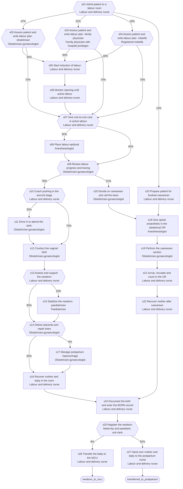

# Support labour and birth

`hosp-wc-labour-delivery` · healthcare (public hospital) · women's and children's program · part of `community-hospital-corp`

A pregnant patient who is in labour, or booked for a caesarean, is admitted from obstetrical triage to a labour, delivery and recovery room, where a labour and delivery nurse stays with her one to one through active labour while an obstetrician, family physician or midwife leads the care. About three in ten births end in a caesarean section in the unit's obstetrical operating room, and some babies need a paediatrician or a NICU bed. The work runs at the pace of unscheduled labour around the clock: delays come from waiting for a free room, the on-call anesthesiologist or obstetrician, the obstetrical OR, and a postpartum bed for the hand-over, and long inductions hold rooms for a day or more.

| | |
|---|---|
| Unit of work | one birth (one labouring or scheduled-caesarean patient and her baby) |
| Starts when | Obstetrical triage confirms active labour, induction or a labour complication and sends the patient to the birthing unit, or a patient arrives for a booked caesarean section. |
| Done when | Mother and baby are handed over to the mother-baby unit, or the baby is admitted to the NICU and the mother is handed over alone; the birth is recorded in the chart and the BORN Information System. |
| Organisation | A three-site Ontario community hospital corporation with about 4,300 to 4,700 births a year in birthing units with 16 labour, delivery and recovery rooms and two obstetrical operating rooms. (5,790 employees, 2019-2022) |
| Volume | 360 cases a month (range 333 to 391) |

## Where it sits

- Starts with **maternity_patient** from wc-obstetric-triage (87% of cases)
- Starts with **or_schedule** from sx-or-scheduling (13% of cases)
- Relies on **staff_schedule** from hr-staff-scheduling (a standing input; it does not start a case)
- Relies on **blood_product** from dx-blood-transfusion (a standing input; it does not start a case)
- Sends **mother_newborn_pair** to wc-postpartum-newborn-care (outcome: transferred_to_postpartum)
- Sends **newborn** to wc-nicu-care (outcome: newborn_to_nicu)
- Sends **maternity_patient** to wc-postpartum-newborn-care (outcome: newborn_to_nicu)
- Sends **birth_record** to born_ontario (outcome: any)
- Sends **blood_order** to dx-blood-transfusion (outcome: any)
- Sends **incident_report** to qp-incident-management (outcome: any)

## Flow

## Roles

| Role | Department | Layer | FTE on this process | Loaded cost per hour | Evidence |
|---|---|---|---:|---:|---|
| Labour and delivery nurse | Maternity (birthing and mother-baby units) | individual contributor | 50 | 62 CAD | B [kelly2022] |
| Obstetrician-gynaecologist | Medical, dental and midwifery staff | senior specialist | 7 | 215 CAD | C |
| Family physician with hospital privileges | Medical, dental and midwifery staff | senior specialist | 2.5 | 140 CAD | C |
| Registered midwife | Medical, dental and midwifery staff | senior specialist | 2 | 70 CAD | C |
| Anesthesiologist | Medical, dental and midwifery staff | senior specialist | 3 | 220 CAD | C |
| Paediatrician | Medical, dental and midwifery staff | senior specialist | 1 | 185 CAD | C |
| Maternity and paediatric unit clerk | Women's and children's program | individual contributor | 2 | 35 CAD | C |
| Patient care manager, maternity or paediatrics | Women's and children's program | manager | 1 | 78 CAD | C |
| Director, women's and children's program | Women's and children's program | director | 0.2 | 101 CAD | C |

## Steps

Hands-on time and the wait before each step show the most common value. Evidence tier A is a sourced number, B a sourced description, C the author's estimate.

| Step | Who | Kind | Hands-on | Wait before | Control | Evidence |
|---|---|---|---:|---:|---|---|
| **s01 Admit patient to a labour room.** The labour and delivery nurse takes report from the triage nurse, settles the patient in a free labour, delivery and recovery room, checks the prenatal record (faxed from the office or viewed in the BORN system), starts an IV and draws admission bloods, and records the admission assessment in the hospital information system. When all rooms are full the patient waits in triage until one is cleaned and free. | Labour and delivery nurse | intake | 30 min | 10 min |  | C |
| **s02 Assess patient and write labour plan (obstetrician).** The obstetrician examines the patient, reviews the fetal heart tracing, cervical examination and prenatal risks, and writes admission orders: monitoring method, group B strep antibiotics, pain relief options and whether to induce or augment labour. Overnight the order is often given by phone and the bedside assessment follows. | Obstetrician-gynaecologist | judgment | 15 min | 20 min | Public Hospitals Act: only a physician or midwife with privileges may order treatment for an inpatient | C |
| **s03 Assess patient and write labour plan (family physician).** The family physician examines the patient, reviews the fetal heart tracing, cervical examination and prenatal risks, and writes admission orders: monitoring method, group B strep antibiotics, pain relief options and whether to induce or augment labour. Overnight the order is often given by phone and the bedside assessment follows. | Family physician with hospital privileges | judgment | 15 min | 20 min | Public Hospitals Act: only a physician or midwife with privileges may order treatment for an inpatient | C |
| **s04 Assess patient and write labour plan (midwife).** The midwife examines the patient, reviews the fetal heart tracing, cervical examination and prenatal risks, and writes admission orders: monitoring method, group B strep antibiotics, pain relief options and whether to induce or augment labour. Overnight the order is often given by phone and the bedside assessment follows. | Registered midwife | judgment | 15 min | 20 min | Public Hospitals Act: only a physician or midwife with privileges may order treatment for an inpatient | C |
| **s05 Start induction of labour.** The nurse checks the induction order against the unit protocol, runs a baseline fetal heart tracing, inserts or assists with cervical ripening (prostaglandin or balloon) or starts an oxytocin infusion on a pump, and documents each dose change and the tracing at set intervals. | Labour and delivery nurse | physical | 45 min | 30 min | High-alert medication (oxytocin) protocol with independent double check | C |
| **s06 Monitor ripening until active labour.** While cervical ripening works, the nurse checks contractions, the fetal heart and vital signs at set intervals, re-examines or calls the provider, and steps up to oxytocin when the cervix is favourable. The patient keeps the room for many hours, which is the main reason rooms run out. | Labour and delivery nurse | physical | 1.0 h | 6.0 h |  | C |
| **s07 Give one-to-one care in active labour.** The nurse stays with the patient through active labour: listens to the fetal heart by intermittent auscultation or reads the continuous monitor, records contractions, vital signs and fluid balance, supports breathing and position changes, and calls the provider when the tracing or progress is abnormal. Much of the time goes to classifying and documenting the tracing. | Labour and delivery nurse | physical | 4.0 h | 10 min | SOGC fetal health surveillance guideline and unit 1:1 labour support policy; Accreditation Canada obstetrics standards | B [kelly2022] |
| **s08 Place labour epidural.** The anesthesiologist reviews the platelet count and consent, places the epidural catheter with the nurse positioning the patient and watching the fetal heart and blood pressure, and writes the infusion order. The patient often waits 10 to 60 minutes while the anesthesiologist finishes a case in the OR; that wait overlaps labour already counted in the previous step. | Anesthesiologist | physical | 20 min | 0 min | Health Care Consent Act, 1996: informed consent before the procedure | C |
| **s09 Review labour progress and tracing.** The provider reviews cervical progress on the partogram and the fetal heart classification with the nurse, decides whether labour can continue, needs oxytocin augmentation, or should end in a caesarean for failure to progress or an abnormal tracing. Family physicians and midwives call the on-call obstetrician for this decision when labour is abnormal. | Obstetrician-gynaecologist | judgment | 10 min | 15 min | Decision to operate rests with the attending obstetrician (hospital medical staff rules) | B [cihi_stays] |
| **s10 Coach pushing in the second stage.** At full dilation the nurse coaches pushing, listens to the fetal heart every five minutes or watches the monitor, prepares the delivery table and baby warmer, and pages the provider when the birth is near. With an epidural the second stage is usually longer. | Labour and delivery nurse | physical | 1.0 h | 0 min |  | C |
| **s11 Drive in to attend the birth.** At night and on weekends the on-call obstetrician, family physician or midwife leaves home when paged and drives to the hospital, usually arriving while the patient is still pushing. | Obstetrician-gynaecologist | travel | 20 min | 5 min |  | C |
| **s12 Conduct the vaginal birth.** The provider gowns, guides the birth of the head and shoulders, uses vacuum or forceps when the second stage stalls or the tracing worsens, clamps and cuts the cord and hands the baby skin to skin or to the second nurse. | Obstetrician-gynaecologist | physical | 25 min | 0 min |  | C |
| **s13 Assess and support the newborn.** A second nurse dries and stimulates the baby, scores Apgars at one and five minutes, starts ventilation if the baby does not breathe well, and calls the paediatrician by the unit's criteria. The baby is weighed, given vitamin K and eye prophylaxis per orders, and banded with matching identification. | Labour and delivery nurse | physical | 20 min | 0 min | Newborn identification and infant security policy: matching bands applied before mother and baby are separated | C |
| **s14 Deliver placenta and repair tears.** The provider delivers the placenta with an oxytocin injection, inspects it, examines and sutures any perineal tear, and estimates or weighs blood loss with the nurse. Heavy bleeding starts the postpartum haemorrhage protocol. | Obstetrician-gynaecologist | physical | 20 min | 0 min |  | C |
| **s15 Stabilize the newborn (paediatrician).** The paediatrician comes to the room or OR, takes over resuscitation or assessment, decides whether the baby can stay with the mother or needs the NICU, and writes newborn orders. | Paediatrician | physical | 30 min | 10 min |  | C |
| **s16 Recover mother and baby in the room.** For about two hours the nurse checks the mother's blood pressure, uterus and bleeding every 15 minutes, supports skin-to-skin contact and the first breastfeed, records the baby's temperature and breathing, and removes the epidural catheter. | Labour and delivery nurse | physical | 1.5 h | 0 min |  | C |
| **s17 Manage postpartum haemorrhage.** The obstetrician leads the haemorrhage protocol with nurses: uterine massage, extra uterotonic drugs, a second IV, blood tests and a crossmatch order to the blood bank, and repair or transfer to the OR when bleeding continues. Severe cases are reported in the incident system. | Obstetrician-gynaecologist | physical | 40 min | 5 min | Obstetrical haemorrhage protocol and massive transfusion protocol | C |
| **s18 Give spinal anaesthetic in the obstetrical OR.** The anesthesiologist checks the patient, places a spinal or tops up the labour epidural (general anaesthetic only in true emergencies), and monitors her through the operation. The case waits when both obstetrical rooms are in use or the anesthesiologist is in the main OR. | Anesthesiologist | physical | 25 min | 30 min | Surgical safety checklist briefing (Accreditation Canada required organizational practice) | C |
| **s19 Perform the caesarean section.** The obstetrician performs the caesarean with a surgical assistant (a second obstetrician or a family physician), delivers the baby to the nurse or paediatrician at the warmer, closes the uterus and abdomen and writes the operative note and post-operative orders. | Obstetrician-gynaecologist | physical | 50 min | 0 min | Surgical safety checklist time-out and sign-out | C |
| **s20 Decide on caesarean and call the team.** The obstetrician explains the reason for a caesarean, gets written consent, books the obstetrical OR and pages the anesthesiologist, the paediatrician when indicated and the nurses who will scrub and circulate. The urgency category sets how fast the team must move. | Obstetrician-gynaecologist | judgment | 15 min | 0 min | Health Care Consent Act, 1996: informed consent to surgery | C |
| **s21 Scrub, circulate and count in the OR.** Two labour and delivery nurses run the obstetrical OR: one scrubs and passes instruments, the other circulates, receives the baby when no paediatrician is present, and both count sponges, needles and instruments before closing. | Labour and delivery nurse | physical | 1.2 h | 0 min | Surgical count standard (ORNAC) and surgical safety checklist | C |
| **s22 Recover mother after caesarean.** The nurse monitors the mother in the recovery area or her room: vital signs, sensation returning after the spinal, wound, bleeding and pain, while supporting skin-to-skin contact and the first feed. | Labour and delivery nurse | physical | 1.5 h | 0 min |  | C |
| **s23 Prepare patient for booked caesarean.** The patient arrives fasting at the booked time; the nurse checks consent, bloodwork and the pre-operative checklist, starts an IV and gives prophylactic antibiotics and antacid. Booked cases are often bumped by emergency caesareans in labour. | Labour and delivery nurse | intake | 45 min | 1.5 h | Pre-operative checklist | C |
| **s24 Document the birth and enter the BORN record.** The nurse completes the birth record in the hospital information system (times, method, blood loss, Apgars, medications) and enters the mother and baby birth data in the BORN Information System, often after the recovery period or at the end of the shift. | Labour and delivery nurse | data entry | 20 min | 10 min | Provincial perinatal data collection through BORN Ontario (prescribed registry under PHIPA) | C |
| **s25 Register the newborn.** The unit clerk creates the newborn's encounter in the hospital information system linked to the mother's, prints identification band labels for the nurse to check against the bands applied at birth, and updates the unit board. | Maternity and paediatric unit clerk | data entry | 10 min | 15 min |  | C |
| **s26 Transfer the baby to the NICU.** The nurse takes the baby to the NICU in a transport incubator with the paediatrician's orders, gives report to the NICU nurse, and then phones report on the mother to the mother-baby unit and moves her there. | Labour and delivery nurse | communication | 30 min | 15 min |  | C |
| **s27 Hand over mother and baby to the postpartum nurse.** When a mother-baby bed is ready the nurse gives a bedside or phone report to the postpartum nurse (birth details, blood loss, feeding, newborn findings) and moves mother and baby together. The room is then released for cleaning. | Labour and delivery nurse | communication | 15 min | 20 min |  | C |

## Exceptions

| Exception | Share of cases | What happens |
|---|---:|---|
| Caesarean in labour | 18% | Labour stalls or the fetal heart tracing is abnormal; the obstetrician decides on a caesarean and the obstetrical OR team is called. |
| Booked caesarean bumped | 4% | A booked caesarean waits for hours because emergency caesareans take the obstetrical rooms. |
| Postpartum haemorrhage | 6% | Heavy bleeding after birth starts the haemorrhage protocol and a blood bank order. |
| Newborn needs NICU | 8% | The paediatrician admits the baby to the NICU and the mother goes to the postpartum unit alone. |
| Long induction | 12% | Cervical ripening takes most of a day, holding a labour room. |

## Benchmarks

| Metric | Value | Unit | Population | Evidence |
|---|---|---|---|---|
| cycle_time_days | p50 0.6, p90 1.2 | calendar days from admission to the birthing unit to hand-over to postpartum or NICU | Ontario community hospital birthing units, 2019-2022 | C |
| caesarean_section_rate | 0.317 | share of hospital births | Canada, 2021-2022 | A [cihi_stays] |
| average_length_of_stay_birth | 2.1 | days, whole hospital stay for giving birth | Canada, 2021-2022 | A [cihi_stays] |

## Pain points

- Labour rooms are held for many hours by inductions and recovering patients, so new labouring patients wait in triage when the unit is full. (steps s01, s06, s16; C)
- Nurses spend much of active labour classifying and charting the fetal heart tracing at the station, and re-enter birth data in BORN. (steps s07, s24; B [kelly2022])
- Booked caesareans are bumped by emergencies because the unit has only two obstetrical rooms and one anaesthesia team. (steps s18, s23; C)
- The hand-over waits for a postpartum bed when the mother-baby unit is full, which keeps the labour room blocked. (steps s27; C)

## Assumptions

- Describes the common practice of an Ontario community hospital birthing unit in 2019-2022, not Halton Healthcare's own procedures.
- The organisation file lists dx-blood-transfusion as a trigger of this process; a blood product does not start a birth, so it is recorded as a standing input and the blood order as an output. Booked caesareans arrive from the surgical schedule (sx-or-scheduling, or_schedule, 13% of cases), a trigger the organisation file lacks.
- Steps s09, s11, s12, s14, s17, s19 and s20 use the obstetrician role. In practice family physicians and midwives conduct their own patients' vaginal births (about 40% of vaginal births) and call the obstetrician for abnormal labour; costs in these steps are therefore somewhat overstated.
- Caesarean rate: 13% booked plus 21% of labouring patients gives about 31%, matching the 31.7% Canadian rate in 2021-2022. Induction (30%), epidural (55%), postpartum haemorrhage (6%), paediatrician attendance (10%) and NICU admission (8%) are tier C estimates.
- The anesthesiologist wait for an epidural and the provider's drive in overlap labour time and are recorded with no extra wait (concurrent_with), so the simulated cycle counts only elapsed time.
- Only one resource figure is used for the whole corporation: the 16 labour rooms and 2 obstetrical ORs in the organisation file, spread across sites.
- Labour nurse FTE (50) is set by around-the-clock room staffing rather than hands-on minutes; the simulated hands-on time implies fewer FTE because one-to-one nurses also cover triage, idle rooms and breaks. Loaded costs come from the organisation file (wage times 1.35; physician figures are gross OHIP earnings).

## Sources

- [halton2122] [Halton Healthcare 2021-2022 Annual Community Report (By the Numbers)](https://www.haltonhealthcare.on.ca/about/reports-and-publications/2021-2022-annual-community-report) (Halton Healthcare, 2022). 2021/22: 4,690 babies born; 161,049 emergency department visits; 37,964 dialysis visits; 62,508 mental health and addictions ambulatory visits; 5,228 staff.
- [halton2021] [Halton Healthcare 2020-2021 Annual Community Report (By the Numbers)](https://www.haltonhealthcare.on.ca/about/reports-and-publications/2020-2021-annual-community-report) (Halton Healthcare, 2021). 2020/21: 4,277 babies born; 126,357 emergency department visits; 37,171 dialysis visits; 89,823 addictions and mental health visits; top five in Ontario for patients on home dialysis (Ontario Renal Network, March 2021).
- [cihi_stays] [Hospital stays in Canada, 2021-2022](https://www.cihi.ca/en/hospital-stays-in-canada-2021-2022) (Canadian Institute for Health Information, 2022). Giving birth was the most common reason for hospitalization, average acute stay 2.1 days; caesarean section the most common inpatient surgery, average stay 2.7 days; total caesarean rate 31.7% in 2021-2022, up from 28.8% in 2017-2018.
- [kelly2022] [Using Institutional Ethnography to Explicate the Everyday Realities of Nurses' Work in Labor and Delivery (P. Kelly, M. Quance, N. Snow, C. Porr), Global Qualitative Nursing Research](https://pmc.ncbi.nlm.nih.gov/articles/PMC9703482) (SAGE / PubMed Central, 2022). In a Canadian labour and delivery unit, the SOGC fetal health surveillance guideline, CAPWHN perinatal nursing standards and the unit's 1:1 labour support policy say women in active labour should receive continuous labour support; SOGC recommends intermittent auscultation for low-risk labour and continuous electronic fetal monitoring for high-risk labour; nurses spent much of the shift interpreting and documenting the fetal monitor tracing and described heavy defensive documentation.

Written by claude-opus on 2026-11-24.
